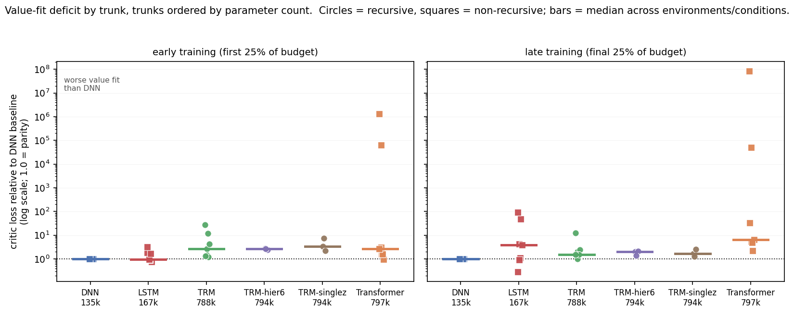
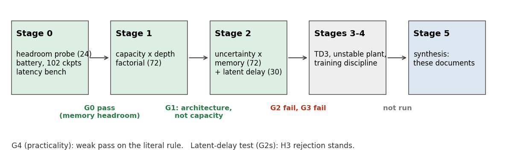
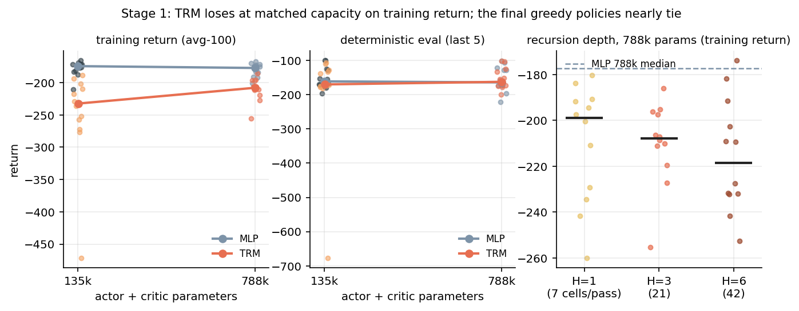

# Recursion Under Delay: Project Summary, Phases 0–3

*trm-delay-robust-scaling · summary document · 2026-09-22*
*A short account of what was done in each phase, why, and what it established. The Phase 3 paper and the final detailed report sit alongside this document.*

## The short version

- **The question.** Tiny Recursive Models (TRM) beat much larger networks on puzzle benchmarks by running one small shared cell many times instead of adding parameters. Does that trade still pay off when the network is the trunk of a model-free RL agent controlling a plant through delayed actions?
- **Phase 0** built the test bed: a delay wrapper, the observation-augmentation fix that makes delayed control learnable, and a TRM port. It also scoped the project, reviewed the literature, and pre-registered a hypothesis.
- **Phase 1** (48 runs) found TRM *worse* than a 5.8× smaller MLP on the one task every trunk learned (Pendulum-v1, 6/6 seed pairs, p = 0.016). The predicted advantage at longer horizons did not appear.
- **Phase 2** (54 runs, BipedalWalker-v3, with ablations) found no significant difference anywhere. Re-analysis then showed two of the three environments were floor effects, and identified three confounds that could each explain the Phase 1 result: capacity, a latent reset at every step, and a task with nothing to infer.
- **Phase 3** (198 runs, 300 checkpoint evaluations, all gated and pre-registered) removed all three confounds:
  - **Capacity:** TRM still loses to a parameter-matched MLP at both 135k and 788k parameters.
  - **Depth:** recursion depth is inert.
  - **Latent reset:** carrying the latent across steps changes nothing.
  - **Something to infer:** where memory has something to recover, no trunk recovers it.
  - **Value fit:** TRM's worse value fit is architectural, not a matter of size.
  - **Final policy:** the gap lives in training, not in the final greedy policy.
  - **Control:** TRM's greedy torque is much smoother, but it is less robust and costs 65× the MLP's latency per decision.
- **Conclusion.** The residual-uncertainty hypothesis H3 is rejected, and so is the capacity account. Weight-tied recursion, ported without TRM's supervised training discipline, does not transfer to delayed model-free continuous control on the tasks tested. **Use the MLP.**

---

## Phase 0 — Groundwork

**What was done.**
- **The pilot.** On Pendulum-v1 under a one-step action delay, the MLP trunk converged but TRM and Transformer trunks did not. The cause was not the trunks. The delay wrapper applied each action late but never told the agent which of its recent actions was about to land, so every stored transition paired a reward with an action that had not caused it.
- **Observation augmentation.** Appending the pending-action queue to the observation fixed this. The fix was verified exact for fixed delays, and a separate audit fixed a silent bug in the stochastic delay.
- **"Comparable reward."** With augmentation, all three trunks reached comparable reward, with TRM taking about 18× longer to train (55 vs 3 minutes per 200 episodes).
- **The TRM port** kept TRM's shared cell, its two-latent recursion (3 outer × 6 inner cycles), and its one-step gradient truncation, under which only 7 of 21 cell applications receive gradient. It dropped what has no analogue for a flat continuous observation.
- **Project scoping.** The project was run as a gated research epic: scoping, a literature review, three rounds of hypothesis review, and experiment planning. The literature review positioned it against model-based TRM-for-control work (Jain & Linares, 2025; Wijayatunga & Armellin, 2026). The hypothesis review capped "significance" at 3/5, and that limitation was carried into the reports rather than hidden.

**Why it mattered.** Without augmentation, the comparison would have measured the delay bug, not the trunks. Without a pre-registered statistic, the project would have repeated the pilot's anecdote ("comparable reward") rather than testing it.

---

## Phase 1 — Does TRM's disadvantage shrink as the horizon grows?

**What was done.**
- **Hypothesis H1:** TRM's advantage grows with task complexity, with a pre-registered threshold at MountainCarContinuous-v0 (5× Pendulum's horizon, sparse reward).
- **Design:** 4 trunks (MLP, Transformer, TRM, LSTM) × 2 environments × {no delay, 1-step delay + augmentation} × 3 seeds = 48 runs on Katana CPUs, analysed with a pooled sign test (n = 6).

**Findings.**

| Comparison | Environment | TRM wins | p |
|---|---|---:|---:|
| TRM − MLP | Pendulum-v1 | 0/6 | 0.016 (deficit) |
| TRM − MLP | MountainCarContinuous-v0 | 3/6 | 0.66 |
| TRM − Transformer | both | 3/6, 4/6 | ≥ 0.34 |

- **Parity failed.** The pilot's parity claim did not survive: the MLP won every Pendulum seed pair, by 37 reward units (about 3% of the performance span).
- **H1's threshold was falsified.** The gap closed on MountainCar but never approached significance.
- **Cost grew with complexity:** TRM went from 6.7× to 12.8× the MLP's wall-clock.
- **The LSTM never learned Pendulum**, which was read as a tuning artefact.

**Why it mattered.** It turned an anecdote into a controlled measurement. It tested the obvious rescue ("harder tasks will need the extra computation") before more compute was spent on it.

---

## Phase 2 — A second complexity axis, with ablations

**What was done.** BipedalWalker-v3 (24-D observation, 4-D action, coupled dynamics) with 6 trunks: the Phase 1 four plus two TRM variants (six parallel latents; a single latent). Conditions were no delay, delay + augmentation, and delay without augmentation. 54 runs on V100 GPUs.

**Findings.**
- **No comparison reached significance in any direction.**
- **The recursive structure made no detectable difference.**
- **Augmentation had no clear effect.**
- **TRM variants cost 5–8× the MLP.**

**Post-hoc analysis of all 102 runs** changed the meaning of both phases:
1. **Only Pendulum was learned.** MountainCar was exploration-limited (median −8.9 against a solved threshold of +90), and no BipedalWalker run learned to walk. The complexity-scaling question was never put at risk: it is untested, not disconfirmed.
2. **TRM fit the value function worse** (7/7 cells, p = 0.008). So did a same-sized Transformer, which pointed to capacity.
3. **Three confounds:**
   - **C-1, capacity:** 788k vs 135k parameters.
   - **C-2, latent reset:** TRM re-initialises its latent every call, the weaker of two variants HRM-Agent compared (Dang & Rawlinson, 2025).
   - **C-3, nothing to infer:** with a fixed delay and augmentation, the observation is already a sufficient statistic.

**Why it mattered.** It showed the Phase 1 negative could not be read as a verdict on recursion until all three confounds were removed. That became Phase 3's job.

---

## Phase 3 — Removing the confounds

**The hypothesis.**

> **H3.** Weight-tied recursion earns its cost only where the input leaves uncertainty that iteration could resolve *and* the trunk carries information across steps.

Its decisive prediction was an interaction: a carried-latent TRM should lose to the MLP when there is nothing to infer, but win when there is. It was tested against a capacity account (H_cap) and a no-transfer account (H_null).

**How it was run.**
- **Gated stages.** Six stages, each with a decision rule fixed before its data, on Katana GPUs: 231 jobs from frozen code snapshots, monitored on a live board.
- **Amendments before any data.** Six were recorded. The most important: under a delay resampled independently every step, the augmented observation is already Markov, so the plan's "oracle" arm could only return a null. A condition that withholds the pending-action queue was added instead.
- **A supplementary test after the main gate failed:** a latent per-episode delay that memory can identify from history, as an independent plan review had recommended. Its rule was fixed before its data.

### Stage 0 — Is there anything to infer? What do the old checkpoints say?

- **Headroom (G0: pass, on the amended rule).** Stochastic delay costs the MLP 53 reward units. Hiding the queue costs another 71 (6/6 seeds), so memory has something to recover. Revealing the realised delay made the MLP *worse* in 6/6 seeds, as the theory check predicted.
- **The banked checkpoints as controllers** (102 re-evaluated, no retraining). Every trunk that learned reaches the same greedy policy (interquartile-mean return about −120). With only 3 seeds per cell, the earlier "TRM is smoother" signal is inside seed noise. TRM is *less* robust to sensor noise than the MLP. G4 (practicality) passes only weakly, on the literal rule.
- **The same battery on all 198 Phase 3 checkpoints** (12 pairs per contrast) sharpens this. TRM's greedy torque *is* much smoother: 0.4 direction reversals per second against the MLP's 9, in 11/12 pairs. Its final return is only 3.6 units lower. But it degrades more under sensor noise, a heavier pendulum and actuator dropout.
- **Latency.** TRM takes 4.1 ms per decision on one CPU thread against the MLP's 0.064 ms. That is a 242 Hz ceiling: enough for 100 Hz control, not for 500 Hz. A GPU is slower still at batch size 1.

### Stage 1 — Capacity or recursion? (G1)

| Contrast (12 seed × condition pairs) | Median return difference | Pairs positive |
|---|---:|---:|
| TRM 136k − MLP 135k | −50.2 | 0/12 |
| TRM 788k − MLP 788k | −27.1 | 2/12 |
| MLP 788k − MLP 135k | −3.8 | 5/12 |
| TRM with 1 vs 3 outer cycles | −3.3 | 5/12 |
| TRM with 6 vs 3 outer cycles | −10.9 | 4/12 |

- **TRM loses at matched capacity, and capacity moves neither family.** The deficit is architectural, which weakens H_cap. The Phase 1 headline also reproduces exactly (−34.4, 0/12).
- **Recursion depth is inert.** Only 7 of the cell applications are ever trained, whatever the depth.
- **TRM's critic fits worse even at matched capacity** (1.45× and 1.89×, 12/12 each), while the bigger MLP fits *better*. This overturns the Phase 2 capacity reading.
- **The final greedy policies nearly tie.** A residual of 3.6 reward units remains (2/12 pairs), a tenth of the training-return gap. The deficit is mostly a training-time phenomenon.

### Stage 2 — Uncertainty × memory (G2, G3)

| Median return | Fixed delay + queue | Stochastic + queue | Stochastic, no queue |
|---|---:|---:|---:|
| MLP | −178 | −294 | −235 |
| TRM (latent reset) | −227 | −271 | −334 |
| TRM Carry-Z (latent carried) | −215 | −300 | −333 |
| LSTM (state carried) | −252 | −786 | −371 |

- **G2 fails.** The interaction H3 needs does not appear, and at the condition with memory headroom it has the wrong sign (1/6).
- **G3 fails.** Carrying the latent never beats resetting it in 5 of 6 seeds, even though the stored-state replay reproduces the behaviour policy exactly.
- **One caveat.** Giving every trunk its previous action closed most of the MLP's gap without the queue. Even so, Carry-Z does not beat an MLP with no history at all.
- **Supplementary latent-delay test (G2s).** Here the delay is drawn once per episode, so it can be identified from history. The H3 rejection stands. Revealing the delay does not reliably help even the MLP (4/6). Carry-Z adds nothing over the resetting TRM (2/6), and the carried LSTM collapses. Both TRM variants do train more *consistently* than the MLP here (seed SD 32 vs 169), which is a stability effect, not inference.

### Stages 3–4 — not run

The TD3 cross-check, the unstable second plant, and restoring TRM's training discipline were each gated on G2 or G3, and did not open.

---

## What the project established

| Claim | Status |
|---|---|
| TRM trails the MLP on Pendulum-v1 training return | replicated (6/6, then 12/12) |
| The deficit is architectural, not capacity | established (Stage 1) |
| Recursion depth adds cost, not return | established |
| TRM's final greedy policy is close to the MLP's | consistent across two measurements |
| Carrying the latent helps | not supported (G3 fails) |
| Recursion with memory exploits residual uncertainty (H3) | rejected (G2 and the latent-delay test G2s both fail) |
| TRM gives smoother actuation | yes: about 20× fewer torque reversals at matched return |
| TRM is a usable controller | only as a trade: 65× latency, 11–13× training cost, narrower robustness envelope |
| TRM's advantage grows with task complexity (H1) | **untested:** two of three rungs were floor effects |

**What remains open.**
1. Porting TRM's *training discipline* (supervising every refinement cycle, not truncating the gradient) to off-policy RL.
2. The same contrast under TD3 and on an unstable plant that is learned within budget.
3. The original complexity-scaling question, on environments that are actually learned.
4. A tuned recurrent baseline.

**For practice:** use the MLP. If a recursive trunk is required anyway, use one outer cycle: the same return at a third of the latency.

---

## Where to find things

| What | Where |
|---|---|
| Phase 3 paper | `Phase 3/2_phase3_paper.md` (+ `.pdf`) |
| Final detailed report, Phases 0–3 | `Phase 3/3_final_report.md` (+ `.pdf`) |
| Phase 3 plan and pre-submission amendments | `papers/phase3/plan.md` (§10) |
| Phases 1–2 combined report | `papers/report.md` |
| Analysis outputs | `experiments/analysis_p3_g0.json`, `analysis_w0.json`, `analysis_s1.json`, `analysis_s2.json`, `analysis_phase3_full.json` |
| Raw Phase 3 results | `results_phase3/` (and `/srv/scratch/z5308482/trm-control/` on Katana) |
| Run board (final) | https://claude.ai/artifact/8BBqkDsAm2ocizL1kTn6nB |
