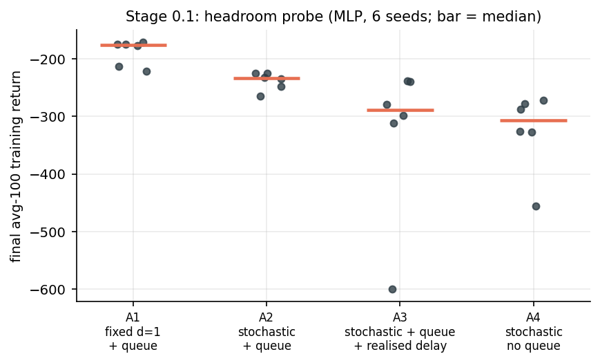
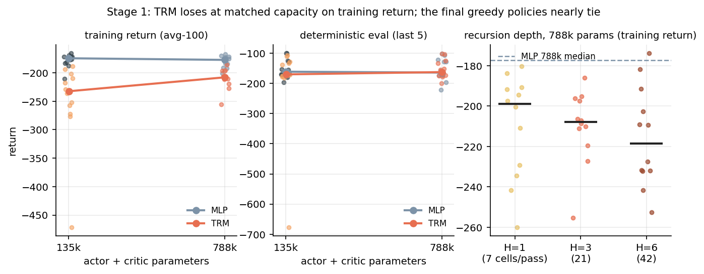
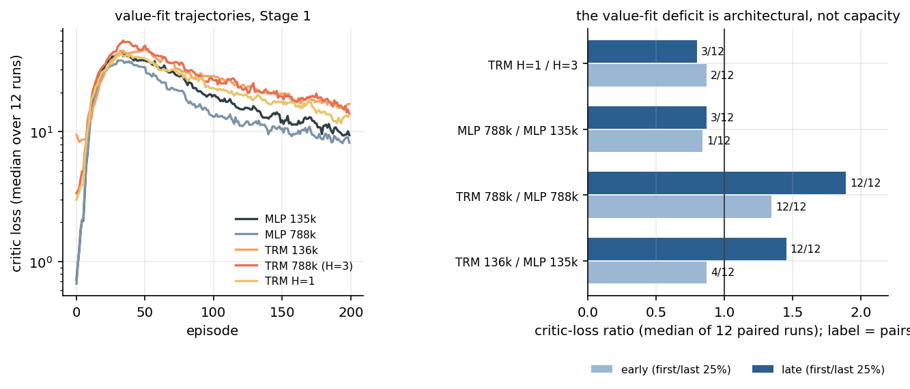
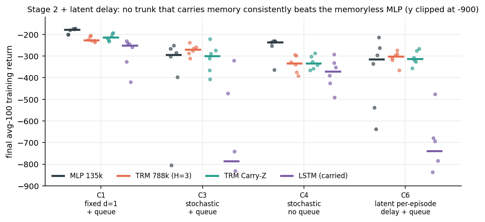
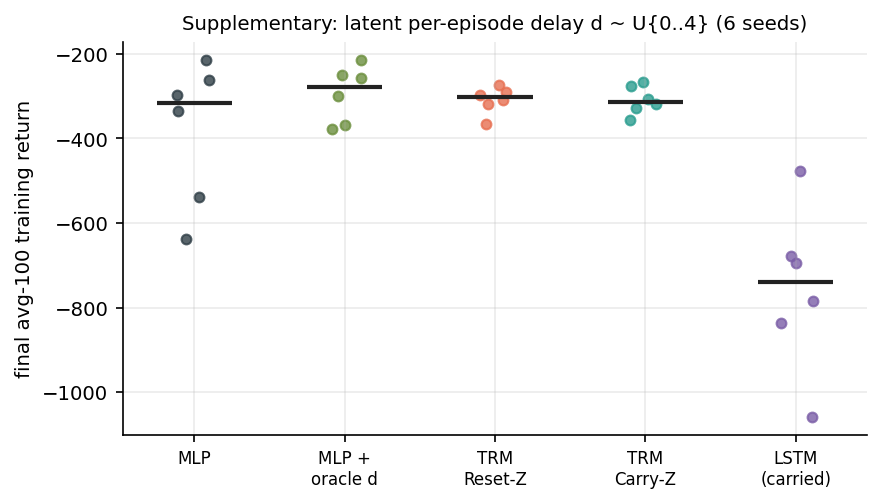
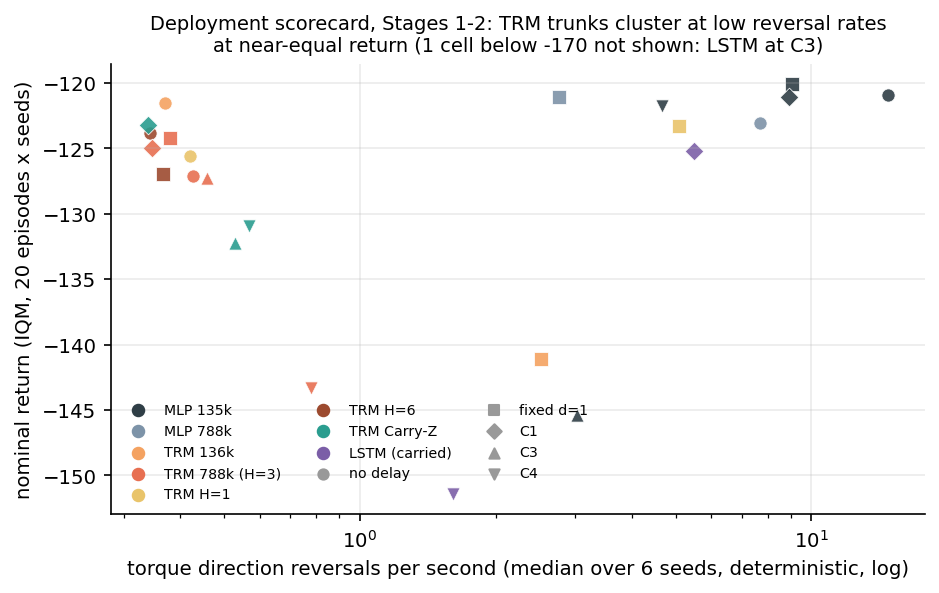
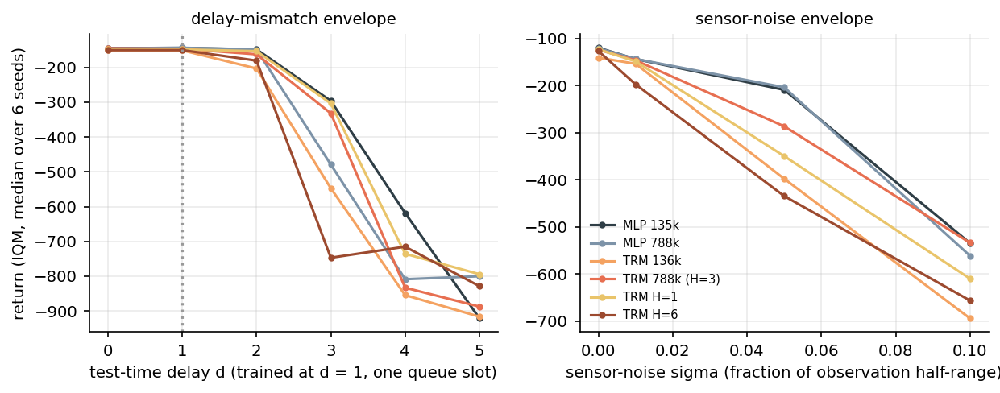
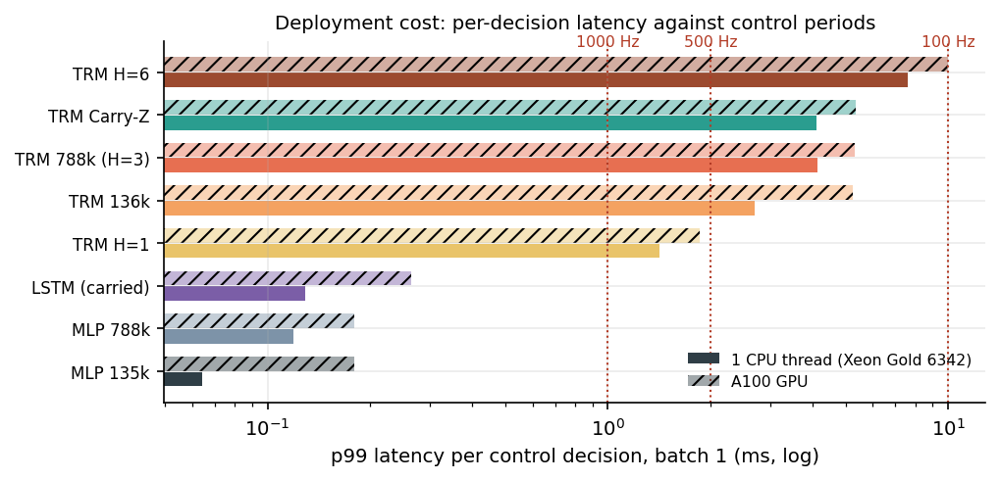

# Carrying the Latent Is Not Enough: A Confound-Controlled Test of Weight-Tied Recursion for Delay-Conditioned Continuous Control

*trm-delay-robust-scaling · Phase 3 paper · 2026-09-22*

## Abstract

Tiny Recursive Models (TRM) replace parameters with iterations of a small weight-tied cell and report state-of-the-art results on puzzle benchmarks. An earlier phase of this project found that a TRM actor–critic trunk underperformed a 5.8× smaller MLP on a delayed continuous-control task. That result was ambiguous for three reasons:
- the recursive trunk also had 5.8× more parameters;
- its latent was reset at every call, so nothing persisted across control steps;
- the task left nothing to infer, because observation augmentation made the input an exact sufficient statistic.

We remove all three confounds in a gated, pre-registered study of 198 training runs and 198 checkpoint evaluations on Pendulum-v1 with DDPG. A 2×2 of architecture × capacity shows the deficit is architectural: TRM loses to a parameter-matched MLP at both 135k (0/12 seed pairs) and 788k (2/12) parameters, while capacity changes neither family. Recursion depth is inert (`H_cycles` ∈ {1, 3, 6}), and TRM's value-fit deficit persists at matched capacity (critic loss 1.45× and 1.89×, 12/12 pairs each). The deficit lives in training rather than in the final greedy policy, which nearly ties the MLP.

A carried-latent variant (Carry-Z), trained with stored-state replay that reproduces the behaviour policy exactly, never beats the resetting TRM. We also construct conditions where memory has something to recover: hiding the pending-action queue under stochastic delay costs a memoryless MLP 71 reward units (6/6 seeds). Even there, neither Carry-Z nor a carried LSTM recovers the loss, and the pre-registered interaction has the wrong sign (1/6). A latent per-episode delay, which memory could identify from history, gives the same answer: carrying the latent adds nothing over resetting it (2/6).

As a controller TRM offers a trade rather than a win. Its greedy policy commands far smoother torque (0.4 vs 9 direction reversals per second, 11/12 pairs) at a final return only 3.6 units lower. It pays with 65× the MLP's per-decision latency (a 242 Hz ceiling on one CPU thread), 11–13× its training cost, and a narrower robustness envelope under sensor noise, plant mismatch and actuator dropout. The residual-uncertainty hypothesis is rejected, and so is the capacity account. Recursion ported without TRM's supervised training discipline does not transfer to this setting.

## 1. Introduction

The standard way to make a network more capable is to add parameters. Tiny Recursive Models question that recipe. A two-layer weight-tied cell, recursively refining a latent state and a candidate answer, reaches 45% on ARC-AGI-1 and 87% on Sudoku-Extreme with roughly 7M parameters (Jolicoeur-Martineau, 2025). If iteration can substitute for parameters, the mechanism should matter wherever parameters and compute are scarce. Robotic and embedded control is such a setting, and delayed control is a principled test bed: under action delay the observation stops being Markov, and a mechanism that iteratively refines a latent resembles a learned state estimator.

An earlier phase of this project tested that idea and found the opposite. On Pendulum-v1 with a one-step action delay and observation augmentation, a TRM trunk lost to a memoryless MLP in 6/6 seed pairs (p = 0.016). Post-hoc analysis showed three confounds, each capable of producing the negative by itself:
- **C-1, capacity.** The recursive trunk held 788k parameters against the MLP's 135k. A same-sized Transformer showed the same value-fit deficit, which pointed to capacity.
- **C-2, latent reset.** The port re-initialised its latent at every forward call. That is the weaker of the two variants HRM-Agent compared (Dang & Rawlinson, 2025), in work where a recursive reasoning model trained by RL alone *succeeded*.
- **C-3, nothing to infer.** With a fixed, known delay and the pending-action queue in the observation, the input is an exact sufficient statistic (Katsikopoulos & Engelbrecht, 2003). An architecture whose supposed advantage is inferring missing state was given no missing state.

This paper removes all three and asks whether recursion earns its cost once it has the conditions its proponents would ask for. Our contributions:

1. **A capacity × architecture × depth factorial.** It attributes the deficit to the recursive architecture, not to parameter count. It also shows recursion depth is inert and the value-fit deficit is architectural, overturning the earlier capacity reading.
2. **A carried-latent TRM (Carry-Z)** with stored-state replay for both actor and critic. It is verified to reproduce the behaviour policy exactly, and tested against the resetting variant under four delay conditions.
3. **A construction of delay conditions with measured headroom for memory**, and a pre-registered interaction test of whether recursion with memory exploits it. That includes a latent per-episode delay that memory can identify from history.
4. **A deployment scorecard:** deterministic control quality, robustness envelopes, and per-decision latency against control periods, measured over every checkpoint.
5. **A pre-registered, gated protocol** in which every decision rule was fixed before its data, with all departures recorded.

## 2. Background and related work

**TRM and its training discipline.** TRM's published results come embedded in a supervised procedure: deep supervision along a refinement trajectory against a fixed answer, per-puzzle embeddings, adaptive halting over a revisited instance, and one-step gradient truncation within each forward pass. Independent analyses attribute most of the benchmark gains to these surrounding components rather than to forward-pass depth. ARC Prize (2025) find the outer refinement loop and training-time depth dominate and the hierarchical architecture is immaterial. Roye-Azar et al. (2026) find that removing puzzle identity collapses accuracy to zero and that most accuracy arrives at the first recursion step. A model-free RL port necessarily drops the per-instance embedding and the deep supervision. What remains is the weight-tied recursion and its truncated gradient.

**Recursion in control and RL.** Tiny Recursive Control (Jain & Linares, 2025) and TRM for the J2-perturbed Lambert problem (Wijayatunga & Armellin, 2026) use recursion *model-based*, refining a control sequence against known dynamics. HRM-Agent (Dang & Rawlinson, 2025) is the closest model-free precedent. It trains a recursive reasoning model with a DQN head on discrete mazes and reports that carrying the latent across timesteps ("Carry-Z") beats resetting it ("Reset-Z").

**Delay and memory.** Augmenting the observation with the pending-action queue restores Markov sufficiency for constant delays (Katsikopoulos & Engelbrecht, 2003), at a cost exponential in the delay (Derman et al., 2021). Random delays admit other treatments (Ramstedt et al., 2021). For partial observability generally, recurrent model-free agents are strong baselines when tuned (Ni et al., 2022). Recurrent off-policy learning needs care with replayed hidden states; stored-state and burn-in replay are the standard answers (Kapturowski et al., 2019).

**Capacity in deep RL.** Naively scaling network size does not reliably help in deep RL (Ota et al., 2021), and plasticity loss is implicated in scaling failures (Klein et al., 2024). This is what made capacity a credible alternative explanation for the earlier negative.

## 3. Hypotheses and protocol

> **H3 (residual uncertainty).** Weight-tied recursion earns its cost in model-free continuous control only where (i) the conditioning leaves state uncertainty that iteration could resolve *and* (ii) the trunk carries information across decision steps.

H3 is tested against **H_cap** (the deficits track parameter count and recursion is irrelevant) and **H_null** (recursive refinement does not transfer to this setting under any conditioning). H3's load-bearing prediction is an **interaction**: [Carry-Z − MLP] ≤ 0 under fixed, known delay but > 0 where there is something to infer. A capacity account cannot flip the sign of a contrast between identical networks across conditions.

The study ran as gated stages, each with a decision rule fixed before its data:
- **G0, headroom:** is there anything for inference to recover?
- **G1, attribution:** capacity or architecture? No kill branch; it sets Stage 2's MLP.
- **G2, interaction:** the H3 test. Failure rejects H3.
- **G3, continuity:** does Carry-Z beat Reset-Z anywhere?
- **G4, practicality:** is any trunk a favourable controller?

Stages 3 (generalisation) and 4 (restoring TRM's training discipline) were conditional on G2 and G3.

Six amendments were recorded before any data (Appendix A). The most consequential was A-1. Under a delay resampled independently every step, the four-slot queue already contains every action that can reach the plant, so the augmented observation is Markov, and exposing the realised past delay (the plan's "oracle") carries no usable information. The protocol therefore added a condition that withholds the queue (C4), made it co-primary for G2, and let G0 pass on either oracle or memory headroom. After G2 failed, a latent per-episode delay (C6) was added as a supplementary test, with its rule fixed before its data. C6 is the condition an independent plan review had recommended as the cleanest test of inference.

## 4. Method

### 4.1 Setting

Pendulum-v1 (3-D observation, 1-D torque, 200-step episodes) is the only environment in this project on which every trunk demonstrably learns within budget. The two harder environments of the earlier phase were floor effects. We use DDPG (Lillicrap et al., 2016) with OU exploration noise, 200 episodes, replay of 200k transitions, batch 128 and one update per step. Hyperparameters are identical across trunks; only the actor and critic trunk changes. Six seeds per cell, with warmup actions seeded from the run seed.

### 4.2 Trunks

| Trunk | Actor + critic params | Recursion per forward pass | Memory across steps |
|---|---:|---|---|
| MLP 135k [256, 256] | 134,914 | — | none |
| MLP 788k [624, 624] | 788,114 | — | none |
| TRM 136k (hidden 44) | 135,654 | H = 3, L = 6: 21 cell applications, 7 with gradient | none (Reset-Z) |
| TRM 788k (hidden 128) | 787,842 | as above | none (Reset-Z) |
| TRM H = 1 / H = 6 | 787,842 | 7 / 42 applications, 7 with gradient | none |
| TRM Carry-Z | 787,842 | as TRM 788k | latent `cat(z_H, z_L)` carried |
| LSTM (carried) | ≈266k | — | `cat(h, c)` carried |

Counts are for Pendulum with fixed-delay augmentation and shift slightly with input width. Parameter matching is within 0.6%. `trm_small` changes shape as well as size: its SwiGLU inner width rounds to 256 on a 44-D latent.

### 4.3 Carry-Z with stored-state replay

Carry-Z starts each decision's recursion from the latents the previous decision ended with, and resets them at episode start. The actor carries its own latent; the critic carries a separate one, advanced at acting time on the executed (observation, action) pair. Every replayed transition stores four carries: actor and critic, before and after the step. An update evaluates Q(s, a) from the stored pre-step critic carry, and the bootstrapped target from the stored post-step carries through the target networks. Carries are inputs, not trained through (R2D2's stored-state option; Kapturowski et al., 2019). They go stale as weights move; the burn-in alternative was held in reserve and never needed. Feeding stored carries back reproduces the behaviour policy's actions and next carries with zero error. The carried LSTM uses the same mechanism.

### 4.4 Delay conditions

| Condition | Delay | Observation | Anything to infer? |
|---|---|---|---|
| C1 | fixed d = 1 | state + 1-slot queue | no: exact sufficient statistic |
| C3 | d ~ U{0..4}, resampled every step | state + 4-slot queue | no: already Markov (A-1) |
| C4 | d ~ U{0..4}, resampled every step | state only | yes: recent own actions |
| C6 | d ~ U{0..4}, drawn once per episode | state + 4-slot queue | yes: which slot is applied (system identification) |
| Oracle arms | as C3 or C6 | + the delay | upper bound on what inference could recover |

In Stage 2 and C6 every trunk, the MLP included, also receives its previous action as input, so trunks differ only in architecture and memory (Ni et al., 2022).

### 4.5 Evaluation battery and latency

Every checkpoint is re-evaluated deterministically on 20 unseen episodes and on 10-episode grids:
- **delay mismatch:** test d = 0…5, keeping the trained queue width, so the policy receives wrong queue information;
- **sensor noise:** σ = 0.01–0.10 of the observation half-range;
- **plant perturbation:** pendulum mass and length 0.7–1.3×;
- **actuator dropout:** 5% and 10%.

Each episode is scored on return and on control quality: effort, command rate |Δu|, jerk, saturation, direction reversals per second, high-frequency power fraction, and mechanical work. Latency is the actor's batch-1 decision time, including host transfers, on one CPU thread (Xeon Gold 6342) and on an A100.

### 4.6 Statistics

The primary metric, as in the earlier phase, is the final 100-episode average of training return. Contrasts are paired by seed, and by seed and condition where two conditions are pooled (n = 12). They are tested with sign tests; gate thresholds are ≥ 5/6 or ≥ 10/12. We also report deterministic evaluation returns on episodes whose initial states are shared across arms within a seed. Battery returns are summarised by the interquartile mean with stratified bootstrap intervals (Agarwal et al., 2021).

### 4.7 Implementation and compute

The experiments ran as 231 PBS jobs on Katana GPU nodes, each stage from a frozen code snapshot. Checks performed:
- all delay-wrapper extensions are bit-identical to the original wrapper on every pre-existing configuration;
- the stateless DDPG and TD3 paths are identical to the original code at the agent level;
- every evaluated checkpoint rebuilds with its recorded parameter count.

Five jobs that landed on an unsupported GPU architecture were rerouted and resubmitted, and no failure went unrecovered.

## 5. Results

### 5.1 There is headroom, but only for memory (G0)

| Arm (MLP, 6 seeds) | Median return |
|---|---:|
| A1 fixed d = 1 + queue | −176.6 |
| A2 stochastic + queue | −234.0 |
| A3 stochastic + queue + realised delay | −289.3 |
| A4 stochastic, no queue | −306.6 |

- **Stochastic delay costs the MLP 53.3 reward units** (A1 − A2, 6/6 seeds).
- **Revealing the realised delay costs a further 39.6** (A3 − A2, 0/6 positive), exactly as A-1 predicts for an uninformative input.
- **Hiding the queue costs 70.8** (A2 − A4, 6/6, above the pooled seed SD of 49.5).

G0 therefore passes on memory headroom alone: a trunk that could rebuild its recent actions from history has 71 units to recover at C4.

### 5.2 The deficit is architectural (G1)

| Contrast (n = 12) | Median | Positive | p |
|---|---:|---:|---:|
| TRM 136k − MLP 135k | −50.2 | 0/12 | 0.0005 |
| TRM 788k − MLP 788k | −27.1 | 2/12 | 0.039 |
| MLP 788k − MLP 135k | −3.8 | 5/12 | 0.77 |
| TRM 788k − TRM 136k | +20.7 | 7/12 | 0.77 |
| TRM H = 1 − H = 3 | −3.3 | 5/12 | 0.77 |
| TRM H = 6 − H = 3 | −10.9 | 4/12 | 0.39 |

- **TRM loses at both matched capacities, and capacity moves neither family.** This is the plan's "architecture-family" branch, and it weakens H_cap.
- **The earlier headline reproduces** on new code and hardware: TRM 788k − MLP 135k is −34.4 at n = 12 (0/12), against −32.8 at n = 6.
- **Recursion depth is inert.** Removing the outer recursion (7 cell applications per pass) or doubling it (42) leaves return unchanged. This is consistent with only 7 applications receiving gradient at any depth, and with the "shallow effective recursion" reported in-domain (Roye-Azar et al., 2026).

### 5.3 What the deficit is: value fit during training, not the final policy

- **Value fit.** Late in training, TRM's critic loss is 1.45× that of the parameter-matched small MLP and 1.89× that of the matched large MLP, 12/12 pairs each. The large MLP fits the value function *better* than the small one (0.87×, 3/12). Removing the outer recursion narrows the deficit (H = 1 vs MLP 1.34×, 10/12). The value-fit deficit is therefore a property of the recursive architecture, not of its size. The earlier capacity reading rested on a Transformer whose deficit was evidently its own.
- **Final policy.** The reward deficit shrinks by about an order of magnitude in the final greedy policy. On deterministic evaluation episodes that share initial states across arms, TRM 788k − MLP 788k is +0.3 (6/12), TRM 136k − MLP 135k is −4.4 (5/12), and TRM − MLP 135k is −2.5. The battery gives the same picture on unseen seeds (§5.6).

TRM reaches a similar greedy policy, slightly behind: the battery puts the residual at 3.6 reward units (2/12, p = 0.039). Learning is similar in speed but not identical. TRM reaches an avg-10 return of −300 about five episodes later than the matched MLP (11/12 pairs), and one episode later than the small MLP (4/11). Throughout training it fits its critic worse and performs worse under exploration noise. The training-return gap is real, but mostly a training-time phenomenon.

### 5.4 Memory does not help, and recursion with memory does not either (G2, G3)

| Median return | C1 fixed + queue | C3 stochastic + queue | C4 stochastic, no queue |
|---|---:|---:|---:|
| MLP 135k | −178.3 | −293.7 | −235.4 |
| TRM Reset-Z | −226.8 | −270.5 | −333.9 |
| TRM Carry-Z | −214.5 | −300.1 | −333.1 |
| LSTM (carried) | −252.1 | −786.3 | −370.9 |

**G2 fails.** The interaction [Carry-Z − MLP] relative to C1 is +20.4 at C3 (3/6) and −40.0 at C4 (1/6). At the condition with measured memory headroom it has the wrong sign: Carry-Z falls *further* behind the MLP. **G3 fails.** Carry-Z − Reset-Z is +4.8, −22.0 and +16.7 at C1, C3 and C4 (4/6, 3/6, 3/6). The carried LSTM is worse than the MLP everywhere (0/6, 1/6, 1/6).

One design choice needs disclosure. Giving the MLP its previous action (amendment A-6) closed most of its C4 headroom by itself: −235 against −307 without the input, paired by seed (5/6). So the Stage 2 MLP was a stronger C4 baseline than the one G0 measured. The failure does not depend on this. Carry-Z at C4 also fails to beat the *history-free* MLP of Stage 0 (−19.2, 2/6).

A redundant previous-action input *hurt* the MLP at C3 (−63.7, 1/6). That probably explains the one exploratory positive in the data, Reset-Z TRM beating the MLP at C3 in 5/6 seeds. H3 cannot produce that result, since C3 has nothing to infer and Reset-Z has no memory.

### 5.5 A latent delay memory can identify (supplementary, G2s)

The C6 delay is drawn once per episode and held constant. The queue shows every candidate action but not which one reaches the plant, so the delay is identifiable from history but not from any single observation. The rule G2s was fixed before submission: H3 survives in narrowed form only if oracle headroom passes *and* Carry-Z beats both the MLP and Reset-Z in ≥ 5/6 seeds.

| C6, median return (6 seeds) | MLP | MLP + oracle | Reset-Z | Carry-Z | LSTM (carried) |
|---|---:|---:|---:|---:|---:|
| | −315.9 | −278.1 | −302.5 | −313.2 | −739.3 |

**The rejection stands.**
- **The latent delay is costly** (MLP C6 − C1: −116 per seed).
- **Revealing it does not reliably recover the cost:** oracle − MLP is +25.2 (4/6), below the pooled SD of 128.
- **Carry-Z adds nothing over Reset-Z** (−4.9, 2/6), and the carried LSTM collapses.

[Carry-Z − MLP] does improve from C1 to C6 in 5/6 seeds, but Reset-Z shows the same pattern more strongly (+53.0, 4/6). The cause is the MLP collapsing in two seeds under the latent delay (−365, −458 relative to C1), while both TRMs degrade uniformly. Seed SD at C6 is 169 for the MLP against 32–33 for either TRM. This is a training-stability observation, not inference, and it is exploratory. On deterministic evaluation Carry-Z edges out Reset-Z in 5/6 seeds (+26.5, secondary metric). The full battery does not confirm it. On 20 unseen-seed episodes per checkpoint, Carry-Z − Reset-Z is +0.4 (4/6, p = 0.34), so the exploratory signal was noise. Deterministically, the oracle helps the MLP modestly (+12.5, 5/6). Both TRM variants' greedy policies sit slightly above the MLP's (Reset-Z +11.4, Carry-Z +15.9, 4/6 each), which again tracks the MLP's two unstable seeds rather than any use of memory.

### 5.6 TRM as a controller

Over all 198 Phase 3 checkpoints, deterministic and on unseen seeds, with n = 12 Stage 1 pairs:
- **Final return.** TRM's greedy policy trails the small MLP by only 3.6 reward units (2/12, p = 0.039), a tenth of the training-return gap.
- **Smoothness.** TRM's torque is much smoother. It reverses direction about 0.4 times per second, against 9 for the small MLP and 2.8 for the matched MLP: fewer reversals in 11/12 pairs against each (p = 0.006). Depth does not matter here either (H = 1 vs H = 3, 6/12), so the regularity comes from the recursive cell, not from iteration. This supports the plan's H3.4: recursion trades a little return for command regularity.
- **Robustness.** TRM pays for that smoothness. Under sensor noise it loses 76 more reward units than the MLP (2/12, p = 0.039), and it degrades more under a 30% heavier pendulum (−233 vs −184) and 10% actuator dropout (−165 vs −145). The deepest recursion degrades most (−506 and −304). H3.5, graceful degradation, is contradicted.
- **Delay mismatch.** The envelope is shared: every trunk trained at d = 1 holds to d = 2 and collapses at d = 3.

| Trunk | CPU p99 per decision | Max control rate | Training cost vs MLP (same GPU) |
|---|---:|---:|---:|
| MLP 135k | 0.064 ms | 15.5 kHz | 1× |
| TRM H = 1 | 1.42 ms | 703 Hz | 6–8× |
| TRM 788k | 4.13 ms | 242 Hz | 11–13× |
| TRM Carry-Z | 4.11 ms | 243 Hz | 12–15× |
| TRM H = 6 | 7.59 ms | 132 Hz | 18–24× |

TRM can close a 100 Hz loop but not a 500 Hz one. A GPU makes batch-1 decisions slower (5.3 ms), because 21 sequential cell applications are bound by kernel-launch overhead. At matched wall-clock the gap is not 3% of the performance span but most of it. When the MLP finishes training, about 3 minutes, TRM has completed 16 episodes and sits at an avg-10 return of −967, against the MLP's final −174.

## 6. Discussion

**Why the negative is now informative.** Each confound that made the earlier result ambiguous is gone:
- **Capacity** is crossed, and matters for neither family.
- **The latent** is carried, with replay that reproduces the behaviour policy exactly, and it changes nothing.
- **The conditioning** leaves something to infer, with the headroom measured, and no trunk recovers it.

What is left is a deficit intrinsic to the recursive architecture as ported, visible most clearly in its value fit.

**Why recursion does nothing here.** Three observations fit together:
- **Depth is inert** from 7 to 42 cell applications.
- **Only 7 applications ever receive gradient.**
- **Removing the outer loop narrows the value-fit deficit.**

The untrained cycles are not refining anything useful. They are extra computation layered on a cell whose single trained pass is a somewhat worse function approximator than two ReLU layers. In the supervised setting, deep supervision along the refinement trajectory gives every cycle a training signal, and per-instance embeddings give the recursion instance-specific information to refine (ARC Prize, 2025; Roye-Azar et al., 2026). Model-free off-policy RL supplies neither: each transition is visited a handful of times against a moving bootstrapped target. Carry-Z supplies cross-step memory, but a latent carried without a training signal that rewards accumulating information has no reason to accumulate it. The carried LSTM, which has that incentive in principle, did not exploit memory either. That suggests the delay information available here is hard for any memory to use at this budget, or that the LSTM was untuned, as Ni et al. (2022) warn.

**How this relates to HRM-Agent's success.** HRM-Agent's positive result was on discrete mazes with a DQN head, where the task rewards multi-step planning over a revisited map. Ours is continuous low-dimensional control, where the MLP already reaches the same greedy policy. The two results are compatible: recursion may earn its cost where the problem has compositional structure to refine, and not where it does not (precondition P2 of the earlier report).

**The one thing TRM does better.** The recursive cell's greedy policies are strikingly regular. That may be an implicit smoothness prior from the RMS-normalised, weight-tied cell, since it does not depend on depth. It does not translate into robustness: the same policies degrade faster under noise, plant change and dropout. That is consistent with a sharper, higher-gain controller that happens to switch direction less often.

**What would change the conclusion.** A positive result from restoring the training discipline would change it: no truncation, supervision on every cycle, or a fixed-point readout (Bai et al., 2019). So would a well-tuned recurrent baseline that *does* exploit delay memory while TRM Carry-Z still does not, which would sharpen the negative to recursion specifically. Neither is tested here.

## 7. Limitations

- **One environment, one learner, six seeds.** The gates detect consistent effects only; the one-sided p at 5/6 is 0.109.
- **The primary metric includes exploration noise.** Conclusions about final policy quality rest on deterministic evaluation.
- **The carried LSTM is engineered but untuned.**
- **The latent-delay test was added after G2 failed.** Its rule was fixed before its data, and it is labelled supplementary.
- **Stages 3 and 4 were not run**, as the gates required. So the result is about this port of recursion, without TRM's training discipline, on this task.

## 8. Conclusion

With capacity matched, the latent carried, and conditions constructed where memory has something to recover, weight-tied recursion still does not earn its cost in delayed model-free continuous control. The deficit is architectural: it shows up in value fit and in training-time return, not in final policy quality. Recursion depth contributes nothing, and carrying the latent contributes nothing. As a controller, the recursive trunk is slower by more than an order of magnitude with no compensating benefit. The residual-uncertainty hypothesis is rejected, and so is the capacity account. The open question worth pursuing is not whether recursion helps control, but whether TRM's *training discipline* can be ported to off-policy RL, because the architecture alone does not transfer.

## References

Agarwal, R. et al. (2021). *Deep RL at the Edge of the Statistical Precipice.* NeurIPS · ARC Prize (2025). *The Hidden Drivers of HRM's Performance on ARC-AGI.* · Bai, S., Kolter, J. Z. & Koltun, V. (2019). *Deep Equilibrium Models.* NeurIPS · Dang, L. H. & Rawlinson, D. (2025). *HRM-Agent.* arXiv:2510.22832 · Derman, E., Dalal, G. & Mannor, S. (2021). *Acting in Delayed Environments with Non-Stationary Markov Policies.* ICLR · Jain, A. & Linares, R. (2025). *Tiny Recursive Control.* arXiv:2512.16824 · Jolicoeur-Martineau, A. (2025). *Less is More: Recursive Reasoning with Tiny Networks.* arXiv:2510.04871 · Kapturowski, S. et al. (2019). *Recurrent Experience Replay in Distributed RL.* ICLR · Katsikopoulos, K. V. & Engelbrecht, S. E. (2003). Markov decision processes with delays. *IEEE TAC* 48(4) · Klein, T. et al. (2024). *Plasticity Loss in Deep RL: A Survey.* arXiv:2411.04832 · Lillicrap, T. P. et al. (2016). *Continuous control with deep RL.* ICLR · Ni, T., Eysenbach, B. & Salakhutdinov, R. (2022). *Recurrent Model-Free RL Can Be a Strong Baseline for Many POMDPs.* ICML · Ota, K., Jha, D. K. & Kanezaki, A. (2021). *Training Larger Networks for Deep RL.* arXiv:2102.07920 · Ramstedt, S. et al. (2021). *Reinforcement Learning with Random Delays.* ICLR · Roye-Azar, A. et al. (2026). *Tiny Recursive Models on ARC-AGI-1.* arXiv:2512.11847 · Wijayatunga, M. & Armellin, R. (2026). *Tiny Recursive Models for the J2-Perturbed Lambert Problem.* arXiv:2606.00895

## Appendix A — Pre-registration timeline

| Date | Record |
|---|---|
| 2026-09-14 | Plan with stages 0–5 and gates G0–G4 (`papers/phase3/plan.md`) |
| 2026-09-17 | Independent plan review recommending a per-episode latent delay (`papers/summary.md` §7) |
| 2026-09-21 | Amendments A-1 to A-6, before any Stage 0 job (plan §10); gate rules operationalised in `gates.json` |
| 2026-09-21 | G0, G4, G1, G2, G3 evaluated as their stages completed |
| 2026-09-22 | Supplementary rule G2s fixed before the latent-delay jobs were submitted |

## Appendix B — Verification summary

- **Delay wrapper:** bit-identical to the original on all pre-existing delay × augmentation configurations.
- **Stateless DDPG and TD3:** updates, weights and actions identical to the original code at agent level.
- **Stored-state replay:** reproduces actor actions and actor and critic carries with zero error.
- **Parameter parity:** Carry-Z equals Reset-Z in every condition.
- **Checkpoint rebuild:** recorded parameter counts match for all 300 checkpoints evaluated (102 banked, 198 Phase 3).
- **Reproducibility:** warmup seeding makes runs reproducible end to end.
