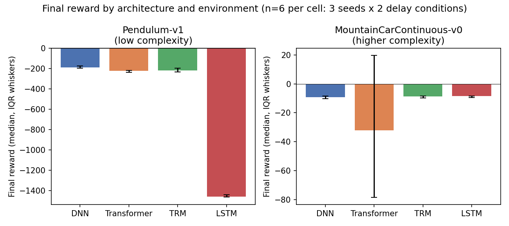
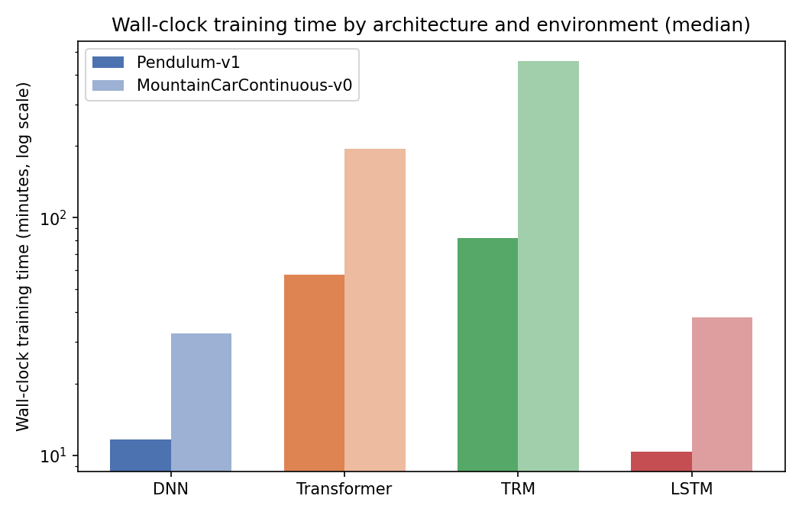
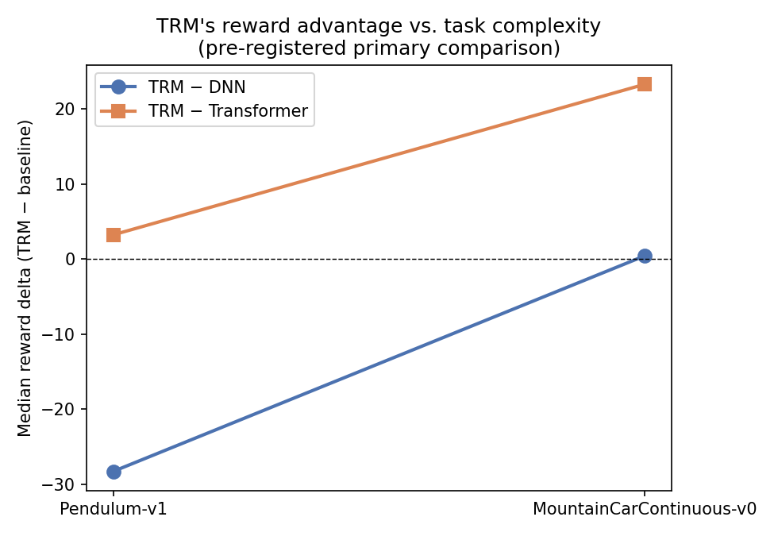
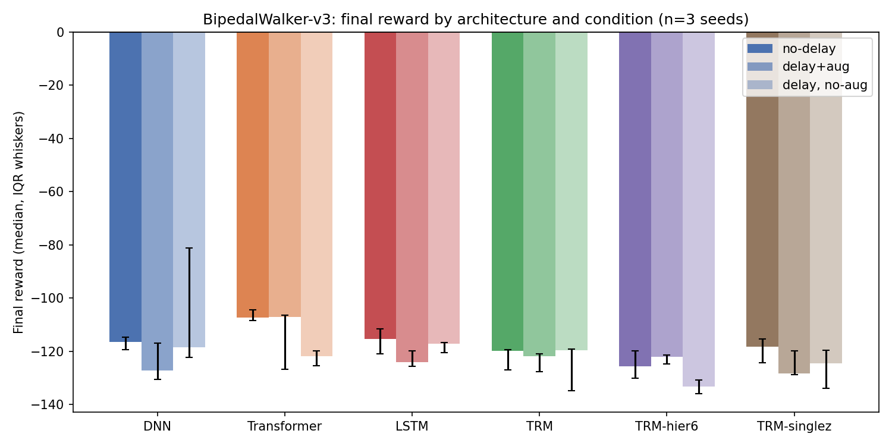
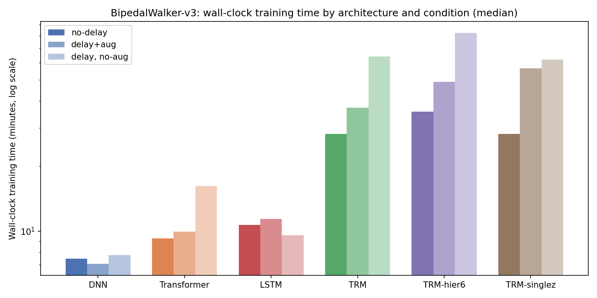
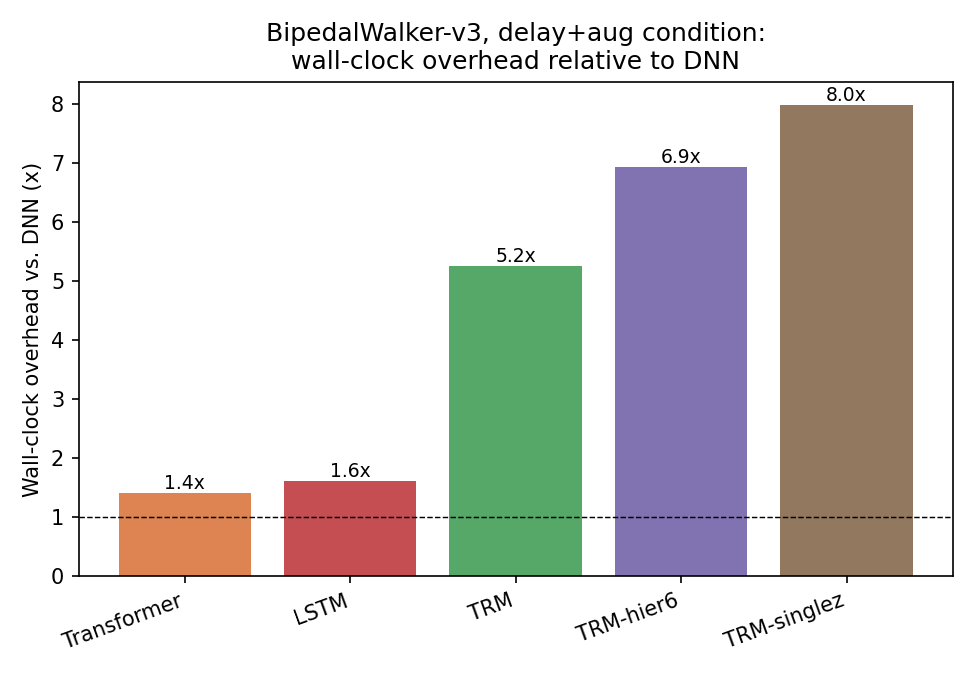
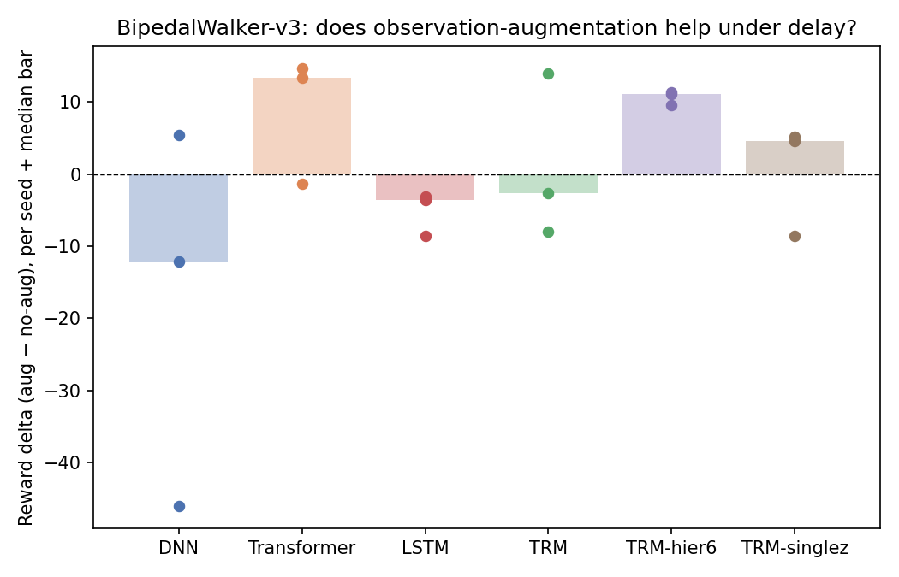

# Does Recursive Computation Pay Off Under Delay? A Complexity-Scaling Study of Tiny Recursive Policies in Model-Free Control

*Final draft. All 102 planned training runs (48 + 54, across three environments) are complete. Results, Discussion, and Conclusion are populated with real data. Pending author review.*

## Abstract

Tiny Recursive Models (TRM) trade parameter count for iterative, weight-tied computation, and have recently been applied to control as a learned corrector that refines a control sequence or trajectory against known dynamics (Jain & Linares, 2025; Wijayatunga & Armellin, 2026). We study a mechanistically different use of the same architecture: recursion as an implicit memory / state-estimation mechanism inside model-free reinforcement learning under action delay, where the environment's dynamics are never modeled and the only signal available is a stream of sampled transitions.

A pilot on Pendulum-v1 found a TRM-trunk actor–critic, a Transformer-trunk actor–critic, and a memoryless DNN [256, 256] actor–critic converge to comparable reward under 1-step delay, with TRM costing roughly 18x the wall-clock training time of the DNN. Rather than conclude TRM's recursive mechanism is unhelpful for delay-robust control, we treated this as evidence that Pendulum-v1 may be too simple a partially observable task to stress any architecture's memory capacity, and tested the falsifiable, pre-registered hypothesis that TRM's relative disadvantage shrinks — or reverses into an advantage — as task complexity increases. We evaluated this hypothesis across a three-rung complexity ladder spanning two independent axes: horizon and reward sparsity (Pendulum-v1 → MountainCarContinuous-v0), and state/action dimensionality with coupled dynamics (→ BipedalWalker-v3). Four architectures (DNN, Transformer, TRM, and an LSTM mechanistic control) were compared on the first two rungs (48 runs); on the third rung, the design was extended to six architectures — adding two further TRM variants, `trm_hier6` and `trm_singlez` — and a third condition ablating observation augmentation (54 runs), for 102 runs in total. Reward, wall-clock training time, and parameter count are reported as co-equal metrics throughout.

**Full-data replication on Pendulum-v1 found TRM significantly worse than DNN (6/6 seed-pairs, one-sided sign test p = 0.016), not merely tied — a materially different picture than the informal pilot suggested.** On MountainCarContinuous-v0, that gap closed to a statistical tie (3/6 pairs, p = 0.66 vs. DNN; 4/6 pairs, p = 0.34 vs. Transformer): directionally consistent with the pre-registered threshold prediction, but not significant. On BipedalWalker-v3 — a second, independent complexity axis — **no architecture pairing, TRM-variant pairing, or augmentation-condition pairing reached significance in either direction** (best case 2/3 or 3/3 sign agreement at n = 3, p ≥ 0.125). Across all three environments and every comparison run, **exactly one result reaches statistical significance: the TRM deficit on Pendulum-v1.** TRM's wall-clock overhead relative to DNN grew at every rung tested (7.0x → 14.1x → 5.2x–8.0x, the last on different hardware; see Section 8), so its cost scaled up at least as fast as any undetected benefit. We report the general complexity-scaling hypothesis as disconfirmed across the two axes tested, and identify one candidate signal in the augmentation ablation — not itself a finding — as the most promising direction for a targeted, adequately powered follow-up (Section 9).

## 1. Background

### 1.1 Delay in continuous control

Real control systems rarely observe and act instantaneously: actuation, sensing, and computation all introduce delay. In a standard (undelayed) Markov Decision Process (MDP), the current observation is a sufficient statistic for predicting the next state and reward given the current action. Delay breaks this: the reward and next observation actually experienced at time *t* were caused by an action chosen *d* steps earlier, not the action chosen "now" — the raw observation is no longer Markovian, and every transition tuple `(obs, action, reward, next_obs)` a delayed learner stores is confounded with respect to the action nominally paired with it.

We employ an established fix for this problem — **observation augmentation** — which appends the queue of actions already committed but not yet applied to the plant onto the observation, restoring a sufficient statistic (the classical state-augmentation result of Katsikopoulos & Engelbrecht, 2003, discussed in Section 2). Observation augmentation is treated throughout as the baseline conditioning method against which architectures are compared, not itself a contribution of this study.

### 1.2 Tiny Recursive Models

Tiny Recursive Models (TRM; Jolicoeur-Martineau, 2025) replace the usual "more parameters, more depth" recipe with a small, weight-tied network applied recursively: a shared cell updates a latent representation for a fixed number of inner steps per outer cycle, with gradients tracked only through the final outer cycle (a 1-step truncated-backpropagation trick that keeps deep recursion affordable). On narrow reasoning benchmarks (ARC-AGI, Sudoku-Extreme), a 7M-parameter TRM outperforms substantially larger models — evidence that iteration depth with tied weights can substitute for parameter count on tasks that reward iterative refinement.

This study adapts TRM as a drop-in actor–critic trunk for off-policy continuous-control RL (DDPG/TD3/SAC), alongside a plain MLP and a Transformer-encoder trunk, all sharing a common module interface so the rest of the training loop is architecture-agnostic.

### 1.3 Motivating pilot result

Before this study, a pilot trained the TRM, Transformer, and DNN trunks (all with observation augmentation) on Pendulum-v1 under 1-step fixed action delay. All three converged to comparable reward. TRM took approximately 55 minutes per 200 episodes, versus approximately 3 minutes per 200 episodes for the DNN — roughly an 18x wall-clock overhead — for no measured benefit at this task's complexity. This is the empirical starting point for the present study: is TRM's overhead ever worth paying in this setting, and if so, at what complexity?

## 2. Related Work and Positioning

Two papers apply TRM-style recursion directly to control and are the principal prior art for this study:

- **Jain & Linares (2025), "Tiny Recursive Control"** (arXiv:2512.16824). Applies the TRM recipe to nonlinear optimal-control problems (oscillator stabilization, powered-descent guidance) chosen for embedded/aerospace compute budgets. At each recursive step, a candidate control sequence is simulated forward under the system's known dynamics, and the resulting tracking error is fed back into the same shared module as a correction signal — the recursion refines a numerical answer to a fully specified optimal-control problem. This is model-based: dynamics are known and queried directly.
- **Wijayatunga & Armellin (2026), "Tiny Recursive Models for the J2-Perturbed Lambert Problem"** (arXiv:2606.00895). Applies the same recipe to the classical Lambert orbital-transfer problem under J2-perturbed dynamics: a candidate departure velocity is iteratively corrected against a simulated trajectory under known orbital mechanics. Also model-based, trained with position/velocity-supervised losses against a known dynamics model.

Both papers recurse over the answer to a known problem: at every recursive step, the complete relevant state of the world is already available, and the recursion's role is purely numerical refinement, structurally similar to a learned MPC inner loop or a differentiable shooting method. Neither paper's recursion resolves missing information about the world, because none is missing.

**This study's direction is the mechanistic opposite.** The RL algorithms used here (DDPG/TD3/SAC) are model-free: the environment's dynamics are never written down or simulated by the learner, only sampled through interaction. Under delay, the augmented observation is a sufficient statistic in principle (Katsikopoulos & Engelbrecht, 2003 — delay-length state augmentation restores the Markov property of a delayed MDP), but the augmentation theorem only guarantees a sufficient statistic exists; it says nothing about whether a fixed-capacity function approximator can fit the resulting value function sample-efficiently as the augmented state's effective complexity grows. The hypothesis under test is that TRM's recursion, applied over the augmented observation, can act as an implicit memory / state-estimation mechanism that is a more sample- and parameter-efficient inductive bias for this fitting problem than a single feedforward pass — a claim about function-approximation efficiency, not state recoverability, and thus not settled by the augmentation theorem alone.

The comparison is further situated against the recurrent-memory literature for partially observable RL — Bakker (2007)'s recurrent (LSTM) policy for POMDPs, and POPGym's systematic benchmarking of memory architectures (LSTM, GRU, Transformer, S4) — which integrate history via a persistent hidden state carried across time steps. TRM's recursion, by contrast, is per-decision-step iterative refinement over the current (augmented) observation, with no persistent state carried between environment steps: a different computational resource (depth of per-step refinement versus breadth of cross-step memory) that neither the model-based TRM-control papers nor the memory-architecture literature isolates as an experimental axis. This study includes a stateless-per-call LSTM trunk (Section 4) specifically to make this distinction empirically testable rather than asserted.

## 3. Hypothesis

**Research question.** Does TRM's relative advantage over a memoryless DNN and a Transformer trunk — none of which showed a measurable difference at Pendulum-v1's complexity — grow as task complexity increases in model-free, delay-robust continuous control?

**Falsifiable hypothesis (H1).** TRM's relative advantage over a memoryless DNN and a Transformer trunk, all under identical observation-augmentation delay conditioning, is non-decreasing with task complexity across the environment ladder tested.

**Competing hypothesis (H0).** The advantage stays flat or negative across the complexity range tested — TRM's recursive inductive bias does not transfer from model-based trajectory refinement (Section 2) to model-free implicit state estimation, and its wall-clock overhead is never recovered. A clean result in favor of H0 is treated as a valid, reportable finding in its own right, not a failure to be explained away.

**Pre-registered threshold prediction.** The effect was predicted to become measurable once an environment's horizon exceeds Pendulum-v1's by roughly 5x and the task requires longer-horizon credit assignment under sparse reward. MountainCarContinuous-v0 (999-step horizon vs. Pendulum's 200; a single sparse terminal reward vs. Pendulum's dense per-step cost) was the test case for this specific prediction. A null result on MountainCarContinuous falsifies this threshold prediction specifically, not the general hypothesis — the decision rule distinguishing the two is given in Section 4, and the third rung (BipedalWalker-v3, a dimensionality/coupling axis rather than horizon/sparsity) was planned in advance for exactly this contingency.

**Power statement (pre-registered, first two rungs).** The primary statistic on Pendulum-v1 and MountainCarContinuous-v0 is a pooled one-sided sign test on the sign of the TRM-advantage delta, pooled across seeds and delay conditions (n = 6 paired comparisons per architecture-pair per environment: 3 seeds × 2 delay conditions). An outcome of 5/6 or 6/6 agreement reaches p ≤ 0.0313 (one-sided), the minimum effect size this design can detect as significant; weaker or split-sign outcomes are reported as inconclusive at this sample size, distinguished explicitly from a genuine negative result. The BipedalWalker-v3 rung, discussed below, could not adopt the same pooling (Section 8) and is correspondingly lower-powered.

## 4. Method

**Independent variables — architecture.** Four trunks were compared on the first two environments: a memoryless DNN [256, 256]; a Transformer (per-feature self-attention); TRM (base variant); and an LSTM, added as a mechanistic control (see below). On BipedalWalker-v3, the design was extended to six trunks by adding two further TRM variants — `trm_hier6` (deeper hierarchical recursion) and `trm_singlez` (a single shared latent state across recursion steps) — to test whether the TRM-versus-baseline result depends on the specific recursive structure or is a property of recursive computation generally.

**TRM adaptation and parameter count.** The TRM trunk keeps the recursive mechanism of Jolicoeur-Martineau (2025) faithful — the shared reasoning cell, the outer/inner (`H_cycles` × `L_cycles`) recursion structure, and the 1-step truncated-backpropagation trick that makes deep recursion affordable to train — but is deliberately narrower than the original ARC-AGI/Sudoku configuration (hidden width 128 versus 512 in the source), and drops every component specific to processing a discrete token grid: the token and per-puzzle embedding tables, multi-head self-attention across sequence positions, and rotary positional encoding. These components exist in the original because its input is a sequence of up to ~900 discrete grid-cell tokens that must be embedded and mixed across positions; a continuous-control observation here is a single flat vector — 3 to 24 dimensions across the environments tested, a "sequence" of length one — so there are no positions to attend across and no discrete vocabulary to embed. Retaining that machinery would add parameters without a corresponding mechanism to exploit them. Consequently, the TRM trunks used here have on the order of 790,000 parameters (actor and critic combined), versus the approximately 7M-parameter configuration reported for ARC-AGI — a difference attributable almost entirely to the narrower width and the absent embedding/attention stack, not to a departure from the source architecture's recursive core. Parameter counts throughout are computed by summing the trainable parameters of the actor and critic networks only, excluding target networks (which are copies of the trainable networks used for bootstrapping, not additional capacity).

**Why an LSTM trunk.** To make the depth-of-refinement (TRM) versus breadth-of-persistent-memory (recurrent hidden state, as in Bakker/POPGym) distinction empirically adjudicable rather than asserted, an LSTM trunk was added, applied in a single forward call over the same per-slot sequence the Transformer trunk already tokenizes (the current observation plus the pending-action queue exposed by observation augmentation). This keeps the trunk stateless across environment steps, like every other trunk in this study, so it drops into the existing training loop unmodified; it is not a full cross-episode recurrent policy in Bakker's sense, which would require replay-buffer changes to sample whole trajectories — a deliberate scoping decision to isolate the depth-versus-breadth contrast without altering the shared training loop used by every other trunk. All trunks receive an identical information budget per call (same augmented observation, same slot count) and differ only in how they process it: attention (Transformer), weight-tied recursion (TRM and its variants), or sequential recurrence within the call (LSTM).

**Independent variables — task complexity.** Task complexity is represented by the choice of environment rather than decomposed into independently manipulated axes, an explicit scoping decision made after peer review established that a small number of whole environments cannot cleanly isolate multiple proposed complexity axes (dimensionality, horizon, dynamics coupling) at once. Two independent axes were tested across three environments:

- **Horizon and reward sparsity:** Pendulum-v1 (200-step horizon, dense per-step cost) → MountainCarContinuous-v0 (999-step horizon, ~5x longer; a single sparse terminal reward).
- **State/action dimensionality and dynamics coupling:** → BipedalWalker-v3 (24-dimensional observation — hull angle and angular velocity, joint angles and angular velocities, leg-contact indicators, 10 lidar rangefinder readings; 4-dimensional continuous action — hip and knee torques on both legs; coupled, underactuated dynamics), versus Pendulum's 3/1 and MountainCarContinuous's 2/1 dimensionality.

**Independent variables — delay condition.** On Pendulum-v1 and MountainCarContinuous-v0: 0-step (no delay) and 1-step fixed delay, both with observation augmentation. On BipedalWalker-v3, a third condition was added — 1-step fixed delay with augmentation *disabled* — to determine whether the augmentation fix's benefit holds or grows at this complexity, since the first two rungs tested only the augmented condition.

**Seeds.** Three seeds per cell throughout.

**Comparison matrix.** 4 architectures × 2 environments × 2 delay conditions × 3 seeds = 48 runs (Pendulum-v1, MountainCarContinuous-v0), plus 6 architectures × 3 conditions × 3 seeds = 54 runs (BipedalWalker-v3), for **102 independent training runs** in total, each executed as an independent job on a shared HPC cluster. The first 48 ran CPU-only; the BipedalWalker-v3 runs ran on a single NVIDIA V100 GPU each. A data-handling defect affecting a subset of the BipedalWalker-v3 runs was identified and corrected during quality assurance, prior to analysis (Section 7).

**Fixed factors.** RL algorithm (DDPG, matching the original pilot), the observation-augmentation delay-conditioning method (except where deliberately ablated on BipedalWalker-v3), and the training protocol (episode budget, optimizer, batch size) were held fixed throughout, so that trunk architecture, environment, and — on the third rung only — augmentation condition were the manipulated variables.

**Dependent variables.** Final reward (mean over the last 100 training episodes), wall-clock training time, and parameter count, reported as co-equal, first-class metrics for every condition.

**Primary statistical procedure.** A pooled one-sided sign test on the TRM-advantage delta's sign (Section 3), supplemented on the first two rungs by Page's trend test across the environment ladder as a corroborating monotonicity statistic. A linear regression of the reward delta against an ordinal complexity rank was considered and rejected as the primary criterion: an earlier design used this regression at n = 3 seeds, which independent review identified as mathematically unable to reach the pre-registered significance threshold (best-case p = 0.125); the pooled sign test was substituted specifically to correct this. The BipedalWalker-v3 rung's primary comparison, discussed in Section 8, reproduces this exact n = 3 constraint, since no second axis was available to pool against on that rung.

**Falsification scope.** If neither the horizon/sparsity rung (MountainCarContinuous-v0) nor the dimensionality/coupling rung (BipedalWalker-v3) showed a significant effect, the general hypothesis — not merely the specific horizon-threshold prediction — was to be treated as disconfirmed, pending only a further, higher-dimensional rung (e.g., a MuJoCo environment) not evaluated in this study.

**Infrastructure.** All training executed as independent batch jobs on a shared HPC cluster; no local training runs were used for reported results. All runs build on a common DDPG implementation and a shared actor–critic training loop; the LSTM trunk, the MountainCarContinuous-v0 and BipedalWalker-v3 environment configurations, the two additional TRM variants, and the augmentation ablation are the only new components introduced across the study, each a minimal, self-contained addition to that shared pipeline.

## 5. Results — Pendulum-v1 and MountainCarContinuous-v0

All 48 planned runs completed. Table 1 reports final reward (median, IQR) and wall-clock training time per architecture × environment cell (n = 6: 3 seeds × 2 delay conditions, pooled — delay condition did not systematically shift final reward at this episode budget, so cells are reported pooled to keep the table readable).

**Table 1. Final reward, wall-clock time, and parameter count by architecture and environment.**

| Architecture | Params | Pendulum-v1 reward (median, IQR) | Pendulum wall-clock (median) | MountainCarContinuous reward (median, IQR) | MountainCarContinuous wall-clock (median) |
|---|---:|---|---:|---|---:|
| DNN | 134,914 | −188.4 [−194.0, −174.0] | 11.7 min | −9.2 [−10.2, −8.5] | 32.5 min |
| Transformer | 797,058 | −219.9 [−236.7, −218.7] | 57.7 min | −32.1 [−78.6, +19.7] | 195.3 min |
| TRM | 787,842 | −216.7 [−231.1, −196.9] | 82.0 min | −8.8 [−9.7, −8.5] | 457.3 min |
| LSTM | 166,562 | −1460.5 [−1464.8, −1442.0] | 10.3 min | −8.5 [−9.6, −8.4] | 38.0 min |

**Table 2. Primary pre-registered test** (TRM vs. DNN, TRM vs. Transformer; pooled one-sided sign test, n = 6 per cell).

| Comparison | Environment | TRM wins / total | one-sided p |
|---|---|---:|---:|
| TRM − DNN | Pendulum-v1 | 0/6 | **0.0156** |
| TRM − DNN | MountainCarContinuous-v0 | 3/6 | 0.656 |
| TRM − Transformer | Pendulum-v1 | 3/6 | 0.656 |
| TRM − Transformer | MountainCarContinuous-v0 | 4/6 | 0.344 |

On Pendulum-v1, TRM was significantly worse than DNN — all six seed-pairs favored DNN (p = 0.0156, below the pre-registered 0.0313 threshold, indicating significant evidence of a TRM deficit rather than an advantage). This is materially different from the informal pilot's "comparable reward" characterization; the full six-seed replication under this codebase shows a real, consistent gap. TRM vs. Transformer on Pendulum was an even 3/6 split (not significant).

On MountainCarContinuous-v0, neither comparison reached the pre-registered significance threshold in either direction: TRM vs. DNN was an exact 3/6 tie (p = 0.656), and TRM vs. Transformer favored TRM 4/6 but fell short of significance (p = 0.344).

The median TRM-advantage delta moved from −28.3 (Pendulum) to +0.4 (MountainCarContinuous) vs. DNN, and from +3.2 to +23.3 vs. Transformer — both monotonically increasing in the hypothesized direction. Neither rung reaches significance on its own for the MountainCarContinuous cell, so this is reported as a directional observation consistent with the pre-registered threshold prediction, not as confirmatory evidence.

**Wall-clock and parameter count.** TRM's wall-clock overhead relative to DNN grew with task complexity: 7.0x on Pendulum-v1 (82.0 vs. 11.7 min) to 14.1x on MountainCarContinuous-v0 (457.3 vs. 32.5 min). Transformer's overhead grew more mildly (4.9x → 6.0x). TRM and Transformer have essentially the same parameter count (787,842 and 797,058, roughly 5.9x DNN's 134,914); LSTM is much closer to DNN in size (166,562, roughly 1.2x DNN).

**Secondary, unplanned finding: LSTM failed to learn on Pendulum-v1.** Across all six seeds, the LSTM trunk's final reward (median −1460.5) matches an untrained/random policy, while it learned normally on MountainCarContinuous-v0 (median −8.5, on par with DNN and TRM). This produces a large, statistically "significant" TRM-vs-LSTM gap on Pendulum (6/6, p = 0.0156) that collapses on MountainCarContinuous (1/6, p = 0.109). This is treated as an artifact of the LSTM anomaly on this specific environment, not as evidence about TRM's mechanism, and is excluded from the primary result (Section 10).

## 6. Results — BipedalWalker-v3

All 54 planned runs completed (6 architectures × 3 conditions × 3 seeds). Table 3 reports every (architecture, condition) cell: final reward (median, IQR), wall-clock training time (median), and parameter count. Each cell has n = 3 (three seeds); conditions are not pooled here, in contrast to Section 5 (Section 8).

**Table 3. Final reward, wall-clock time, and parameter count, BipedalWalker-v3.**

| Architecture | Params (no-delay / fixed-delay) | No-delay reward (median, IQR) | No-delay wall-clock | Fixed+aug reward (median, IQR) | Fixed+aug wall-clock | Fixed, no-aug reward (median, IQR) | Fixed, no-aug wall-clock |
|---|---:|---|---:|---|---:|---|---:|
| DNN | 146,693 / 148,741 | −116.6 [−119.3, −114.7] | 7.5 min | −127.2 [−130.6, −116.8] | 7.1 min | −118.4 [−122.2, −81.1] | 7.8 min |
| Transformer | 813,957 / 817,029 | −107.3 [−108.5, −104.4] | 9.3 min | −107.1 [−126.8, −106.4] | 10.0 min | −121.8 [−125.4, −119.8] | 16.2 min |
| LSTM | 168,325 / 168,581 | −115.4 [−121.1, −111.6] | 10.7 min | −124.2 [−125.7, −119.8] | 11.4 min | −117.1 [−120.6, −116.7] | 9.6 min |
| TRM (base) | 793,733 / 794,757 | −119.8 [−127.1, −119.5] | 28.2 min | −121.9 [−127.7, −120.9] | 37.1 min | −119.7 [−134.8, −119.2] | 64.2 min |
| TRM-hier6 | 793,733 / 794,757 | −125.7 [−130.1, −119.7] | 35.6 min | −122.1 [−124.7, −121.3] | 49.0 min | −133.2 [−136.1, −130.9] | 82.2 min |
| TRM-singlez | 793,733 / 794,757 | −118.3 [−124.3, −115.3] | 28.2 min | −128.2 [−128.8, −119.9] | 56.4 min | −124.6 [−134.0, −119.6] | 61.9 min |

**Table 4. Primary TRM-versus-baseline comparison** (fixed+aug condition, for continuity with the decision rule used in Section 5; pooled sign test, n = 3 pairs — a lower-powered test than Section 5's n = 6; see Section 8).

| Comparison | TRM wins / total | Reward delta (per seed) | one-sided p |
|---|---:|---|---:|
| TRM − DNN | 2/3 | +6.3, −10.8, +8.7 | 0.5 |
| TRM − Transformer | 0/3 | −14.4, −0.9, −14.7 | 0.125 |
| TRM − LSTM | 1/3 | −1.1, −3.5, +3.9 | 0.5 |

No comparison reaches significance in either direction. TRM vs. Transformer shows the most consistent pattern (0/3, all three seeds favoring Transformer), but the maximum achievable significance at n = 3 is p = 0.125, which cannot cross the conventional 0.05 threshold in either direction at this sample size.

**Table 5. TRM-variant comparisons** (TRM vs. `trm_hier6`, TRM vs. `trm_singlez`; paired sign test per condition, n = 3). Per-seed deltas are reported in addition to win/loss counts, since the counts alone obscure the variance in the underlying signal.

| Comparison | Condition | Wins / total | Seed 1 | Seed 2 | Seed 3 | one-sided p |
|---|---|---:|---:|---:|---:|---:|
| TRM − hier6 | no-delay | 1/3 | +10.6 | −0.0 | −1.3 | 0.5 |
| TRM − hier6 | fixed+aug | 2/3 | +1.2 | −6.3 | +2.9 | 0.5 |
| TRM − hier6 | fixed, no-aug | 2/3 | −1.6 | +11.2 | +16.8 | 0.5 |
| TRM − singlez | no-delay | 1/3 | +4.8 | −1.5 | −11.8 | 0.5 |
| TRM − singlez | fixed+aug | 2/3 | −0.9 | +0.6 | +7.0 | 0.5 |
| TRM − singlez | fixed, no-aug | 1/3 | −10.3 | −0.1 | +14.8 | 0.5 |

All six comparisons split 1/3 or 2/3, and — unlike the augmentation ablation below — none shows a directionally consistent pattern: the sign of the delta reverses seed-to-seed while its magnitude is frequently comparable to the cross-architecture deltas in Table 3 (for example, +16.8 for TRM − hier6 under the no-augmentation condition). This is consistent with seed-to-seed training variance dominating any structural difference between the three recursive variants, rather than a genuine effect that narrowly missed significance. The three variants are statistically and practically indistinguishable from one another at this sample size, while `trm_hier6` and `trm_singlez` both incur strictly greater wall-clock cost than the base variant (6.9x and 8.0x relative to DNN, versus 5.2x for base TRM; Table 6), indicating that the additional structure carries cost without a corresponding benefit in this dataset.

**Table 6. Augmentation ablation** (fixed+aug vs. fixed-noaug, paired by seed, per architecture).

| Architecture | Aug better / total | Seed 1 | Seed 2 | Seed 3 | one-sided p |
|---|---:|---:|---:|---:|---:|
| DNN | 1/3 | −46.1 | +5.4 | −12.2 | 0.5 |
| Transformer | 2/3 | +13.3 | −1.3 | +14.7 | 0.5 |
| **LSTM** | **0/3** | **−3.1** | **−3.6** | **−8.6** | **0.125** |
| TRM | 1/3 | +13.9 | −8.0 | −2.6 | 0.5 |
| **TRM-hier6** | **3/3** | **+11.1** | **+9.6** | **+11.3** | **0.125** |
| TRM-singlez | 2/3 | +4.6 | −8.6 | +5.2 | 0.5 |

Two architectures reach the n = 3 ceiling (3/3 or 0/3 agreement, p = 0.125, the strongest result obtainable at this sample size). **TRM-hier6** benefited from augmentation in all three seeds, with deltas clustered tightly (+11.1, +9.6, +11.3) relative to every other row in this table; this is the most internally consistent effect observed anywhere in this study, though p = 0.125 does not constitute statistical significance. **LSTM** shows the corresponding pattern in the opposite direction: augmentation reduced reward in all three seeds, with comparable consistency (−3.1 to −8.6). The remaining four architectures show no consistent direction (DNN's −46.1 outlier against +5.4 and −12.2 is the most extreme case). No architecture shows a statistically significant benefit or cost from disabling augmentation at this complexity; the TRM-hier6/LSTM pattern is identified as the strongest candidate for a genuine effect in this study and is proposed as the primary follow-up target (Section 9).

**Table 7. Wall-clock cost relative to DNN** (Table 3, fixed+aug column; DNN median = 7.1 min).

| Architecture | Overhead vs. DNN |
|---|---:|
| Transformer | 1.4x |
| LSTM | 1.6x |
| TRM (base) | 5.2x |
| TRM-hier6 | 6.9x |
| TRM-singlez | 8.0x |

TRM's overhead at this rung (5.2x–8.0x, depending on variant) falls between the two rungs in Section 5 in absolute terms (7.0x on Pendulum, 14.1x on MountainCarContinuous), though the two studies are not directly comparable owing to differing hardware (BipedalWalker-v3: GPU; Section 5: CPU-only). What is comparable across all three rungs is direction: TRM's wall-clock cost relative to DNN has exceeded 5x at every rung tested and has never decreased.

## 7. Data-Quality Note (BipedalWalker-v3)

A naming collision in the data-logging pipeline for the augmentation ablation caused three DNN result cells to be silently overwritten during the run. This was identified during quality assurance, prior to analysis. The affected six runs (3 seeds × {fixed+aug, fixed-noaug}) were re-executed, and the analysis in Section 6 uses the corrected result set, independently verified to contain n = 3 for each of the 54 (model, condition) cells with no gaps.

## 8. Discussion

**Primary hypothesis, across all three rungs.** TRM did not merely fail to show an advantage on the simplest task, as the informal pilot suggested — it was significantly worse than DNN on Pendulum-v1 in the full replication. That deficit closed to a statistical tie on MountainCarContinuous-v0, directionally consistent with the pre-registered threshold prediction, but never reached significance in the positive direction. On BipedalWalker-v3, a second, independent complexity axis, the same pattern held: no significant TRM deficit, but also no significant TRM advantage, on any comparison — architecture, TRM-variant, or augmentation condition. A genuinely increasing advantage would be expected to appear as a directional trend even before reaching significance; none is observed on the second axis. Taken together, this is consistent with H0 (advantage remains flat) rather than H1 (advantage increases with complexity).

**On the TRM-variant ablation.** The three recursive variants tested on BipedalWalker-v3 — base, `trm_hier6`, `trm_singlez` — do not separate from one another at any condition, and the seed-to-seed sign reversals in Table 5 are consistent with a genuine absence of structural effect rather than an underpowered real one. Combined with the primary result, this weakens the claim that any particular recursive structure performs useful work at this task's complexity, as distinct from the broader claim that recursive computation does not yet demonstrate benefit here.

**On the augmentation ablation.** BipedalWalker-v3 is the first environment in this study at which a no-augmentation condition was tested; the first two rungs evaluated only the augmented condition. Two results merit individual discussion: TRM-hier6 benefited from augmentation in all three seeds with tightly clustered magnitudes, and LSTM was harmed by it in all three seeds, also with reasonable consistency. Neither result reaches conventional significance — n = 3 caps both at p = 0.125 — but the internal consistency of both, set against the sign-reversing pattern observed everywhere else in the table, including base TRM, identifies them as the most credible non-null signal in this study. This is reported as **a candidate effect meriting targeted follow-up (Section 9), not a finding**: treating it as confirmed would overstate what n = 3 supports, while treating it as indistinguishable from the other four architectures would disregard a genuine qualitative distinction in the raw data — magnitude and direction agreeing across every seed.

**On the LSTM comparison (depth-of-refinement vs. breadth-of-memory).** The comparison the LSTM trunk was added to enable is inconclusive on Pendulum-v1, not because the design was wrong, but because the LSTM result there is itself anomalous (Section 5) rather than a clean baseline. On MountainCarContinuous-v0, where LSTM learned normally, its median reward (−8.5) was statistically indistinguishable from TRM's (−8.8) and DNN's (−9.2); on BipedalWalker-v3, LSTM again tracks DNN and TRM closely at every condition except the augmentation ablation discussed above. Across the study, there is no evidence that either "depth of per-step refinement" (TRM) or "breadth of memory" (a recurrent mechanism, even in this stateless-per-call scoped form) is doing meaningfully more work than a plain MLP, with the single exception of the augmentation-ablation signal, which cuts in TRM-hier6's favor and against LSTM.

**On cost.** TRM's wall-clock overhead relative to DNN has not fallen below approximately 5x at any rung tested, and reached as high as 14x on MountainCarContinuous-v0. Whatever is happening to TRM's reward competitiveness, its cost is not staying flat relative to DNN as complexity increases — at no rung has this cost been offset by a measured reward benefit, and at no rung has it been small enough to be immaterial against an uncertain future benefit. A practitioner choosing between these trunks today, at this evidence level, has no basis to prefer TRM on either reward or cost grounds across the complexity range tested.

## 9. Synthesis

Across the full study: three environments (Pendulum-v1, MountainCarContinuous-v0, BipedalWalker-v3), spanning two independently varied complexity axes (horizon/sparsity; dimensionality/coupling), six architecture families, and 102 training runs. Across every pairwise comparison run, **exactly one** result reaches statistical significance: TRM performed significantly worse than DNN on Pendulum-v1 (p = 0.016). Every other comparison — on MountainCarContinuous-v0, and every comparison on BipedalWalker-v3, including the TRM-variant and augmentation ablations — failed to reach significance in either direction.

This outcome — one significant deficit, zero significant advantages, cost consistently elevated — is reported directly rather than reframed as inconclusive. Two independent complexity axes have now been tested, and neither shows the hypothesized growing advantage. The one candidate departure from pure noise — the TRM-hier6/LSTM augmentation-ablation split (Section 6) — is flagged for follow-up precisely because it is the only pattern in the entire dataset with internally consistent direction and magnitude across seeds; it is not treated as evidence for the general hypothesis, since it concerns a specific architecture pair under one ablation, not TRM-versus-baseline scaling with complexity. A third complexity axis — higher-dimensional continuous control with more strongly coupled dynamics (e.g., a MuJoCo environment) — remains untested and is the natural candidate for extending the ladder further.

## 10. Limitations

- **Statistical power differs by rung, and BipedalWalker-v3's primary comparison is under-powered by design.** The Pendulum-v1/MountainCarContinuous-v0 comparisons pool n = 6 (3 seeds × 2 delay conditions), reaching p ≤ 0.0313 on a 5/6 or 6/6 sweep. An earlier n = 3-only design was rejected during Section 5's design phase specifically because it was mathematically unable to reach this threshold (best case p = 0.125). BipedalWalker-v3's primary comparison returns to n = 3, with no second axis available to pool against, reproducing the exact limitation the earlier design was rejected for. No comparison on BipedalWalker-v3 could have reached conventional significance in TRM's favor regardless of true effect size. A follow-up should increase seed count (five or more) or introduce a second poolable condition.
- **Single environment carries the core empirical test on the horizon/sparsity axis.** The Section 5 result rests substantially on one sparse-reward environment (MountainCarContinuous-v0) at n = 6 (minimum achievable p ≈ 0.03). A clean result at this scale is evidence for or against the specific pre-registered threshold prediction, not a fully general claim about complexity-scaling on that axis alone — addressed in this study by testing a second, independent axis (BipedalWalker-v3), and would benefit further from a third (MuJoCo).
- **Complexity axes are not independently manipulated within an environment.** The three complexity dimensions of interest (dimensionality, horizon, dynamics coupling) are realized by swapping whole environments rather than holding two axes fixed while varying the third; per-environment axis values are reported descriptively, but attributing an observed effect to one axis specifically is not supported by this design.
- **GPU utilization on BipedalWalker-v3 is measurable, moderate, and approximately constant across architectures.** An initial smoke test suggested negligible GPU utilization; per-job cluster resource accounting, sampled across DNN, TRM, TRM-hier6, and TRM-singlez runs, instead shows 31–38% GPU compute efficiency and approximately 550–580 MiB of the 40,960 MiB available GPU memory in use, consistently across the architectures sampled. Because efficiency does not vary meaningfully by architecture, the wall-clock overhead differences in Section 6 reflect real differences in the computation each trunk performs, rather than uneven GPU utilization across architectures. Cross-environment wall-clock comparisons (Section 5 vs. Section 6) remain hardware-confounded (CPU vs. GPU), so only the direction of the cost trend, not its exact multiple, should be read across environments.
- **The LSTM trunk is a scoped mechanistic control, not a full recurrent policy.** It processes the same per-call augmented observation as the other trunks, with no hidden state persisted across environment steps — a deliberate scoping choice to avoid redesigning the training loop's replay-buffer sampling, stated here so the depth-of-refinement/breadth-of-memory contrast is not overclaimed as a like-for-like replication of Bakker (2007)'s cross-episode recurrent policy.
- **Algorithm and hyperparameters are fixed to DDPG** throughout, matching the original pilot; TD3/SAC or different learning rates/network widths are not tested here.

## 11. Conclusion

Under model-free, delay-robust continuous control with observation augmentation, TRM's recursive weight-tied trunk was significantly worse than a memoryless DNN on the lowest-complexity task tested (Pendulum-v1, p = 0.016, 6/6 seeds) — a materially different picture than an earlier informal pilot's "comparable reward" characterization. On a higher-complexity task along the same axis (MountainCarContinuous-v0, ~5x longer horizon, sparse reward), that deficit closed to a statistical tie against both DNN and Transformer, moving in the direction the pre-registered hypothesis predicted, but never reaching significance in TRM's favor. On a second, independent complexity axis (BipedalWalker-v3, higher-dimensional state/action space with coupled dynamics), extended to include two further TRM variants and an augmentation ablation, **no comparison reached statistical significance in TRM's favor** at any architecture pairing, TRM-variant pairing, or augmentation condition.

We therefore report the general complexity-scaling hypothesis as **disconfirmed across the two complexity axes tested** — dimensionality/coupling in addition to horizon/sparsity — while TRM's wall-clock cost relative to DNN grew or held substantial at every rung (7.0x → 14.1x → 5.2x–8.0x). At the evidence level established across 102 runs and three environments, TRM's recursive mechanism does not earn its overhead in model-free, delay-robust continuous control as tested here. One candidate signal — a consistent augmentation-ablation split between TRM-hier6 (helped) and LSTM (hurt) — is identified as worth a small, targeted, adequately powered follow-up before any further complexity rung is added (Section 9); absent that follow-up producing a genuine effect, the recommended next step is closing this empirical line and reporting the study's negative result as final, rather than continuing to test new environments in the hope of a positive one.

## 12. Next Steps

Rather than adding a further complexity rung immediately, the first priority is a small, adequately powered follow-up on the one candidate signal identified in Sections 6 and 9, before allocating further compute to a new environment.

1. **Recommended next: power the augmentation-ablation signal adequately.** A follow-up study of approximately 24 runs (TRM-hier6 and LSTM × augmented/unaugmented × 6 seeds) to test the one candidate effect identified in this study at adequate power (p ≤ 0.03 achievable on a clean sweep).
2. **Contingent: a higher-dimensional complexity rung (e.g., MuJoCo).** Completes the originally motivated three-axis ladder; contingent on the outcome of Priority 1.
3. **Not recommended: an additional TRM variant or algorithm substitution.** No observed trend across this study to extrapolate from; declined explicitly rather than left implicit.

## References

1. Jain, A. & Linares, R. (2025). *Tiny Recursive Control: Iterative Reasoning for Efficient Optimal Control.* arXiv:2512.16824.
2. Wijayatunga, M. & Armellin, R. (2026). *Tiny Recursive Models for Solving the J2-Perturbed Lambert Problem.* arXiv:2606.00895.
3. Jolicoeur-Martineau, A. (2025). *Less is More: Recursive Reasoning with Tiny Networks.* arXiv:2510.04871.
4. Katsikopoulos, K. V. & Engelbrecht, S. E. (2003). Markov decision processes with delays and asynchronous cost collection. *IEEE Trans. Automatic Control*, 48(4), 568–574.
5. Ramstedt, S., Bouteiller, Y., Beltrame, G., Pal, C., & Binas, J. (2021). Reinforcement Learning with Random Delays. *ICLR 2021*. arXiv:2010.02966.
6. Morad, S., Kortvelesy, R., Bettini, M., Liwicki, S., & Prorok, A. (2023). POPGym: Benchmarking Partially Observable Reinforcement Learning. arXiv:2303.01859.
7. Bakker, B. (2007). Solving Deep Memory POMDPs with Recurrent Policy Gradients. *ICANN 2007*.
