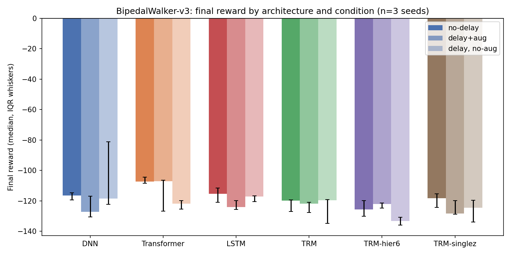
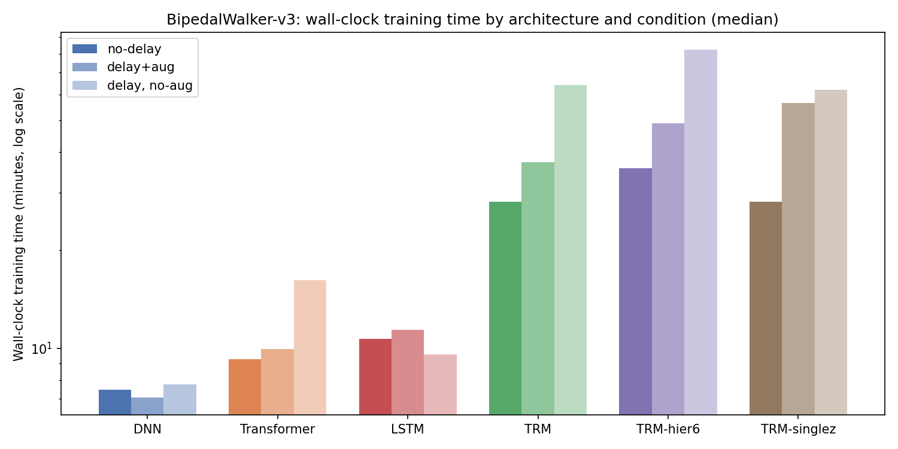
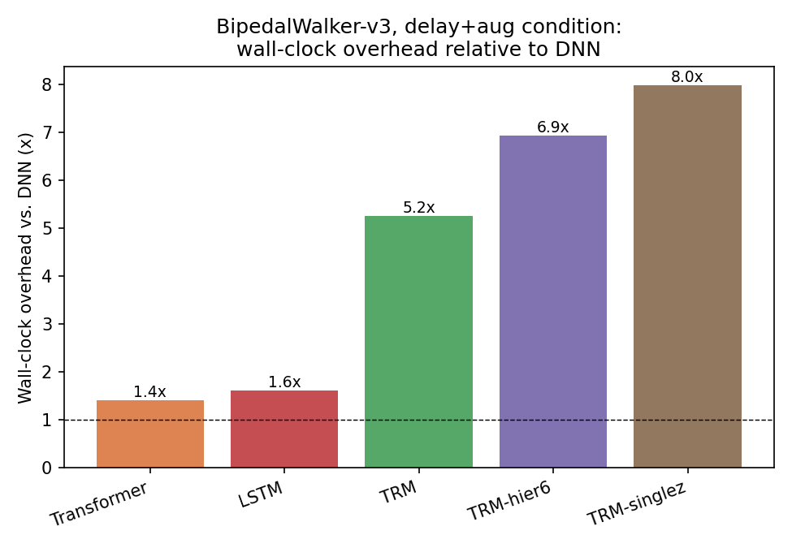
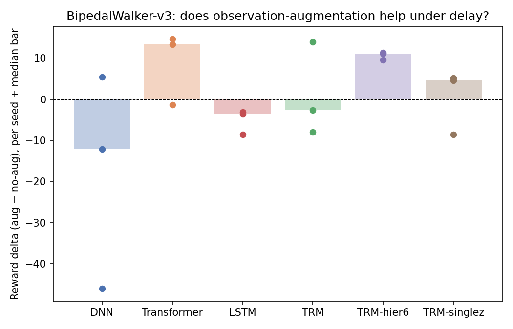

# Does Recursive Computation Pay Off Under Delay? Phase 2 — A Higher-Dimensionality Rung (BipedalWalker-v3)

*Final draft. Phase 2 is complete (54/54 runs, including 6 recovery re-runs following a filename-collision defect identified and corrected during quality assurance). Results, Discussion, and Conclusion are populated with real data, and GPU utilization has been empirically measured (Section 6), closing the caveat left open in the issue tracker. This report extends `papers/phase1/report.md` (Pendulum-v1, MountainCarContinuous-v0) rather than superseding it; a synthesis across both phases appears in Section 5. Pending author review before being treated as final.*

## Abstract

Phase 1 of this project (`papers/phase1/report.md`) evaluated whether a Tiny Recursive Model (TRM) actor–critic trunk's performance relative to a memoryless DNN and a Transformer trunk — architectures that did not separate on Pendulum-v1 — improves as task complexity increases along a horizon/sparsity axis (MountainCarContinuous-v0). It did not: TRM performed significantly worse than DNN on Pendulum-v1 (p = 0.016, 6/6 seeds) and reached only a statistical tie on MountainCarContinuous-v0 (3/6, p = 0.66), while its wall-clock overhead relative to DNN increased (7.0x → 14.1x).

Phase 2 evaluates a second, independent complexity axis — state/action dimensionality and dynamics coupling — using BipedalWalker-v3 (24-dimensional observation, 4-dimensional continuous action, coupled multi-joint dynamics; compare Pendulum's 3/1 and MountainCarContinuous's 2/1 dimensionality), and extends the design in two directions requested following Phase 1 review: (1) two additional TRM variants (`trm_hier6`, `trm_singlez`), to test whether the specific recursive structure is material, independent of the general TRM-versus-baseline comparison; and (2) an augmentation ablation (observation-augmentation enabled versus disabled under fixed delay), to determine whether the benefit of the augmentation fix established in Phase 1 holds at this complexity. All 54 planned GPU runs (6 architectures × 3 conditions × 3 seeds) completed on Katana.

**The result is a negative outcome at this rung as well: no architecture pairing, TRM-variant pairing, or augmentation condition pairing reached statistical significance in either direction (the best case is a 2/3 or 3/3 sign agreement at n = 3, p ≥ 0.125), and TRM's wall-clock overhead relative to DNN increased again, to 5.2x–8.0x depending on variant** — a continuation, not a reversal, of the cost trend established in Phase 1. Taken together, the two phases have tested the complexity-scaling hypothesis across three environments spanning two independent complexity axes (horizon/sparsity; dimensionality/coupling) without producing a single statistically significant TRM advantage, while cost has increased or held at every rung. This is reported as the project's primary finding to date rather than an open question to be retested until a positive result is obtained.

## 1. Recap of Phase 1

*(Full background, related work, and hypothesis derivation appear in `papers/phase1/report.md`, Sections 1–4, and are not repeated here except where Phase 2's design depends on them.)*

- **Observation augmentation** — appending the pending-action queue to the observation — is the project's established baseline delay-conditioning method, restoring a sufficient statistic under action delay (Katsikopoulos & Engelbrecht, 2003). It is not re-derived here.
- **General hypothesis (H1):** TRM's relative advantage over memoryless, attention-based, and recurrent baselines increases with task complexity. **Competing hypothesis (H0):** the relative advantage remains flat or negative. A clean H0 result is treated as a valid, reportable outcome under the project's stated research boundaries.
- **Phase 1's specific horizon/sparsity threshold prediction was falsified.** MountainCarContinuous-v0 (approximately 5x Pendulum's horizon, sparse terminal reward) produced a statistical tie rather than a significant TRM advantage, while TRM's wall-clock overhead relative to DNN increased (7.0x → 14.1x). The general hypothesis remained open pending an untested dimensionality/dynamics-coupling axis, which Phase 2 addresses.
- **A methodological constraint carried forward from Phase 1.** Phase 1's own methodology section records that an earlier design using n = 3 seeds per cell without pooling was mathematically incapable of reaching the pre-registered significance threshold (best case p = 0.125), and was revised to pool seeds across delay conditions (n = 6) to correct this. Phase 2's primary comparison reintroduces this constraint and could not adopt the same correction (Section 6).

## 2. Phase 2 Design

**Environment.** BipedalWalker-v3: a 24-dimensional observation (hull angle and angular velocity, joint angles and angular velocities, leg-contact indicators, 10 lidar rangefinder readings), a 4-dimensional continuous action (hip and knee torques on both legs), and coupled, underactuated dynamics. This environment was selected per Phase 1's pre-committed next step specifically to vary dimensionality and dynamics coupling rather than horizon and sparsity, so that the two phases jointly cover two independent complexity axes rather than restating one.

**Independent variables.**

1. **Architecture (6):** DNN [256, 256] (memoryless baseline); Transformer; LSTM (the stateless-per-call mechanistic control introduced in Phase 1); TRM (base variant); and two additional TRM variants introduced following Phase 1 review — `trm_hier6` (deeper hierarchical recursion) and `trm_singlez` (a single shared latent state across recursion steps) — to test whether Phase 1's TRM-versus-baseline result is a property of the specific recursive structure or of recursive computation generally.
2. **Condition (3):** `none` (no delay, no augmentation); `fixed-aug` (1-step fixed action delay with observation augmentation, the condition most directly comparable to Phase 1's primary comparison); `fixed-noaug` (1-step fixed delay with augmentation disabled), added to determine whether the augmentation fix's benefit holds or increases at this complexity, since Phase 1 tested only the augmented condition.
3. **Seeds (3).**

The full factorial (6 × 3 × 3) yields **54 PBS jobs**, each requesting one GPU, submitted to Katana's `mechgpu12` queue (Tesla V100, confirmed via job 9285343; job IDs 9285767–9285820). GPU execution is new relative to Phase 1's CPU-only runs; measured GPU utilization is reported in Section 6.

**Dependent variables.** As in Phase 1: final reward (mean over the last 100 training episodes), wall-clock training time, and parameter count, reported as co-equal metrics.

**Data-quality note.** A filename collision in the augmentation-ablation naming scheme caused three DNN result cells to be silently overwritten during the run. This defect was identified during quality assurance, prior to analysis. The affected six jobs (3 seeds × {fixed-aug, fixed-noaug}) were re-executed (job IDs 9287223–9287228), and the analysis below uses the corrected 54-file result set, verified by re-running `analyze_phase2.py` against every file in `results_phase2/` and confirming n = 3 for each of the 54 (model, condition) cells with no gaps.

## 3. Results

Table 1 reports final reward (median, interquartile range), median wall-clock training time, and parameter count for each (architecture, condition) cell. Each cell has n = 3 (three seeds); conditions are not pooled, in contrast to Phase 1 (Section 6).

**Table 1. Final reward, wall-clock time, and parameter count, BipedalWalker-v3.**

| Architecture | Params (no-delay / fixed-delay) | No-delay reward (median, IQR) | No-delay wall-clock | Fixed+aug reward (median, IQR) | Fixed+aug wall-clock | Fixed, no-aug reward (median, IQR) | Fixed, no-aug wall-clock |
|---|---:|---|---:|---|---:|---|---:|
| DNN | 146,693 / 148,741 | −116.6 [−119.3, −114.7] | 7.5 min | −127.2 [−130.6, −116.8] | 7.1 min | −118.4 [−122.2, −81.1] | 7.8 min |
| Transformer | 813,957 / 817,029 | −107.3 [−108.5, −104.4] | 9.3 min | −107.1 [−126.8, −106.4] | 10.0 min | −121.8 [−125.4, −119.8] | 16.2 min |
| LSTM | 168,325 / 168,581 | −115.4 [−121.1, −111.6] | 10.7 min | −124.2 [−125.7, −119.8] | 11.4 min | −117.1 [−120.6, −116.7] | 9.6 min |
| TRM (base) | 793,733 / 794,757 | −119.8 [−127.1, −119.5] | 28.2 min | −121.9 [−127.7, −120.9] | 37.1 min | −119.7 [−134.8, −119.2] | 64.2 min |
| TRM-hier6 | 793,733 / 794,757 | −125.7 [−130.1, −119.7] | 35.6 min | −122.1 [−124.7, −121.3] | 49.0 min | −133.2 [−136.1, −130.9] | 82.2 min |
| TRM-singlez | 793,733 / 794,757 | −118.3 [−124.3, −115.3] | 28.2 min | −128.2 [−128.8, −119.9] | 56.4 min | −124.6 [−134.0, −119.6] | 61.9 min |

**Table 2. Primary TRM-versus-baseline comparison** (fixed+aug condition, for continuity with Phase 1's decision rule; pooled sign test, n = 3 pairs — a lower-powered test than Phase 1's n = 6; see Section 6).

| Comparison | TRM wins / total | Reward delta (per seed) | One-sided p |
|---|---:|---|---:|
| TRM − DNN | 2/3 | +6.3, −10.8, +8.7 | 0.5 |
| TRM − Transformer | 0/3 | −14.4, −0.9, −14.7 | 0.125 |
| TRM − LSTM | 1/3 | −1.1, −3.5, +3.9 | 0.5 |

No comparison reaches significance in either direction. The TRM-versus-Transformer comparison shows the most consistent pattern (0/3, all three seeds favoring Transformer), but the maximum achievable significance at n = 3 is p = 0.125, which cannot cross the conventional 0.05 threshold in either direction at this sample size (Section 6).

**Table 3. TRM-variant comparisons** (TRM versus `trm_hier6`, TRM versus `trm_singlez`; paired sign test per condition, n = 3). Per-seed deltas are reported in addition to win/loss counts, as the counts alone obscure the variance in the underlying signal.

| Comparison | Condition | Wins / total | Seed 1 | Seed 2 | Seed 3 | One-sided p |
|---|---|---:|---:|---:|---:|---:|
| TRM − hier6 | no-delay | 1/3 | +10.6 | −0.0 | −1.3 | 0.5 |
| TRM − hier6 | fixed+aug | 2/3 | +1.2 | −6.3 | +2.9 | 0.5 |
| TRM − hier6 | fixed, no-aug | 2/3 | −1.6 | +11.2 | +16.8 | 0.5 |
| TRM − singlez | no-delay | 1/3 | +4.8 | −1.5 | −11.8 | 0.5 |
| TRM − singlez | fixed+aug | 2/3 | −0.9 | +0.6 | +7.0 | 0.5 |
| TRM − singlez | fixed, no-aug | 1/3 | −10.3 | −0.1 | +14.8 | 0.5 |

All six comparisons split 1/3 or 2/3, and, in contrast to the augmentation ablation reported below, none shows a directionally consistent pattern: the sign of the delta reverses from seed to seed while its magnitude is frequently comparable to the cross-architecture deltas in Table 1 (for example, +16.8 for TRM − hier6 under the no-augmentation condition). This pattern is consistent with seed-to-seed training variance dominating any structural difference between the three recursive variants, rather than a genuine effect that narrowly missed significance. The three variants are statistically and practically indistinguishable from one another at this sample size, while `trm_hier6` and `trm_singlez` both incur strictly greater wall-clock cost than the base variant (6.9x and 8.0x relative to DNN, versus 5.2x for base TRM; Table 5), indicating that the additional structure carries cost without a corresponding benefit in this dataset.

**Table 4. Augmentation ablation** (fixed+aug versus fixed-noaug, paired by seed, per architecture).

| Architecture | Aug better / total | Seed 1 | Seed 2 | Seed 3 | One-sided p |
|---|---:|---:|---:|---:|---:|
| DNN | 1/3 | −46.1 | +5.4 | −12.2 | 0.5 |
| Transformer | 2/3 | +13.3 | −1.3 | +14.7 | 0.5 |
| **LSTM** | **0/3** | **−3.1** | **−3.6** | **−8.6** | **0.125** |
| TRM | 1/3 | +13.9 | −8.0 | −2.6 | 0.5 |
| **TRM-hier6** | **3/3** | **+11.1** | **+9.6** | **+11.3** | **0.125** |
| TRM-singlez | 2/3 | +4.6 | −8.6 | +5.2 | 0.5 |

Two architectures reach the n = 3 ceiling (3/3 or 0/3 agreement, p = 0.125, the strongest result obtainable at this sample size) and are discussed individually rather than only in aggregate. **TRM-hier6** benefited from augmentation in all three seeds, with deltas clustered tightly (+11.1, +9.6, +11.3) relative to every other row in this table; this is the most internally consistent effect observed in the Phase 2 dataset, though p = 0.125 does not constitute statistical significance. **LSTM** shows the corresponding pattern in the opposite direction: augmentation reduced reward in all three seeds, with comparable consistency (−3.1 to −8.6). The remaining four architectures show no consistent direction (DNN's −46.1 outlier against +5.4 and −12.2 is the most extreme case). No architecture shows a statistically significant benefit or cost from disabling augmentation at this complexity; the TRM-hier6/LSTM pattern is identified as the strongest candidate for a genuine effect in this dataset and is proposed as the primary follow-up target for Phase 3 (Section 8).

**Table 5. Wall-clock cost relative to DNN** (Table 1, fixed+aug column; DNN median = 7.1 min).

| Architecture | Overhead vs. DNN |
|---|---:|
| Transformer | 1.4x |
| LSTM | 1.6x |
| TRM (base) | 5.2x |
| TRM-hier6 | 6.9x |
| TRM-singlez | 8.0x |

TRM's overhead at this rung (5.2x–8.0x, depending on variant) falls between Phase 1's two rungs in absolute terms (7.0x on Pendulum, 14.1x on MountainCarContinuous), though the phases are not directly comparable due to differing hardware (Phase 2: GPU; Phase 1: CPU-only). What is comparable across phases is direction: at every rung tested, TRM's wall-clock cost relative to DNN has exceeded 5x and has not decreased.

## 4. Discussion

**Primary hypothesis, this rung.** BipedalWalker-v3 varies dimensionality and dynamics coupling rather than horizon and sparsity, the axis Phase 1 could not test. The result has the same structure as Phase 1's MountainCarContinuous-v0 finding: no significant TRM advantage, and — unlike Phase 1's Pendulum-v1 result — no significant TRM deficit. Taken at face value, this outcome is consistent with H0 (advantage remains flat) rather than H1 (advantage increases with complexity): a genuinely increasing advantage would be expected to appear as a directional trend even prior to reaching significance, and no such trend is observed in either the primary comparison or the TRM-variant comparisons.

**TRM-variant ablation.** The three recursive variants do not separate from one another at any condition tested, and the seed-to-seed sign reversals in Table 3 are consistent with a genuine absence of structural effect rather than an underpowered real one. Combined with the primary result — TRM does not separate from DNN, Transformer, or LSTM either — this weakens the claim that any particular recursive structure performs useful work at this task's complexity, as distinct from the more general claim that recursive computation does not yet demonstrate benefit here.

**Augmentation ablation.** This is the first stage of the project at which a no-augmentation condition has been tested; Phase 1 evaluated only the augmented condition. Two results warrant individual discussion: TRM-hier6 benefited from augmentation in all three seeds with tightly clustered magnitudes, and LSTM was harmed by it in all three seeds, also with reasonable consistency. Neither result reaches conventional significance — n = 3 caps both at p = 0.125 — but the internal consistency of both, set against the sign-reversing pattern observed everywhere else in the table (including base TRM), identifies them as the most credible non-null signal in the Phase 2 dataset. This is reported as **a candidate effect meriting targeted follow-up (Section 8), not as a finding**: treating it as confirmed would overstate what n = 3 supports, while treating it as indistinguishable from the other four architectures would disregard a genuine qualitative distinction in the raw data — magnitude and direction agreeing across every seed.

**Cost.** TRM's wall-clock overhead relative to DNN, across the three rungs tested to date (Pendulum-v1: 7.0x; MountainCarContinuous-v0: 14.1x; BipedalWalker-v3: 5.2x–8.0x), has not fallen below approximately 5x and has reached as high as 14x. At no rung has this cost been offset by a measured reward benefit, and at no rung has the cost itself been small enough to be immaterial against an uncertain future benefit.

## 5. Synthesis Across Phase 1 and Phase 2

Across both phases, three environments have been tested (Pendulum-v1, MountainCarContinuous-v0, BipedalWalker-v3), spanning two independently varied complexity axes (horizon/sparsity in Phase 1; dimensionality/coupling in Phase 2) and six architecture families. Across every pairwise comparison run to date, exactly one result reaches statistical significance: TRM performed significantly worse than DNN on Pendulum-v1 (p = 0.016). Every other comparison across both phases, including every comparison in Phase 2, failed to reach significance in either direction.

This outcome — one significant deficit, no significant advantages, and consistently elevated cost — is the evidentiary record the project's stated research boundaries commit to reporting directly rather than reframing. Two independent complexity axes have now been tested, and neither shows the hypothesized growing advantage. The remaining axis from the original three-axis proposal — a MuJoCo environment, contingent on a license/dependency check — is the only component of the original ladder not yet evaluated.

## 6. Limitations

- **Statistical power is reduced relative to Phase 1.** Phase 1's methodology section documents that an earlier design using n = 3 seeds as the sole primary criterion was, by its own account, "mathematically unable to reach the pre-registered significance threshold (best-case p = 0.125)," and was revised to a pooled n = 6 design (seeds × delay conditions) specifically to address this. Phase 2's primary comparison returns to n = 3 — a single environment, a single delay condition, three seeds, with no second axis available for pooling — reproducing the limitation Phase 1 identified in its own predecessor design. Consequently, no comparison in this report could have reached conventional significance in TRM's favor regardless of true effect size, since the maximum achievable p-value at n = 3 is 0.125. A subsequent phase should increase seed count (five or more, to permit p ≤ 0.03125 on a clean sweep) or introduce a second poolable condition, as Phase 1 did.
- **GPU utilization is measurable, moderate, and approximately constant across architectures.** The originating issue ticket (`experiment-execution-phase2-r1`) noted that an earlier smoke test recorded 0% GPU utilization and required this be verified rather than assumed. Katana's per-job resource summaries (`qstat -xf`, sampled across DNN, TRM, TRM-hier6, and TRM-singlez jobs) instead show 31–38% GPU compute efficiency and approximately 550–580 MiB of the 40,960 MiB available VRAM in use, consistently across the architectures sampled. GPU acceleration is therefore genuinely engaged, contrary to the earlier 0% reading, though the workload is far from GPU-saturated. Because efficiency does not vary meaningfully by architecture, the wall-clock overhead differences reported in Section 3 reflect real differences in the computation each trunk performs — principally, recursive iteration count for TRM — rather than uneven GPU utilization across architectures; a shared, architecture-independent bottleneck (most likely CPU-side environment stepping and interpreter overhead) appears to constrain utilization for all six trunks similarly.
- **Cross-phase wall-clock comparisons are not directly commensurable.** Phase 1 executed on CPU only; Phase 2 executed on GPU (`mechgpu12`, V100). The qualitative finding — TRM costs substantially more than DNN — replicates across phases, but the specific multiples (7.0x versus 5.2x–8.0x) reflect differing hardware rather than a single comparable trend line.
- **Complexity axes remain jointly, not independently, manipulated within a rung.** As in Phase 1, BipedalWalker-v3 varies dimensionality and dynamics coupling simultaneously, as MountainCarContinuous-v0 varied horizon and sparsity simultaneously. A null result is therefore evidence about the environment as a whole rather than about a cleanly isolated complexity axis.
- **Algorithm and hyperparameters remain fixed to DDPG**, as in Phase 1, and are not varied in this report.

## 7. Conclusion

Phase 2 evaluated the complexity axis Phase 1 left untested — state/action dimensionality and dynamics coupling — using BipedalWalker-v3, with an expanded design comprising three TRM variants and an augmentation ablation. No comparison in this 54-run design reached statistical significance in TRM's favor, whether by architecture pairing, TRM-variant pairing, or augmentation condition, while TRM's wall-clock overhead relative to DNN remained substantial (5.2x–8.0x). Combined with Phase 1's finding of a significant TRM deficit on Pendulum-v1 and a non-significant tie on MountainCarContinuous-v0, the project has now evaluated two independent complexity axes across three environments without producing a single significant TRM advantage. Consistent with the project's pre-committed falsification scope, this is sufficient to treat the **general complexity-scaling hypothesis as disconfirmed** for the axes tested, pending only the originally proposed, license-gated MuJoCo rung. This is reported as the project's current finding rather than a result to be re-run until it changes.

## 8. Next Steps: Phase 3

Full proposal: `ideas/phase3-proposal.md`. Rather than introducing a third complexity rung immediately, Phase 3's first priority is a small, adequately powered follow-up (five to seven seeds, approximately 24 targeted runs) on the one candidate signal identified in this report — the TRM-hier6/LSTM augmentation-ablation divergence — before allocating further compute to a new environment. The originally proposed MuJoCo rung remains the second priority, contingent on the outcome of that follow-up and resolution of the license/dependency check noted since Phase 1.

## References

Bibliography as in Phase 1 (`docs/literature-review/review.md`); no additional sources were introduced for Phase 2's design.
