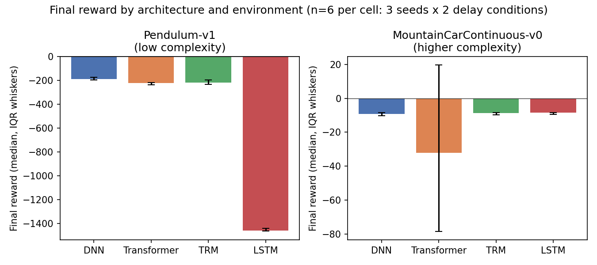
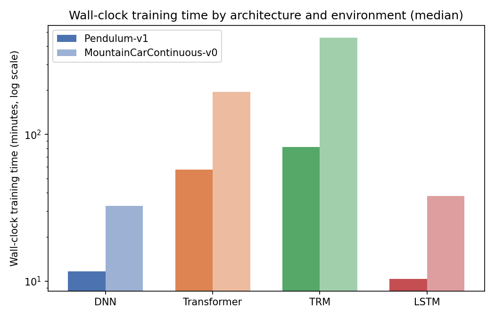
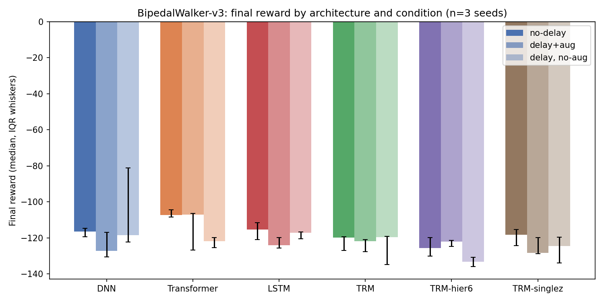
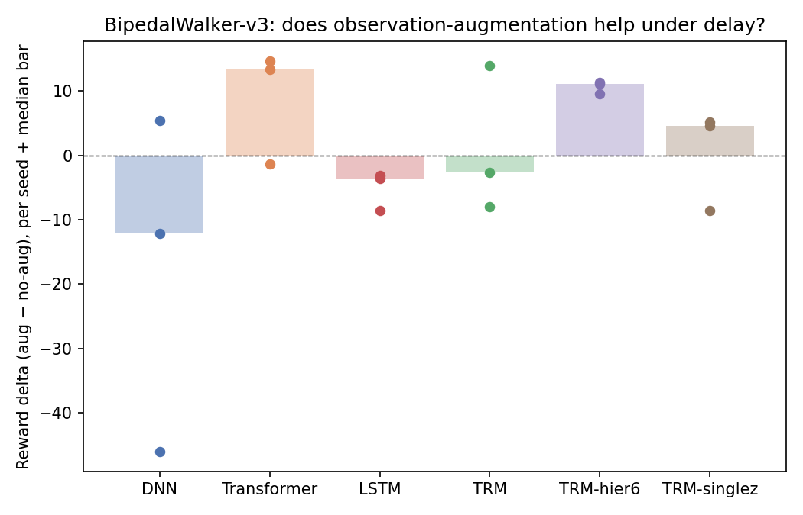
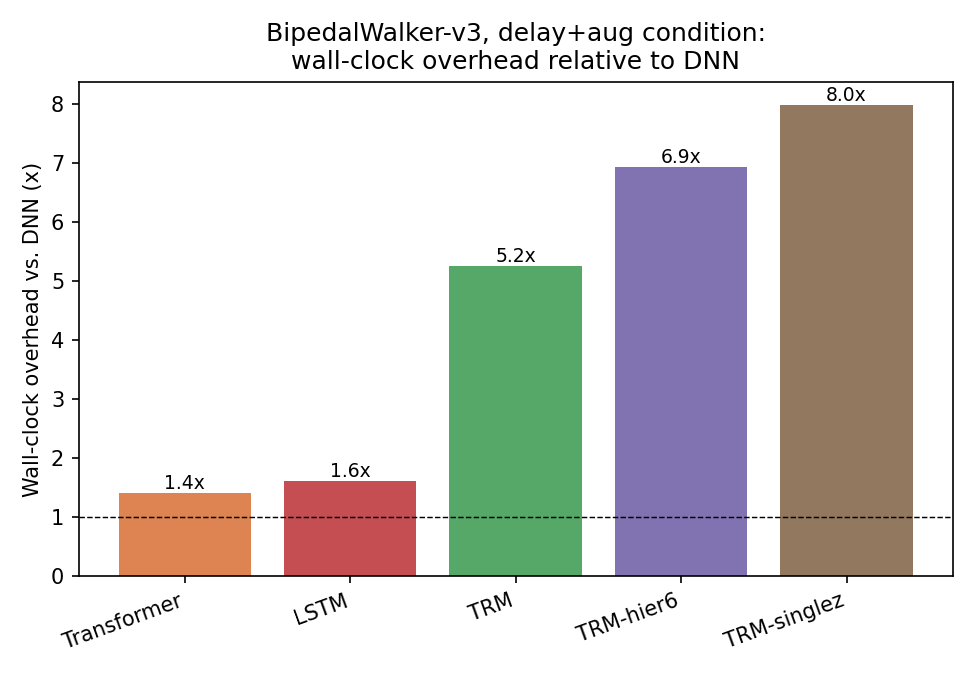
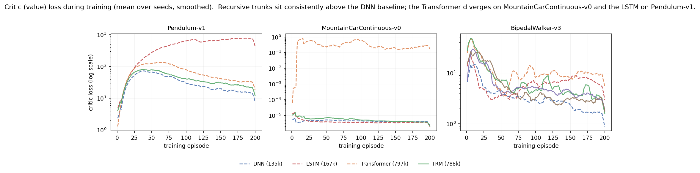
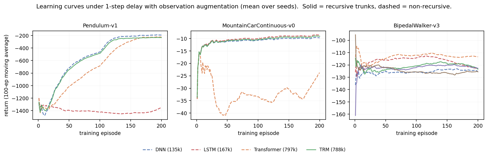
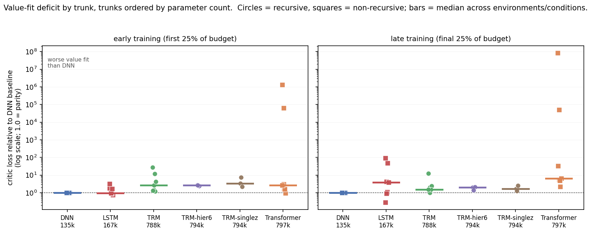

# When Does Recursive Computation Transfer? Preconditions for Porting Tiny Recursive Models to Delay-Conditioned Continuous Control

*Draft for author review. 102 training runs across three continuous-control environments, six actor–critic trunk architectures, and two delay conditions, with a mechanistic analysis of training telemetry from every run.*

## Abstract

Tiny Recursive Models (TRM) report a striking result: a 7M-parameter network, applied recursively to its own latent state and predicted answer, outperforms substantially larger models on ARC-AGI, Sudoku-Extreme and Maze-Hard (Jolicoeur-Martineau, 2025). The implied claim is architectural rather than task-specific — that iteration depth with tied weights can substitute for parameter count — and it invites extension beyond the benchmarks on which it was established.

This study asks whether the mechanism transfers to delay-conditioned continuous control under model-free actor–critic reinforcement learning. Action delay renders the raw observation non-Markovian; observation augmentation restores a sufficient statistic in principle (Katsikopoulos & Engelbrecht, 2003) but says nothing about whether a fixed-capacity approximator can *fit* the resulting value function efficiently, which makes iterative latent refinement a plausible inductive bias and this setting a fair test rather than an arbitrary one.

We compare six actor–critic trunks — a memoryless MLP, a Transformer, a stateless LSTM, and three TRM variants — across three environments (Pendulum-v1, MountainCarContinuous-v0, BipedalWalker-v3) under 0-step and 1-step delay, with an augmentation ablation, reporting reward, wall-clock time and parameter count as co-equal metrics (102 runs). **On the one environment where every trunk demonstrably learned the task, the recursive trunk was outperformed by a memoryless MLP with 5.8× fewer parameters (Pendulum-v1, 0/6 seed-pairs, one-sided sign test p = 0.016), by ≈37 reward units — roughly 3% of the span between an untrained policy and the best result observed in this study.** No comparison anywhere favoured recursion, and recursion cost 5–14× the MLP's wall-clock time throughout.

Three findings from post-hoc analysis qualify that headline and, we argue, matter more than it. First, **two of the three environments are floor effects**: the median MountainCarContinuous-v0 run never reaches the goal (−8.9 against a +90 solved threshold, reproducing a documented DDPG failure mode; Matheron et al., 2019), and no BipedalWalker-v3 run learned to walk (best −81.1 against +300). The apparent convergence to parity at higher complexity is therefore uninformative: the complexity-scaling question was never put at risk. Second, mining per-episode telemetry shows the recursive trunks fit the value function systematically worse than the MLP at matched budget (critic loss elevated in 7 of 7 cells early in training, p = 0.008, median 2.7×) at unchanged learning speed and stability — **but the similarly-sized Transformer shows the same deficit while the small LSTM does not**, so the deficit tracks capacity, a known difficulty in deep RL (Ota et al., 2021; Klein et al., 2024), rather than recursion. Third, and most consequentially, **our port re-initialises the recursive latent on every forward call**, which is precisely the weaker of the two variants isolated by HRM-Agent (Dang & Rawlinson, 2025) — independent work that trained a recursive reasoning model with reinforcement learning alone and *succeeded*, reaching ~99% success on dynamic mazes, with its stronger variant carrying the latent across environment timesteps.

We therefore report a setting-specific negative result with an identified, fixable cause rather than a verdict on recursive computation in RL. The framing is corroborated by independent analyses of TRM and HRM attributing their benchmark performance to training-time outer-loop refinement, task-identity conditioning and test-time compute rather than to deep forward-pass recursion (ARC Prize, 2025; Roye-Azar et al., 2026) — the very components a naive architectural port discards. We specify five experiments that would separate the competing explanations, of which a capacity-matched MLP and a carried-latent variant are the most urgent.

## 1. Introduction

The prevailing recipe for increasing a network's capability is to add parameters. Tiny Recursive Models challenge that recipe directly: a two-layer, weight-tied cell, applied recursively to a latent state and a candidate answer, reaches 45% on ARC-AGI-1 and 87% on Sudoku-Extreme with roughly 7M parameters, beating far larger models on those benchmarks (Jolicoeur-Martineau, 2025). The interpretation offered is that iteration depth with tied weights can substitute for parameter count on problems that reward iterative refinement.

Stated that way, the claim concerns a computational mechanism rather than a task family, which raises the question of scope: where does recursion-in-place-of-scale pay off, and where does it not? We chose delay-conditioned continuous control for a substantive reason. Action delay breaks the Markov property: the reward and next observation at time *t* were caused by an action chosen *d* steps earlier. Appending the queue of pending actions to the observation restores a sufficient statistic in principle (Katsikopoulos & Engelbrecht, 2003), but that theorem guarantees only that a sufficient statistic *exists* — not that a fixed-capacity approximator can fit the resulting value function sample-efficiently. Iterative latent refinement over the augmented observation is a plausible inductive bias for exactly that fitting problem, and closely analogous to what a state estimator does. The expectation going in was not that recursion would be irrelevant, but that it would earn its overhead once the fitting problem became hard enough — an expectation that also motivated the original design choice to compare a small MLP against a larger recursive trunk, on the assumption that the recursive trunk's capacity premium would be repaid at higher complexity.

The results did not follow that arc, and the reasons proved more interesting than the headline. Section 6 reports the reward outcomes; §6.2 then establishes that only one of the three environments constitutes a valid test at all. Section 7 investigates *why* the recursive trunk underperformed where it was validly tested, using per-episode value-loss telemetry from all 102 runs, and finds a deficit that is real, statistically consistent, and not specific to recursion. Section 8 draws the consequences — including for the parameter-count assumption the design rested on, and for a latent-initialisation choice in our port that independent work suggests was the wrong one. Section 10 specifies the experiments that would resolve what remains open.

## 2. Background

### 2.1 Delay-induced partial observability

Real control systems do not observe and act instantaneously: sensing, computation and actuation all introduce delay. In an undelayed Markov Decision Process the current observation is a sufficient statistic for predicting the next state and reward given the current action. Delay breaks this: the transition tuple `(obs, action, reward, next_obs)` a delayed learner stores is confounded, because the observed consequence was produced by an action chosen *d* steps earlier.

The standard remedy is state augmentation — append the queue of committed-but-unapplied actions to the observation, restoring the Markov property of the delayed MDP (Katsikopoulos & Engelbrecht, 2003). We treat augmentation as the established baseline conditioning method against which architectures are compared, and ablate it on the third environment. Its limitations are not incidental and are taken up in §3.3.

### 2.2 Tiny Recursive Models, and the training discipline that surrounds them

TRM replaces depth-by-parameters with depth-by-iteration: a single small shared cell recursively updates a latent state `z` conditioned on the input and the current answer, then updates the answer given the refined latent, for a fixed number of inner and outer cycles. Crucially — and this is the part most relevant to transfer — the published mechanism is embedded in a training procedure with four components that are easy to overlook when the architecture alone is ported. Reading the reference implementation:

1. **Discrete embedding and de-embedding.** Inputs are grid-cell tokens passed through a learned embedding table (`embed_tokens`); outputs are produced by a linear head back to vocabulary logits (`lm_head`). The recursion operates in a representation space built for a structured, discrete answer.
2. **Per-instance adaptive capacity.** A learned embedding is allocated *per puzzle instance* (`puzzle_emb`, a sparse embedding over puzzle identifiers), prepended to the token sequence, accumulating instance-specific information across the many gradient steps in which that instance recurs.
3. **Adaptive computation with a carried state, over a revisitable instance.** An outer wrapper holds a carry (`z_H`, `z_L`, plus step and halt flags) and re-invokes the model on *the same input* for up to `halt_max_steps` successive improvement steps, with a learned halting head deciding when to stop. The loss is applied at each such step — deep supervision along the refinement trajectory, against a fixed and known ground-truth answer.
4. **One-step gradient truncation.** Within a forward pass, all but the final outer cycle run under `no_grad`; only the last cycle is backpropagated. This keeps deep recursion affordable, and it is sound *because* component 3 supplies gradient signal at many points along the trajectory across successive supervision steps.

Components 3 and 4 are coupled. Truncating the gradient to the final cycle is a reasonable economy when deep supervision repeatedly re-enters the trajectory; it is a different proposition when the only gradient the recursion ever receives is at its endpoint. Deep supervision itself is a well-established device for exactly this purpose — attaching companion objectives to intermediate depths to shorten the path from loss to early layers and combat vanishing gradients (Lee et al., 2015) — which is precisely the function component 3 performs for TRM and which a bare architectural port removes.

## 3. Related work

### 3.1 What actually drives TRM and HRM performance

TRM simplifies the earlier Hierarchical Reasoning Model (HRM; Wang et al., 2025). Two independent analyses have since attributed the performance of these models to components other than the recursive architecture itself, and both bear directly on transferability.

The ARC Prize team's component analysis of HRM (ARC Prize, 2025) reports that the hierarchical architecture is largely immaterial — a plain transformer of equal parameter count lands within ≈5 percentage points — while **the outer refinement loop is the true driver**, worth +13pp from zero to one refinement iteration and doubling public-evaluation performance from 1 to 8 loops. Decisively for the present study, they find that *training-time* refinement depth matters far more than inference-time depth: a model trained with 16 loops but evaluated with 1 outperforms a model trained with 1 loop by more than 15pp. They further characterise HRM as "fundamentally transductive," dependent on task-specific embedding IDs, and functioning as a form of zero-pretraining test-time training that encodes task solutions in weights via gradient descent; ACT at inference contributes only a few percentage points.

A TRM-specific analysis (Roye-Azar et al., 2026) reaches a compatible conclusion by different means. A puzzle-identity ablation finds that **replacing the correct puzzle ID with a blank or random token yields zero accuracy**; test-time augmentation with 1000-sample majority voting accounts for ≈11pp of Pass@1; and a recursion-trajectory analysis finds that most of the final accuracy is attained at the *first* recursion step, with performance plateauing quickly — "shallow effective recursion." Their summary is that TRM's performance emerges from efficiency, task-specific conditioning and aggressive test-time compute "rather than deep internal reasoning."

Taken together, these analyses identify the load-bearing components as (i) outer-loop refinement *during training*, (ii) per-instance identity conditioning, and (iii) test-time compute. A port that transplants the recursive cell and its forward-pass cycles while discarding all three is, on this evidence, unlikely to reproduce the benefit — a prediction this study inadvertently tested.

Recursive computation with tied weights has a broader lineage that supplies principled alternatives to TRM's truncation: Deep Equilibrium Models solve for a fixed point and differentiate implicitly, obtaining effectively unbounded depth at constant memory without truncating the gradient (Bai et al., 2019), while Adaptive Computation Time (Graves, 2016) and PonderNet (Banino et al., 2021) learn how long to iterate. These matter for §10: TRM's one-step truncation is an economy, not a necessity, and the alternatives are directly applicable.

### 3.2 Recursive models in control and in reinforcement learning

Two papers apply TRM-style recursion to control in a model-based setting. Jain & Linares (2025) apply the recipe to nonlinear optimal-control problems, simulating a candidate control sequence forward under known dynamics and feeding the tracking error back into the shared module. Wijayatunga & Armellin (2026) apply it to the J2-perturbed Lambert problem, iteratively correcting a candidate departure velocity against a simulated trajectory under known orbital mechanics. Both recurse over a candidate answer to a fully specified problem: at every step the relevant state of the world is available and the recursion performs numerical refinement, structurally analogous to a shooting method or an MPC inner loop. Neither recursion resolves missing information, because none is missing.

**Most directly relevant to this study, HRM-Agent (Dang & Rawlinson, 2025) trains a recursive reasoning model with reinforcement learning alone**, replacing HRM's output head with a DQN head and learning end-to-end from reward with no supervised loss. On two dynamic maze tasks derived from the NetHack Learning Environment — with stochastically toggling doors and obstacles — it reaches ~99% goal-reaching success with near-optimal path lengths. Two aspects of their result are important here. First, it establishes that recursive reasoning *can* be trained by RL: our negative result cannot be read as a general incompatibility. Second, they isolate two variants of latent initialisation — "Carry Z," which initialises the recurrent state from the previous timestep's final values, and "Reset Z," which re-initialises every step — and find that the recurrent process converges faster with Carry Z, which trained faster in 4 of 5 random-maze runs, interpreting this as the model reusing computation across timesteps while a plan remains partially valid. As §5.2 records, our port implements Reset Z. Concurrent work also frames TRM-style latent reasoning in explicitly RL terms (Asadulaev et al., 2025), and applies TRM outside its original domain to tabular prediction (Sarkar et al., 2026) and test-time adaptation (Bhatt et al., 2025); we note these as evidence of active interest in the transfer question rather than relying on their specific claims.

The distinction our setting adds to HRM-Agent's is threefold: continuous rather than discrete actions, delay-induced partial observability rather than stochastic-but-observed dynamics, and an actor–critic rather than value-only learner. It also differs in the latent-initialisation choice, which we now regard as a design error rather than a neutral simplification.

### 3.3 Delay in reinforcement learning

Beyond the classical augmentation result, Ramstedt et al. (2021) study random delays and off-policy correction. Most significant as a caveat on the present frame, Derman et al. (2021) prove that under execution delay, deterministic Markov policies over the *original* state space suffice for optimality but must be **non-stationary**, that stationary Markov policies are sub-optimal in general, and that the brute-force augmentation baseline carries complexity exponential in the delay *m*; empirically, they report that approaches relying on state augmentation "struggle or fail due to divergence" relative to their non-stationary method. Our study trains stationary policies over augmented states at *m* = 1, where the exponential blow-up is not yet material, but the sub-optimality result means our conditioning method is a defensible baseline rather than a neutral choice, and §9 records this.

### 3.4 Memory architectures for partial observability

The comparison is situated against recurrent-memory approaches for POMDPs — Bakker (2007)'s recurrent policy gradients and POPGym's systematic benchmarking of memory architectures (Morad et al., 2023) — which integrate history via a persistent hidden state carried *across* time steps. TRM's recursion is instead per-decision-step refinement over the current observation. This is the depth-of-refinement versus breadth-of-memory contrast our stateless LSTM trunk was added to keep separable. Ni et al. (2022) are important for interpreting that control: they show a *carefully tuned* recurrent model-free implementation matches or beats six specialised POMDP methods on 18 of 21 environments, which means a poorly-performing recurrent baseline should be read as an artefact of tuning rather than as evidence about recurrence. Our LSTM's failure on Pendulum-v1 (§6.1) should be read in that light.

### 3.5 Capacity and optimisation in deep reinforcement learning

The mechanistic finding of §7.3 — that the two ≈790k-parameter trunks fit the value function worse than a 135k MLP at matched budget — is consistent with an established literature rather than novel. Ota et al. (2021) show that naively increasing network capacity does not improve deep-RL performance and attribute this to training instability, in explicit contrast with vision and language where scaling reliably helps; their remedy requires architectural and training changes (DenseNet connectivity, decoupled representation learning, distributed training) rather than width alone. Related phenomena appear under several names — capacity loss, implicit under-parameterisation, primacy bias and plasticity loss — surveyed by Klein et al. (2024), who note that loss of plasticity produces performance plateaus and contributes specifically to *scaling failures*; Abbas et al. (2023) document it in continual deep RL. Our result should therefore be presented as one more instance of a known effect, and as a confound in our own design, not as a discovery.

Two further methodological references bound what our statistics can claim. Henderson et al. (2018) show that learning curves from different random seeds can be non-overlapping under fixed hyperparameters, making cross-condition comparison unreliable at small seed counts. Agarwal et al. (2021) quantify the cost: point estimates from five runs per task on Atari 100k yield Type I error above 50%, and they recommend the interquartile mean over mean or median. At three seeds per cell, our third-environment comparisons sit below even that threshold, which §9 records.

### 3.6 The failure mode of our second environment

Our MountainCarContinuous-v0 result (§6.2) reproduces a documented pathology rather than revealing an architectural one. DDPG with Ornstein–Uhlenbeck exploration is known to fail on this task — returns remaining near −10 after a million steps — because the OU process resets to zero at episode start and supplies little noise exactly when exploration matters, and because a per-step action cost creates a strong local optimum of inaction; Matheron et al. (2019) analyse the resulting deadlock in deterministic sparse-reward environments, and parameter-space noise was introduced partly to address it (Plappert et al., 2018). Our median final return of −8.9 is that failure mode, and it is why the environment cannot discriminate architectures.

## 4. Hypotheses

The study is framed as a test between two accounts of TRM's reported benefit.

**H_transfer (the mechanism account).** The benefit is a property of weight-tied recursive computation itself. Prediction: a recursive trunk should match or exceed a memoryless MLP of equal or greater capacity in delay-conditioned continuous control, with relative standing non-decreasing in task complexity and delay length.

**H_precondition (the training-discipline account).** The benefit is conditional on properties that TRM's original supervised setting supplies and that our model-free actor–critic port removes:

- **P1 — refinement continuity: per-step supervision and a persistent state to refine.** TRM applies its loss at every improvement step against a known answer, re-entering the same instance repeatedly with a carried latent (§2.2, components 3–4). Our port supplies one gradient at the end of the recursion, against a bootstrapped and non-stationary target, from a latent re-initialised on every call. Both forms of continuity are broken. The literature supports each half independently: ARC Prize (2025) find training-time refinement depth dominates inference-time depth, and Dang & Rawlinson (2025) find carrying the latent across timesteps outperforms re-initialising it.
- **P2 — a structured, compositionally correctable answer object.** A 900-cell grid admits partial correctness, so recursion can repair individual cells while preserving the rest. A continuous action in ℝ¹–ℝ⁴ offers no such structure. Roye-Azar et al. (2026) report that most of TRM's accuracy arrives at the first recursion step even on grids, which suggests the exploitable refinement structure may be shallower than assumed even in-domain.
- **P3 — per-instance adaptive capacity.** The per-puzzle embedding accumulates instance-specific information across epochs; replay-buffer transitions have no analogue. This precondition is load-bearing in-domain to the point of total collapse: removing the puzzle identifier yields *zero* accuracy (Roye-Azar et al., 2026), and ARC Prize (2025) characterise the mechanism as test-time training.

Prediction under H_precondition: recursion yields no reward benefit in this setting while incurring its full compute cost, additional recursion depth is neutral-to-harmful, and restoring either form of refinement continuity should recover part of the gap.

**Discriminating observations.** The two accounts differ in what they predict beyond mean reward, which is what makes the analysis of §7 informative rather than decorative.

| Observation | H_transfer predicts | H_precondition predicts |
|---|---|---|
| Reward vs. capacity-matched MLP | ≥ parity | deficit or parity, never advantage |
| Value-fit quality at matched budget | ≈ parity | recursive trunk worse (gradient reaches only the final cycle) |
| Effect of increasing recursion depth | improves, or at worst neutral | neutral-to-harmful, cost grows linearly |
| Effect of carrying the latent across steps | little change | recovers part of the gap |
| Effect of per-cycle supervision | little change (already fine) | recovers part of the gap |

**Pre-registered statistics.** The primary reward statistic is a one-sided sign test on the sign of the per-seed reward difference, pooled across seeds and delay conditions (n = 6 per architecture pair per environment: 3 seeds × 2 delay conditions). A 5/6 or 6/6 agreement reaches p ≤ 0.0313; weaker outcomes are reported as inconclusive and explicitly distinguished from evidence of equivalence. An earlier design using a regression of reward difference on complexity rank at n = 3 was rejected before execution because its best achievable p-value was 0.125.

## 5. Method

### 5.1 Trunks

All trunks are drop-in replacements for the actor and critic feature extractor, sharing a common module interface, so the trunk is the only manipulated component.

| Trunk | Parameters (actor + critic) | Mechanism |
|---|---:|---|
| DNN [256, 256] | 134,914 | memoryless MLP baseline |
| LSTM | 166,562 | sequential recurrence within a call, stateless across steps |
| TRM (base) | 787,842 | weight-tied recursion, two latents (`z_H`, `z_L`) |
| TRM-hier6 | 787,842 | six parallel low-level latent slots |
| TRM-singlez | 787,842 | single latent, no `z_H`/`z_L` split |
| Transformer | 797,058 | per-feature self-attention |

Parameter counts sum the trainable parameters of actor and critic, excluding target networks (copies used for bootstrapping, not additional capacity). Counts are for Pendulum-v1 and shift by <2% across environments with observation dimensionality.

### 5.2 The TRM port: what is preserved, what is dropped, and one choice we got wrong

The port preserves the recursive mechanism: a single shared reasoning cell, the outer/inner (`H_cycles` = 3, `L_cycles` = 6) recursion structure, fixed non-trainable initial latent states, and the one-step gradient truncation in which the first `H_cycles − 1` outer cycles run under `no_grad`. With these settings, **14 of the 21 shared-cell applications per forward pass receive no gradient**.

Four surrounding components of §2.2 are dropped, and the *reasons* are themselves evidence about transferability rather than incidental engineering:

- **Token embedding and de-embedding** do not apply: the input is a flat continuous vector of 3–24 dimensions, not a sequence of discrete tokens over a vocabulary. The trunk uses a linear input projection with the source's embedding-scale convention; the actor/critic head plays the de-embedding role.
- **Self-attention and positional encoding** have nothing to operate on: the observation is a "sequence" of length one, so attention degenerates to a per-token projection. The recursive cell retains the channel-mixing half of each block.
- **Per-instance embeddings (P3)** have no analogue: replay transitions are not identified, recurring instances.
- **Adaptive computation with deep supervision (P1)** has no analogue under off-policy RL, which calls the trunk once per transition and does not revisit the same observation across optimiser steps: there is nothing for a halting policy to act on and no trajectory along which to supervise.

To these we must add a choice that was not forced. **The recursion is re-initialised from fixed buffers on every forward call**, so no latent state persists between consecutive environment steps. At the time this was treated as the faithful reading of TRM, whose per-call recursion genuinely starts from learned-at-init constants. But consecutive states in a control task are highly correlated, and HRM-Agent's controlled comparison of exactly this choice (Dang & Rawlinson, 2025) finds that carrying the latent across timesteps converges faster than re-initialising it. Our port therefore implements their weaker variant. We regard this as the most likely single implementation cause of the results below, and §10 gives it its own experiment.

Reduced width (hidden 128 versus 512 in the source) and the absent embedding/attention stack are why the trunks hold ≈790k rather than ≈7M parameters — a scale-appropriate adaptation to a 3–24-dimensional input, not a departure from the recursive core.

### 5.3 Environments, delay conditions, seeds

Two complexity axes were varied across three environments: *horizon and reward sparsity* (Pendulum-v1, 200-step horizon with dense per-step cost → MountainCarContinuous-v0, 999-step horizon with a single sparse terminal reward) and *dimensionality and dynamics coupling* (→ BipedalWalker-v3, 24-dimensional observation, 4-dimensional action, coupled underactuated dynamics).

Delay conditions: 0-step and 1-step fixed action delay, both with augmentation, on the first two environments; on the third, a further condition with augmentation *disabled*. Three seeds per cell. Algorithm (DDPG; Lillicrap et al., 2016), training protocol and episode budget (200 episodes) held fixed throughout. Full factorial: 4 × 2 × 2 × 3 = 48 runs plus 6 × 3 × 3 = 54 runs, for **102 independent runs**, each an independent job on a shared HPC cluster (first 48 CPU-only; the BipedalWalker set on one NVIDIA V100 each). A data-logging naming collision that silently overwrote three cells was caught during quality assurance before analysis; the affected six runs were re-executed and the corrected set verified to contain n = 3 for all 54 cells.

### 5.4 Metrics

Final reward (mean over the last 100 episodes), wall-clock training time, and parameter count, reported as co-equal metrics. Every run additionally records per-episode telemetry — return, 100-episode moving average, actor loss and critic loss — which §7 uses to analyse *how* each trunk trained rather than only where it ended.

## 6. Results: reward outcomes

### 6.1 The three environments

**Table 1. Final reward and wall-clock time by trunk and environment** (median, IQR; n = 6 per cell: 3 seeds × 2 delay conditions, pooled).

| Trunk | Params | Pendulum-v1 reward | wall-clock | MountainCarContinuous-v0 reward | wall-clock |
|---|---:|---|---:|---|---:|
| DNN | 134,914 | −188.4 [−194.0, −174.0] | 11.7 min | −9.2 [−10.2, −8.5] | 32.5 min |
| Transformer | 797,058 | −219.9 [−236.7, −218.7] | 57.7 min | −32.1 [−78.6, +19.7] | 195.3 min |
| TRM | 787,842 | −216.7 [−231.1, −196.9] | 82.0 min | −8.8 [−9.7, −8.5] | 457.3 min |
| LSTM | 166,562 | −1460.5 [−1464.8, −1442.0] | 10.3 min | −8.5 [−9.6, −8.4] | 38.0 min |

**Table 2. Primary pre-registered test** (pooled one-sided sign test, n = 6 per cell).

| Comparison | Environment | TRM wins / total | one-sided p |
|---|---|---:|---:|
| TRM − DNN | Pendulum-v1 | 0/6 | **0.0156** |
| TRM − DNN | MountainCarContinuous-v0 | 3/6 | 0.656 |
| TRM − Transformer | Pendulum-v1 | 3/6 | 0.656 |
| TRM − Transformer | MountainCarContinuous-v0 | 4/6 | 0.344 |

On Pendulum-v1 the memoryless MLP outperformed the recursive trunk in all six seed-pairs (p = 0.0156). The margin, under fixed delay with augmentation, is 37.1 reward units (−194.0 vs. −231.1). In context: an untrained policy scores around −1460 — as the failed LSTM runs incidentally demonstrate — and the best result observed anywhere in this study is −169.9, so the deficit is roughly 3% of the span between untrained and best-observed. It is statistically consistent but modest, and it is not a collapse. Against the Transformer, the recursive trunk was indistinguishable (3/6). On MountainCarContinuous-v0, no comparison approached significance.

The LSTM's failure on Pendulum-v1 (median −1460.5, matching an untrained policy, while learning normally on the other two environments) is reported for completeness but not interpreted as evidence about recurrence: per Ni et al. (2022), recurrent model-free baselines are highly tuning-sensitive and a well-configured one is competitive with specialised POMDP methods, so a single failed configuration is an artefact of our setup rather than a property of the architecture class.

### 6.2 Validity: two of three environments are floor effects

Before interpreting the harder environments as evidence of anything, it is necessary to establish whether the trunks learned the tasks at all. They largely did not, and this materially changes what the study can support.

**Table 3. Did learning occur?** Outcome against each task's own success criterion, across all 102 runs at a 200-episode budget.

| Environment | Solved threshold | Best final | Median final | Verdict |
|---|---:|---:|---:|---|
| Pendulum-v1 | ≈ −150 | −169.9 | −219.9 | **learned** (untrained ≈ −1460) |
| MountainCarContinuous-v0 | +90 | +45.6 | −8.9 | **exploration-limited, bimodal** |
| BipedalWalker-v3 | +300 | −81.1 | −120.7 | **floor effect**, no run learned to walk |

Only Pendulum-v1 produced a valid architecture comparison. On MountainCarContinuous-v0 the median run finishes at ≈ −9 — paying the action cost while never reaching the goal — with a minority of seeds solving it and consequently extreme across-seed variance (the Transformer's seed standard deviation there is 51.8 reward units). As §3.6 records, this is the documented DDPG-with-OU-noise failure mode on this task rather than an architectural signal. On BipedalWalker-v3 every run sits near the failure floor: the best final return across 54 runs is −81.1 against a +300 solved threshold, and no run finished positive; a 200-episode budget is roughly an order of magnitude short of what DDPG-class methods typically require.

The consequence cuts against our own design. **The complexity-scaling question was never put at risk.** The convergence to parity on the harder two environments is not evidence that recursion catches up as tasks get harder; it is what one observes when no architecture learns and all conditions collapse onto a shared floor. The remaining comparisons are reported for completeness but inherit this limitation.

### 6.3 Recursive-structure and augmentation ablations

Across all six TRM-variant comparisons (base vs. hier6 and vs. singlez, at each of three conditions on BipedalWalker-v3, n = 3), no comparison shows a directionally consistent pattern: the sign reverses seed-to-seed while the magnitude is often comparable to the between-trunk differences of Table 1. Within the floor-effect caveat, the specific recursive structure makes no detectable difference, while `trm_hier6` and `trm_singlez` both cost strictly more wall-clock than the base variant.

**Table 4. Augmentation on vs. off under fixed delay** (BipedalWalker-v3, paired by seed).

| Trunk | Aug better/total | Seed 1 | Seed 2 | Seed 3 | one-sided p |
|---|---:|---:|---:|---:|---:|
| DNN | 1/3 | −46.1 | +5.4 | −12.2 | 0.5 |
| Transformer | 2/3 | +13.3 | −1.3 | +14.7 | 0.5 |
| LSTM | 0/3 | −3.1 | −3.6 | −8.6 | 0.125 |
| TRM | 1/3 | +13.9 | −8.0 | −2.6 | 0.5 |
| TRM-hier6 | 3/3 | +11.1 | +9.6 | +11.3 | 0.125 |
| TRM-singlez | 2/3 | +4.6 | −8.6 | +5.2 | 0.5 |

Two trunks reach the n = 3 ceiling (p = 0.125, the strongest attainable at this sample size): TRM-hier6 benefited from augmentation in all three seeds with unusually tightly clustered magnitudes, and the LSTM was harmed in all three. Both are candidate effects meriting a powered follow-up, not findings, and both inherit the floor-effect caveat. That augmentation shows no clear benefit for any trunk here is not evidence against augmentation; it is what a floor effect looks like.

### 6.4 Compute cost

**Table 5. Wall-clock cost relative to the DNN baseline** (median, fixed delay with augmentation).

| Trunk | Pendulum-v1 | MountainCarContinuous-v0 | BipedalWalker-v3 |
|---|---:|---:|---:|
| Transformer | 4.9× | 6.0× | 1.4× |
| LSTM | ≈0.9× | 1.2× | 1.6× |
| TRM (base) | 6.7× | 12.8× | 5.2× |
| TRM-hier6 | — | — | 6.9× |
| TRM-singlez | — | — | 8.0× |

Recursion's cost is unambiguous and reproduces on every environment and both hardware configurations: the recursive trunks never cost less than ≈5× the memoryless baseline and reached ≈13×. Cross-environment comparison of the multiple is confounded by hardware, but the direction is invariant, and no measured reward benefit offsets it anywhere in the study.

## 7. Mechanistic analysis

Reward comparisons establish *that* recursion did not pay off; they do not say why. Because every run recorded per-episode actor and critic losses alongside returns, the existing 102 runs support a mechanistic analysis at no additional compute cost, discriminating an optimisation/conditioning deficit (E1) from slower learning at equal asymptote (E2), a lower asymptote (E3), and increased instability (E4).

### 7.1 Value-fit quality

The clearest signal in the study is not in the reward data. At matched episode budget, the recursive trunk fits the value function systematically worse than the memoryless MLP.

**Table 6. Critic-loss sign tests against the DNN baseline.** Each cell is one (environment, delay condition) pair; "worse" means the trunk's median critic loss exceeded the DNN's. Early = first 25% of budget, late = final 25%.

| Trunk | Params | Early: worse in | median ratio | p | Late: worse in | median ratio | p |
|---|---:|---:|---:|---:|---:|---:|---:|
| TRM | 788k | **7/7** | 2.72× | **0.008** | 6/7 | 1.56× | 0.063 |
| TRM-hier6 | 788k | 3/3 | 2.61× | 0.125 | 3/3 | 2.00× | 0.125 |
| TRM-singlez | 788k | 3/3 | 3.41× | 0.125 | 3/3 | 1.68× | 0.125 |
| Transformer | 797k | 6/7 | 2.64× | 0.063 | **7/7** | 6.51× | **0.008** |
| LSTM | 167k | 3/7 | 0.95× | 0.773 | 5/7 | 3.89× | 0.227 |

The recursive family shows elevated critic loss in every cell measured — 13 of 13 across the three variants, the base variant's 7/7 reaching p = 0.008. This is the only statistically significant *positive* detection in the study, in the sense of a consistently-signed effect rather than a failure to reject, and it supports E1: the recursive trunk is a worse value approximator *to train* here, not merely a worse performer.

Two caveats bound the effect size. On MountainCarContinuous-v0 both trunks' critic losses are of order 10⁻⁶ — the value function is nearly constant because the goal is rarely reached — so the large ratios there are ratios between negligible quantities and should not be read as meaningful. The interpretable comparisons are Pendulum-v1 (1.18× early, 1.56× late) and BipedalWalker-v3 (2.7× early, 2.0× late). Late-training ratios are additionally contaminated by divergence on specific (trunk, environment) pairs — the Transformer on MountainCarContinuous, the LSTM on Pendulum — which is why the early window is primary.

### 7.2 Learning speed and stability are unaffected

E2 and E4 are not supported. On Pendulum-v1 the recursive trunk reaches 90% of the study's per-environment performance span at essentially the same point as the MLP (median episode 117 vs. 115 under fixed delay; 105 vs. 103 undelayed), and the normalised area under its learning curve is nearly identical (0.701 vs. 0.719). It is not learning more slowly; it tracks the same trajectory to a slightly lower plateau. Across-seed standard deviation of final return shows no systematic inflation (TRM/DNN ratios across the seven cells: 0.39, 0.51, 0.70, 0.99, 1.01, 1.48, 1.84). That leaves E1 and E3 as the pattern consistent with the data.

### 7.3 The deficit is not specific to recursion

Here the analysis undercuts the most convenient interpretation. If the value-fit deficit were caused specifically by recursion — for instance by the truncation leaving 14 of 21 cell applications untrained — a similarly-sized *non-recursive* trunk should not show it. The Transformer does: 6/7 early and 7/7 late, with a *larger* median late ratio (6.51×) than the recursive trunk's (1.56×). The small LSTM shows no early deficit at all (3/7, median 0.95×).

Ordering trunks by parameter count makes the pattern legible: the four high-capacity trunks (788k–797k) all sit well above the 135k MLP's value-fit quality early in training, while the 167k LSTM sits at parity. Capacity under a fixed sample budget is therefore at least as good an explanation as recursion, and on this evidence a better one — and, per §3.5, an expected one: naive capacity scaling is known not to help in deep RL (Ota et al., 2021), with plasticity and capacity loss implicated specifically in scaling failures (Klein et al., 2024; Abbas et al., 2023).

The pattern is not a clean capacity law either: the small LSTM is catastrophically the worst trunk on Pendulum-v1, so trunk-specific optimisation pathologies exist independent of size. What the data support is narrower and firmer: **at a 200-episode budget, both ≈790k-parameter trunk families fit the value function substantially worse than a 135k MLP, and recursion is not distinguishable as the cause.**

### 7.4 Synthesis

The recursive trunk's reward deficit on the one validly-tested environment is accompanied by a consistent value-fit deficit it shares with the other high-capacity trunk, at unchanged learning speed and stability. Recursion adds computation but not sample efficiency, so it pays the high-capacity trunk's optimisation penalty without an offsetting benefit. Whether recursion *itself* carries an additional penalty — as the untrained-gradient argument of §5.2 predicts — cannot be determined here, because parameter count and recursion are confounded in the design.

## 8. Discussion

### 8.1 What this study licenses, and what it does not

It licenses: on a delay-conditioned continuous-control task where learning demonstrably occurred, a faithful-but-Reset-Z port of TRM's recursive mechanism was outperformed — consistently across seeds, modestly in magnitude — by a memoryless MLP with 5.8× fewer parameters, while costing 5–14× more wall-clock time; the specific recursive structure was immaterial; and the recursive trunk trained to a measurably worse value fit.

It does not license: any claim about recursion at higher task complexity, because the harder environments never left the floor (§6.2); any claim that recursion *per se* caused the value-fit deficit, because a similarly-sized non-recursive trunk shows the same deficit (§7.3); any claim that recursive models cannot be trained by RL, which HRM-Agent refutes directly (§3.2); or any claim against TRM's published results, which concern a different regime and are not contested here.

Nor is this the first test of recursive reasoning under RL. HRM-Agent preceded it and succeeded. What distinguishes our setting is continuous actions, delay-induced partial observability, an actor–critic learner — and, less creditably, a latent-initialisation choice that their controlled comparison identifies as the weaker option.

### 8.2 The three preconditions, graded

**P1 (refinement continuity) — best supported, and now partly external.** The port supplies one gradient at the recursion's endpoint, against a bootstrapped target, from a cold-started latent. Two independent results bear on the two halves: ARC Prize (2025) find training-time refinement depth dominates inference-time depth by >15pp, and Dang & Rawlinson (2025) find carrying the latent beats re-initialising it. The predicted consequence — a poorly-conditioned approximator visible as a worse value fit rather than slower learning — is what §7.1–7.2 observe, though the confound of §7.3 prevents attributing it to this mechanism specifically.

**P2 (structured, correctable answer) — plausible, and complicated in-domain.** A 1–4 dimensional continuous action offers no partial-correctness structure. Notably, Roye-Azar et al. (2026) find most of TRM's accuracy arrives at the first recursion step even on grids, which suggests the exploitable structure may be shallower than assumed even where it exists. Our study contains no manipulation isolating P2.

**P3 (per-instance adaptive capacity) — plausible, load-bearing in-domain, untestable here.** Removing the puzzle identifier drops TRM to zero accuracy (Roye-Azar et al., 2026), and ARC Prize (2025) characterise HRM as transductive test-time training. If a substantial share of the published benefit rests on per-instance conditioning, no architectural port to replay-based RL can carry it, and the transfer question is partly answered before any experiment is run.

### 8.3 The parameter-count assumption, and how the analysis inverted it

The original design deliberately compared a small MLP against a larger recursive trunk, reasoning that TRM's 5.8× capacity premium would be *repaid* at higher complexity, and that the natural follow-up — scaling the MLP to parameter parity — would then show recursion rather than size was responsible. That plan presupposed an advantage to attribute.

The mechanistic analysis inverts the role of the same experiment. If the value-fit deficit tracks capacity under a fixed sample budget (§7.3), the parameter mismatch is not a conservative choice handicapping the MLP; it is a confound handicapping the *recursive trunk*, and the observed deficit may be substantially an artefact of size. The capacity-matched MLP therefore changes from a confirmatory follow-up into the study's most diagnostic missing experiment:

- If a ≈790k MLP also fits value worse than the 135k MLP and loses reward accordingly, the deficit of §6.1 is largely a capacity effect, and comparing TRM against a 135k baseline was never a fair test of recursion.
- If a ≈790k MLP matches the 135k MLP, something specific to the high-capacity trunk *families* — tied-weight recursion with truncated gradients, or attention — is implicated, and the recursion-specific account survives.

Either outcome is informative, and neither is available from present data. This is the clearest instance in the study of analysis changing the experimental question rather than answering it.

### 8.4 Cost, and the practical reading

Whatever the resolution, the cost ledger is not in doubt: 5–14× wall-clock overhead on every environment and both hardware configurations, with no measured reward benefit anywhere. For a practitioner choosing a trunk for delay-conditioned continuous control at this scale today, the evidence supports the memoryless MLP. That is a narrow, budget-specific recommendation, not a claim about the architecture's ceiling.

## 9. Threats to validity

- **Episode budget (most serious).** 200 episodes suffices for Pendulum-v1 and not for the other two (§6.2). This invalidates the complexity comparison, weakens both ablations, and is the first thing a replication should change.
- **Latent re-initialisation.** Our port implements HRM-Agent's weaker "Reset Z" variant (§5.2). This is a design shortfall, not an inherent property of TRM, and it may account for much of the result.
- **Capacity confound.** Recursion and parameter count are not independently varied (§8.3).
- **Statistical power.** Primary tests pool to n = 6 (minimum achievable p ≈ 0.03); third-environment ablations are n = 3 (minimum p = 0.125). Henderson et al. (2018) and Agarwal et al. (2021) show this regime is unreliable for cross-condition comparison — Type I error above 50% at five runs per task — and recommend interquartile-mean reporting over more seeds, which a replication should adopt.
- **Stationary policies over augmented states.** Derman et al. (2021) prove stationary Markov policies are sub-optimal in general under execution delay and report divergence for augmentation-based approaches. At *m* = 1 this is a mild caveat, but our conditioning method is a defensible baseline rather than a neutral choice.
- **Single algorithm.** DDPG throughout, matching the original pilot; it is independently known to be brittle on two of our three tasks (§3.6). TD3 or SAC would raise the floor and might change which environments are valid.
- **Complexity axes are not independently manipulated.** They are realised by swapping whole environments.
- **The LSTM is a scoped control, not a tuned recurrent policy** (§6.1).
- **Effect-size framing.** The one significant reward result is ≈3% of the untrained-to-best span: consistent but small.

## 10. Experimental programme

Five experiments, ordered by diagnostic value per unit compute, each with the prediction that discriminates H_transfer from H_precondition.

**E1 — Capacity-matched MLP (highest priority).** A ≈790k MLP (widening [256, 256] to [624, 624], which gives 788,114 parameters against TRM's 787,842) against the 135k baseline and the recursive trunk on Pendulum-v1 under both delay conditions, 6 seeds; ≈24 runs, and the MLP is the cheapest trunk. *Predictions:* under a capacity explanation the large MLP degrades toward the recursive trunk; under a recursion-specific explanation it matches the small MLP, isolating the deficit to the recursive/attention families. Gates the interpretation of §6.1.

**E2 — Carried latent ("Carry Z").** Initialise `z_H`/`z_L` from the previous environment step's final values instead of the fixed buffers, per Dang & Rawlinson (2025); Pendulum-v1, both delay conditions, 6 seeds. A contained change to the trunk's forward signature plus per-environment latent bookkeeping in the agent. *Predictions:* H_precondition expects a partial recovery of the gap, since it restores one of the two forms of refinement continuity; H_transfer expects little change. This is the cheapest test of the most likely implementation cause.

**E3 — Recursion-depth sweep.** `H_cycles` ∈ {1, 3, 6} at fixed capacity on Pendulum-v1, 6 seeds — a configuration change requiring no new code. `H_cycles` = 1 removes recursion while holding parameters fixed, making it the cleanest isolation of mechanism from capacity. *Predictions:* H_transfer expects reward to improve or at least not degrade with depth; H_precondition expects reward flat-to-worse with linearly growing cost. Roye-Azar et al. (2026) observing that most accuracy arrives at the first recursion step even in-domain makes the flat outcome the more likely one.

**E4 — Extended budget on the harder environments.** Re-run MountainCarContinuous-v0 and BipedalWalker-v3 at a budget sufficient to leave the floor — the former with parameter-space noise or another exploration fix rather than more episodes alone (§3.6), the latter at ≥2000 episodes or with TD3/SAC — 3 seeds, DNN and TRM only. *Prediction:* this is the only route to an actual test of the complexity-scaling question, which currently stands untested rather than disconfirmed.

**E5 — Restoring per-cycle supervision.** Two variants: (a) backpropagate through all outer cycles, removing the one-step truncation; (b) apply the critic loss to every outer cycle's output rather than only the last — a deep-supervision surrogate in the sense of Lee et al. (2015). Deep Equilibrium Models (Bai et al., 2019) offer a third, principled route: solve for the fixed point and differentiate implicitly, avoiding truncation entirely at constant memory. *Predictions:* if any closes part of the gap, P1 is supported constructively — the mechanism transfers when its training discipline is ported with it, a more useful and more favourable conclusion for the method than a bare negative result.

E1, E2 and E3 together cost less than the original 54-job matrix and would resolve the central ambiguities of §7.4 and §8.3. They are the recommended immediate step; E5 is the most scientifically interesting and should follow.

## 11. Conclusion

We set out to test whether the parameter-efficiency benefit reported for Tiny Recursive Models survives transfer to delay-conditioned continuous control under model-free actor–critic learning. On the one environment where every trunk demonstrably learned the task, it did not: a memoryless MLP with 5.8× fewer parameters outperformed the recursive trunk in all six seed-pairs (p = 0.016) by a consistent but modest margin, the specific recursive structure was immaterial, and recursion cost 5–14× the wall-clock time throughout without a measured benefit anywhere.

Three qualifications, all from post-hoc analysis, determine what that means. Two of the three environments never left the failure floor, so the complexity-scaling question was never put at risk and stands untested rather than disconfirmed. The value-fit deficit that accompanies the reward deficit is shared by a similarly-sized non-recursive trunk and absent in a small one, so it tracks capacity — a known difficulty in deep RL — rather than recursion, and parameter count is confounded with architecture in the direction opposite to our design's assumption. And our port re-initialises the recursive latent every call, the weaker of two variants that independent work on recursive reasoning under RL has explicitly compared.

That independent work also supplies the appropriate frame. Recursive reasoning models *can* be trained by reinforcement learning alone, and do well on dynamic discrete navigation when the latent is carried across timesteps. Meanwhile, analyses of TRM and HRM in their original domain attribute their performance largely to training-time outer-loop refinement, per-instance identity conditioning and test-time compute — precisely the components an architecture-only port leaves behind, one of which collapses the model to zero accuracy when removed. Read against that literature, our result is neither a refutation of recursive computation nor a surprise: it is what one should expect when the mechanism is transplanted without the discipline that makes it work, into a regime where its answer object has no correctable structure and its capacity is a liability rather than an asset.

The honest summary is therefore specific rather than sweeping. Recursion did not pay for itself in our port, we can name three reasons and rank our confidence in each, and we can specify five experiments — two of them cheap and immediately runnable — that would separate the fixable causes from the fundamental ones. We make no claim that recursive computation is unsuited to reinforcement learning, and none against TRM's published results. What this work contributes is a measurement of where a naive port fails, why, and what it would take to do better.

## References

1. Jolicoeur-Martineau, A. (2025). *Less is More: Recursive Reasoning with Tiny Networks.* arXiv:2510.04871.
2. Wang, G., Li, J., Sun, Y., Chen, X., Liu, C., Wu, Y., Lu, M., Song, S., & Abbasi Yadkori, Y. (2025). *Hierarchical Reasoning Model.* arXiv:2506.21734.
3. ARC Prize (2025). *The Hidden Drivers of HRM's Performance on ARC-AGI.* https://arcprize.org/blog/hrm-analysis
4. Roye-Azar, A., Vargas-Naranjo, S., Ghai, D., Balamurugan, N., & Amir, R. (2026). *Tiny Recursive Models on ARC-AGI-1: Inductive Biases, Identity Conditioning, and Test-Time Compute.* arXiv:2512.11847.
5. Dang, L. H. & Rawlinson, D. (2025). *HRM-Agent: Training a recurrent reasoning model in dynamic environments using reinforcement learning.* arXiv:2510.22832.
6. Jain, A. & Linares, R. (2025). *Tiny Recursive Control: Iterative Reasoning for Efficient Optimal Control.* arXiv:2512.16824.
7. Wijayatunga, M. & Armellin, R. (2026). *Tiny Recursive Models for Solving the J2-Perturbed Lambert Problem.* arXiv:2606.00895.
8. Asadulaev, A., Banerjee, R., Karray, F., & Takac, M. (2025). *Latent Reasoning in TRMs is Secretly a Policy Improvement Operator.* arXiv:2511.16886.
9. Bai, S., Kolter, J. Z., & Koltun, V. (2019). *Deep Equilibrium Models.* NeurIPS 2019. arXiv:1909.01377.
10. Graves, A. (2016). *Adaptive Computation Time for Recurrent Neural Networks.* arXiv:1603.08983.
11. Banino, A., Balaguer, J., & Blundell, C. (2021). *PonderNet: Learning to Ponder.* ICML 2021 AutoML Workshop. arXiv:2107.05407.
12. Lee, C.-Y., Xie, S., Gallagher, P., Zhang, Z., & Tu, Z. (2015). *Deeply-Supervised Nets.* AISTATS 2015. arXiv:1409.5185.
13. Katsikopoulos, K. V. & Engelbrecht, S. E. (2003). Markov decision processes with delays and asynchronous cost collection. *IEEE Transactions on Automatic Control*, 48(4), 568–574.
14. Derman, E., Dalal, G., & Mannor, S. (2021). *Acting in Delayed Environments with Non-Stationary Markov Policies.* ICLR 2021. arXiv:2101.11992.
15. Ramstedt, S., Bouteiller, Y., Beltrame, G., Pal, C., & Binas, J. (2021). *Reinforcement Learning with Random Delays.* ICLR 2021. arXiv:2010.02966.
16. Bakker, B. (2007). Solving Deep Memory POMDPs with Recurrent Policy Gradients. *ICANN 2007*.
17. Morad, S., Kortvelesy, R., Bettini, M., Liwicki, S., & Prorok, A. (2023). *POPGym: Benchmarking Partially Observable Reinforcement Learning.* ICLR 2023. arXiv:2303.01859.
18. Ni, T., Eysenbach, B., & Salakhutdinov, R. (2022). *Recurrent Model-Free RL Can Be a Strong Baseline for Many POMDPs.* ICML 2022. arXiv:2110.05038.
19. Ota, K., Jha, D. K., & Kanezaki, A. (2021). *Training Larger Networks for Deep Reinforcement Learning.* arXiv:2102.07920.
20. Klein, T., Miklautz, L., Sidak, K., Plant, C., & Tschiatschek, S. (2024). *Plasticity Loss in Deep Reinforcement Learning: A Survey.* arXiv:2411.04832.
21. Abbas, Z., Zhao, R., Modayil, J., White, A., & Machado, M. C. (2023). *Loss of Plasticity in Continual Deep Reinforcement Learning.* CoLLAs 2023. arXiv:2303.07507.
22. Henderson, P., Islam, R., Bachman, P., Pineau, J., Precup, D., & Meger, D. (2018). *Deep Reinforcement Learning that Matters.* AAAI 2018. arXiv:1709.06560.
23. Agarwal, R., Schwarzer, M., Castro, P. S., Courville, A., & Bellemare, M. G. (2021). *Deep Reinforcement Learning at the Edge of the Statistical Precipice.* NeurIPS 2021. arXiv:2108.13264.
24. Matheron, G., Perrin, N., & Sigaud, O. (2019). *The problem with DDPG: understanding failures in deterministic environments with sparse rewards.* arXiv:1911.11679.
25. Plappert, M., Houthooft, R., Dhariwal, P., Sidor, S., Chen, R. Y., Chen, X., Asfour, T., Abbeel, P., & Andrychowicz, M. (2018). *Parameter Space Noise for Exploration.* ICLR 2018. arXiv:1706.01905.
26. Lillicrap, T. P., Hunt, J. J., Pritzel, A., Heess, N., Erez, T., Tassa, Y., Silver, D., & Wierstra, D. (2016). *Continuous control with deep reinforcement learning.* ICLR 2016. arXiv:1509.02971.
