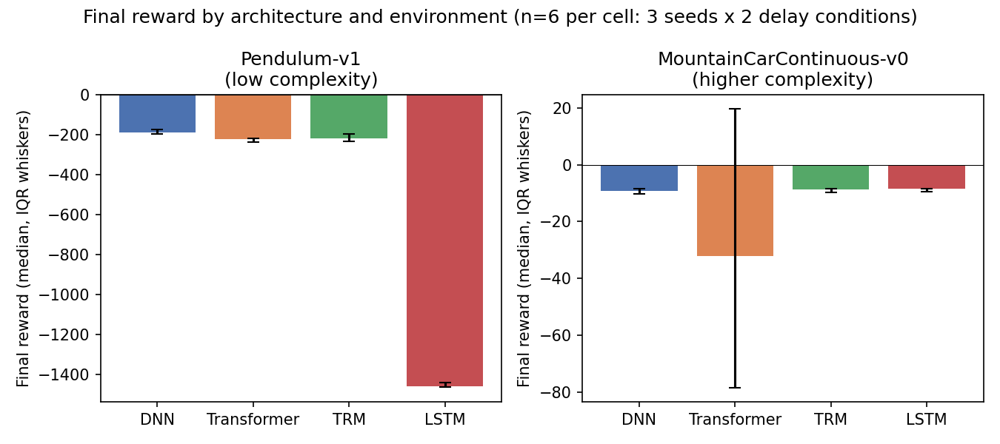
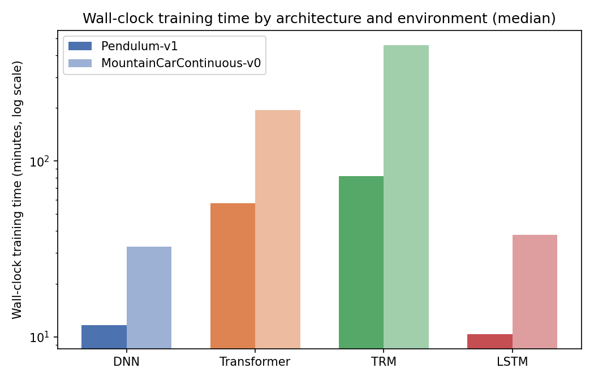
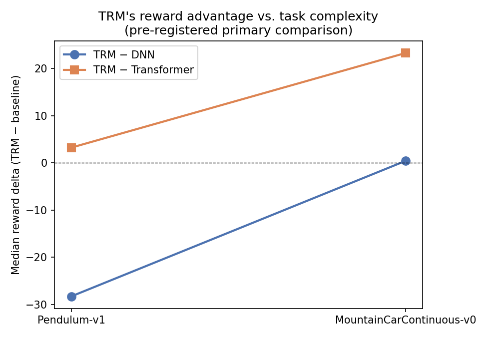
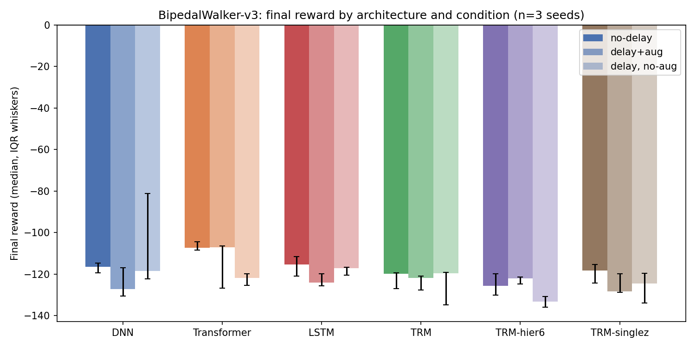
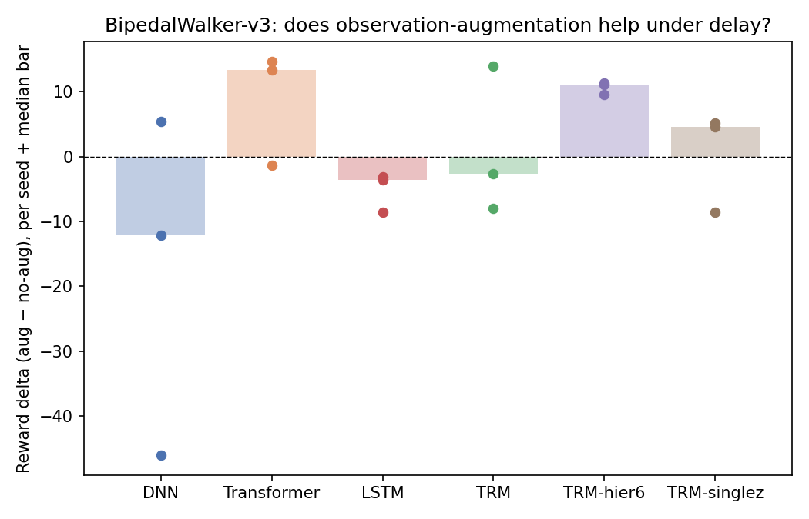
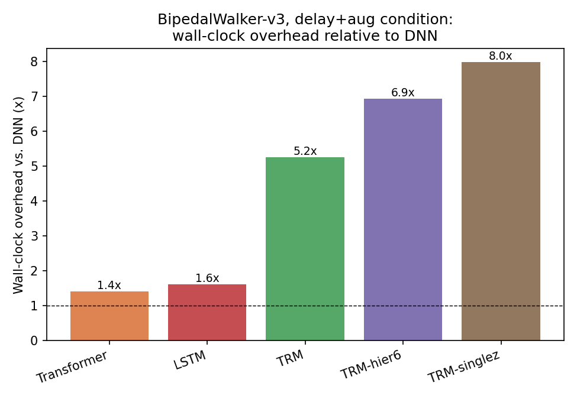
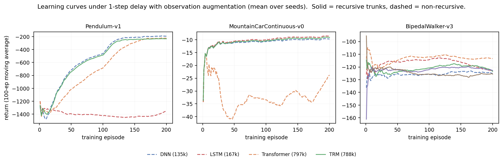
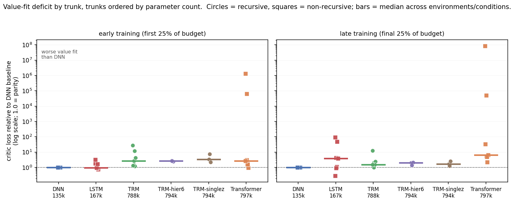
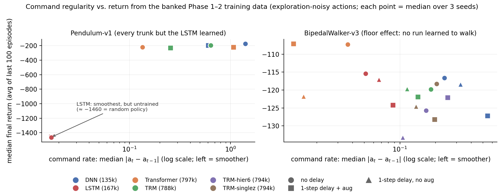
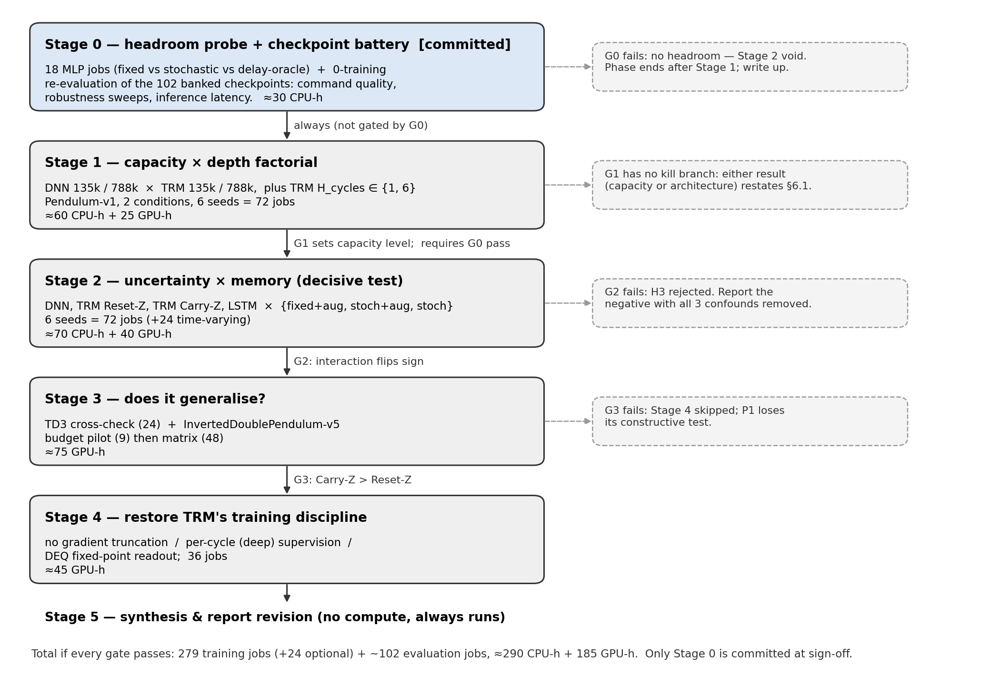

# Project Summary: Recursive Computation Under Action Delay — Phases 1–2 and the Phase 3 Plan

*`trm-delay-robust-scaling`, summary as of 2026-09-17. Sources: `papers/phase1/report.md`, `papers/phase2/report.md`, the combined report `papers/report.md` (including its post-hoc mechanistic analysis), and the Phase 3 plan `papers/phase3/plan.md`. §7 is a review of that plan against the codebase. All figures live in `papers/figures/`; figures 11–12 are new and come from `experiments/make_figures_summary.py`.*

---

## 0. The short version

- **The question.** Tiny Recursive Models (TRM) beat much larger networks on puzzle benchmarks by running one small shared cell over and over, instead of adding parameters. **Does that trade (iterations instead of parameters) still pay off when the network is the actor/critic trunk of a model-free RL agent controlling a plant with delayed actions?**
- **Phase 1** (48 runs: Pendulum-v1 and MountainCarContinuous-v0, 4 trunks, 0- and 1-step delay) tested whether TRM's disadvantage shrinks as horizon and reward sparsity grow. **TRM was significantly *worse* than a 5.8× smaller MLP on Pendulum (6/6 seed-pairs, p = 0.016).** It tied on MountainCar. The pre-registered threshold prediction was falsified.
- **Phase 2** (54 runs: BipedalWalker-v3, 6 trunks including two more TRM variants, plus an augmentation ablation) tested a second complexity axis: dimensionality and dynamics coupling. **No comparison reached significance in any direction.** TRM cost 5–8× the MLP's wall-clock.
- **Post-hoc analysis** of all 102 runs changed what the headline means. (i) Two of the three environments are **floor effects**: no architecture learned them, so "the complexity axis" was never really tested. (ii) The recursive trunks **fit the value function worse** (7/7 cells, p = 0.008), but a similarly-sized Transformer does too and a small LSTM does not. The deficit **tracks parameter count, not recursion**. (iii) The TRM port **resets its latent every forward call**, which is the weaker of two variants that independent work compared directly.
- **Phase 3** stops adding environments. It (a) removes the three confounds (capacity, latent reset, a delay condition with nothing to infer), (b) tests recursion where it *could* help, and (c) adds a control-engineering scorecard: command smoothness, robustness margins, and inference latency. Stages are gated, and only a cheap Stage 0 is committed.
- **Review verdict (§7).** The plan's diagnosis and its gated structure are strong. But **its decisive condition, stochastic delay with augmentation, turns out to contain no hidden state in this codebase.** I verified this against `DelayedEnv`: the applied action was always visible to the agent in 19,600 of 19,600 steps, and the delay is drawn fresh and independently each step. As written, Stage 0's headroom gate and Stage 2's interaction test would therefore return a null *whether or not* the Phase 3 hypothesis is true. This should be fixed before anything is submitted. §7.4 gives a concrete redesign.

---

## 1. Background: why this question, and why delay

**TRM's claim.** A roughly 7M-parameter, two-layer, weight-tied cell reaches 45% on ARC-AGI-1 and 87% on Sudoku-Extreme, beating far larger models (Jolicoeur-Martineau, 2025). The implied claim is about a *computational mechanism*: iteration depth with tied weights can substitute for parameter count. If that is true, it should matter in places other than puzzles. One such place is embedded and robotic control, where parameters, memory and latency are all scarce.

**Why action delay is a fair test.** Real controllers sense, compute and actuate with latency. Under a *d*-step action delay, what happens at time *t* was caused by the action chosen *d* steps earlier, so the raw observation is no longer Markov. The classical fix is **observation augmentation**: append the queue of actions that have been committed but not yet applied. This restores a sufficient statistic (Katsikopoulos & Engelbrecht, 2003). That theorem only says such a statistic *exists*, though, not that a small network can *fit* the resulting value function efficiently. The project's founding bet was that iterative latent refinement (something like a learned state estimator) would be a better inductive bias for that fitting problem than a single feed-forward pass.

**What gets compared.** Every trunk is a drop-in feature extractor for both actor and critic under DDPG, so the trunk is the only thing that changes:

| Trunk | Params (actor + critic, Pendulum) | Mechanism |
|---|---:|---|
| DNN [256, 256] | 134,914 | memoryless MLP baseline |
| LSTM | 166,562 | recurrence within a call, stateless across steps (a mechanistic control) |
| TRM (base) | 787,842 | weight-tied recursion, `H_cycles=3 × L_cycles=6`, two latents |
| TRM-hier6 | 787,842 | six parallel low-level latent slots (Phase 2) |
| TRM-singlez | 787,842 | a single latent, no `z_H`/`z_L` split (Phase 2) |
| Transformer | 797,058 | per-feature self-attention |

Reward, wall-clock time and parameter count are reported as **co-equal** metrics. That is a deliberate choice: a trunk that ties on reward at 10× the cost has not tied.

---

## 2. Phase 1 — Does TRM's disadvantage shrink as the horizon grows?

### 2.1 What was done

An informal pilot on Pendulum-v1 suggested that TRM, a Transformer and an MLP reached "comparable reward" under 1-step delay, with TRM costing about 18× the MLP's training time. Phase 1 did not conclude that recursion is useless. Instead it asked whether **Pendulum is simply too easy to reward extra computation**, and turned that into a falsifiable hypothesis:

> **H1:** TRM's advantage over the MLP and the Transformer is non-decreasing in task complexity. **Pre-registered threshold:** it becomes measurable once the horizon is roughly 5× Pendulum's *and* reward is sparse, which is what MountainCarContinuous-v0 provides (999 steps, one sparse terminal reward).

- **Design:** 4 trunks (DNN, Transformer, TRM, LSTM) × 2 environments × 2 delay conditions (0-step, 1-step + augmentation) × 3 seeds = **48 runs**, 200 episodes each, CPU-only on Katana.
- **Statistic:** a pooled one-sided sign test on per-seed reward differences, n = 6 per comparison (3 seeds × 2 conditions), so 5/6 or 6/6 gives p ≤ 0.031. This replaced an earlier regression design that review showed could never get below p = 0.125 at n = 3.

### 2.2 Why it mattered

It turned an anecdote ("TRM ties but is slower") into a controlled, pre-registered measurement. It also tested the most natural rescue of the pilot ("harder tasks will need the extra computation") *before* more compute went into it.

### 2.3 Findings

| Comparison | Environment | TRM wins / 6 | one-sided p |
|---|---|---:|---:|
| TRM − DNN | Pendulum-v1 | **0/6** | **0.016** (significant *deficit*) |
| TRM − DNN | MountainCarContinuous-v0 | 3/6 | 0.656 |
| TRM − Transformer | Pendulum-v1 | 3/6 | 0.656 |
| TRM − Transformer | MountainCarContinuous-v0 | 4/6 | 0.344 |

1. **The pilot was wrong about parity.** With the full replication, the MLP beat TRM in every seed-pair on Pendulum, by 37 reward units under fixed delay (−194.0 vs −231.1). That is about 3% of the gap between an untrained policy (≈ −1460) and the best run: consistent, but small.
2. **The gap closed on MountainCar and moved in the predicted direction** (median TRM−DNN went from −28.3 to +0.4; TRM−Transformer from +3.2 to +23.3), but never reached significance. The specific threshold prediction was **falsified**; the general hypothesis was left open.
3. **The cost grew with complexity:** TRM went from ~7× to ~13–14× the MLP's wall-clock. Any undetected benefit would have to outgrow a cost that was already growing.
4. The LSTM never learned Pendulum (≈ −1460, an untrained policy) but learned the other tasks normally. This was flagged as a tuning artefact rather than evidence about recurrence (Ni et al., 2022).

---

## 3. Phase 2 — A second complexity axis: dimensionality and coupling

### 3.1 What was done

Phase 1 covered one complexity axis (horizon and sparsity). Its pre-committed next step was a *different* axis, so that the two phases together could not be read as restating one test.

- **Environment:** BipedalWalker-v3 (24-D observation, 4-D action, coupled underactuated dynamics).
- **Trunks:** the four from Phase 1 plus **TRM-hier6** and **TRM-singlez**, to test whether Phase 1's result depended on TRM's *particular* recursive structure or held for recursion in general.
- **Conditions:** no delay; 1-step delay + augmentation; and **1-step delay without augmentation**, the first test of whether augmentation matters more on a harder task.
- **Scale:** 6 × 3 × 3 seeds = **54 runs**, one V100 each (`mechgpu12`). A filename collision silently overwrote three DNN cells. QA caught it before analysis, the six jobs were re-run, and all 54 cells were confirmed at n = 3.

### 3.2 Why it mattered

It was the pre-registered falsification rung. If neither axis showed a TRM advantage, the general complexity-scaling hypothesis would count as disconfirmed. It also added the first **structure ablation** (does the flavour of recursion matter?) and the first **augmentation ablation** (does the standard delay fix help at all?).

### 3.3 Findings

| Comparison (fixed + aug, n = 3) | TRM wins | per-seed Δ | one-sided p |
|---|---:|---|---:|
| TRM − DNN | 2/3 | +6.3, −10.8, +8.7 | 0.5 |
| TRM − Transformer | 0/3 | −14.4, −0.9, −14.7 | 0.125 |
| TRM − LSTM | 1/3 | −1.1, −3.5, +3.9 | 0.5 |

1. **Nothing was significant in any direction**, whether by architecture pair, TRM variant, or augmentation condition. Taken with Phase 1, the project had now covered two complexity axes on three environments **without a single significant TRM advantage**, and Phase 2 reported the general hypothesis as disconfirmed on the axes tested.
2. **The recursive structure made no detectable difference.** Base vs hier6 vs singlez deltas changed sign from seed to seed. Both variants cost *more* than the base TRM.
3. **Augmentation had no clear effect for any trunk.** Two candidate signals hit the n = 3 ceiling (p = 0.125): TRM-hier6 helped by augmentation in 3/3 seeds, LSTM hurt in 3/3. They were flagged for a powered follow-up, not reported as findings.
4. **The cost stayed high:** TRM 5.2×, hier6 6.9×, singlez 8.0× the MLP's wall-clock (on GPU).

---

## 4. Post-hoc analysis — what Phases 1–2 actually established

After Phase 2, the combined report re-analysed all 102 runs using per-episode telemetry (returns, actor loss, critic loss) that every run had already logged. No new compute was used. This step is where the project changed its understanding of its own results, and it is the reason Phase 3 looks the way it does.

### 4.1 Two of the three environments are floor effects

| Environment | Solved threshold | Best final | Median final | Verdict |
|---|---:|---:|---:|---|
| Pendulum-v1 | ≈ −150 | −169.9 | −219.9 | **learned** |
| MountainCarContinuous-v0 | +90 | +45.6 | −8.9 | exploration-limited (a known DDPG + OU-noise failure; Matheron et al., 2019) |
| BipedalWalker-v3 | +300 | −81.1 | −120.7 | **floor**: no run learned to walk |

**Why this matters:** the "gap closes as tasks get harder" pattern is exactly what you see when *no* architecture learns and every result collapses onto the same floor. The complexity-scaling question was **never put at risk**. It is untested, not disconfirmed. Pendulum is the only valid comparison in the study.

### 4.2 Recursive trunks fit the value function worse, and so does the Transformer

At the same episode budget, TRM's critic loss was higher than the MLP's in **7/7 cells early in training (median 2.72×, p = 0.008)**. Across all three TRM variants it was higher in 13/13 cells. Learning speed and stability did *not* differ: episodes to reach 90% were 117 vs 115 on Pendulum, and seed spread was not inflated. So TRM follows the same trajectory to a slightly lower plateau.

**The same deficit appears in the 797k Transformer (6/7 early, 7/7 late) and not in the 167k LSTM (3/7, 0.95×).** Sorted by parameter count, the value-fit deficit follows *size*, not recursion. This matches a known deep-RL result: naively scaling capacity does not help and can hurt (Ota et al., 2021; Klein et al., 2024).

### 4.3 The three confounds

The analysis turned three design choices into explicit confounds:

- **C-1, capacity.** Every recursive trunk has about 788k parameters and the MLP has 135k. Nothing in the design separates the two, and the evidence above currently favours capacity as the explanation.
- **C-2, latent reset.** `TRMTrunk.forward` re-initialises `z_H`/`z_L` from fixed buffers on every call, so nothing carries across control steps. HRM-Agent (Dang & Rawlinson, 2025), which trained a recursive reasoning model with RL alone *and succeeded*, found that carrying the latent ("Carry-Z") beats resetting it. **A trunk with no cross-step state cannot do state estimation**, which is the mechanism the project set out to test.
- **C-3, nothing to infer.** Under fixed 1-step delay with augmentation, the augmented observation is an exact sufficient statistic (proved and checked in `augmentation.md`). An architecture whose supposed advantage is *inferring missing state* was given a task with no missing state.

Independent analyses of TRM/HRM point the same way. Their benchmark gains come mostly from training-time outer-loop refinement, per-puzzle identity embeddings, and test-time compute (ARC Prize, 2025; Roye-Azar et al., 2026). Those are exactly the parts a bare architectural port leaves out.

### 4.4 What is and is not established after Phases 1–2

| Established | Strength |
|---|---|
| On the one environment every trunk learned, TRM loses to a 5.8× smaller MLP | 6/6, p = 0.016; ≈3% of the performance span |
| Recursion costs 5–14× the MLP's wall-clock on every environment and hardware setup | direction never varies |
| Recursive trunks fit value worse at matched budget | 7/7, p = 0.008 |
| ...but so does a same-size non-recursive trunk | the deficit tracks capacity |
| Learning speed and stability are unchanged | 117 vs 115 episodes to 90% |
| The specific recursive structure is immaterial | sign-inconsistent deltas |
| **Not established:** anything about complexity scaling, anything about recursion *per se*, anything about a TRM that carries its latent | — |

**The practical reading today:** for delay-conditioned continuous control at this scale, use the MLP. **The scientific reading:** the port tested recursion under the one condition where theory says recursion is unnecessary, and at a parameter count that is itself a handicap.

---

## 5. Phase 3 — Does recursion have anything left to infer?

### 5.1 The hypothesis

> **H3 (residual-uncertainty hypothesis).** Weight-tied recursion earns its cost in model-free control only when **(i)** the agent's input leaves state uncertainty that iteration could resolve **and (ii)** the trunk carries information across decision steps. Phases 1–2 met neither condition, so their null is what H3 *predicts*.

H3 is tested against two deflationary alternatives that the current data actually support: **H_cap** (the deficits are about capacity; recursion is irrelevant) and **H_null** (recursive refinement does not transfer to model-free continuous control under any conditions). The load-bearing prediction (H3.2) is an **interaction**, not a main effect: *Carry-Z − MLP ≤ 0 under fixed, known delay, but > 0 under uncertain delay*. A capacity story cannot flip the sign between conditions using the same networks.

### 5.2 The missing axis: would any of these be usable as a controller?

So far the project has scored trunks on return, training time and parameter count. A controls reader needs three more things, and Phase 3 adds all three as a **deployment scorecard**:

1. **Command quality:** control effort, command rate |Δu|, jerk, saturation, high-frequency power. Two controllers with equal return are not equal if one works the actuator twice as hard.
2. **Robustness envelope:** performance under test-time delay mismatch, sensor noise, plant mass/length changes, and actuator dropout. Given that the project is about delay robustness, this is the largest gap in the evidence.
3. **Real-time feasibility:** per-decision latency at batch size 1 against a 100 Hz / 500 Hz / 1 kHz control period. TRM applies its shared cell 21 times per forward pass; this has never been measured.

The plan also reports cost both ways. At **matched episodes** TRM trails by 37 reward units (≈3% of span). At **matched wall-clock** (the moment the MLP finishes) TRM is still at −488 to −1390, which is **≈58% of the span** behind.

### 5.3 A preliminary signal in the data already collected

Re-reading the logged action sequences (`analyze_control_quality.py`, no new compute) shows the non-MLP trunks issuing smoother commands than the MLP (TRM 13/15 pairs, median 0.42× the MLP's |Δa|, p = 0.004). The plan correctly treats this only as a candidate: the actions include exploration noise, a dead policy is maximally smooth, and the LSTM and Transformer are smoother than TRM. Figure 11 shows why the qualifications matter (see also §7.2, item 7).

### 5.4 The stage plan

| Stage | Question | Jobs | Cost | Gate |
|---|---|---:|---|---|
| **0** | Is there headroom for inference? What do the trained checkpoints already tell us (scorecard)? | 18 + ~102 eval | ≈30 CPU-h | **G0:** oracle-delay MLP beats augmented MLP under stochastic delay |
| **1** | Capacity or recursion? 2×2 of {MLP, TRM} × {135k, 788k}, plus `H_cycles` ∈ {1, 6} at fixed parameters | 72 | ≈60 CPU-h + 25 GPU-h | **G1:** attribution; no kill branch |
| **2** | Uncertainty × memory: {MLP, TRM Reset-Z, TRM Carry-Z, carried LSTM} × {fixed+aug, stochastic+aug, stochastic no-aug} | 72 (+24) | ≈70 CPU-h + 40 GPU-h | **G2:** interaction flips sign, else H3 rejected |
| **3** | Does it generalise? TD3 cross-check; InvertedDoublePendulum-v5 (open-loop unstable) after a budget pilot | 24 + 9 + 48 | ≈75 GPU-h | **G3:** Carry-Z > Reset-Z somewhere |
| **4** | Restore TRM's training discipline: no truncation, per-cycle supervision, DEQ readout | 36 | ≈45 GPU-h | — |
| **5** | Synthesis | 0 | — | always |

Only Stage 0 is committed at sign-off. The total if every gate passes is 279 training jobs, ≈290 CPU-h and 185 GPU-h.

### 5.5 Why Phase 3 is important

- **It is the step that makes the negative result mean something.** Right now "TRM lost" cannot be separated from "a 788k network lost to a 135k one", or from "a stateless port was asked to estimate state it was already handed". Phase 3 either finds a regime where recursion pays, or produces a negative with capacity controlled, the latent carried, real uncertainty present, and environments that actually get learned. The second outcome is a finding about recursive computation in continuous control, not about one port.
- **It is cheap to kill.** Each stage has a pre-registered gate, and the first costs about 30 CPU-hours. That is the opposite of Phases 1–2, which committed 102 jobs up front.
- **It connects the work to engineering practice.** The scorecard (smoothness, robustness margin, latency) decides whether *any* of these trunks could sit in a robot's control loop, and it holds up whichever way the scientific gates resolve.
- **It follows the literature's strongest lead.** HRM-Agent shows carried-latent recursion can be trained by RL. Stages 2 and 4 are the first tests of whether that carries over to continuous control under delay.

---

## 6. Where the project stands

| | Phase 1 | Phase 2 | Post-hoc | Phase 3 (planned) |
|---|---|---|---|---|
| Runs | 48 | 54 | 0 (re-analysis) | Stage 0: 18 + evaluation |
| Axis | horizon / sparsity | dimensionality / coupling | mechanism | uncertainty × memory × capacity; control quality |
| Headline | TRM significantly worse on Pendulum; tie on MountainCar | no significant differences; structure immaterial | floor effects; value-fit deficit tracks capacity; latent reset | — |
| Status | complete | complete | complete, in report | awaiting sign-off |

---

## 7. Review of the Phase 3 plan

*Checked against `src/delays.py`, `src/models/trm_control.py`, `src/trainer.py`, `conf/`, and `experiments/analysis_control_quality.json` on 2026-09-17.*

### 7.1 What the plan gets right

- **The diagnosis is correct and candid.** The three confounds are real, the plan restates them as design faults rather than caveats, and H3 is written so it can clearly fail ("if the interaction does not appear, H3 is dead").
- **`trm_h1` is the best single control in the project.** It turns recursion off while leaving parameters, optimiser and input identical. Growing the MLP *and* shrinking TRM into a full 2×2 is the right fix for C-1.
- **Gating is disciplined.** Kill criteria are written before any compute, only Stage 0 is committed, and "success is not a positive result" is stated up front.
- **Lessons were learned.** A budget pilot before any new environment (the cause of Phase 2's floor effect); 6 seeds minimum; IQM with bootstrap CIs; the matched-wall-clock reading.
- **The Carry-Z risk is taken seriously.** The plan sees that carrying a latent at acting time but not in replay would confound the comparison, and books real engineering time for stored-state and burn-in options.
- **Re-using the checkpoints** for the scorecard is excellent value for compute.

### 7.2 Issues

#### Critical: these would invalidate the decisive test

**1. "Stochastic delay + augmentation" contains no inferable hidden state in this codebase.** In `DelayedEnv.step`, the delay *d* is drawn **independently each step** (`StochasticDelay.sample`), and the applied action is `buf[-(d+1)]`. It is therefore always either the new action or one of the last `max_delay` committed actions, and **all of those are already in the augmented observation**. I verified this by driving the real wrapper for 19,600 post-warm-up steps: the applied action fell outside (augmented pending queue ∪ current action) **0 times**. Because future delays are independent of past ones, knowing past realised delays tells the agent nothing about the next one. The uncertainty left under C3 is **irreducible noise, not hidden state**: an MLP sees everything a perfect memory would. The `augmentation.md` caveat ("approximation") is about the *meaning* of the queue slots, not about Markov sufficiency.

Consequences:
- **H3.2 predicts *no* interaction at C3 even if H3 is true**, so G2 would fail and the plan would "reject H3" for a reason unrelated to H3.
- **The Stage 0 oracle arm is uninformative either way.** If A3 exposes the delay of the transition just completed, it adds nothing useful for the next decision and G0 fails spuriously. If it exposes the *upcoming* delay, it provides information no architecture could ever infer, so passing G0 does not show that an *inferring* trunk has headroom.

**2. Delay size is confounded with delay uncertainty.** C1 is d = 1 with one queue slot; C3 has mean delay 2, maximum 4, and four queue slots. An interaction between C1 and C3 could come from longer delay or wider input rather than uncertainty. A **fixed d = 4 + augmentation** arm (same input width as C3) or a fixed d = 2 arm (same mean delay) is needed as the matching control.

**3. The primary contrast does not separate recursion from memory.** Δ = (Carry-Z − MLP) at C3 − (Carry-Z − MLP) at C1 would be positive for *any* trunk that carries state, including a carried LSTM. If the LSTM shows the same interaction, the finding is "memory helps under latent delay", which is textbook, not "recursion helps". The pre-registered primary should be **(Carry-Z − carried LSTM)** and/or **(Carry-Z − Reset-Z)** interactions, with the MLP contrast as secondary.

#### Major

**4. The gate thresholds are looser than the project's own significance standard.** "≥5 of 6 seeds sign-consistent" is a one-sided p of 0.109, yet Phases 1–2 required p ≤ 0.031. The interaction sign test also pairs seed *k* at C1 with seed *k* at C3, which only makes sense if seeds share initialisation; state that explicitly. MLP-only arms take about 12 CPU-minutes, so **Stage 0 and the MLP arms can afford 10+ seeds** (9/10 gives p = 0.011). For the difference-of-differences, pre-register a bootstrap CI on IQMs rather than a pairwise sign test.

**5. The delay-mismatch probe cannot run as specified.** The augmented input width equals `max_delay`. A policy trained at fixed d = 1 expects exactly one queue slot. Testing at d = 0 turns augmentation off (input width 3), and d ≥ 2 needs more slots, so every off-nominal point is a **shape mismatch**. The battery has to pre-register a choice, for example keeping a 1-slot wrapper while applying the true delay (the policy is then fed *wrong* queue information, which is a legitimate but specific robustness test).

**6. Battery scope is inflated.** Of the 102 checkpoints, only the Pendulum ones (24, 3 seeds per cell, minus the untrained LSTMs) are learned policies. Command quality and robustness sweeps on the floor-effect BipedalWalker and MountainCar policies can't be interpreted. Narrow the scorecard to Pendulum, add seeds 4–6 from Stage 1 once available, and pack the evaluation into a handful of jobs instead of ~102 half-hour ones.

**7. The §5 smoothness signal is weaker than the plan presents it.** Most pooled pairs (9 of 15 for TRM, Transformer and LSTM) come from BipedalWalker, where nothing learned. On Pendulum with fixed delay + augmentation, **the Transformer is *rougher* than the MLP** (median |Δa| 1.07 vs 0.60), which contradicts "every non-MLP trunk is markedly smoother". Figure 11 shows this: on the one valid environment there is no clean ordering. The signal still deserves Stage 0.2, but the plan should present it as "mixed on Pendulum".

**8. The carried-LSTM baseline has no engineering or tuning budget.** A properly carried recurrent baseline needs the same off-policy machinery as Carry-Z (sequence replay or stored state, burn-in), plus the tuning Ni et al. (2022) show is decisive. E-2 is scoped to TRM only. Add an engineering item and a small tuning sweep, or the "honest memory baseline" will repeat the untuned LSTM of Phase 1.

**9. The Carry-Z spec is incomplete for actor–critic.** The critic also has a TRM trunk, and target networks need a carry for s′. The stored-state option has to say which carries are stored (actor, critic, both targets) and how the target's carry for s′ is obtained. That choice directly affects the bootstrapped target.

#### Minor

**10.** `delay=stochastic min=0 max=4` is **not U{0..4}**. It rounds a continuous uniform, giving P(d) = 0.125, 0.25, 0.25, 0.25, 0.125 (verified by sampling). Either document it or sample integers.

**11.** `delay=time_varying` switches on the **global training step** (0 → 1 at 10k, → 3 at 20k, → 0 at 30k). Pendulum runs 40k steps, so the avg-100 return mixes d = 3 and d = 0. That makes it a training-time distribution shift, not within-episode non-stationarity. The C5 rationale also misreads Derman et al. (2021): their sub-optimality result is about stationary policies over the *original* state under *constant* delay. Augmented-state policies are optimal there, just exponentially expensive. (Report §3.3 and §9 carry the same reading and should be corrected.)

**12.** `trm_small` (`hidden_size=44`) changes shape as well as size. The SwiGLU inner width rounds up to a multiple of 256, giving 256 on a 44-D latent (≈5.8× expansion) against 512 on 128-D (4×). Note this, or add a second small variant (e.g. `L_layers=1` at h = 128).

**13.** Stage 1 re-runs DNN and TRM seeds 1–3, which already exist. That is fine because the code has changed since Phase 1, but state that it **doubles as a reproduction check**, and put the TRM arms on the same hardware as Phase 1 (CPU), or else don't compare their wall-clock with Phase 1.

**14.** H3.5 ("recursion degrades more gracefully") has no proposed mechanism for a Reset-Z trunk. Label it exploratory.

### 7.3 Is the budget sensible?

Yes, broadly. Compute is conditional and front-loaded with cheap stages, and the GPU-hour estimates are consistent with Phase 2's measured TRM wall-clock. The main schedule risk is not compute but E-2 (Carry-Z, rated high risk) plus the missing LSTM equivalent (item 8). Together these gate Stage 2 by roughly a week of engineering.

### 7.4 Recommended amendments before sign-off

1. **Redesign the uncertainty axis so the hidden quantity can actually be inferred from history.** The cleanest option is a **per-episode latent delay**: draw d ~ U{0..4} once at reset and hold it for the whole episode, with augmentation over 4 slots. A memoryless trunk cannot know *d*; a carried trunk can identify it within a few transitions (this is system identification). The oracle arm (expose *d*) then measures exactly the headroom inference could recover, which is what G0 is meant to test. A **regime-switching (Markov-chain) delay** with long dwell times is a good second condition and a sound replacement for C5. Keep the i.i.d. stochastic condition only as a *negative control*, where H3 itself predicts no interaction.
2. **Add a fixed d = 4 + augmentation arm** to Stages 0 and 2 to separate delay size from uncertainty.
3. **Make the primary contrast (Carry-Z − carried LSTM)**, with (Carry-Z − Reset-Z) co-primary and (Carry-Z − MLP) secondary.
4. **Tighten the gates:** 10 seeds for the MLP-only arms; gates at p ≤ 0.05 or bootstrap CIs excluding zero; one pre-registered statistic per gate.
5. **Fix the battery:** pre-register how off-nominal delays are presented to fixed-width policies, and restrict the scorecard to learned (Pendulum) policies.
6. **Add E-items** for the carried-LSTM off-policy machinery and its tuning, and spell out Carry-Z carries for the critic and target networks.
7. **Correct the Derman et al. reading** and the U{0..4} description in the plan and the report.

**Bottom line.** The plan's epistemics and its structure are the strongest in the project. Stage 0.2, the checkpoint battery, can be approved now once item 5 is fixed; it answers the control-practicality questions no matter what happens next. Stage 0.1 and Stage 2 should **not** be submitted as written: under this wrapper, their "uncertain" condition is informationally equivalent to the augmented observation, so the decisive test would come back null regardless of whether H3 is true. With the per-episode latent-delay redesign, the same budget buys a test that can actually tell H3 apart from H_cap and H_null.

---

### References

Agarwal et al. (2021) *Deep RL at the Edge of the Statistical Precipice*, NeurIPS · ARC Prize (2025) *The Hidden Drivers of HRM's Performance on ARC-AGI* · Bai, Kolter & Koltun (2019) *Deep Equilibrium Models*, NeurIPS · Dang & Rawlinson (2025) *HRM-Agent*, arXiv:2510.22832 · Derman, Dalal & Mannor (2021) *Acting in Delayed Environments with Non-Stationary Markov Policies*, ICLR · Jolicoeur-Martineau (2025) *Less is More: Recursive Reasoning with Tiny Networks*, arXiv:2510.04871 · Katsikopoulos & Engelbrecht (2003) Markov decision processes with delays, *IEEE TAC* 48(4) · Klein et al. (2024) *Plasticity Loss in Deep RL: A Survey*, arXiv:2411.04832 · Matheron, Perrin & Sigaud (2019) *The problem with DDPG*, arXiv:1911.11679 · Ni, Eysenbach & Salakhutdinov (2022) *Recurrent Model-Free RL Can Be a Strong Baseline for Many POMDPs*, ICML · Ota, Jha & Kanezaki (2021) *Training Larger Networks for Deep RL*, arXiv:2102.07920 · Roye-Azar et al. (2026) *Tiny Recursive Models on ARC-AGI-1*, arXiv:2512.11847
