# Recursion Under Delay: Final Report, Phases 0–4

*trm-delay-robust-scaling · final detailed report, whole project · 2026-10-08*
*Covers every phase, from the pilot that motivated the project to the last Phase 4 job. Supersedes `phase3/report/3_final_report.md` as the project's detailed record; Phases 0–3 are carried over from it with their numbers unchanged. Figures are in `figures/`; analysis files in `../../experiments/`. Per-phase summaries, a Q&A and a glossary are in `phase_summaries/`, `qa_all_phases.md` and `glossary.md` alongside this report.*

<!-- toc -->

## Executive summary

**The question.** Tiny Recursive Models (TRM) reach state-of-the-art puzzle results with a ~7M-parameter network by applying one small weight-tied cell many times instead of adding parameters. This project asked whether that trade, iteration in place of parameters, pays off when the network is the actor and critic trunk of a model-free reinforcement-learning agent that controls a plant through delayed actions.

**The answer, after five phases, 441 training runs, 300 checkpoint evaluations and a gain analysis of 72 more checkpoints:** it does not, in the regime tested. The project can say why not in some detail, because it removed, one at a time, every explanation for the deficit that it could test: capacity, the latent reset, the absence of anything to infer, untuned learning rates, the truncated gradient and the missing per-cycle supervision. One question it set out to answer, whether TRM's standing improves with task complexity, remains untested, because no task harder than Pendulum-v1 was learned by the baseline under the conditions tried.

- **TRM trails a plain MLP on the one task every trunk learned, and the deficit is architectural.** On Pendulum-v1 under DDPG, TRM trails a 5.8× smaller MLP in 12 of 12 seed × condition pairs (median −34.4, p = 0.0005). It loses to a parameter-matched MLP at both 135k (−50.2, 0/12) and 788k (−27.1, 2/12), while growing the MLP 5.8× changes nothing (−3.8, 5/12).
- **Recursion depth is inert, and training all of it does not help.** At fixed parameters, `H_cycles` ∈ {1, 3, 6} leaves return unchanged (5/12, 4/12 against H = 3) while cost scales with depth. The port trains only 7 of 21 cell applications; backpropagating through all 21, with or without a value loss at every outer cycle, changes nothing on the pre-registered gate (GA: best contrasts 4/6, pass needs 5/6) and costs 1.45–1.5× more to train.
- **It is not an untuned learning rate.** A 3 × 3 grid of actor and critic learning rates (×0.3 to ×3 of the defaults) flags no cell (GC insensitive); the default is among the best, and raising the actor's rate hurts.
- **TRM fits its value function worse, architecturally.** Its late critic loss is 1.45× and 1.89× a parameter-matched MLP's (12/12 each); with full gradients it is still 1.35–1.45× the MLP's (6/6 at C1).
- **The deficit lives mostly in training, not in the final policy.** Evaluated deterministically, the trunks nearly tie: a residual of 3.6 reward units remains (2/12 pairs), a tenth of the training-return gap.
- **Memory does not help.** Carrying the latent across steps changes nothing (G3 fails at every condition). Where memory has something to recover (hiding the action queue costs the MLP 71 units, 6/6), no trunk recovers it; the pre-registered interaction has the wrong sign (1/6). A latent per-episode delay gives the same answer.
- **Under a second algorithm the recursive trunk is fragile.** Under TD3 as configured, both MLPs reproduce their DDPG results in every run, but TRM 788k fails to train in 10 of 12 runs (its critic loss rises through training) and TRM 136k trails the MLP by three times its DDPG deficit. The capacity contrast passes its gate on sign (GT, 12/12), but by optimisation failure; the Phase 3 magnitude was not replicated.
- **As a controller, TRM is a trade, and a poor one here.** Its greedy torque is much smoother (0.4 against 9 direction reversals per second, 11/12 pairs), and its actor has a lower local gain, yet it is less robust to sensor noise, a heavier plant and actuator dropout, and the lower gain does not explain the noise sensitivity. It costs 65× the MLP's decision latency on one CPU thread and 11–13× its training time on the same GPU.
- **Complexity scaling (H1) is untested.** MountainCarContinuous-v0 and BipedalWalker-v3 (Phases 1–2) were floor effects; InvertedDoublePendulum-v5 and Hopper-v5 (Phase 4) were not learned by the MLP baseline under TD3 with a one-step delay at up to 1M and 500k steps. On IDP the delay, not the budget, is the obstacle: without it the same learner reaches the bar.

**Status of the hypotheses.** H3, the residual-uncertainty hypothesis, is rejected (G2, G3, G2s). The capacity account H_cap is rejected (G1). The two explanations Phase 4 tested, an untuned learning rate and the missing training discipline, are not supported (GC, GA). What remains is H_null restricted to this setting: weight-tied recursion, ported into an off-policy actor-critic without per-pass error feedback, does not transfer to delayed model-free continuous control on the tasks tested. H1 is untested. **The practical recommendation is firm: use the MLP.** If a recursive trunk is required anyway, use one outer cycle: the same return at a third of the latency.

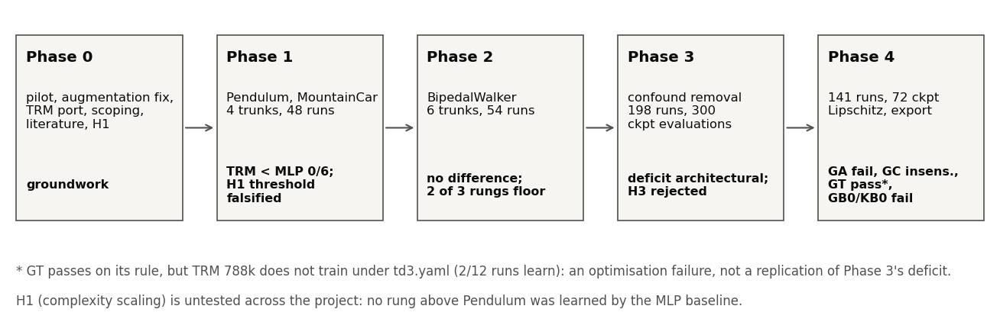

---

## 1. Research question and hypotheses

### 1.1 The research question

> **Does weight-tied recursion (TRM), used as the actor-critic trunk of a model-free RL agent, benefit continuous control under action delay — and if not, why not?**

"Benefit" was measured on three axes reported side by side throughout: return (final avg-100 training return as the pre-registered primary metric, deterministic evaluation as secondary), cost (training wall-clock and per-decision latency), and, from Phase 3, control quality (smoothness and robustness of the greedy policy). The comparison is always against a plain MLP trunk trained by the same algorithm with the same inputs.

### 1.2 The hypotheses tested

| Hypothesis | Introduced | Test: stage, gate, rule | Outcome |
|---|---|---|---|
| **H1** TRM's advantage is non-decreasing in task complexity | Phase 1 | Phase 1 primary test: pooled sign test, n = 6, significant at ≥ 5/6 | threshold falsified (3/6 on MountainCar, p = 0.66); general H1 **untested** |
| **H1′** TRM's normalised deficit shrinks on a learned harder rung | Phase 4 | Stage B1 (after GB0): ≥ 5/6 seed pairs | **not run** (GB0, KB0 fail; K-3) |
| **H_precondition (P1)** refinement continuity is needed: per-step supervision and a persistent latent | Phases 1–2 post hoc | G3 (carried latent); GA (full gradient, deep supervision) | **not supported**; P2, P3 untested |
| **H3** recursion pays only with residual uncertainty *and* a carried latent | Phase 3 | Stage 2, G2: interaction ≥ 5/6 at C3 or C4; G2s | **rejected** (3/6, 1/6; G2s stands) |
| **H_cap** the deficit tracks parameter count | Phase 3 | Stage 1, G1: "different" = ≥ 10/12 | **rejected**; not rescued under TD3 |
| **H_null** no transfer under any conditioning | Phase 3 | the account left if G2 fails | **stands, restricted to the setting** |
| **H_A** restoring the training discipline improves TRM | Phase 4 | Stage A, GA: any of 4 contrasts ≥ 5/6 | **not supported** (GA fail) |
| **H_C** the deficit reflects untuned learning rates | Phase 4 | Stage C, GC: Δ > pooled SD in 3/3 seeds | **not supported** (GC insensitive) |
| **H_T** G1's attribution holds under TD3 | Phase 4 (T-1) | Stage T, GT: ≥ 10/12 negative | **pass** (12/12) by optimisation failure |
| Stage E: local gain explains smoothness and noise sensitivity | Phase 4 | exploratory, no gate | **no** for noise sensitivity |

The sub-claims of H3 (`phase3/plan/plan.md` §2.1):

| Sub-claim | Test | Outcome |
|---|---|---|
| H3.1 the deficit is a capacity artefact | Stage 1, G1 | **rejected**: TRM worse at both sizes (0/12, 2/12); MLP capacity inert (5/12) |
| H3.2 uncertainty × memory interaction | Stage 2, G2 | **rejected** |
| H3.3 depth pays only when there is something to infer | Stage 1 depth arms | flat where tested (5/12, 4/12); the stochastic-delay half **not tested** |
| H3.4 recursion trades return for command regularity | Stage 0 battery (G4); full battery | **supported**: 0.4 vs 9 reversals/s, 11/12, p = 0.006 |
| H3.5 recursion degrades more gracefully off-nominal | battery | **contradicted**: worse under noise (2/12 favourable, p = 0.039), heavier plant, dropout |
| H3.6 recursion is real-time feasible | latency benchmark | **quantified**: 4.13 ms p99 (242 Hz): 100 Hz yes, 500 Hz no |

*Sources: gate rules and outcomes from `phase3/plan/plan.md` §2.1 and §4.7, the Phase 3 final report's Appendix A, and `experiments/phase4/gates.json`.*

**H1, complexity scaling (Phase 1).** *Origin:* the pilot found "comparable reward" on Pendulum-v1 at 18× the training time, and the natural reading was that Pendulum was too easy to need iterative refinement. *Prediction:* TRM's advantage over the MLP and Transformer is non-decreasing in complexity, and becomes measurable once the horizon is about 5× Pendulum's and reward is sparse (MountainCarContinuous-v0). *Test and rule:* a pooled one-sided sign test over 3 seeds × 2 delay conditions (n = 6), significant at ≥ 5/6 (p ≤ 0.031); Phase 2 added BipedalWalker-v3 as a second axis. *Outcome:* the threshold prediction was falsified (TRM − MLP 3/6 on MountainCar, p = 0.66). The post-hoc analysis then showed MountainCar and BipedalWalker were floor effects, so the general hypothesis was never put at risk.

**H1′, complexity scaling restated (Phase 4).** *Origin:* to test H1 on a rung the baseline actually learns. *Prediction:* the normalised deficit δ_E(s) = [final_MLP135k(s) − final_TRM788k(s)] / span_E is smaller on the new rung than on Pendulum. *Test and rule:* Stage B1 after pilot gate GB0 (MLP learned, final avg-100 ≥ 90% of the registered threshold, in ≥ 2/3 seeds); H1′ supported only if δ_new < δ_Pendulum in ≥ 5/6 seed pairs. *Outcome:* not run. GB0 failed on InvertedDoublePendulum-v5 and the fallback KB0 on Hopper-v5; the author decided not to run B1 (K-3). H1 remains untested for the whole project.

**H_precondition, refinement continuity (Phases 1–2 post hoc).** *Origin:* the Phase 1–2 report's reading of what TRM's success depends on in its own domain: P1, refinement continuity (supervision at every refinement step and a persistent latent to refine); P2, a structured, correctable answer; P3, per-instance adaptive capacity. *Prediction:* restoring either half of P1 should recover part of the gap. *Tests:* the carried latent (Phase 3 Carry-Z, G3: Carry-Z beats the resetting TRM in ≥ 5/6 seeds at some condition) and the training discipline (Phase 4 GA). *Outcome:* neither recovers anything. P2 and P3 had no manipulation in any phase.

**H3, residual uncertainty × memory (Phase 3).** *Origin:* the Phase 1–2 post-hoc analysis found three confounds that could each explain the Phase 1 deficit (capacity; a latent reset at every step; a task in which the augmented observation already contains everything, so there is nothing to infer). H3 was the account under which recursion would still earn its cost once those were fixed: only where the input leaves residual uncertainty *and* the trunk carries information across steps. *Prediction (H3.2, load-bearing):* an interaction, [Carry-Z − MLP] ≤ 0 under a fixed known delay but > 0 under a stochastic delay; a capacity story cannot flip that sign with identical networks. *Test and rule:* Stage 2, G2: the interaction contrast relative to C1 positive in ≥ 5/6 seeds at C3 or C4 (co-primary); failure rejects H3. A supplementary latent per-episode delay test (G2s) was added after G2 with its rule fixed before its data. *Outcome:* rejected. The interaction is +20.4 (3/6) at C3 and −40.0 (1/6) at C4, the wrong sign at the condition with memory headroom; G3 fails; G2s's rejection stands. The sub-claims: H3.1 and H3.3 are covered in the next paragraphs and the table; H3.4 (smoother actuation at matched return) is supported at n = 12; H3.5 (graceful degradation) is contradicted; H3.6 (real-time feasibility) is quantified at 4.13 ms per decision (p99, one CPU thread), enough for 100 Hz but not 500 Hz. Phase 4's Stage E adds that the smoothness (H3.4) coincides with lower local gain, while the poor robustness (H3.5) is not explained by gain.

**H_cap, capacity (Phase 3).** *Origin:* in Phases 1–2 the ~790k-parameter Transformer showed the same value-fit deficit as TRM while the 167k LSTM did not, so the post-hoc analysis attributed the deficit to capacity. *Prediction:* the deficit tracks parameter count: a small TRM should match a small MLP, and a large MLP should degrade toward the large TRM. *Test and rule:* Stage 1's 2 × 2 of {MLP, TRM} × {135k, 788k}, G1, n = 12 (seed, condition) pairs, "different" = ≥ 10/12 share a sign. *Outcome:* rejected. TRM loses at both sizes and MLP capacity changes nothing. Under TD3 (Stage T) the larger MLP is slightly *worse* than the smaller (−2.73, 10/12 negative): the opposite of what H_cap needs.

**H_null, no transfer (Phase 3).** *Origin:* the deflationary account H3 was tested against: recursive refinement is a property of supervised, revisitable, correctable problems and does not transfer to model-free continuous control under any conditioning. *Prediction:* TRM ≤ MLP everywhere, cost always net negative. *Test:* it is the account left standing if G2 fails and capacity is excluded. *Outcome:* it stands, restricted to what was tested: Pendulum-v1, DDPG and TD3 as configured, delays of up to four steps, 200-episode budgets.

**H_A, training discipline (Phase 4).** *Origin:* Phases 1–3 named the missing training discipline (one-step gradient truncation; supervision only of the final readout) as the remaining open explanation. *Prediction:* backpropagating through all 21 cell applications, or additionally supervising every outer cycle's value readout, should improve TRM over the truncated port. *Test and rule:* Stage A, GA: any of {full grad, full grad + deep supervision} × {C1, C4} positive against the truncated port in ≥ 5/6 seeds. *Outcome:* not supported (3/6, 4/6, 3/6, 4/6).

**H_C, untuned learning rates (Phase 4).** *Origin:* every TRM run used DDPG defaults never tuned for the recursive trunk. *Prediction:* some cell of a ×0.3–×3 actor × critic learning-rate grid beats the default. *Test and rule:* Stage C, GC: a cell is flagged if its per-seed difference from the default exceeds the pooled seed SD in all 3 seeds. *Outcome:* not supported; no cell flagged.

**H_T, algorithm generality (Phase 4).** *Origin:* every contrast in Phases 1–3 used DDPG. *Prediction:* G1's attribution holds under TD3: TRM 788k − MLP 788k < 0. *Test and rule:* Stage T, GT: negative in ≥ 10/12 (seed, condition) pairs. *Outcome:* pass, 12/12, with a recorded caveat: TRM 788k does not train under `td3.yaml` (2/12 runs learn), so the pass reflects optimisation failure, not a Phase-3-sized deficit.

**The Stage E question (Phase 4, exploratory).** *Origin:* Phase 3 found TRM smoother but less robust to sensor noise. A low local gain would explain the first and predict the opposite of the second. *Test:* the actor's local Lipschitz constant at visited states, rank-correlated with reversals and noise drop; no gate. *Outcome:* TRM's gain is lower, its noise drop larger; gain does not explain the noise sensitivity.

### 1.3 How the answers add up

The research question has two parts, and the hypotheses answer them in turn.

**Does TRM benefit delayed continuous control?** No, on every task that was learned. On Pendulum-v1 TRM trails the MLP without delay and under a fixed delay, under DDPG and under TD3, and it never beats the MLP on a pre-registered contrast. The two places where a TRM median sits above the MLP's are not wins for recursion: at C3 the resetting TRM beats the MLP in 5/6 seeds, which coincides with the MLP's degradation from a redundant previous-action input and which a trunk without memory cannot owe to inference (§9.5, exploratory); under the latent per-episode delay the MLP's median is pulled down by two collapsed seeds (§9.6). TRM's final greedy policy comes close to the MLP's but not level, and the one property in which it is better, smoother torque, comes with worse robustness, 65× the latency and 11–13× the training cost.

**Why not?** Each tested explanation for the deficit was removed in turn:

- not capacity (H_cap and H3.1 rejected; G1);
- not the latent reset (G3) and not the absence of anything to infer (H3 rejected; G0 established memory headroom, G2 and G2s found no trunk exploiting it);
- not untuned learning rates (H_C; GC);
- not the gradient truncation or the missing per-cycle value supervision (H_A; GA).

What remains is a positive description. The recursive cell behaves like a feed-forward block that is harder to optimise: its value fit is worse at every capacity and with full gradients, its extra depth is inert whether trained or not, and under a more aggressive optimiser configuration it fails outright. The likely reason, offered as interpretation rather than result (§11), is that in this port each pass of the recursion re-reads the same observation with no new information and no per-pass error signal, so iteration has nothing to refine. In TRM's own domain and in model-based control (Tiny Recursive Control), each pass is anchored to a fixed answer or to the error of the current candidate under known dynamics.

**What the hypotheses leave open.** H1 is untested: no rung above Pendulum was learned by the baseline, so the project cannot say whether TRM's relative standing changes with complexity. P2 and P3 of H_precondition had no manipulation. The answer is therefore bounded: no benefit, for the identified reasons, on the tasks and algorithms tested.


---

## 2. Background and scope

### 2.1 Tiny Recursive Models and the claim at stake

TRM (Jolicoeur-Martineau, 2025) replaces depth-by-parameters with depth-by-iteration. A two-layer shared cell recursively refines a latent state conditioned on the input and a candidate answer, then refines the answer, for a fixed number of inner (`L_cycles`) and outer (`H_cycles`) cycles. With about 7M parameters it reaches 45% on ARC-AGI-1 and 87% on Sudoku-Extreme, beating far larger models. The implied claim concerns a *mechanism*, not a task family: iteration with tied weights can substitute for parameter count on problems that reward iterative refinement. If that is true it should matter elsewhere, and embedded or robotic control, where parameters, memory and latency are all scarce, is a natural place to look.

### 2.2 Why action delay is a fair test

Real controllers sense, compute and actuate with latency. Under a *d*-step action delay, the reward and next observation at time *t* are produced by the action chosen *d* steps earlier, so the raw observation stops being Markov and every stored transition is confounded. The classical fix is observation augmentation: append the queue of committed-but-unapplied actions, which restores a sufficient statistic (Katsikopoulos & Engelbrecht, 2003). That theorem guarantees only that a sufficient statistic *exists*, not that a small network can *fit* the resulting value function sample-efficiently. Iterative latent refinement, something like a learned state estimator, was a plausible inductive bias for exactly that fitting problem. That was the project's founding bet.

### 2.3 Scope and boundaries

The project brief (`project-config.yaml`) fixed four boundaries that held throughout:

- **Simulation first.** Embedded deployment was out of scope until Phase 4's Stage D, which only exported weights for an on-device test the author runs.
- **Augmentation is the baseline**, not something to re-derive.
- **Cost is a first-class metric.** Wall-clock time and parameter count are reported alongside reward on every comparison.
- **A rigorous negative result is a valid outcome.** The project was not to bias toward a positive result.

The mandatory positioning against prior TRM-for-control work also held. Jain & Linares (2025) and Wijayatunga & Armellin (2026) both use TRM *model-based*, refining a control sequence or a trajectory against known dynamics. This project instead tests recursion as an implicit memory or state-estimation mechanism for delay-induced partial observability in *model-free* RL. HRM-Agent (Dang & Rawlinson, 2025), found during the literature review, is the closest precedent: a recursive reasoning model trained by RL alone that succeeded on discrete mazes, and whose stronger variant carries its latent across timesteps. The author's framing for the final phase is kept here: the goal is to assess whether TRM's architecture works as a model-free RL trunk, not to redesign it.

---

## 3. Methodology

This section sets out the methods common to all phases, then what each phase added or changed. The per-phase sections that follow (§4–§10) report results and discuss them.

### 3.1 Common elements

**The delay wrapper and augmentation.** `DelayedEnv` (`src/delays.py`) holds each committed action in a queue and applies it *d* steps later. With `augment_obs=true` the pending queue is appended to the observation; for a fixed delay this restores an exact sufficient statistic (verified in Phase 0, §3.2). With `prev_action_obs=true` the previously committed action is also appended (Phase 3 amendment A-6). Perturbations for evaluation (`src/perturb.py`) act below the delay wrapper.

**Delay conditions.** The labels were fixed in Phase 3 and are used throughout this report:

| Label | Delay | Queue in observation | Used in |
|---|---|---|---|
| C0 | none | — | Phases 1–4 |
| C1 | fixed d = 1 | yes (1 slot) | Phases 1–4 (Phase 1's "1-step delay with augmentation") |
| C2 | fixed d = 1 | no | Phase 2 augmentation ablation |
| C3 | d ~ U{0..4}, resampled every step | yes (4 slots) | Phase 3 Stage 2 |
| C4 | d ~ U{0..4}, resampled every step | no | Phase 3 Stages 0 and 2; Phase 4 Stage A |
| C5 | time-varying schedule | — | planned as optional in Phase 3; never run |
| C6 | d ~ U{0..4}, drawn once per episode and held | yes (4 slots) | Phase 3 supplementary latent-delay test |

Phase 3 Stage 0 also used oracle variants (the realised delay appended), and Phase 3 Stage 2, the latent-delay test and Phase 4 Stage A append the previous action.

**Trunks.** Every trunk is a drop-in feature extractor for the actor and the critic with the same interface (`instantiate(model_cfg, in_dim=...)`), so the trunk is the only manipulated component.

| Trunk (config) | Structure |
|---|---|
| MLP 135k (`dnn`) | `[256, 256]`, ReLU |
| MLP 788k (`dnn_large`) | `[624, 624]`, ReLU (Phase 3 onward) |
| Transformer (`transformer`) | hidden 128, 4 heads, 2 layers, FFN ×4, per-feature tokens, CLS pooling (Phases 1–2) |
| LSTM (`lstm`) | hidden 128, token width 32, run over the observation's slots within one call; stateless across steps (Phases 1–2) |
| LSTM carried (`lstm_carry`) | hidden 128, embedding 128, hidden state carried across steps with stored-state replay (Phase 3) |
| TRM 788k (`trm`) | one SwiGLU/RMSNorm reasoning cell (2 layers, expansion 4, hidden 128), latents `z_H`, `z_L`, `H_cycles = 3`, `L_cycles = 6`: 21 cell applications per call, one-step gradient truncation (7 trained); latent re-initialised every call ("Reset-Z") |
| TRM 136k (`trm_small`) | as `trm` with hidden 44 (Phase 3 onward) |
| TRM H = 1, H = 6 (`trm_h1`, `trm_h6`) | as `trm` with 1 or 6 outer cycles: 7 or 42 applications, 7 trained in each case (Phase 3 onward) |
| TRM-hier6, TRM-singlez | six parallel low-level latent slots; a single latent (Phase 2) |
| TRM Carry-Z (`trm_carryz`) | as `trm`, latent carried across steps with stored-state replay (Phase 3) |
| TRM full grad, + deep sup. (`trm_fullgrad`, `trm_fullgrad_ds`) | as `trm` without truncation (21 trained); plus a critic readout and loss at every outer cycle (Phase 4) |

**Parameter-count basis.** Every count in this report sums the trainable parameters of all networks the agent trains, excluding target networks, as written to each run's `param_count` (`src/trainer.py::_count_params`). Under DDPG that is actor + one critic; under TD3, actor + twin critics. The labels "135k", "136k" and "788k" always name the DDPG-basis configurations; under TD3 the "788k" TRM agent holds about 1.18M parameters. Counts shift slightly with the observation width.

| Configuration | Pendulum C1 (DDPG) | Other counts |
|---|---:|---|
| MLP 135k | 134,914 | 134,402 at C0; 135,426 / 136,962 / 134,914 at C1 / C3 / C4 with previous action; 202,499 under TD3 at C1; 146,693–148,741 on BipedalWalker; 207,107 on IDP (TD3) |
| MLP 788k | 788,114 | 786,866 at C0; 1,182,483 under TD3 at C1 |
| TRM 136k | 135,654 | 135,566 at C0; 203,503 under TD3 at C1 |
| TRM 788k, H = 1, H = 6, full grad, + DS | 787,842 | 787,586 at C0; 788,098 / 788,866 / 787,842 at C1 / C3 / C4 with previous action (also Carry-Z); 1,181,827 under TD3 at C1; 793,733–794,757 on BipedalWalker; 1,184,131 on IDP (TD3) |
| Transformer | 797,058 | 813,957–817,029 on BipedalWalker |
| LSTM (stateless) | 166,562 | 168,325–168,581 on BipedalWalker |
| LSTM carried | — | 266,114 / 266,882 / 265,858 at C1 / C3 / C4 with previous action (Phase 3 Stage 2) |

*Sources: Phases 1–2 from the Phase 1–2 report (`phase2/report-phases1-2/report.md`, Table 1 and §5.1) and the Phase 2 report; Phase 3 from `param_count` in `phase3/results/results_p3s1` and `results_p3s2`; Phase 4 from `phase4/report/figures/derived_numbers.json`.*

**Algorithms.** DDPG was used in Phases 1–3 and in Phase 4's Stages A and C; TD3 in Phase 4's Stages B0 and T. Both configurations were last changed on 2026-07-31, before Phase 1 (git history of `conf/arch/`), so every phase used the same settings.

| Setting | DDPG (`conf/arch/ddpg.yaml`) | TD3 (`conf/arch/td3.yaml`) |
|---|---|---|
| Actor / critic learning rate | 1e-4 / 1e-3 | 1e-3 / 1e-3 |
| Batch size | 128 | 256 |
| Random-action warmup | 1000 steps | 10,000 steps |
| Exploration | Ornstein–Uhlenbeck, θ = 0.15, σ = 0.2, dt = 0.01 | Gaussian, 0.1 of the action range |
| Critics; actor update | one; every step | twin (minimum for targets); every 2 critic steps |
| Target-policy smoothing | — | noise 0.2, clipped at 0.5 |
| γ, τ, replay buffer | 0.99, 0.005, 200,000 | 0.99, 0.005, 200,000 |
| Updates | one per env step, from the point the buffer holds one batch | same |

**Metrics.**

- *Primary, every phase:* final avg-100 *training* return, the mean return of the last 100 training episodes, exploration noise included.
- *Deterministic evaluation:* one noise-free evaluation episode every 10 training episodes; "eval last-5" is the mean of the last five.
- *Critic-loss windows:* Phases 1–2 post hoc used the median critic loss over the first and last 25% of the budget ("early", "late"). Phases 3–4 use the median over the last quarter of episodes with updates ("late"); ratios between arms are computed per seed and summarised by their median.
- *Evaluation battery (Phase 3, reused in Phase 4):* every checkpoint is rebuilt from its results file and run for 20 deterministic episodes on unseen seeds (nominal), plus 10-episode grids for delay mismatch (d = 0…5, trained queue width kept), sensor noise (σ = 0.01–0.10 of the observation half-range), pendulum mass and length (0.7–1.3×) and actuator dropout (5%, 10%). Returns are summarised by the interquartile mean (IQM) with stratified bootstrap 95% CIs (Agarwal et al., 2021). Control quality: command rate |Δu|, torque direction reversals per second.
- *Cost:* wall-clock per run, compared within a GPU model from Phase 3 onward; per-decision latency at batch 1 on one CPU thread.

**Statistics.** Arms are paired by seed (and by condition where conditions are pooled). The sign test counts k of n positive paired differences, with the binomial tail as p: one-sided where a rule has a direction, two-sided reported alongside. The thresholds the design can reach: at n = 3 the best one-sided p is 0.125; at n = 6, 5/6 gives one-sided 0.109 and 6/6 gives 0.016; at pooled n = 12, 10/12 gives two-sided 0.039 and 12/12 gives 0.0005. Where a rule has a magnitude condition, the pooled seed SD of two arms is the square root of the mean of their seed variances. Phase 1 pooled seeds over two delay conditions (n = 6); Phase 2 could not (n = 3); Phase 3 used n = 6 per condition and pooled n = 12 where both Stage 1 conditions entered a contrast; Phase 4 used n = 3 (pilots, LR grid), 6 (Stage A) and 12 (Stage T).

**Compute.** All training ran as PBS batch jobs on UNSW Katana, never on the login node: CPU-only in Phase 1, one GPU per job from Phase 2 on.

### 3.2 Phase 0: groundwork

- **Environment.** Pendulum-v1 (3-D observation, 1-D torque, 200-step episodes, dense cost), the pilot's task.
- **Algorithm.** DDPG; trunks MLP, Transformer and TRM.
- **Delay.** One-step fixed delay, first without and then with the queue in the observation.
- **Verification.** The augmentation fix was verified exact for fixed delays: all five delay values, ten steps each, zero mismatches against a recorded action sequence (`augmentation.md`). An audit of the delay strategies (`delay-verification.md`) found and fixed a bug in `StochasticDelay`: unclipped samples above `max_delay` silently fell back to random actions for the rest of the episode.
- **The TRM port** (`src/models/trm_control.py`) is described in §4.2.
- **Pre-registration.** The project was scoped as a gated research epic; the hypothesis stage ran three rounds of review and fixed H1 with its threshold prediction and power statement before Phase 1 (`phase0-literature/ideation/proposal-final.json`).

### 3.3 Phase 1: horizon and sparsity

- **Environments.** Pendulum-v1 and MountainCarContinuous-v0 (2-D observation, 999-step horizon, one sparse terminal reward), chosen because H1's threshold prediction named a horizon about 5× Pendulum's with sparse reward.
- **Algorithm.** DDPG (`ddpg.yaml`), matching the pilot.
- **Trunks.** MLP, Transformer, TRM (787,842 parameters on Pendulum), and an LSTM added as a mechanistic control for depth-of-refinement against breadth-of-memory (stateless across steps, so it dropped into the training loop unchanged).
- **Conditions, seeds, budget.** C0 and C1; 3 seeds; 200 episodes. 4 × 2 × 2 × 3 = 48 runs.
- **Statistics.** Pooled one-sided sign test, n = 6 per architecture pair per environment; 5/6 or 6/6 reaches p ≤ 0.031. Page's trend test as a corroborating statistic; a regression on complexity rank kept only as descriptive, because an earlier design using it as the primary statistic at n = 3 could not reach the threshold (best p = 0.125).
- **Compute.** CPU-only PBS jobs. The matrix was submitted three times: v1 lost 8 TRM/Transformer MountainCar jobs to walltime, v2 added per-episode logging, and v3 added step-level history and is canonical (`phase1/results/`).

### 3.4 Phase 2: dimensionality and coupling

- **Environment.** BipedalWalker-v3 (24-D observation, 4-D action, coupled underactuated dynamics, up to 1600 steps), chosen to vary dimensionality and dynamics coupling rather than horizon.
- **Trunks.** The Phase 1 four plus TRM-hier6 and TRM-singlez, added at the author's request to test whether the specific recursive structure matters.
- **Conditions, seeds, budget.** C0, C1 and C2 (the augmentation ablation); 3 seeds; 200 episodes; 6 × 3 × 3 = 54 runs.
- **Statistics.** Per-cell sign tests at n = 3 (best one-sided p = 0.125), so no comparison could reach significance; the report said so.
- **Compute.** One V100 per job (`mechgpu12`); measured GPU utilisation 31–38%, about the same for every trunk.
- **Quality assurance.** A filename collision silently overwrote three MLP cells; it was caught before analysis and six jobs were rerun.
- **Post-hoc analysis.** Per-episode telemetry from all 102 Phase 1–2 runs was re-analysed with no new compute: learning against each task's solved threshold, critic-loss sign tests over (environment, condition) cells (n = 7, early and late windows), learning speed (episodes to 90% of the span) and seed spread.

### 3.5 Phase 3: confound removal

- **Environment.** Pendulum-v1 only: the one task every trunk learned, so every contrast is interpretable.
- **Algorithm.** DDPG. TD3 support for the carried trunks was built but not used (its stage was gated on G2).
- **Trunks.** MLP 135k and 788k; TRM 136k and 788k; TRM H = 1 and H = 6 at identical parameters; Carry-Z and a carried LSTM, both trained with stored-state replay.
- **Conditions.** Stage 0: four MLP arms (C1; C3; C3 with the realised delay exposed as an oracle; C4). Stage 1: C0 and C1. Stage 2: C1, C3 and C4, with the previous action for every trunk (A-6). Supplementary: C6, with and without an oracle showing the episode's delay.
- **Seeds and budget.** Seeds 1–6, 200 episodes; 198 training runs (24 + 72 + 72 + 30).
- **Evaluation.** The battery (§3.1) over the 102 banked Phase 1–2 checkpoints and all 198 Phase 3 checkpoints; a latency benchmark (batch 1 and batch 256, one CPU thread of a Xeon Gold 6342 and an A100, plus full update cost).
- **Statistics and gates.** G0 (headroom: oracle or memory headroom with median above the pooled seed SD and ≥ 5/6), G1 (n = 12, "different" = ≥ 10/12), G2 (interaction ≥ 5/6 at C3 or C4), G3 (Carry-Z beats Reset-Z in ≥ 5/6 at some condition), G4 (practicality), G2s (supplementary). Rules are in Appendix A.
- **Pre-registration.** The plan (`phase3/plan/plan.md`, 2026-09-14) fixed every gate before its data; six amendments were recorded before submission (§8.4); each stage ran from a frozen code snapshot (`p3code/<stage>`), with a job ledger and a live run board.
- **Verification.** `DelayedEnv` extensions bit-identical to the old wrapper on all 20 existing delay × augmentation configurations; stored-state replay reproduces the behaviour policy's actions and carries with zero error; every rebuilt checkpoint's parameter count equals the recorded one (300 of 300); stateless agent paths identical to the old code; warmup actions seeded from the run seed (they were unseeded in Phases 1–2).
- **Compute.** GPU nodes (V100, A100, L40S, H100), 231 jobs. Jobs of ≤ 2 h route to `mechgpu2`, which reaches every GPU node; one node type was excluded (`gpu_rp6000=False`) after five jobs crashed on it.

### 3.6 Phase 4: complexity rung, training discipline, tuning, algorithm

- **Environments.** InvertedDoublePendulum-v5 (open-loop unstable with a short time constant, so delay consumes stability margin; reference 9100 from the Gymnasium 1.3.0 registry, learned ≥ 8190), Hopper-v5 as the kill-switch fallback (reference 3800, learned ≥ 3420), and Pendulum-v1 for Stages A, C and T.
- **Algorithms.** TD3 (`td3.yaml` unchanged) for B0, B0h, B0d and T; DDPG for A and C.
- **Trunks.** MLP 135k for the pilots (plus 15k-step TRM and TRM H = 1 timing runs); TRM 788k for C; TRM-trunc, TRM-fullgrad and TRM-fullgrad + deep supervision for A, with the MLP reused from Phase 3 Stage 2 (amendment R-1); MLP 135k and 788k, TRM 136k and 788k for T.
- **Conditions.** C1 without previous action (B0, C, T); C0 (T, and the IDP diagnostic); C1 and C4 with previous action (A).
- **Seeds and budgets.** Seeds 1–3 for the pilots and C, 1–6 for A and T. Env-step budgets of 150k, 300k and 500k for the pilots, 1M and 500k for the diagnostic; 200 episodes elsewhere. 141 training runs.
- **Gradient clipping (Stage A only).** Per-network `clip_grad_norm_` at actor 15 and critic 2800, the 99th percentiles of the truncated TRM's pre-clip norms in a four-run pilot (amendment A-1).
- **Exploratory and engineering stages.** Stage E computed the actor's local Lipschitz constant on the 72 Phase 3 Stage 1 checkpoints; Stage D exported three actors to C headers.
- **Statistics and gates.** GB0, KB0 (≥ 2/3 learned), GC (per-seed magnitude rule, 3/3), GA (≥ 5/6), GT (≥ 10/12), H1′ (≥ 5/6). Rules in Appendix A.
- **Pre-registration.** Plan frozen 2026-10-06 (`phase4/plan/plan.md`); rules machine-readable in `experiments/phase4/gates.json`; eight dated amendments, each before the data it affects; frozen snapshots `p4code/<stage>`.
- **Verification (V-1).** A gradient-hook test (7/21 cell applications receive gradient truncated, 21/21 with `full_grad`; 7/7 at H = 1; 7/42 against 42/42 at H = 6); 30 of 30 existing configurations bit-identical between the pre-Phase-4 snapshot and the Phase 4 tree; the new paths checked (clip = inf reproduces unclipped runs exactly; `total_steps` stops at budget); a GPU smoke job.
- **Compute.** 154 PBS jobs, each with one GPU, two CPU cores, 8 or 16 GB, walltime 01:59:00 (`mechgpu2`). Training runs landed on V100 (56), L40S (53) and A100 (32) GPUs.


---

## 4. Phase 0 — Groundwork (before 2026-09-08)

### 4.1 The pilot and the augmentation fix

The project began from an informal pilot on Pendulum-v1 in this repository. With DDPG, an MLP trunk converged under a 1-step fixed action delay while TRM and Transformer trunks did not. Tracing it (`augmentation.md`) showed the cause was not the trunks. `DelayedEnv` delayed the action correctly but never told the agent which of its recent actions was about to land, so the replay buffer paired each reward with an action that had no causal role in it. Appending the pending-action queue to the observation fixed it, and the fix was verified exact for fixed delays: all five delay values, ten steps each, zero mismatches against a recorded action sequence. A separate audit of the delay strategies (`delay-verification.md`) found and fixed a bug in `StochasticDelay`: unclipped samples above `max_delay` silently fell back to random actions for the rest of the episode.

With augmentation in place, the pilot reported "comparable reward" for MLP, Transformer and TRM on Pendulum-v1, with TRM costing about 18× the MLP's training time (55 min vs 3 min per 200 episodes). The project was framed around that observation. Phase 1 later showed the "comparable" part did not survive a controlled replication.

### 4.2 The TRM port

The recursive trunk (`src/models/trm_control.py`, documented in `notes.md`) ports TRM's mechanism into the same drop-in contract every trunk uses. It keeps:

- the single shared SwiGLU/RMSNorm reasoning cell;
- the two-latent (`z_H`, `z_L`) recursion with `H_cycles = 3`, `L_cycles = 6`;
- fixed initial latent buffers;
- the one-step gradient truncation, in which all but the final outer cycle run under `no_grad`.

It drops what has no analogue for a flat continuous observation: token embeddings, self-attention over a length-one sequence, per-puzzle embeddings, and ACT halting with deep supervision. Two properties of the port matter for everything that follows:

- **Only 7 of the 21 cell applications per forward pass receive gradient** (confirmed directly by Phase 4's gradient-hook test).
- **The latent is re-initialised on every call**, so nothing persists between control steps.

The second was later identified as the weaker of HRM-Agent's two variants ("Reset-Z"), and Phase 3 tested the stronger one. The first is what Phase 4 Stage A removed.

### 4.3 Scoping, literature review, hypothesis and planning (2026-09-07 to 09-08)

The project was then run as a gated research epic (`epics/trm-delay-robust-scaling/`) in autonomous mode.

- **Scoping** confirmed that the algorithms (DDPG, TD3, SAC, PPO), the trunks and the augmentation fix already existed and were testable, and that Katana PBS access worked.
- **Literature review** (`phase0-literature/literature-review/review.md`) engaged the two mandatory model-based papers and the broader delayed-MDP, POMDP-memory and weight-tied-recursion literature. It stated the model-free versus model-based distinction in a dedicated section.
- **Hypothesis ideation** ran three rounds with two reviewers and hit its round cap. Significance stayed at 3 of 5 because the claim rested on one sparse-reward environment and a low-power test. The project escalated, was unblocked by the author ("keep going"), and carried the limitation into the report rather than hiding it. The resulting hypothesis was H1 (§1.2).
- **Experiment planning** added an LSTM trunk (stateless across calls, a mechanistic control), a MountainCarContinuous config, and a first-class results writer. It also replaced a regression design, whose best achievable p at n = 3 was 0.125, with a pooled sign test at n = 6.

### 4.4 Discussion

Phase 0's result is methodological, and it shaped everything after it. Without the queue in the observation, the comparison would have measured the delay bug rather than the trunks: the pilot's original "TRM and Transformer fail, MLP converges" was an artefact of a non-Markov training signal that the MLP happened to tolerate. Without a pre-registered statistic, the project would have carried forward the pilot's "comparable reward", an anecdote from one seed that Phase 1 overturned. The port's two properties (7 of 21 applications trained; latent reset every call) were faithful to TRM's per-call recursion as published but became, in turn, the subjects of Phase 3's Carry-Z test and Phase 4's Stage A.

---

## 5. Phase 1 — Horizon and sparsity (48 runs)

**Hypothesis H1.** TRM's advantage over the MLP and Transformer is non-decreasing in task complexity. The pre-registered threshold was that the advantage becomes measurable once the horizon is about 5× Pendulum's and reward is sparse, which MountainCarContinuous-v0 provides (999 steps, one sparse terminal reward).

**Design.** 4 trunks (MLP, Transformer, TRM, LSTM) × 2 environments × 2 delay conditions (C0; C1) × 3 seeds = 48 runs, 200 episodes each, CPU only on Katana (§3.3).

| Comparison | Environment | TRM wins / 6 | one-sided p |
|---|---|---:|---:|
| TRM − MLP | Pendulum-v1 | **0/6** | **0.016** (a significant *deficit*) |
| TRM − MLP | MountainCarContinuous-v0 | 3/6 | 0.656 |
| TRM − Transformer | Pendulum-v1 | 3/6 | 0.656 |
| TRM − Transformer | MountainCarContinuous-v0 | 4/6 | 0.344 |

*Source: `experiments/analysis_v3_final.json`, as reported in the Phase 3 final report §3.*

**Findings.**
1. **The pilot's parity claim did not survive.** The MLP beat TRM in every seed-pair on Pendulum, by 37.1 reward units under fixed delay (−194.0 vs −231.1): about 3% of the span between an untrained policy (≈ −1460) and the best run.
2. **H1's threshold prediction was falsified.** The gap closed on MountainCar in the predicted direction but never approached significance.
3. **TRM's cost grew with complexity**, from 6.7× to 12.8× the MLP's wall-clock.
4. **The LSTM failed on Pendulum** (≈ −1460, an untrained policy) while learning the other tasks, and was flagged as a tuning artefact (Ni et al., 2022).

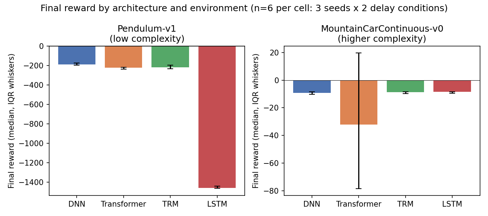

### 5.1 Discussion

**What the numbers show.** On Pendulum the result is a consistent, modest deficit: every one of six seed pairs favoured the MLP, by about 3% of the performance span. On MountainCar nothing separated. TRM cost 6.7–12.8× the MLP's wall-clock.

**How robust.** 0/6 is the strongest outcome a pooled n = 6 design can produce (one-sided p = 0.016). It replicated in Phase 3 on new code, new hardware and seeded warmup: −34.4 at n = 12 (0/12) against Phase 1's −32.8 at n = 6, with the MLP's medians matching too (§9.4). The MountainCar tie is not robust in the sense that matters: the post-hoc analysis (§7) found the median run never reaches the goal.

**Competing explanations for the Pendulum deficit**, as they stood after Phase 1: (a) recursion itself; (b) capacity, since TRM held 5.8× the MLP's parameters and larger networks are known to train worse in deep RL at fixed budget; (c) the latent reset; (d) a task with nothing for recursion to infer. Phase 1 could not separate them; Phase 3 removed (b)–(d) and Phase 4 removed two training-side explanations.

**How it constrains the hypotheses.** The pilot's parity was falsified, and so was H1's specific threshold. The general H1 remained formally open, because the MountainCar trend moved in the predicted direction (median TRM − MLP from −28.3 to +0.4 in the Phase 1 report), but that movement later proved to be the convergence of all trunks onto a shared floor.

**What it does not show.** It does not show that TRM catches up as tasks get harder: on a task nobody learns, every trunk ties. Nor does it attribute the Pendulum deficit to recursion.

---

## 6. Phase 2 — Dimensionality and coupling (54 runs)

**Design.** Phase 2 tested a second complexity axis on BipedalWalker-v3 (24-D observation, 4-D action, coupled underactuated dynamics). At the author's request it added two ablations: a **recursive-structure ablation** (TRM-hier6 with six parallel latent slots, and TRM-singlez with one latent) and an **augmentation ablation** (fixed delay with the queue removed, C2). The matrix was 6 trunks × 3 conditions × 3 seeds = 54 runs, one V100 each. A filename collision silently overwrote three MLP cells. It was caught before analysis, and six jobs were re-run.

**Findings.**
1. **No comparison reached significance in any direction** (TRM − MLP 2/3, TRM − Transformer 0/3, TRM − LSTM 1/3).
2. **The recursive structure made no detectable difference.** Deltas between base, hier6 and singlez reversed sign from seed to seed, and both variants cost more than the base.
3. **Augmentation had no clear effect for any trunk.** Two candidates reached the n = 3 ceiling (p = 0.125): TRM-hier6 helped in 3/3 seeds, LSTM hurt in 3/3.
4. **Cost** was TRM 5.2×, hier6 6.9× and singlez 8.0× the MLP's wall-clock on GPU.

*Source: `experiments/analysis_phase2_final.json`, as reported in the Phase 3 final report §4.*

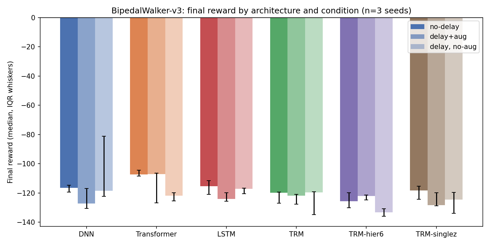

### 6.1 Discussion

**What the numbers show.** Nothing separated, in any direction, on any of three kinds of comparison (between trunks, between recursive variants, with and without augmentation). Cost again exceeded 5× for every recursive variant.

**How robust.** Not at all, by design: at n = 3 the best achievable one-sided p is 0.125, so no comparison could have reached significance whatever the effect, and the Phase 2 report said so. The two 3/3 augmentation results are the most internally consistent signals in the dataset, but they are candidates, not findings.

**Competing explanations for the null.** (a) No real difference between trunks at this complexity; (b) no trunk learned the task, so all comparisons collapse onto a floor. The post-hoc analysis (§7) settled it for (b): no BipedalWalker run learned to walk (best −81.1 against a solved threshold of +300).

**How it constrains the hypotheses.** Weakly. The recursive-structure ablation hints that the particular recursion (two latents, six slots, one latent) does not matter, but on a floor-effect task even that is uninformative. Phase 2 did not test H1, because its rung was never learned.

**What it does not show.** That complexity leaves TRM's standing unchanged, or that augmentation is useless: at a floor, neither question is put at risk.

---

## 7. Post-hoc analysis of Phases 1–2

Re-analysis of the per-episode telemetry every run had logged, with no new compute, changed what Phases 1–2 meant.

1. **Two of three environments are floor effects.** Pendulum-v1 was learned: the best final return was −169.9 against a solved threshold of about −150. MountainCarContinuous-v0 was exploration-limited and bimodal: median −8.9 against a solved threshold of +90, the documented DDPG + OU-noise failure (Matheron et al., 2019). No BipedalWalker-v3 run learned to walk (best −81.1 against +300). The complexity-scaling question was therefore never put at risk: it is *untested*, not disconfirmed.
2. **The recursive trunks fit the value function worse.** TRM's critic loss was higher than the MLP's in 7/7 cells early in training (median 2.72×, p = 0.008), at unchanged learning speed (117 vs 115 episodes to 90% of span).
3. **The deficit looked like capacity.** The 797k Transformer showed it too (6/7 early, 7/7 late) and the 167k LSTM did not, so the analysis attributed it to capacity rather than recursion. Phase 3 overturned this attribution (§9.4).
4. **Three confounds were identified:**
   - **C-1, capacity:** every recursive trunk held about 788k parameters against the MLP's 135k.
   - **C-2, latent reset:** the port re-initialises its latent every call, HRM-Agent's weaker variant.
   - **C-3, nothing to infer:** under fixed d = 1 with augmentation the observation is an exact sufficient statistic.

The report was rewritten after author review rejected the first draft. The rejection cited a weak hypothesis, unfair narration, no mechanism, and an unexamined parameter confound. The literature review was then integrated, bringing the report to 26 sources. That integration retracted the novelty claim, because HRM-Agent precedes this work, and identified the latent-reset choice as the most likely single implementation cause. The rewritten report also framed the question as H_transfer against H_precondition (§1.2), with three preconditions for TRM's in-domain success (refinement continuity, a structured correctable answer, per-instance adaptive capacity) that an architecture-only port leaves behind.

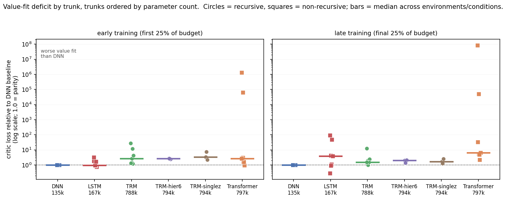

### 7.1 Discussion

**What the numbers show.** The one validly tested environment shows a consistent reward deficit accompanied by a consistent value-fit deficit, at unchanged learning speed and stability (seed-SD ratios TRM/MLP across the seven cells ranged from 0.39 to 1.84 in the Phase 1–2 report, with no systematic inflation). TRM tracks the same learning trajectory to a slightly lower plateau.

**How robust.** The 7/7 early critic-loss result (p = 0.008) was the only significant positive detection in Phases 1–2. Its effect size is bounded: on MountainCar both trunks' critic losses are of order 1e-6, so the large ratios there are ratios between negligible quantities; the interpretable cells are Pendulum (1.18× early, 1.56× late) and BipedalWalker (2.7× early, 2.0× late) (Phase 1–2 report §7.1).

**Competing explanations for the value-fit deficit.** (a) Recursion, through the untrained cell applications; (b) capacity, since the equally large Transformer shared the deficit. At the time (b) looked stronger. Phase 3 Stage 1 reversed this: at matched capacity TRM still fits worse (1.45×, 1.89×), while a 5.8× larger MLP fits slightly better, so the Transformer's deficit was the Transformer's own.

**How it constrains the hypotheses.** It reframed the project from "does TRM catch up at higher complexity" (untestable on these rungs) to "is the Pendulum deficit about recursion at all", and it produced the three confounds Phase 3 was designed to remove.

**What it does not show.** Any claim about complexity scaling; any causal attribution of the deficit, which needed the capacity-matched design of Phase 3.


---

## 8. Phase 3 — Design, engineering and execution

### 8.1 Hypothesis and alternatives

> **H3 — residual-uncertainty hypothesis.** Weight-tied recursion earns its cost in model-free continuous control only where **(i)** the agent's conditioning leaves residual state uncertainty that iteration could resolve, **and (ii)** the trunk carries information across decision steps so iteration has something to accumulate. Phases 1–2 satisfied neither.

H3 was tested against two deflationary accounts: **H_cap** (the deficits track parameter count; recursion is irrelevant) and **H_null** (recursive refinement does not transfer to model-free continuous control under any conditioning). Its load-bearing prediction (H3.2) was an *interaction*: Carry-Z − MLP ≤ 0 under fixed, known delay but > 0 where there is something to infer. A capacity story cannot flip that sign using identical networks.

### 8.2 Stages and gates

The plan (`phase3/plan/plan.md`, 2026-09-14) laid out six gated stages, each with a decision rule written before its compute:

| Stage | Question | Gate |
|---|---|---|
| 0 | Is there headroom for inference? What do the banked checkpoints already say about control quality? | G0 headroom; G4 practicality |
| 1 | Capacity or recursion? 2×2 of {MLP, TRM} × {135k, 788k}, plus `H_cycles` ∈ {1, 6} | G1 attribution, no kill branch |
| 2 | Uncertainty × memory: {MLP, Reset-Z, Carry-Z, carried LSTM} × {C1, C3, C4} | G2 interaction; failure rejects H3 |
| 3 | Does it generalise? TD3 cross-check; InvertedDoublePendulum-v5 | G3 continuity |
| 4 | Restore the training discipline: no truncation, per-cycle supervision, DEQ | — |
| 5 | Synthesis | always |

Stages 3 and 4 did not run in Phase 3: both were gated on G2 or G3, which failed. Phase 4 later ran their substance under its own pre-registration: the TD3 cross-check as Stage T, the unstable plant as Stage B0, and the training discipline as Stage A (§10).

The delay conditions were:
- **C1:** fixed d = 1 with the queue (the Phase 1 condition).
- **C3:** d ~ U{0..4} resampled every step, with the 4-slot queue.
- **C4:** the same delay with the queue withheld.

### 8.3 The 2026-09-17 plan review

A review written three days after the plan (`phase2/report-phases1-2/summary.md` §7) found the plan's diagnosis and gating sound. Its one critical objection was that **C3 contains no inferable hidden state in this codebase.** With the delay drawn fresh each step, every action that can reach the plant is already in the augmented observation, so an MLP sees everything a perfect memory would. Its recommendations, and what Phase 3 did with each:

| Review recommendation | Adopted? |
|---|---|
| Replace the uncertainty axis with a **per-episode latent delay** (d drawn once per episode) that memory can identify | **Yes, as a supplementary test** after G2 (§9.6); the primary Stage 2 ran C3/C4 as planned |
| Add a fixed d = 4 control to separate delay size from uncertainty | No (moot once G2 found no interaction to explain) |
| Make Carry-Z − carried LSTM and Carry-Z − Reset-Z co-primary | Both computed and reported (§9.5); Carry-Z − Reset-Z is G3 |
| Tighten gates (10 seeds for MLP arms; p ≤ 0.05) | No: 6 seeds and ≥5/6 throughout, as pre-registered |
| Pre-register how off-nominal delays are shown to fixed-width policies | **Yes** (A-5 battery design: the trained queue width is kept) |
| Engineer the carried LSTM's off-policy machinery | **Yes** (same stored-state replay as Carry-Z); not tuned |
| Correct the U{0..4} description | **Yes** (amendment A-4) |

This review was not consulted before execution began on 2026-09-21. Execution reached its central point independently (amendment A-1 below) but not its recommended fix. The latent-delay test was therefore added afterwards, with its rule written before its data. It is labelled supplementary throughout.

### 8.4 Amendments recorded before submission (2026-09-21)

- **A-1, theory check.** Under i.i.d. per-step delay with a fully observed plant and the 4-slot queue, the augmented observation is already Markov, so the oracle arm (realised past delay) is predicted null and G0 as written would fail by construction.
- **A-2, extra arm and amended G0.** Arm A4 (stochastic delay, no queue) was added, and G0 passes on either oracle headroom (A3 − A2) or memory headroom (A2 − A4).
- **A-3, co-primary condition.** C4 became co-primary with C3 for G2.
- **A-4, exact delay distribution.** U{0..4} is now drawn exactly; the old `uniform` option under-weights the endpoints.
- **A-5, compute placement.** Every job ran on a GPU node, the battery ran as 12 shard jobs, latency as one job, and every result records its device.
- **A-6, Stage 2 inputs.** Every Stage 2 trunk, the MLP included, also sees its previous action (Ni et al., 2022), so the trunks differ only in architecture and memory. §9.5 shows this choice had a side effect.

---

### 8.5 Engineering and verification

Every new component was verified before it was used for a result.

| Component | What it does | Verification |
|---|---|---|
| `DelayedEnv` extensions (`src/delays.py`) | exact `uniform_int` delay, delay oracle, configurable queue width, previous-action wrapper, per-episode latent delay | bit-identical to the old wrapper on all existing delay × augmentation configurations (20 before the latent delay, re-checked after) |
| `src/perturb.py` | sensor noise, actuator dropout, pendulum mass/length scaling, all below the delay wrapper | exercised by 300 battery evaluations |
| `src/eval.py`, `w0_eval.py` | rebuilds any checkpoint from its results file; deterministic batched rollouts under 20 grid points; control-quality metrics | rebuilt parameter count equals the recorded one for all 300 checkpoints evaluated |
| `TRMCarryTrunk`, `LSTMCarryTrunk` | latent / hidden state carried across steps; `forward(x, carry) -> (features, carry)` | Carry-Z parameters identical to Reset-Z's in every condition |
| Stored-state replay (DDPG and TD3) | actor and critic carries stored before and after every step; updates start each trunk from the carry it acted from | feeding stored carries back reproduces the behaviour policy's actions and next carries with **zero error** |
| Stateless paths after the changes | — | DDPG and TD3 updates, weights and actions identical to the old code at agent level |
| Seeding | warmup `action_space.sample()` was unseeded in Phases 1–2; now seeded from the run seed | runs reproducible end to end; every arm's first episode now identical |
| `bench_latency.py` | batch-1 and batch-256 decision latency, CPU (1 thread) and GPU, plus full update cost | one job on a Xeon Gold 6342 + A100 |
| Job manager `p3.py` | per-stage frozen code snapshots, ledger, live status JSON | two GPU smoke jobs passed before any stage was submitted |

A live run board (`https://claude.ai/artifact/8BBqkDsAm2ocizL1kTn6nB`) was polled about every 19 minutes during execution.

---

### 8.6 Execution log

| Stage | Jobs | Notes |
|---|---:|---|
| Smoke tests | 2 | A100; all arms, battery and latency passed |
| S0.1 headroom probe | 24 | MLP runs about 3 min each on GPU |
| S0.2 battery (102 banked checkpoints) | 12 | 0 parameter-rebuild mismatches |
| S0.2 latency benchmark | 1 | Xeon Gold 6342 (1 thread) + A100 |
| Stage 1 | 72 | 5 crashed on an unsupported GPU and were resubmitted |
| Stage 2 | 72 | from a frozen snapshot, MLP = `dnn` per G1 |
| Supplementary latent-delay test | 30 | rule fixed before submission |
| Battery over Stage 0.1, 1 and 2 checkpoints | 12 | 168 checkpoints |
| Battery top-up | 1 | 6 checkpoints skipped by a filename collision (incident 3) |
| Battery, latent-delay checkpoints | 5 | 30 checkpoints |
| **Total** | **231** | plus 5 resubmissions; 0 unrecovered failures |

Four incidents are worth recording.
1. **Unsupported GPU (k207).** Five Stage 1 MLP jobs landed on an RTX PRO 6000 Blackwell node (sm_120), for which the venv's torch 2.5.1 + cu121 build has no kernels. All queued jobs were altered to request `gpu_rp6000=False`, which excludes only that node, and the five were resubmitted.
2. **Queue routing.** Jobs requesting 4–6 h queued in `mechgpu12`, which reaches only group-owned nodes, and only two ran at a time. Jobs of ≤ 2 h route to `mechgpu2`, which reaches every GPU node. Because a site hook forbids changing a queued job's walltime, the 46 queued TRM jobs were deleted and resubmitted at 1:59 from the same frozen snapshot. The first attempt at this failed its resubmits because `qstat` truncated job names; all 46 were then resubmitted from the ledger's full names.
3. **Battery filename collision.** Stage 0's arm A1 and Stage 1's `dnn` at fixed delay produce identical results basenames. The battery therefore skipped the six Stage 1 checkpoints as "already done". They were identified by `model_id`, evaluated in a separate top-up job, and every battery row is attributed to its stage by `model_id`, never by filename.
4. **Hardware heterogeneity.** Runs landed on V100, A100, L40S and H100 GPUs. Every result records its device, and the cost ledger compares trunks within a GPU model.

---

## 9. Phase 3 results

All returns are the final 100-episode average of *training* return (the pre-registered metric, as in Phases 1–2) unless marked as deterministic evaluation. "k/n" means k of n paired differences are positive; p is a sign test.

### 9.1 Stage 0.1 — Headroom (G0)

Four MLP arms on Pendulum-v1, 6 seeds each:

| Arm | Condition | Median final return |
|---|---|---:|
| A1 | fixed d = 1 + queue | −176.6 |
| A2 | stochastic U{0..4} + queue | −234.0 |
| A3 | A2 + realised delay exposed (the oracle) | −289.3 |
| A4 | stochastic U{0..4}, no queue | −306.6 |

| Contrast | Median diff | Pooled SD | Positive | p (one-sided) | Passes? |
|---|---:|---:|---:|---:|---|
| Oracle headroom A3 − A2 (pre-registered) | −39.6 | 96.9 | 0/6 | 1.000 | no |
| Memory headroom A2 − A4 (amendment A-2) | +70.8 | 49.5 | 6/6 | 0.016 | **yes** |
| Cost of stochastic delay A1 − A2 | +53.3 | 19.2 | 6/6 | 0.016 | — |

**G0 passes, on the amended rule only.** Showing the realised delay made the MLP *worse* in all six seeds, as A-1 predicted: the input carries no usable information and costs something to ignore. Hiding the queue costs 71 reward units, so there *is* headroom for a trunk that can rebuild the queue from its own history. That made C4 the decisive Stage 2 condition.

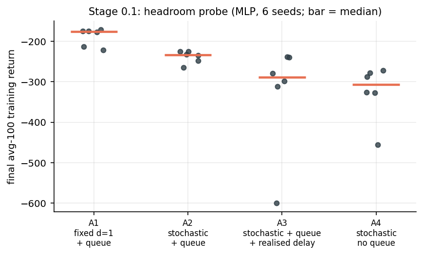

### 9.2 Stage 0.2 — The banked checkpoints as controllers (G4)

All 102 Phase 1–2 checkpoints were re-evaluated with no retraining: 20 deterministic episodes on unseen seeds, plus 10-episode grids for delay mismatch (d = 0…5, keeping the trained queue width), sensor noise (σ = 0.01–0.10 of the observation half-range), pendulum mass and length (0.7–1.3×) and actuator dropout (5%, 10%). The interpretable cells are Pendulum-v1 (n = 3 seeds each):

| Trunk (fixed d = 1 + queue) | Nominal IQM [95% CI] | Command rate abs(Δu) | Reversals / s | Sensor noise σ = 0.05 | Delay d = 3 |
|---|---:|---:|---:|---:|---:|
| MLP 135k | −119.9 [−122.6, −96.3] | 0.729 | 3.9 | −145.2 | −406.8 |
| TRM 788k | −124.2 [−133.4, −99.3] | 0.642 | 0.8 | −337.9 | −379.8 |
| Transformer 797k | −122.0 [−160.6, −96.5] | 1.299 | 7.7 | −260.3 | −509.2 |
| LSTM 167k | −1146.2 [−1526.5, −188.1] | 0.000 | 0.0 | −1477.6 | −1489.7 |

- **Every trunk that learned reaches the same greedy policy quality** (IQM about −120).
- **At n = 3 the Phase 1–2 smoothness signal is inside seed noise.** That signal came from exploration-noisy actions. Deterministically, command rate varies more across seeds of one trunk than between trunks (MLP 0.10–0.78, TRM 0.13–0.79). §9.7 revisits this at n = 12 and finds a real difference in direction reversals.
- **All learned trunks share one delay envelope:** fine at d ≤ 2, collapsing at d ≥ 3.
- **TRM degrades faster under sensor noise** than the MLP.

**G4 passes weakly, on the literal rule.** TRM is non-dominated against the MLP on command rate at a tied return and admits 100 Hz control, but the margin is inside seed noise. The LSTM also satisfies the rule, but degenerately: a policy that never learned is maximally smooth. The rule did not exclude that case and is reported as written.

### 9.3 Latency — can it close a real control loop?

Actor forward pass per decision, batch 1, including host transfers:

| Trunk | 1 CPU thread p99 | Max rate | A100 p99 | Update (batch 128), A100 |
|---|---:|---:|---:|---:|
| MLP 135k | 0.064 ms | 15.5 kHz | 0.18 ms | 3.7 ms |
| MLP 788k | 0.119 ms | 8.4 kHz | 0.18 ms | 3.7 ms |
| LSTM (carried) | 0.129 ms | 7.7 kHz | 0.26 ms | 4.9 ms |
| Transformer | 0.512 ms | 2.0 kHz | 0.61 ms | 14.2 ms |
| TRM H = 1 | 1.42 ms | 703 Hz | 1.86 ms | 24.2 ms |
| TRM 136k | 2.69 ms | 371 Hz | 5.25 ms | 40.8 ms |
| TRM 788k (H = 3) | 4.13 ms | 242 Hz | 5.31 ms | 41.3 ms |
| TRM Carry-Z | 4.11 ms | 243 Hz | 5.35 ms | 41.8 ms |
| TRM H = 6 | 7.59 ms | 132 Hz | 10.0 ms | 66.3 ms |

- **TRM supports a 100 Hz loop but not 500 Hz or 1 kHz.** It is 65× the MLP's latency, and a GPU makes batch-1 decisions *slower* because the 21 sequential cell applications are bound by kernel-launch overhead.
- **Latency scales with depth, not width.** TRM 136k is barely faster than TRM 788k, while H = 1 is about 3× faster than H = 3.

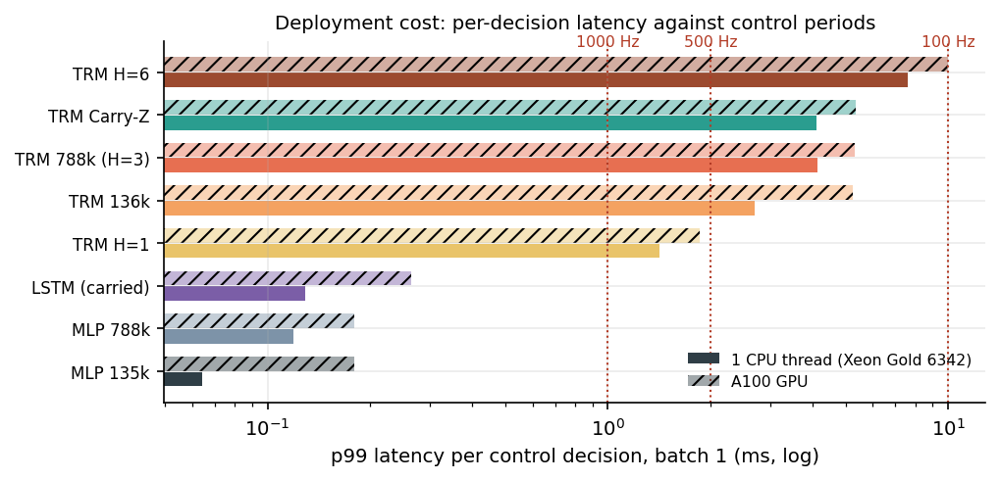

### 9.4 Stage 1 — Capacity or recursion? (G1)

Six arms × {no delay, fixed d = 1 + queue} × 6 seeds (n = 12 pairs per contrast):

| Arm | Params | Median return | Deterministic eval (last 5) | Median wall-clock | Critic loss, late |
|---|---:|---:|---:|---:|---:|
| MLP 135k (`dnn`) | 134,914 | −174.5 | −161.0 | 3.0 min | 11.0 |
| TRM 136k (`trm_small`) | 135,654 | −232.4 | −169.9 | 31.7 min | 16.8 |
| MLP 788k (`dnn_large`) | 788,114 | −177.3 | −164.0 | 3.0 min | 9.2 |
| TRM 788k (`trm`) | 787,842 | −207.9 | −162.3 | 32.2 min | 17.4 |
| TRM H = 1 | 787,842 | −198.9 | −165.1 | 12.4 min | 14.4 |
| TRM H = 6 | 787,842 | −218.4 | −163.8 | 35.2 min | 18.7 |

| Contrast (n = 12) | Training return | Positive | p (two-sided) | Deterministic eval |
|---|---:|---:|---:|---:|
| TRM 136k − MLP 135k | −50.2 | 0/12 | 0.0005 | −4.4 (5/12) |
| TRM 788k − MLP 788k | −27.1 | 2/12 | 0.039 | +0.3 (6/12) |
| MLP 788k − MLP 135k | −3.8 | 5/12 | 0.77 | −2.2 (4/12) |
| TRM 788k − TRM 136k | +20.7 | 7/12 | 0.77 | +2.7 (8/12) |
| TRM H = 1 − H = 3 | −3.3 | 5/12 | 0.77 | −2.8 (5/12) |
| TRM H = 6 − H = 3 | −10.9 | 4/12 | 0.39 | −2.2 (4/12) |
| TRM 788k − MLP 135k (the Phase 1 headline) | −34.4 | 0/12 | 0.0005 | −2.5 (2/12) |

**G1: the deficit is architecture-family, not capacity.** TRM loses at both matched sizes, and capacity moves neither family. Per the pre-registered rule, Stage 2's MLP is `dnn`. Four further findings sharpen this.

1. **Reproduction.** On new code, new hardware and seeded warmup, the Phase 1 headline reproduces: TRM − MLP −34.4 at n = 12 (0/12), against Phase 1's −32.8 at n = 6 (0/6). The MLP medians also match Phase 1 (no delay −174.3 vs −174.0).
2. **Depth is inert.** H = 1 has 7 cell applications per pass against H = 3's 21, and H = 6 has 42, yet returns do not move. Only 7 applications receive gradient at any depth. This reproduces Roye-Azar et al.'s "shallow effective recursion" outside its original domain.
3. **The value-fit deficit is architectural.** Late critic loss is 1.45× (TRM 136k vs MLP 135k) and 1.89× (TRM 788k vs MLP 788k), 12/12 pairs each, while the 788k MLP fits value slightly *better* than the 135k one (0.87×, 3/12). Removing the outer recursion reduces but does not remove the deficit (H = 1 vs MLP: 1.34×, 10/12). This reverses the Phase 1–2 post-hoc attribution to capacity, which rested on the Transformer. That Transformer deficit is now better read as the Transformer's own.
4. **The deficit lives mostly in training, not in the final policy.** On deterministic evaluation episodes, which share initial states across arms within a seed, the gaps shrink to a few reward units. The battery (§9.7), on unseen seeds, puts the residual at 3.6 units (2/12, p = 0.039): small but consistent. TRM nearly reaches the MLP's greedy policy, but fits its critic worse and performs worse under exploration noise throughout training.

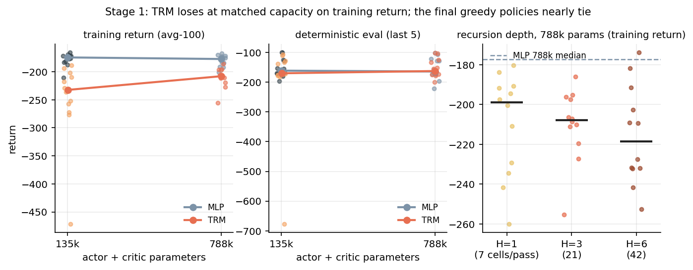

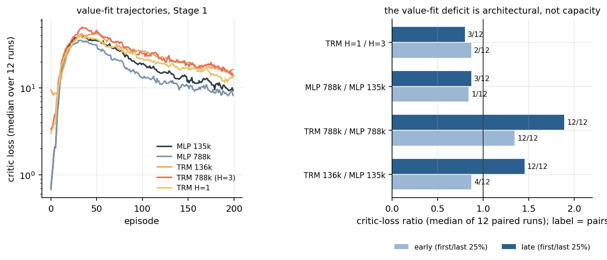

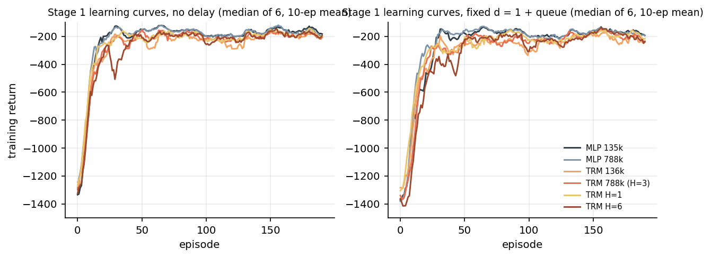

### 9.5 Stage 2 — Uncertainty × memory (G2, G3)

Four trunks × three conditions × 6 seeds. Every trunk also sees its previous action (A-6).

| Trunk | C1 fixed + queue | C3 stochastic + queue | C4 stochastic, no queue |
|---|---:|---:|---:|
| MLP 135k | −178.3 | −293.7 | −235.4 |
| TRM Reset-Z | −226.8 | −270.5 | −333.9 |
| TRM Carry-Z | −214.5 | −300.1 | −333.1 |
| LSTM (carried) | −252.1 | −786.3 | −370.9 |

| Contrast (n = 6) | Median | Positive | p (two-sided) |
|---|---:|---:|---:|
| **G2** interaction [Carry-Z − MLP], C3 − C1 | +20.4 | 3/6 | 1.00 |
| **G2** interaction [Carry-Z − MLP], C4 − C1 | −40.0 | 1/6 | 0.22 |
| **G3** Carry-Z − Reset-Z at C1 / C3 / C4 | +4.8 / −22.0 / +16.7 | 4/6, 3/6, 3/6 | ≥ 0.69 |
| Carry-Z − MLP at C1 / C3 / C4 | −29.5 / −18.2 / −81.5 | 1/6, 2/6, 1/6 | — |
| Carry-Z − LSTM at C1 / C3 / C4 | +56.5 / +500.0 / +45.0 | 6/6, 6/6, 5/6 | — |
| Carried LSTM − MLP at C1 / C3 / C4 | −66.4 / −381.6 / −137.2 | 0/6, 1/6, 1/6 | — |

**G2 fails and H3 is rejected.** The interaction does not appear at either co-primary condition, and at C4, the condition G0 showed has memory headroom, it has the wrong sign: Carry-Z falls *further* behind the MLP when the queue is hidden. **G3 fails.** Carrying the latent never beats resetting it in ≥ 5/6 seeds. Carry-Z does beat the carried LSTM everywhere, but only because the LSTM trains poorly at every condition; it was engineered, not tuned.

**The side effect of A-6, and why it does not rescue H3.** Giving the MLP its previous action changed its results against Stage 0's otherwise identical arms (same seeds, same code, no previous-action input):
- **C4:** the previous action alone closes most of the memory headroom: +67.0 (5/6), from −307 to −235, against −234 with the full queue.
- **C3:** it *hurts* the MLP: −63.7 (1/6), a redundant input that duplicates the newest queue slot.
- **C1:** neutral (−0.4, 3/6).

So the Stage 2 MLP was a stronger C4 baseline than planned. But Carry-Z at C4 also fails to beat the *history-free* Stage 0 MLP, A4 (−19.2, 2/6), so the G2 failure does not depend on A-6.

Two further observations.
- **An exploratory positive, with an artefact behind it.** Reset-Z TRM beats the MLP at C3 in 5/6 seeds (+17.6). This coincides with the MLP's C3 degradation from the redundant input. It is not a pre-registered contrast, and H3's mechanism cannot produce it, since C3 has nothing to infer and Reset-Z has no memory.
- **Deterministic evaluation tells the same story.** Greedy MLP performance barely moves across conditions (−169.5, −173.0, −170.4), while TRM variants lose ground at C4 (Reset-Z −253, Carry-Z −227). The eval-return interaction at C4 is −42.8 (1/6).

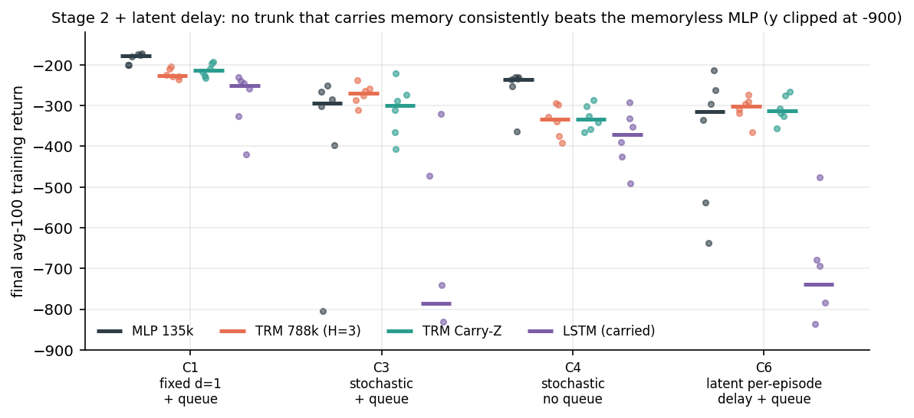

### 9.6 Supplementary — Latent per-episode delay (G2s)

**Why this test, and its rule.** The Sep-17 plan review's central recommendation (§8.3) was a delay that memory can *identify*: d ~ U{0..4} drawn once at the start of each episode and held constant, with the 4-slot queue shown. A memoryless policy sees every candidate action but cannot know which slot reaches the plant. A policy that carries state could work it out from a few transitions, which is system identification. The rule, G2s, was fixed in `gates.json` before any job was submitted (Appendix A). Every trunk also sees its previous action, as in Stage 2. Five arms × 6 seeds = 30 runs.

| Arm (C6, latent per-episode delay) | Median return | Seed SD |
|---|---:|---:|
| MLP 135k | −315.9 | 168.8 |
| MLP + oracle (the episode's delay shown) | −278.1 | — |
| TRM Reset-Z | −302.5 | 32.0 |
| TRM Carry-Z | −313.2 | 33.2 |
| LSTM (carried) | −739.3 | — |

| Contrast (n = 6) | Median | Positive | Verdict |
|---|---:|---:|---|
| Headroom: MLP + oracle − MLP | +25.2 (mean +86.4) | 4/6 | **fails** (pooled SD 128.3) |
| Carry-Z − MLP | +6.3 | 3/6 | fails |
| Carry-Z − Reset-Z | −4.9 | 2/6 | fails |
| Carried LSTM − MLP | −432.7 | 0/6 | — |
| Interaction [Carry-Z − MLP], C6 − C1 | +15.1 | 5/6 | see below |
| Interaction [Reset-Z − MLP], C6 − C1 | +53.0 | 4/6 | see below |

**G2s: the H3 rejection stands.** The latent delay is expensive for every trunk: it costs the MLP 116 reward units against C1 (median per seed). But even revealing the delay does not consistently recover that cost (4/6, inside the seed spread). Carrying the latent adds nothing over resetting it (2/6), and the carried LSTM collapses.

**The one pattern that could be misread.** [Carry-Z − MLP] improves from C1 to C6 in 5/6 seeds, the shape H3 predicted. It is not a memory effect.
- **Reset-Z, which carries nothing, shows it more strongly** (+53.0, 4/6).
- **Its source is the MLP.** Under the latent delay the MLP collapses in two seeds (C6 − C1: −365 and −458), while both TRM variants degrade uniformly (−60 to −137). Seed SD at C6 is 169 for the MLP against 32–33 for either TRM.

The real observation is that **the recursive trunks train more consistently than the MLP under a latent delay**: the MLP either copes or collapses. That concerns training stability, not inference, and it is exploratory.

**Deterministic evaluation, secondary.** On the last five evaluation episodes, Carry-Z's greedy policy beats Reset-Z's in 5/6 seeds (median +26.5). That is the only place in the study where carrying the latent shows a consistent sign, on a secondary metric at n = 6 (one-sided p = 0.109). The full battery does not confirm it. On 20 unseen-seed episodes per checkpoint, Carry-Z − Reset-Z is +0.4 (4/6, p = 0.34), so the exploratory signal was noise. Deterministically, the oracle helps the MLP modestly (+12.5, 5/6). Both TRM variants' greedy policies sit slightly above the MLP's (Reset-Z +11.4, Carry-Z +15.9, 4/6 each), which again tracks the MLP's two unstable seeds rather than any use of memory.

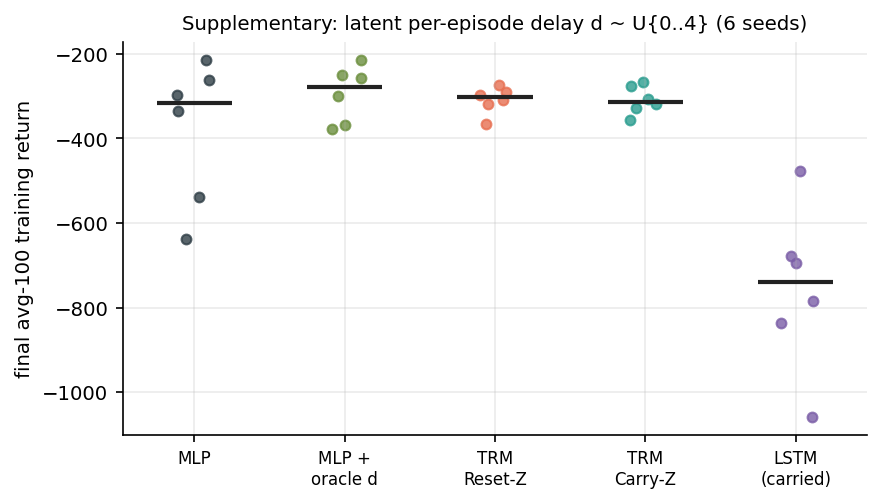

### 9.7 Deployment scorecard over all Phase 3 checkpoints

All 198 Phase 3 checkpoints were run through the same battery (0 parameter-rebuild mismatches). Stage 1 now gives n = 6 seeds per cell and 12 pairs per contrast on learned policies, which the banked checkpoints (n = 3) could not.

**Stage 1 checkpoints, trained at fixed d = 1 + queue** (medians over 6 seeds):

| Trunk | Nominal IQM [95% CI] | Reversals / s | abs(Δu) | Noise σ = 0.05 | Mass ×1.3 | Dropout 10% | Delay d = 3 |
|---|---:|---:|---:|---:|---:|---:|---:|
| MLP 135k | −120.1 [−121.6, −104.0] | 9.06 | 0.805 | −209.3 | −183.6 | −144.8 | −296.4 |
| MLP 788k | −121.1 [−123.3, −104.9] | 2.76 | 0.398 | −204.0 | −182.9 | −145.1 | −479.2 |
| TRM 136k | −141.1 [−545.2, −113.6] | 2.52 | 0.488 | −397.8 | −248.5 | −253.0 | −547.4 |
| TRM 788k | −124.2 [−129.7, −106.7] | 0.38 | 0.227 | −286.7 | −232.7 | −165.3 | −332.2 |
| TRM H = 1 | −123.3 [−128.4, −105.6] | 5.09 | 1.149 | −349.9 | −238.5 | −190.0 | −303.7 |
| TRM H = 6 | −127.0 [−135.2, −109.6] | 0.37 | 0.076 | −434.5 | −505.9 | −304.0 | −746.9 |

**Paired over 12 (seed, condition) pairs:**

| Contrast | Nominal IQM | Reversals / s | abs(Δu) | Drop under noise σ = 0.05 |
|---|---:|---:|---:|---:|
| TRM 788k − MLP 135k | −3.6 (2/12, p = 0.039) | −6.0 (1/12, p = 0.006) | −0.6 (3/12) | −75.8 (2/12, p = 0.039) |
| TRM 788k − MLP 788k | −3.9 (3/12) | −2.4 (1/12, p = 0.006) | −0.3 (3/12) | −66.2 (4/12) |
| TRM 136k − MLP 135k | −3.6 (4/12) | −4.0 (2/12, p = 0.039) | −0.4 (2/12, p = 0.039) | −46.7 (3/12) |
| TRM H = 1 − H = 3 | +0.9 (6/12) | +0.1 (6/12) | 0.0 (6/12) | −55.9 (5/12) |
| MLP 788k − MLP 135k | −0.4 (5/12) | −0.3 (6/12) | −0.3 (4/12) | −13.1 (5/12) |

Four findings, two of which revise the banked-checkpoint reading of §9.2:

1. **Final policy quality is nearly matched, with a small consistent TRM deficit.** TRM's greedy policy trails the small MLP by 3.6 reward units (2/12 pairs, p = 0.039), about 0.3% of the performance span. The training-return gap of §9.4 is ten times larger.
2. **TRM commands markedly smoother torque (revising §9.2).** It reverses direction about 0.4 times per second, against 9 for the small MLP and 2.8 for the matched one: fewer reversals in 11/12 pairs against each (p = 0.006). This is the plan's H3.4, *regularity at matched return*, and at n = 12 it holds. The banked n = 3 checkpoints hid it because one TRM seed chattered. It is not a depth effect: H = 1 and H = 3 are indistinguishable (6/12), so it comes from the recursive cell, not from iteration.
3. **TRM is less robust across every perturbation (H3.5 is contradicted).** Under sensor noise it loses 76 more reward units than the MLP (2/12 favourable, p = 0.039). Under a 30% heavier pendulum it drops to −233 against the MLP's −184, and under 10% actuator dropout to −165 against −145. The deeper the recursion, the less robust (H = 6: −506 under the heavier plant, −304 under dropout). The MLP's envelope is nearly flat across all three.
4. **Delay mismatch is shared.** Every trunk trained at d = 1 holds to d = 2 and collapses at d = 3, and the pairwise contrasts in that drop are sign-inconsistent (6/12).

**Stage 2 checkpoints** (n = 6 per contrast). Deterministically, Carry-Z's greedy policy edges out Reset-Z's at C1 (+3.6, 5/6) and is smoother than the MLP there (6/6). At C4, the MLP's greedy policy beats Carry-Z's in 6/6 seeds (−4.7), and the carried LSTM trails the MLP everywhere. Nothing in the deterministic evaluation reverses the G2 or G3 conclusions.

**What the scorecard says as a whole.** TRM is a real trade, not a dominated point. It buys much smoother actuation at a small cost in final return. It pays for that with 65× decision latency, 11–13× training cost, and a narrower robustness envelope. For a plant where actuator wear dominates and the environment is benign, the trade could be worth making. For the delay-robustness brief of this project, it is not.

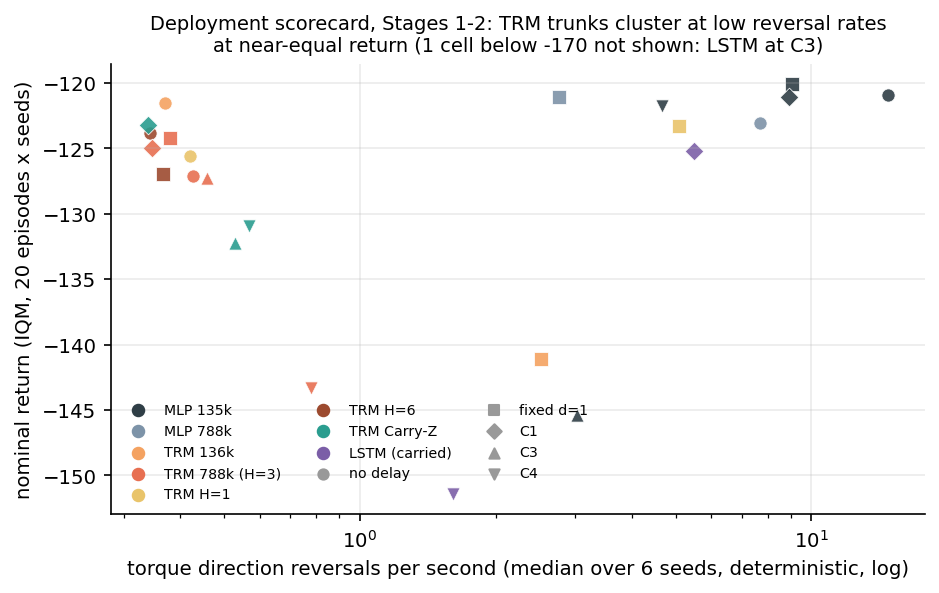

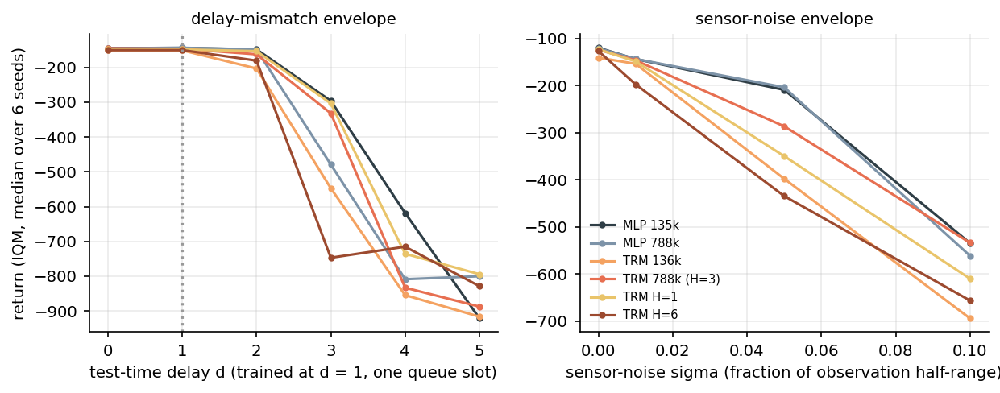

### 9.8 The cost ledger, three ways

| Reading | TRM 788k vs MLP 135k (Pendulum-v1) |
|---|---|
| **Matched episodes** (the pre-registered comparison) | −34.4 training return (0/12); about −2.5 on deterministic evaluation |
| **Matched wall-clock** (when the MLP finishes, about 3 min) | TRM has completed 16 episodes; avg-10 return −967 against the MLP's final −174 |
| **Matched inference latency** | 65× slower per decision on one CPU thread (4.13 vs 0.064 ms p99) |
| Training cost, same GPU model | 10.8× (A100), 11.7× (L40S), 13.0× (V100) |

The shallow TRM (H = 1) halves the training premium (6–8×) and has the best matched-wall-clock reading of the TRM family (avg-10 −251 after 42 episodes). It still loses on every reading, but it is the variant to use if a recursive trunk is required.

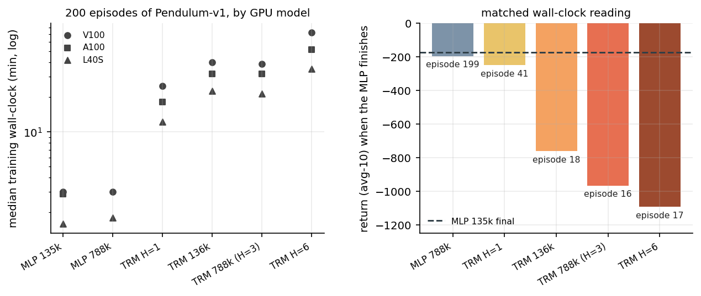

---


### 9.9 Discussion of the Phase 3 results

**G0, headroom.** *What it shows:* stochastic delay costs the MLP 53 reward units against a fixed delay, and hiding the queue costs another 71, so a trunk that could rebuild the queue from its own history had something to gain. *Robustness:* the memory headroom is positive in 6/6 seeds with its median (70.8) above the pooled seed SD (49.5); the oracle result is equally consistent in the other direction (0/6). *Competing explanations for the oracle's harm:* the theory check A-1 predicted it before any data: under a per-step i.i.d. delay with the 4-slot queue the augmented observation is already Markov, so the realised past delay carries no usable information and costs something to ignore. *What it constrains:* it made C4 the decisive condition for H3 and showed that H3 was given a fair chance. *What it does not show:* that any trunk can actually exploit the headroom.

**G1, capacity or recursion.** *What it shows:* TRM loses at both matched sizes, MLP capacity changes nothing, TRM capacity changes nothing, and depth changes nothing; TRM's critic fits worse at matched capacity while the larger MLP fits slightly better. *Robustness:* the small-capacity deficit is 0/12 (two-sided p = 0.0005) and the large-capacity one 2/12 (p = 0.039); the Phase 1 headline reproduces almost exactly (−34.4 at n = 12 against −32.8 at n = 6). The deterministic evaluation shrinks every gap to a few units, which the battery confirms on unseen seeds (−3.6, 2/12). *Competing explanations:* (a) capacity, now rejected; (b) iteration depth, inert; (c) the recursive cell as a harder-to-optimise block, consistent with everything here and with the worse value fit at matched size; (d) an exploration-time effect, consistent with the training-return gap being ten times the greedy-policy gap. (c) and (d) are compatible: a worse critic gives worse exploratory behaviour throughout training while the final greedy policy nearly catches up. *What it constrains:* H_cap and H3.1 are rejected; H3.3's fixed-delay half (depth flat) is consistent with every account and so discriminates nothing on its own. *What it does not show:* why the cell is harder to optimise, or whether restoring the training discipline would fix it (Phase 4 Stage A answered that: it does not).

**G2 and G3, uncertainty × memory.** *What it shows:* the interaction H3 needs does not appear, and has the wrong sign at the condition with memory headroom; carrying the latent never beats resetting it. *Robustness:* at C4 the interaction is negative in 5/6 seeds (median −40.0). At C3 it is 3/6 with a median of +20.4 but a mean of +102.4, because one seed contributes +582.8. In that seed even the carried LSTM, which otherwise trails the MLP at C3 by a median 381.6, beats the MLP (+63.6), which points to an MLP collapse in that run (`analysis_s2.json`). The C3 result is therefore noise around zero with one outlier, not a weak positive. *Competing explanations for the failure:* (a) an implementation fault in the carried latent, excluded by the stored-state replay check, which reproduces the behaviour policy's actions and carries with zero error; (b) a stronger-than-planned MLP baseline (A-6 gave it the previous action, which closed most of the C4 headroom), excluded for the G2 conclusion because Carry-Z also fails against the history-free Stage 0 MLP (−19.2, 2/6); (c) no trunk in this setting can learn to use memory at this budget, consistent with the untuned carried LSTM failing everywhere; (d) recursion has nothing to add even with memory. (c) and (d) cannot be fully separated without a tuned recurrent baseline. *What it constrains:* H3 is rejected and confound C-2 (latent reset) is removed. *What it does not show:* that no memory architecture could exploit the headroom.

**G2s, the latent per-episode delay.** *What it shows:* even an identifiable latent delay produces no memory benefit: the oracle itself helps only inconsistently (4/6), and Carry-Z adds nothing over Reset-Z (2/6). *Robustness:* n = 6, and the one H3-shaped pattern (Carry-Z − MLP improving from C1 to C6 in 5/6 seeds) is produced by two collapsed MLP seeds; Reset-Z, which carries nothing, shows it more strongly. *What it constrains:* the H3 rejection stands under the review's recommended design. *What it does not show:* that the recursive trunks' lower seed spread under the latent delay (SD 32–33 against the MLP's 169) is anything more than a training-stability observation; it is exploratory.

**G4, the battery and latency.** *What it shows:* every trunk that learns reaches about the same greedy return; TRM's torque is much smoother; TRM is less robust under every perturbation; TRM's decision latency is 65× the MLP's. *Robustness:* the smoothness difference needed n = 12 (the banked n = 3 checkpoints hid it behind one chattering seed); at n = 12 it is 11/12 (p = 0.006) against each MLP. The robustness deficit is consistent across noise (2/12 favourable, p = 0.039), plant mass and dropout, and grows with depth. *Competing explanations for the smoothness:* iteration (refining the action) or the recursive cell itself. H = 1 and H = 3 are indistinguishable (6/12), so it comes from the cell, not the iteration; Phase 4's Stage E adds that TRM actors have a lower local gain at the median. *What it constrains:* H3.4 is supported, H3.5 contradicted, H3.6 quantified (100 Hz feasible, 500 Hz not, on one Xeon thread). *What it does not show:* whether the smoothness is worth its price on a real actuator, or why TRM is less robust (Stage E shows it is not local gain).

**The cost ledger.** On matched episodes, matched wall-clock and matched latency, TRM loses every reading; the only reading where the gap nearly closes is the deterministic final policy. At matched wall-clock (about 3 minutes, when the MLP has finished), TRM has completed 16 episodes, with an avg-10 return of −967 against the MLP's final −174.


---

## 10. Phase 4 — Complexity rung, training discipline, tuning, algorithm (141 runs)

### 10.1 Why Phase 4, and what was pre-registered

Phase 3 left three things open: H1 had never been tested on a rung the baseline learned; the port had dropped TRM's training discipline (7 of 21 applications trained, only the final readout supervised); and every contrast had used DDPG. Phase 4's plan (`phase4/plan/plan.md`, frozen 2026-10-06, rules in `experiments/phase4/gates.json`) took these in order of how much each would change the conclusions:

| Stage | Question | Gate and rule |
|---|---|---|
| B0 (B0h, B0d) | Is InvertedDoublePendulum-v5 (fallback Hopper-v5) learned by the MLP under TD3 + one-step delay, and at what budget? | GB0 / KB0: ≥ 2/3 seeds reach 90% of the registered threshold at some budget |
| B1 | Does TRM's span-normalised deficit shrink on the new rung (H1′)? | ≥ 5/6 seed pairs |
| A | Does restoring full gradients and deep supervision help TRM? | GA: any of 4 contrasts ≥ 5/6 |
| C | Is TRM's deficit an untuned learning rate? | GC: a cell beats the default by > pooled SD in 3/3 seeds |
| T (added, T-1) | Does G1 hold under TD3? | GT: TRM 788k − MLP 788k negative in ≥ 10/12 |
| E | Does the actor's local gain explain smoothness and noise sensitivity? | exploratory, no gate |
| D | Export actors to C headers for an on-device test | engineering, no gate |

Methods are in §3.6. Before any B0, C or A job, verification V-1 passed: the gradient-hook test (7/21 truncated, 21/21 with full gradients), 30 of 30 existing configurations bit-identical between the pre-Phase-4 snapshot and the Phase 4 tree, the new paths, and a GPU smoke job. The same check allowed Stage A to reuse Phase 3 Stage 2's MLP runs (R-1).

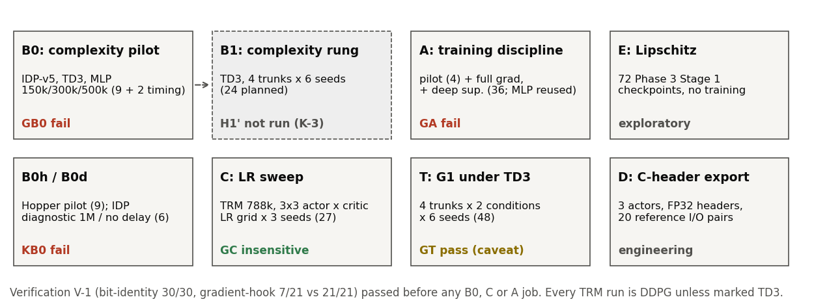

### 10.2 Execution

154 PBS jobs ran between 2026-10-06 and 2026-10-08: 1 smoke job, 141 training runs, and 12 Lipschitz jobs (the first six failed on a snapshot path bug and were rerun). No training run failed. One reproducibility limit appeared: runs are not bit-reproducible across GPU models. B0's nested budgets show it: pairs run on the same model were identical (IDP 2/2, Hopper 4/4); every pair on different models diverged (IDP 0/4, Hopper 0/2), sometimes by more than the seed spread (`analysis_p4_b0.json`, `nested_check`).

### 10.3 Results against each rule

All returns are final avg-100 training returns unless marked otherwise. "k/n" is k of n paired differences positive. The stage notes (`stage_B0.md`, `stage_C.md`, `stage_A.md`, `stage_T.md`, `stage_E.md`, `stage_D.md`) and the Phase 4 report (`phase4_report.md`) give the full tables, per-seed values and figures; this section gives the results against each rule and discusses them.

#### 10.3.1 Stage B0: no learnable rung (GB0 fail, KB0 fail)

| Rung | Budget | Final avg-100, seeds 1 / 2 / 3 | Learned |
|---|---|---|---:|
| IDP-v5 (bar 8190) | 150k / 300k / 500k | 3681.0 / 2291.1 / 2032.4 · 3861.2 / 3077.6 / 4160.1 · 4312.4 / 3781.1 / 3591.6 | 0/3 at each |
| Hopper-v5 (bar 3420) | 150k / 300k / 500k | 1101.1 / 954.0 / 1708.2 · 1729.6 / 1855.6 / 1790.4 · 1418.0 / 2805.3 / 2201.3 | 0/3 at each |
| IDP diagnostic, C1 | 1M | 4146.9 / 2590.2 / 1732.8 | 0/3 |
| IDP diagnostic, no delay | 500k | 8226.2 / 5516.8 / 5779.7 (all three crossed 8190 at some point) | 1/3 |

*Source: `experiments/analysis_p4_b0.json`, `analysis_p4_b0h.json`, `analysis_p4_b0d.json`.*

**What the numbers show.** On IDP the MLP plateaued at avg-100 between about 3100 and 4300 from 300k steps on, far above the uniform-random baseline (49.90) and far below the bar. Its episodes are bimodal: in the last 100 episodes of the 500k runs, 32–45% are full 1000-step solves and the rest mostly early falls (of 300 pooled episodes, 116 solved, 171 below 500, 13 between). The threshold was missed through unreliability, not budget: 1M steps were no better than 300k–500k, and the per-100k solve share moved between 5.7% and 48.5% without a trend. Removing the delay changed the picture: every seed crossed 8190 (two by about 106k steps), and the deterministic policy solved 23–26 of the last 30 evaluations against 9–11 of 30 under C1. Hopper's MLP reached at most 2805.3 at 500k (82% of its bar), a risk the plan had flagged in advance.

**Robustness.** The verdict is uniform: none of the 21 C1 runs across B0, B0h and B0d was learned. The no-delay result is less clean: TD3 collapses and recovers there too, and only one seed ends above the bar.

**Competing explanations.** (a) *Too little budget:* contradicted by the 1M runs. (b) *The bar is too strict for noisy training return:* partly true (deterministic evaluations are higher), but even greedy policies solve only about a third of episodes under delay. (c) *TD3 as configured is unstable on IDP:* supported in part, since even the no-delay runs do not hold the bar. (d) *The one-step delay on an unstable plant:* the strongest single factor, since removing it moves the same learner from 0/3 to 3/3 crossings and from about a third to about three quarters of greedy episodes solved.

**What it constrains.** Nothing about TRM. GB0 and KB0 are pilots of the baseline; their failure means B1 had no pre-registered rung on which to test H1′. **What it does not show:** that TRM's relative standing changes, or does not change, with complexity.

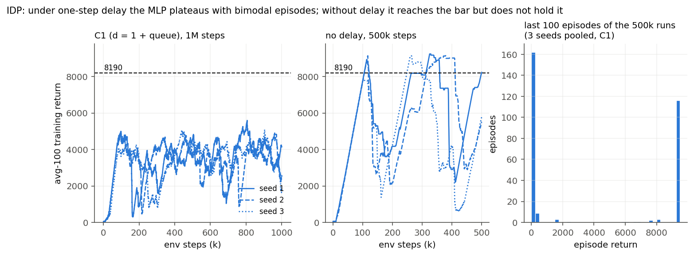

#### 10.3.2 Stage B1 and H1′: not run (K-3)

Under amendment K-2, if the 1M diagnostic failed GB0's rule, B1 could only run as an exploratory study with a post-hoc "clear of floor" criterion. A draft amendment proposing exactly that (`phase4/plan/K-3_draft.md`: IDP at 300k, "clear of floor" at ≥ 2275, Stage T as the Pendulum reference) went to the author. Before it was approved, Stage T showed that TRM 788k does not train under `td3.yaml` even on Pendulum. The author decided on 2026-10-08 not to run B1 (amendment K-3): no harder rung was learnable by the baseline under the pre-registered conditions, and a TD3 B1 would most likely have measured TRM's optimisation failure rather than complexity scaling. The draft is superseded, H1′ is recorded as not run, and **H1 remains untested for the whole project**: MountainCarContinuous-v0, BipedalWalker-v3, InvertedDoublePendulum-v5 and Hopper-v5 were all unlearnable by the baseline at the budgets and settings tried. This is a limitation of the study, not evidence against TRM.

The H1′ span would have used a uniform-random untrained baseline (R-2: Pendulum −1163.84, IDP 49.90, Hopper 16.32). That differs from the "≈ −1460" untrained Pendulum figure Phases 1–3 quoted, which was the return of an actor that learned nothing (the failed Phase 1 LSTM), not of random actions.

#### 10.3.3 Stage C: learning-rate sweep (GC insensitive)

| Actor LR \ critic LR | 3e-4 | 1e-3 | 3e-3 |
|---|---:|---:|---:|
| 3e-5 | −223.85 (Δ −8.73, 0/3) | −234.79 (−18.51, 0/3) | −245.59 (−49.57, 1/3) |
| 1e-4 | −250.41 (−35.29, 0/3) | **−215.12 (default)** | −208.79 (+10.95, 2/3) |
| 3e-4 | −261.45 (−41.72, 0/3) | −270.82 (−55.71, 0/3) | −244.75 (−48.73, 0/3) |

*Median final avg-100 per cell (median Δ against the default cell, seeds positive). Source: `experiments/analysis_p4_c.json`.*

**What the numbers show.** No cell is flagged, so GC records "TRM insensitive to LR within ×0.3–×3". The default is among the best cells: seven of eight alternatives have lower medians, six of them in all three seeds. The only cell with a higher median (critic ×3) has per-seed differences −15.3, +17.3, +11.0 against a pooled SD of 10.2.

**Robustness.** n = 3 per cell; a 0/3 cell has two-sided p = 0.25. The rule can detect only large, consistent improvements, and the grid shows none. Deterministic evaluation is nearly flat outside the ×3-actor row (−179.3 to −173.5).

**An exploratory pattern with consequences for Stage T.** All three ×3-actor-LR cells (3e-4) are below the default in 3/3 seeds, by 41.7–55.7 at the median, and carry the grid's highest late critic losses (24.5–28.2 against 22.6). Raising TRM's actor learning rate hurts it. TD3's actor rate is 1e-3, ten times the DDPG default.

**What it constrains.** The "untuned" explanation for TRM's deficit, along the learning-rate axes. The best cell's median (−208.8) is about where Phase 3's TRM 788k sat at C1 (−208.7 for seeds 1–3) and well below Phase 3's MLP 135k at C1 (−176.8), a cross-stage comparison. **What it does not show:** insensitivity to other optimiser settings (batch size, τ, noise scale), or at other conditions.

#### 10.3.4 Stage A: training discipline (GA fail)

| Contrast (n = 6) | Median Δ | Positive | p one-sided | p two-sided |
|---|---:|---:|---:|---:|
| TRM-fullgrad − TRM-trunc, C1 | +2.49 | 3/6 | 0.656 | 1.00 |
| TRM-fullgrad − TRM-trunc, C4 | +10.07 | 4/6 | 0.344 | 0.69 |
| TRM-fullgrad + DS − TRM-trunc, C1 | +0.35 | 3/6 | 0.656 | 1.00 |
| TRM-fullgrad + DS − TRM-trunc, C4 | +28.45 | 4/6 | 0.344 | 0.69 |
| *Secondary:* TRM-fullgrad − MLP, C1 / C4 | −40.50 / −82.66 | 1/6, 1/6 | — | 0.22, 0.22 |
| *Secondary:* TRM-fullgrad + DS − MLP, C1 / C4 | −22.46 / −88.77 | 1/6, 1/6 | — | 0.22, 0.22 |

*Source: `experiments/analysis_p4_a.json`. TRM arms clipped at actor 15 / critic 2800 (A-1); MLP reused from Phase 3 Stage 2, unclipped (R-1).*

| Arm | C1 median | C4 median | Eval last-5 C1 / C4 | Late critic loss C1 / C4 |
|---|---:|---:|---|---|
| MLP 135k | −178.31 | −235.37 | −169.46 / −170.44 | 13.63 / 41.76 |
| TRM-trunc | −208.71 | −340.19 | −168.62 / −194.10 | 18.54 / 50.45 |
| TRM-fullgrad | −218.41 | −344.59 | −170.01 / −209.21 | 19.90 / 46.42 |
| TRM-fullgrad + DS | −200.00 | −323.03 | −159.59 / −202.06 | 16.84 / 47.85 |

**What the numbers show.** GA fails: no contrast reaches 5/6. Training all 21 cell applications leaves TRM within 10 reward units of the truncated port at both conditions, sign-inconsistently, at 1.44–1.50× its training time on every GPU model. Deep supervision's C4 contrast has the largest median (+28.45), but two of its six seeds lose 36 and 90 units. Both restored variants still trail the MLP in 5/6 seeds at each condition, and their late critic loss is still above the MLP's in 6/6 seeds at C1 (1.45× and 1.35×). Deterministic evaluation tells the same story: at C1 all arms' greedy policies are within about 10 units; at C4 the TRM arms trail the MLP by 24–39 units.

**Robustness.** n = 6; the per-seed differences straddle zero with magnitudes comparable to the pooled seed SD (27.6–35.1). Inference latency is unchanged by the flags, as expected (p50 7.69–7.77 ms for all three TRM arms against the MLP's 0.098 ms on the local workstation), so the restored variants buy nothing at deployment either.

**Competing explanations for the null.** (a) *The untrained 14 applications never mattered:* consistent with Phase 3's depth result (H = 1, 3, 6 indistinguishable) and with this one. (b) *Clipping restrained the full-gradient arms:* the same actor clip bound them about 4–7 times as often as TRM-trunc (median 3.5–8.7% of updates against 0.6–2.0%). This cannot be excluded at the frozen clip. (c) *The wrong kind of supervision:* deep supervision here gives every outer cycle the same bootstrapped TD target. Published TRM supervises successive improvement steps against a fixed, known answer, on a revisitable instance with a carried latent; that has no off-policy analogue here and was not tested.

**What it constrains.** The training-discipline explanation, in the forms that port: the deficit is not caused by the gradient truncation or by supervising only the final readout. **What it does not show:** that no supervision scheme could help.

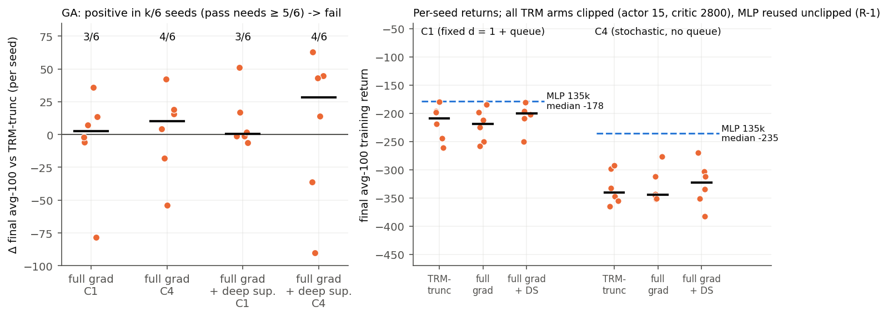

#### 10.3.5 Stage T: G1 under TD3 (GT pass, with caveat)

| Contrast (n = 12) | TD3 median Δ | TD3 positive (p two-sided) | DDPG median Δ (Phase 3) | DDPG positive |
|---|---:|---|---:|---:|
| **TRM 788k − MLP 788k (GT)** | **−1214.95** | **0/12 (0.0005)** | −27.1 | 2/12 |
| TRM 136k − MLP 135k | −152.53 | 0/12 (0.0005) | −50.2 | 0/12 |
| MLP 788k − MLP 135k | −2.73 | 2/12 (0.039) | −3.8 | 5/12 |
| TRM 788k − TRM 136k | −669.48 | 3/12 (0.15) | +20.7 | 7/12 |

| Trunk | TD3 median | DDPG median (Phase 3) | Runs learned under TD3 | Late critic loss TD3 |
|---|---:|---:|---:|---:|
| MLP 135k | −171.71 | −174.48 | 12/12 | 26.34 |
| MLP 788k | −175.92 | −177.32 | 12/12 | 23.69 |
| TRM 136k | −321.44 | −232.39 | 9/12 | 107.74 |
| TRM 788k | −1389.27 | −207.95 | 2/12 | 560.94 |

*Source: `experiments/analysis_p4_t.json`; "runs learned" uses a descriptive cut at final avg-100 > −1000 that reproduces the counts recorded in the GT caveat (`derived_numbers.json`, `t`). Under TD3 the totals include twin critics: TRM 788k is 1,181,443–1,181,827 parameters, MLP 788k 1,180,611–1,182,483.*

**GT: pass,** with the caveat recorded in `gates.json`: the pass reflects an optimisation failure, not a Phase-3-sized deficit. TRM 788k stays at random-policy level in 10 of 12 runs, its critic loss rises through training, and every MLP run learns. Phase 3's magnitude (−27.1) is *not* replicated, and Stage T does not measure it.

**What the numbers show.** Both MLPs reach the same medians under TD3 as under DDPG, in every run. TRM 788k's two learning runs are both at C1; all six no-delay runs end below the uniform-random policy's −1163.84. Its median critic loss rises from 118.6 (episodes 51–75) to 560.9 (last quarter), and rises in 11 of 12 runs; both MLPs' fall in every run. TRM 136k learns in 9 of 12 runs but trails the MLP by a median 152.5 (every pair negative, the smallest by 46.8), three times its DDPG deficit. Under TD3 the larger TRM is the worse one, the reverse of DDPG.

**Competing explanations** (none tested). The actor learning rate (1e-3, ten times DDPG's; Stage C shows a ×3 increase already hurts TRM under DDPG) is the most likely contributor, as `gates.json` records. Width-dependent instability (hidden 128 fails, 44 mostly learns) is consistent with it. The rising critic loss may be a cause or a consequence: a policy stuck near random visits high-cost states and inflates the TD targets. The other TD3 differences (batch, twin critics, target smoothing, policy delay) apply equally to the MLPs, which are unaffected.

**What it constrains.** The single-algorithm threat, partly. "TRM trails a parameter-matched MLP" holds under TD3 at both sizes (0/12 each), and MLP capacity does not rescue a capacity account: the larger MLP is slightly *worse* (−2.73, 10/12 negative, "different" by the rule but tiny). **What it does not show:** the size of an architectural deficit under TD3 among runs that train, or why TRM 788k fails.

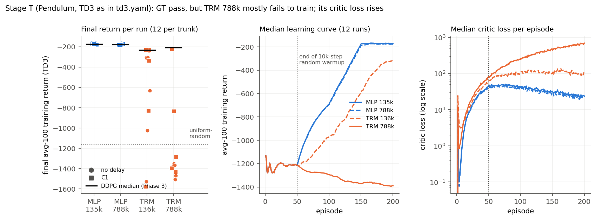

#### 10.3.6 Stage E: Lipschitz constants (exploratory)

| Trunk (12 checkpoints each) | Lipschitz median | Reversals / s | Noise drop at σ = 0.05 |
|---|---:|---:|---:|
| MLP 135k / 788k | 29.11 / 34.05 | 9.32 / 2.76 | 100.1 / 81.0 |
| TRM 136k / 788k | 11.00 / 14.61 | 0.59 / 0.43 | 156.74 / 179.09 |
| TRM H = 1 / H = 6 | 16.18 / 14.01 | 0.54 / 0.37 | 256.63 / 251.42 |

*Source: `experiments/analysis_p4_e.json`. Spearman ρ of the Lipschitz median with the noise drop: +0.06 overall (n = 72), +0.18 within MLPs, +0.23 within TRMs; with reversals: −0.24, −0.59, −0.40.*

**What the numbers show.** TRM actors have about a third to a half of the MLPs' median local gain, yet lose more return under sensor noise in 8–10 of 12 paired comparisons. Across checkpoints, gain and noise drop are essentially uncorrelated (permutation p 0.62 overall; 0.39 and 0.11 within families). The local Lipschitz constant does not explain TRM's noise sensitivity. The negative correlation with reversals is mostly produced by bang-bang policies: of the 12 checkpoints with median gain below 5, nine chatter at more than five reversals per second, saturated (locally flat) at most states and switching sharply at a boundary.

**What it does not show:** what does make TRM noise-sensitive. Non-local sensitivity, closed-loop recovery and the noise-visited state distribution remain untested candidates.

#### 10.3.7 Stage D: embedded export

The MLP 135k actor (67,329 parameters; 263.0 KiB FP32) and the TRM 136k actor (67,805 parameters plus 88 buffer floats; 265.2 KiB) both fit a 512 KiB flash budget in FP32. The TRM H = 1 actor of the 788k configuration (393,857 parameters) needs 1539.5 KiB in FP32 and fits only in INT8 (385.7 KiB). Headers with 20 reference input/output pairs each are in `phase4/results/export_c/`. The on-device equivalence test, quantised accuracy and on-device latency were not run. At matched size flash is not TRM's embedded cost; the 21 cell applications per decision are (Phase 3: 2.69 ms against 0.064 ms per decision on one Xeon thread for TRM 136k against the MLP).

### 10.4 Deviations from the Phase 4 plan

**Amendments, in order** (all dated and recorded before the data they affect; `gates.json`, plan §10):

| ID | Date | Change |
|---|---|---|
| R-1 | 2026-10-06 | Stage A MLP reuse check passed (bit-identical to Phase 3's `p3code/s2`); 12 MLP runs reused from `results_p3s2`, not rerun |
| R-2 | 2026-10-06 | Untrained baselines for the H1′ span frozen: uniform-random policy, Pendulum −1163.84, IDP 49.90, Hopper 16.32 (differs from the "≈ −1460" Phases 1–3 quoted) |
| V-1 | 2026-10-07 | Plan §5 verification passed (gradient hooks, 30/30 bit-identity, new paths, GPU smoke) before any B0, C or A job |
| A-1 | 2026-10-07 | Stage A clip norms frozen from the pilot: actor 15, critic 2800, on all three TRM arms; MLP and all earlier runs unclipped |
| K-1 | 2026-10-07 | GB0 failed; the author fired kill switch KB0 on day 2 (before the 2026-10-09 deadline); Hopper pilot run as pre-registered |
| K-2 | 2026-10-07 | KB0 also failed; Hopper dropped; IDP diagnostic (C1 at 1M, no delay at 500k) run instead; a K-3 draft to go to the author before any B1 data |
| T-1 | 2026-10-07 | Stage T added: Phase 3 Stage 1 under TD3, 48 jobs, gate GT |
| K-3 | 2026-10-08 | B1 not run, H1′ recorded as not run; the exploratory K-3 draft superseded; H1 remains untested |

**Stages that did not run.** B1 (24 planned jobs) and therefore H1′, for the reasons in §10.3.2. The on-device half of Stage D is the author's and was not part of this execution.

**Departures in execution.**

- **The kill switch fired early.** The plan set 2026-10-09 as the deadline; the author fired it on 2026-10-07 once GB0 had failed at every budget.
- **The plan's order changed.** The plan put B1 and A in week 2 and reserved week 3 for analysis. In practice every stage that ran finished between 2026-10-06 and 2026-10-08.
- **Stage E's first submission failed.** Six jobs (`p4e_lipschitz_00`–`05`) failed at import because in the frozen `p4code/e` snapshot `lipschitz.py` could not locate `src/eval.py` (a snapshot path bug). They were rerun as stage `e2` (six jobs), which processed all 72 checkpoints.
- **Two jobs reported PBS exit status −19 after completing cleanly**: one in Stage A (`p4a_trm_fullgrad_ds_C1pa_clip_s4`) and one in B0h (`p4b0h_dnn_C1_150k_s2`). In both, the job log records `exit 0` and the results file was written; both were counted done (`experiments/phase4/dashboard_state/status_latest.json`).
- **Job totals.** 154 PBS jobs: 1 smoke, 141 training runs, 6 failed and 6 successful Lipschitz jobs. No training run failed or was resubmitted.


### 10.5 What Phase 4 changes about the Phase 0–3 conclusions

| Phase 0–3 conclusion | After Phase 4 |
|---|---|
| TRM trails the MLP on Pendulum-v1; the deficit is architectural, not capacity (G1) | **Holds, and extends to TD3 in sign** (0/12 at both sizes). The magnitude did not replicate because TRM 788k mostly failed to train |
| Recursion depth is inert; only 7 of 21 applications are trained | **Holds, and training all 21 does not help** (GA fail); the 7-of-21 count is now verified directly |
| TRM fits its value function worse | **Holds** with full gradients and deep supervision (1.35–1.45× the MLP at C1, 6/6), and worsens under TD3 (3.83× and 24.91× at matched capacity) |
| The missing training discipline might explain the deficit (open) | **Not supported** in the forms that port to off-policy RL |
| TRM ran at untuned learning rates (threat) | **Ruled out** within ×0.3–×3 of both rates (GC insensitive) |
| TRM commands smoother torque but is less robust | **Holds**; the lower robustness is not explained by local gain (Stage E) |
| One learning algorithm (threat) | **Partly addressed**: the MLP transfers to TD3 unchanged; TRM is fragile under TD3 |
| Complexity scaling (H1) untested | **Still untested**: IDP and Hopper were not learned by the baseline under the pre-registered conditions |
| Use the MLP; if recursion is required, one outer cycle | **Unchanged** |

---

## 11. Cross-phase discussion: the mechanism

### 11.1 What the evidence says, piece by piece

Across five phases the evidence about *how* the recursive trunk behaves is consistent, and each piece rules something out.

1. **Only 7 of 21 cell applications are trained, but training all 21 changes nothing.** Phase 0's port truncates the gradient; Phase 4's hook test confirms the 7-of-21 count; Stage A's full-gradient arms leave return within 10 units of the truncated port, sign-inconsistently. The untrained applications were not an unused reservoir.
2. **Depth is inert.** One, three and six outer cycles give the same return at fixed parameters (Phase 3, 5/12 and 4/12), while latency and training cost scale with depth. The trunk's useful computation happens in roughly one pass, which reproduces the "shallow effective recursion" Roye-Azar et al. (2026) found for TRM on ARC, outside its original domain.
3. **The value fit is worse, at every capacity and with full gradients.** The Phase 1–2 post-hoc analysis found it first (7/7 cells); Phase 3 showed it survives capacity matching (1.45×, 1.89×, 12/12) while a larger MLP fits better; Phase 4 showed it survives full gradients and deep supervision (1.35–1.45× at C1, 6/6) and grows under TD3 (3.83×, 24.91×).
4. **The deficit is not a tuning artefact.** Neither learning rate, varied ninefold, improves TRM under DDPG (Phase 4 Stage C); a higher actor rate hurts it.
5. **The trunk is fragile under a more aggressive optimiser.** With TD3's settings (actor rate 1e-3, ten times DDPG's), TRM 788k fails to learn in 10 of 12 runs and its critic loss rises through training, while both MLPs reproduce their DDPG results exactly. The narrower TRM learns but trails by three times its DDPG gap.
6. **The deficit lives in training more than in the final policy.** Deterministic greedy policies nearly tie (−3.6, 2/12 on unseen seeds) while training return trails by ten times as much (Phase 3); the same holds with full gradients (Phase 4 Stage A, C1 greedy returns within about 10 units).
7. **Its actuation is smoother, with lower local gain, but less robust, and gain does not explain the robustness.** The smoothness comes from the recursive cell, not from iteration (H = 1 is as smooth as H = 3); TRM actors have about a third to a half of the MLP's median local gain; yet they lose more under sensor noise, a heavier plant and actuator dropout, and across checkpoints gain and noise drop are uncorrelated (Phase 3 battery; Phase 4 Stage E).
8. **Memory adds nothing.** Carrying the latent never helps (G3), including where memory has headroom (G0) and where the delay is identifiable from history (G2s).

**One reading that fits all eight** (an interpretation, not a tested result): as ported, the recursive cell is a deep, weight-tied, normalised feed-forward function of the current observation. Because every pass sees the same input and receives no error signal of its own, additional passes add depth but no information, so depth is inert and training it changes nothing. The weight-tied, normalised structure yields smooth, low-gain action maps, which explains the smoother torque, but it is a harder function class to fit by bootstrapped regression, which shows up as a worse value fit at any size, and it tolerates a large actor step size poorly. A worse critic degrades exploratory behaviour throughout training, while the final greedy policy nearly recovers, which is why the training-return gap is ten times the greedy gap.

### 11.2 Situating the result in the literature

- **TRM's own training discipline** (Jolicoeur-Martineau, 2025) supervises up to 16 successive improvement steps of the *same* input against a fixed, known answer, with a carried latent and a learned halting head; the one-step gradient truncation is affordable because supervision re-enters the trajectory at every step. An off-policy actor-critic calls the trunk once per transition and never revisits an instance, so the port kept the truncation without the supervision that justifies it. Phase 4's Stage A restored the parts that have an off-policy analogue (all gradients; a value loss at every outer cycle) and found no benefit.
- **What drives HRM and TRM in-domain.** The ARC Prize (2025) analysis of HRM finds the outer refinement loop during training to be the main driver (training-time refinement depth matters more than inference-time depth by over 15 points) and characterises the model as transductive, dependent on task identifiers. Roye-Azar et al. (2026) find that removing TRM's puzzle identifier drops accuracy to zero and that most accuracy arrives at the first recursion step. Both point to components (training-time refinement against fixed answers, per-instance conditioning, test-time compute) that an architecture-only port leaves behind, which is what this project's preconditions P1–P3 named.
- **HRM-Agent** (Dang & Rawlinson, 2025) shows that a recursive reasoning model *can* be trained by RL alone, on discrete dynamic mazes with a value-based learner, and that carrying the latent across timesteps helps there. This project's setting differs in continuous actions, an actor-critic learner trained by bootstrapping, and delay-induced partial observability; Phase 3's Carry-Z, with exact stored-state replay, did not reproduce the benefit. The result does not contradict HRM-Agent; it marks a setting where the benefit did not appear.
- **Tiny Recursive Control** (Jain & Linares, 2025) applies the same weight-tied recursion to optimal control and succeeds. The contrast explains why the port's extra depth goes unused. In Tiny Recursive Control each pass simulates the current candidate control sequence through known dynamics and feeds the tracking error back into the shared cell, and training supervises the refinements against solver-generated labels: every pass receives new information about how wrong the current answer is. Wijayatunga & Armellin (2026) do the same for the perturbed Lambert problem. In this project's model-free port, every pass re-reads the same observation and the only signal is a bootstrapped value target, so iteration has nothing to refine toward. This is context for the result, not a recommended pivot: the project's question was whether TRM's architecture works as a model-free RL trunk, and adding a dynamics model would answer a different question.
- **Capacity in deep RL** (Ota et al., 2021; Klein et al., 2024) made the Phase 1–2 capacity reading plausible, but in this setting MLP capacity was inert under DDPG and slightly harmful under TD3, so the literature's capacity effect is not what limits TRM here.
- **Memory baselines** (Ni et al., 2022) are strong when tuned; this project's carried LSTM was engineered but not tuned, which limits the memory conclusions to "Carry-Z adds nothing", not "memory cannot help".
- **Delay theory** (Derman et al., 2021) shows stationary policies over augmented states are sub-optimal in general under delay. At delays of one to four steps augmentation is a defensible baseline, but not a neutral one.

### 11.3 What the project does not license

- No claim against TRM's published results, which concern supervised puzzle solving.
- No claim that recursive models cannot be trained by RL (HRM-Agent shows they can).
- No claim about how TRM's standing changes with task complexity: H1 is untested.
- No claim beyond what was tested: Pendulum-v1 for every decisive contrast; DDPG and TD3 as configured (plus a learning-rate grid under DDPG); delays of up to four steps; 200-episode budgets for Pendulum.

---

## 12. Synthesis across phases

| Claim | Evidence | Strength |
|---|---|---|
| On Pendulum-v1, TRM trails the MLP on training return | Phase 1 0/6; Phase 3 Stage 1 0/12 (−34.4) | replicated, p = 0.0005 |
| The deficit is not a capacity artefact | matched-capacity losses at 135k (0/12) and 788k (2/12); MLP capacity inert (5/12); under TD3 TRM worse at both sizes (0/12, 0/12) | strong |
| The deficit is not an untuned learning rate | GC: no cell of a ×0.3–×3 actor × critic grid flagged; default among the best | moderate: n = 3 per cell, LR axes only |
| The deficit is not the truncated gradient or the missing per-cycle supervision | GA: full grad 3/6, 4/6; + deep sup. 3/6, 4/6 against the truncated port | moderate: n = 6, one form of supervision, clipped arms |
| Recursion depth adds cost, not return | H ∈ {1, 3, 6} flat (5/12, 4/12); latency and training cost scale with H | strong |
| TRM fits its value function worse, architecturally | 1.45× / 1.89× at matched capacity (12/12 each); 1.35–1.45× with full gradients (6/6); 3.83× / 24.91× under TD3 | strong |
| The final greedy policies are close to equivalent | battery TRM − MLP −3.6 (2/12, p = 0.039), about 0.3% of span | small but consistent TRM deficit |
| Carrying the latent does not help | G3: never ≥ 5/6 at C1, C3, C4; C6 2/6 | moderate: n = 6 excludes only consistent effects |
| Memory does not recover delay headroom (H3) | G2 wrong sign at C4 (1/6); carried LSTM worse everywhere; G2s fails | moderate |
| TRM is fragile under a second algorithm | TD3: TRM 788k learns in 2/12 runs, critic loss rises in 11/12; MLPs unaffected | strong for `td3.yaml`; cause untested |
| TRM commands smoother torque at matched return (H3.4) | 0.4 vs 9 reversals/s, 11/12 pairs, p = 0.006; lower median local gain | supported at n = 12 |
| TRM degrades more gracefully off-nominal (H3.5) | worse under noise (2/12), heavier plant and dropout; deeper is worse; not explained by local gain | contradicted |
| TRM is a worse controller to deploy | 65× latency, 11–13× training cost, narrower robustness envelope; at matched size the same flash footprint | strong on cost and robustness |
| Complexity scaling (H1) | MountainCar and BipedalWalker floor effects; IDP and Hopper not learned by the baseline under TD3 + one-step delay | **untested**, not disconfirmed |
| The recursive structure (base, hier6, singlez) matters | sign-inconsistent on a floor-effect environment | not established either way |

**What the confounds and alternative explanations became.**
- **C-1 (capacity):** removed by Phase 3's 2×2. The result is architectural.
- **C-2 (latent reset):** removed by Carry-Z with exact stored-state replay. The result is unchanged.
- **C-3 (nothing to infer):** removed by showing real memory headroom (G0) and an identifiable latent delay (G2s). No trunk exploited either.
- **Untuned learning rates:** removed by Stage C.
- **Truncated gradient, no per-cycle supervision:** removed by Stage A, in the forms that port.
- **Single algorithm:** partly removed by Stage T, which exposed a new fragility instead of a clean replication.

---

## 13. Threats to validity

- **One validated environment.** Every decisive test in Phases 3 and 4 ran on Pendulum-v1. Four candidate rungs above it (MountainCar, BipedalWalker, the inverted double pendulum and Hopper) were not learned by the baseline under the conditions tried, so no result generalises across tasks.
- **Algorithms as configured.** DDPG and TD3 ran with their repository configurations; only Stage C varied learning rates, and only under DDPG. Stage T shows configuration can dominate a TRM comparison.
- **Seeds.** 3 per cell in Phases 1–2 and in Phase 4's pilots and LR grid; 6 per cell in Phases 3–4 with gates at ≥ 5/6 (one-sided p = 0.109); pooled 12 for capacity contrasts. The designs detect consistent effects, not small ones. Two-sided p-values are reported alongside.
- **The primary metric includes exploration noise.** Training avg-100 was pre-registered for continuity. Conclusions about final policy quality rest on deterministic evaluation and the battery, which show much smaller gaps.
- **The carried LSTM was not tuned.** It is a weak memory baseline, as the Phase 1 LSTM was. Carry-Z beating it is not evidence for recursion, and its failure is not evidence against memory.
- **A-6 changed the Phase 3 Stage 2 baseline.** The previous-action input closed most of C4's headroom for the MLP. The G2 failure survives the stricter comparison against a history-free MLP, but that comparison crosses two stages.
- **Clipping in Stage A.** All Stage A TRM arms are clipped and every other run in the project is not; the actor clip bound the full-gradient arms about 4–7 times as often as the truncated port.
- **Hardware.** GPU models varied in every phase from Phase 2 on, and Phase 4 showed runs are not bit-reproducible across models. Costs are compared within a model; latency was measured on one fixed machine per phase (a Katana Xeon in Phase 3, a local workstation in Phase 4, compared only as ratios).
- **Plan-review timing (Phase 3).** The 2026-09-17 review was not consulted before execution; its central fix was run afterwards as a supplementary test with its rule fixed before data.
- **Gate operationalisation.** G4's rule did not exclude untrained policies and is reported as written. GT's rule counts signs and cannot distinguish a deficit from a failure to train; its caveat is reported with it.
- **Exploratory additions.** Stage E, and the parts of Phase 4's analysis computed while writing (paired counts, permutation p-values, the learned-run cut for Stage T, the saturation reading), are labelled exploratory.
- **Scope of the port.** The port keeps TRM's recursive core and drops what has no analogue for a flat continuous observation (token embeddings, attention over a length-one sequence, per-instance embeddings, ACT halting). The conclusions are about this port, which the project regards as faithful to the architecture but necessarily without TRM's supervised setting.

---

## 14. Recommendations and open questions

**For practice.**
- Use the MLP for delay-conditioned model-free control at this scale.
- If a recursive trunk is required anyway, use `H_cycles = 1`: the same return as deeper variants at a third of the latency.
- Do not restore the full gradient or add deep supervision for this use: it costs 1.45–1.5× the training time for no measured gain.
- Under TD3, do not assume a recursive trunk will train with settings that suit an MLP; the 788k TRM did not with `td3.yaml`.
- For embedded deployment, a 136k TRM actor fits the same flash as a 135k MLP actor (265.2 and 263.0 KiB in FP32), but costs about 42× the decision latency on one CPU thread (2.69 against 0.064 ms in Phase 3). Measure on the target before choosing it.

**For science, in order of value.**
1. **Complexity scaling is still untested.** Any new rung needs a baseline pilot first, as Phase 4 did. The IDP diagnostic shows the obstacle there is the one-step delay on an unstable plant, not budget: without delay the MLP reaches the bar. A rung that is learned under delay, or a TD3 configuration that holds IDP under delay, is a precondition for testing H1 at all.
2. **Why TRM fails under TD3.** A small actor learning-rate sweep for TRM under TD3 would test the contributor recorded in the GT caveat directly.
3. **What makes TRM noise-sensitive.** Local gain is excluded. Closed-loop recovery from noise-induced drift and sensitivity to finite perturbations are the remaining candidates.
4. **A tuned recurrent baseline** (Ni et al., 2022) before any claim about memory in this setting.
5. **Forms of training discipline not tested here:** a fixed-point (DEQ) formulation, or supervision against a fixed answer. The forms that need per-pass error feedback from a dynamics model belong to a model-based question, outside this project's scope.
6. **The on-device equivalence test** of the exported headers (the author's STM32 side), and an evaluation of INT8 actors.

---

## 15. Reproducibility

- **Code.** Training entry point `main.py` (Hydra). Phase 3 code: `src/delays.py`, `src/perturb.py`, `src/eval.py`, `TRMCarryTrunk` in `src/models/trm_control.py`, `LSTMCarryTrunk` in `src/models/lstm_control.py`, and the stored-state replay in `src/algos/ddpg.py` and `td3.py`. Phase 4 code: `src/trainer.py` (step budget), `src/models/trm_control.py` (`full_grad`, `deep_sup`), `src/algos/ddpg.py` (deep-supervision loss, per-network clipping). Configs: `conf/arch/{ddpg,td3}.yaml`; `conf/model/{dnn,dnn_large,trm,trm_small,trm_h1,trm_h6,trm_carryz,lstm_carry,trm_fullgrad,trm_fullgrad_ds}.yaml`; `conf/delay/{fixed,stochastic_u4,episode_u4}.yaml`; `conf/env/{pendulum,invdoublependulum,hopper}.yaml`.
- **Job tooling.** `experiments/phase3/p3.py` and `experiments/phase4/p4.py` (manifests, submission, status), `sync.sh` (frozen per-stage snapshots on Katana), `w0_eval.py` (battery), `bench_latency.py`, `verify_code.py`, `lipschitz.py`, `export_c.py`.
- **Analysis.** Phase 1–2: `experiments/analyze_phase1.py`, `analyze_phase2.py`, `analyze_mechanism.py` → `analysis_v3_final.json`, `analysis_phase2_final.json`, `analysis_mechanism.json`. Phase 3: `experiments/phase3/gates_eval.py`, `analyze_phase3.py` → `analysis_p3_g0.json`, `analysis_w0.json`, `analysis_s1.json`, `analysis_s2.json`, `analysis_phase3_full.json`. Phase 4: `experiments/phase4/gates_eval.py` (rules in `gates.json`) → `analysis_p4_<stage>.json`; figures and derived numbers from `experiments/phase4/make_figures_phase4.py` → `phase4/report/figures/` (including `derived_numbers.json`).
- **Data.** Raw results in `phase1/results/`, `phase2/results/`, `phase3/results/`, `phase4/results/`, and under `/srv/scratch/z5308482/trm-control/` on Katana. Checkpoints in `models/`, named by each run's `model_id`. Job ledgers `~/jobs/phase3/ledger.jsonl` and `~/jobs/phase4/ledger.jsonl`.
- **One training run**, e.g. Phase 3 Stage 2 Carry-Z at C4, seed 1:

```
python3 main.py arch=ddpg model=trm_carryz env=pendulum \
  delay=stochastic_u4 augment_obs=false prev_action_obs=true \
  run_tag=pa arch.total_episodes=200 seed=1 wandb.enabled=false
```

---

## Appendix A — Gate rules as fixed before their data

**Phase 3** (`phase3/plan/plan.md`; G2s rule in Phase 3's `gates.json`):

| Gate | Rule | Outcome |
|---|---|---|
| G0 | Per seed, final return. Passes if oracle headroom (A3 − A2) *or* memory headroom (A2 − A4) has median above the pooled seed SD and is positive in ≥ 5/6 seeds. | pass (memory headroom only) |
| G1 | n = 12 (seed, condition) pairs. "Different" = ≥ 10/12 share a sign. Stage 2 MLP = `dnn_large` iff MLP capacity is different, else `dnn`. | decided; `dnn` |
| G2 | [Carry-Z − MLP] relative to C1, at C3 or C4 (co-primary), positive in ≥ 5/6 seeds. | fail |
| G3 | Carry-Z beats Reset-Z in ≥ 5/6 seeds at some condition. | fail |
| G4 | Pendulum fixed-delay checkpoints: a non-MLP trunk non-dominated against the MLP on (return, command rate) and admitting 100 Hz at CPU p99. | weak pass (literal) |
| G2s | Latent per-episode delay. Headroom (oracle − MLP) passes as G0 does; H3 survives, narrowed, only if Carry-Z also beats both the MLP and Reset-Z in ≥ 5/6 seeds. | rejection stands (headroom 4/6; Carry-Z − Reset-Z 2/6) |

**Phase 4** (`experiments/phase4/gates.json`):

| Gate | Rule | Outcome |
|---|---|---|
| GB0 | IDP-v5, TD3, C1, MLP, seeds 1–3, budgets 150k/300k/500k. Learned = final avg-100 ≥ 8190. Passes if ≥ 2/3 learned at some budget. | fail (0/3 at every budget) |
| KB0 | If GB0 has not passed by 2026-10-09: the same on Hopper-v5, learned ≥ 3420. If that fails, Stage B stops. | fail (0/3 at every budget); Hopper dropped (K-2) |
| GC | TRM 788k, Pendulum, DDPG, C1, LR multipliers {0.3, 1, 3}², seeds 1–3. Flag a cell if final(cell, s) − final(×1/×1, s) > pooled SD in 3/3 seeds. | insensitive (no cell flagged) |
| GA | Pendulum, DDPG, C1 and C4 with previous action, seeds 1–6. Any of {full grad, + deep sup.} × {C1, C4} − TRM-trunc positive in ≥ 5/6. | fail (3/6, 4/6, 3/6, 4/6) |
| GT | Pendulum, TD3 as configured, {C0, C1} × seeds 1–6. TRM 788k − MLP 788k negative in ≥ 10/12. | pass (12/12), caveat: optimisation failure, not a Phase-3-sized deficit |
| H1′ | δ_new(s) < δ_Pendulum(s) in ≥ 5/6 seed pairs, δ = (MLP 135k − TRM 788k) / span. | not run (K-3) |

## Appendix B — Where the phases departed from their plans

**Phase 3.**
- **Stage 0 on GPU, not CPU** (author direction). The battery ran as shard jobs rather than one job per checkpoint.
- **Stage 1 ran alongside Stage 0**, not after it. It is not gated by G0.
- **Arm A4, the C4 co-primary and the previous-action input** were added before any data (A-2, A-3, A-6).
- **The latent-delay test** was added after G2, with its rule fixed before its data.
- **The battery was run over all 198 Phase 3 checkpoints** for the synthesis. It was not in the plan, which covered only the banked checkpoints.
- **Stages 3 and 4 were not run**, per G2 and G3. Phase 4 later ran their substance under a new pre-registration.

**Phase 4.** Every amendment and every execution departure is listed in §10.4. In short: the kill switch fired two days early (K-1); Hopper was dropped and an IDP diagnostic run instead (K-2); Stage T was added (T-1); B1 and H1′ were not run (K-3); Stage E's first submission failed and was rerun; two jobs reported PBS exit −19 after completing cleanly.

## Appendix C — Where to find things

| What | Where |
|---|---|
| This report (whole project) | `phase4/report/full_report.md` (+ `.pdf`) |
| Project summary for a supervisor | `phase4/report/project_summary.md` (+ `.pdf`) |
| Phase 4 report and stage notes | `phase4/report/phase4_report.md`; `stage_B0.md`, `stage_C.md`, `stage_A.md`, `stage_T.md`, `stage_E.md`, `stage_D.md` |
| Per-phase summaries, Q&A, glossary | `phase4/report/phase_summaries/`, `phase4/report/qa_all_phases.md`, `phase4/report/glossary.md` |
| Phase 4 plan and amendments | `phase4/plan/plan.md` (§10); rules and outcomes in `experiments/phase4/gates.json` |
| Phase 3 final report, paper, summary | `phase3/report/3_final_report.md`, `2_phase3_paper.md`, `1_summary_phases_0-3.md` |
| Phase 3 plan and amendments | `phase3/plan/plan.md` (§10) |
| Phases 1–2 combined report | `phase2/report-phases1-2/report.md` |
| Literature review | `phase0-literature/literature-review/review.md` |
| Analysis outputs | `experiments/analysis_*.json` |
| Run boards | Phase 3: https://claude.ai/artifact/8BBqkDsAm2ocizL1kTn6nB · Phase 4: https://claude.ai/artifact/AiHU7T9dgTWNWzXnaP8Us9 |

## References

Agarwal, R. et al. (2021). *Deep Reinforcement Learning at the Edge of the Statistical Precipice.* NeurIPS. arXiv:2108.13264 · ARC Prize (2025). *The Hidden Drivers of HRM's Performance on ARC-AGI.* · Bai, S., Kolter, J. Z. & Koltun, V. (2019). *Deep Equilibrium Models.* NeurIPS. · Dang, L. H. & Rawlinson, D. (2025). *HRM-Agent.* arXiv:2510.22832 · Derman, E., Dalal, G. & Mannor, S. (2021). *Acting in Delayed Environments with Non-Stationary Markov Policies.* ICLR. · Fujimoto, S., van Hoof, H. & Meger, D. (2018). *Addressing Function Approximation Error in Actor-Critic Methods.* ICML · Jain, A. & Linares, R. (2025). *Tiny Recursive Control.* arXiv:2512.16824 · Jolicoeur-Martineau, A. (2025). *Less is More: Recursive Reasoning with Tiny Networks.* arXiv:2510.04871 · Katsikopoulos, K. V. & Engelbrecht, S. E. (2003). Markov decision processes with delays and asynchronous cost collection. *IEEE TAC* 48(4) · Klein, T. et al. (2024). *Plasticity Loss in Deep RL: A Survey.* arXiv:2411.04832 · Lee, C.-Y. et al. (2015). *Deeply-Supervised Nets.* AISTATS · Lillicrap, T. P. et al. (2016). *Continuous control with deep reinforcement learning.* ICLR · Matheron, G., Perrin, N. & Sigaud, O. (2019). *The problem with DDPG.* arXiv:1911.11679 · Ni, T., Eysenbach, B. & Salakhutdinov, R. (2022). *Recurrent Model-Free RL Can Be a Strong Baseline for Many POMDPs.* ICML · Ota, K., Jha, D. K. & Kanezaki, A. (2021). *Training Larger Networks for Deep RL.* arXiv:2102.07920 · Roye-Azar, A. et al. (2026). *Tiny Recursive Models on ARC-AGI-1.* arXiv:2512.11847 · Towers, M. et al. (2024). *Gymnasium.* arXiv:2407.17032 · Wijayatunga, M. & Armellin, R. (2026). *Tiny Recursive Models for Solving the J2-Perturbed Lambert Problem.* arXiv:2606.00895
