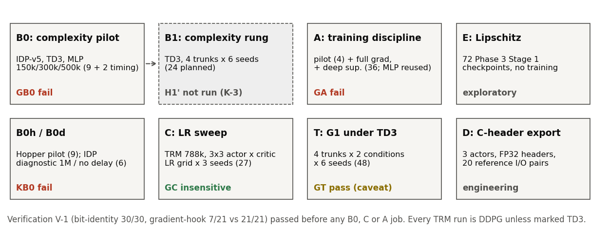
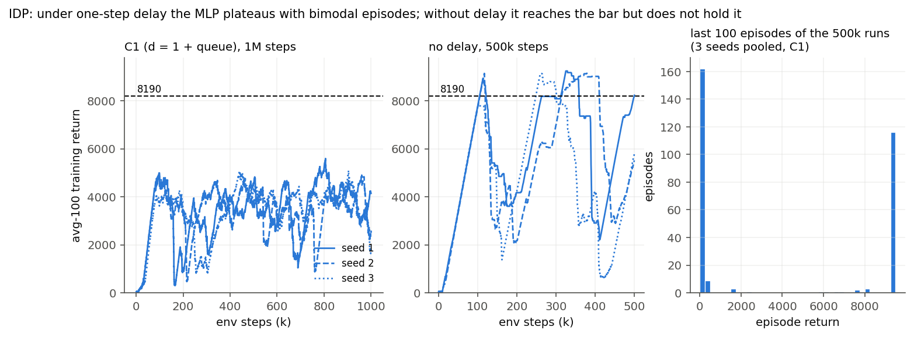
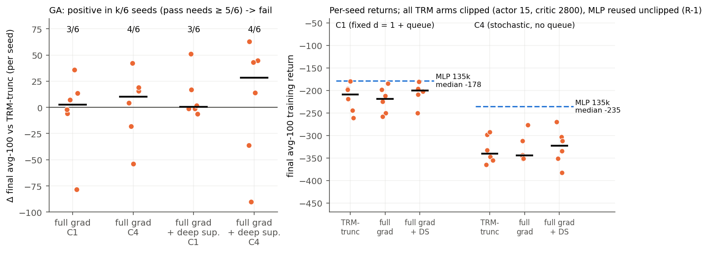
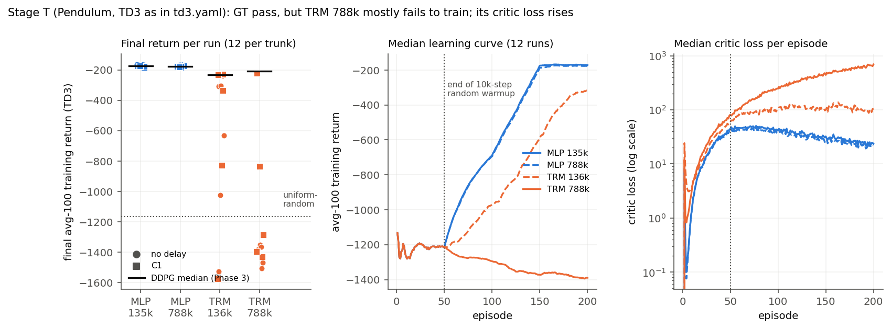

# Recursion Under Delay: Phase 4 Report

*trm-delay-robust-scaling · Phase 4 report · 2026-10-08*
*Complexity rung, training discipline, learning-rate sweep, the capacity contrast under TD3, and two exploratory stages. Stage notes (`stage_B0.md`, `stage_C.md`, `stage_A.md`, `stage_T.md`, `stage_E.md`, `stage_D.md`) and figures (`figures/`) sit alongside; analysis files are in `../../experiments/`.*

<!-- toc -->

## Executive summary

**Why Phase 4.** Phases 0–3 found that a TRM actor-critic trunk trails a plain MLP on Pendulum-v1 under delay, that the deficit is architectural rather than a matter of capacity, that recursion depth is inert, and that carrying the latent across steps adds nothing (the residual-uncertainty hypothesis H3 was rejected). Three things were left open: the complexity-scaling question H1 had never been tested on a rung the baseline could learn; the port had dropped TRM's training discipline (it trains only 7 of 21 cell applications and supervises only the final readout); and every contrast had used one algorithm, DDPG.

**What was run.** A pre-registered plan (frozen 2026-10-06, rules in `experiments/phase4/gates.json`), executed on UNSW Katana in 154 PBS jobs: 141 training runs, 12 jobs for a Lipschitz analysis of 72 Phase 3 checkpoints (six of them failed and were rerun) and one smoke job. The C-header export was not a PBS job (`p4.py` has no export stage). Every rule change was recorded as a dated amendment before the data it affected.

**What it found.**

| Stage | Question | Outcome (as recorded in `gates.json`) |
|---|---|---|
| B0 | Is InvertedDoublePendulum-v5 learned by the MLP under TD3 + one-step delay? | **GB0 fail**: 0/3 seeds learned at 150k, 300k and 500k steps |
| B0h | Kill-switch fallback: is Hopper-v5? | **KB0 fail**: 0/3 at every budget; Hopper dropped (K-2) |
| B0d | IDP diagnostic: does 1M steps or removing the delay help? | Not a gate. 1M: 0/3. No delay: all 3 reach 8190 at some point, 1/3 hold it |
| B1 | Does TRM's normalised deficit shrink on the harder rung (H1′)? | **Not run** (author decision, K-3); H1 remains untested |
| C | Is TRM's deficit an untuned learning rate? | **GC insensitive**: no cell of a ×0.3–×3 actor × critic grid is flagged |
| A | Does restoring full gradients and deep supervision help TRM? | **GA fail**: best contrasts 4/6 (pass needs 5/6) |
| T | Does Phase 3's capacity attribution (G1) hold under TD3? | **GT pass** (12/12), **with a recorded caveat**: TRM 788k does not train under `td3.yaml` (2/12 runs learn; its critic diverges), so the pass is an optimisation failure, not a Phase-3-sized deficit |
| E | Does the actor's local Lipschitz constant explain TRM's smoothness and noise sensitivity? | Exploratory: TRM actors have *lower* local gain yet larger noise drops; the constant does not explain the noise sensitivity |
| D | Export actors to C headers for an STM32 test | Done; MLP 135k and TRM 136k fit 512 KiB in FP32, the 788k-configuration TRM only in INT8; on-device test not run |

**What it changes.** Two of the explanations Phase 3 left for TRM's deficit are now removed: it is not an untuned learning rate (Stage C), and it is not the truncated gradient or the missing per-cycle supervision, at least in the forms that have an off-policy analogue (Stage A). Stage T adds that the recursive trunk is fragile under a second algorithm: with TD3's settings it mostly fails to train at all, while the MLP is unaffected. The complexity question H1 could not be put at risk, because neither harder rung was learned by the baseline under the pre-registered conditions; it stays untested, and that is a limitation of the project, not evidence against TRM. **The practical recommendation is unchanged: use the MLP.**



---

## 1. Why Phase 4

Phase 3 removed the three confounds that had made the Phase 1–2 negative ambiguous: capacity, the latent reset, and the absence of anything to infer. Its final report closed with four open questions, in order of value: restore the training discipline; test the contrast under TD3 and on an unstable plant learned at budget; re-test complexity scaling on environments that are actually learned; and build a tuned recurrent baseline. Phase 4 took the first three, re-ordered by what would most change the conclusions (plan §0):

1. **Stage B (complexity).** Add one rung the MLP learns, then test H1′: does TRM's span-normalised deficit shrink from Pendulum to the new rung?
2. **Stage A (training discipline).** Backpropagate through every cell application, and supervise every outer cycle's value readout.
3. **Stage C (tuning).** Rule out "TRM was never tuned" with a small learning-rate sweep.

Stage T (G1 under TD3) was added by amendment T-1 after the plan was frozen and before its data, to address the single-algorithm threat directly. Stage E (Lipschitz mechanism analysis) and Stage D (C-header export) were exploratory and engineering stages without gates.

The thesis framing is unchanged: the goal is to assess whether TRM's architecture, ported as faithfully as the setting allows, works as a model-free RL trunk. Phase 4 does not redesign the architecture.

## 2. What was pre-registered

The plan (`phase4/plan/plan.md`) was frozen on 2026-10-06, before any Phase 4 data. Its decision rules are machine-readable in `experiments/phase4/gates.json`, and `experiments/phase4/gates_eval.py` evaluates them; a gate command writes an outcome only when its data are complete and never edits a rule or a frozen value.

| Gate | Stage | Pre-registered rule |
|---|---|---|
| GB0 | B0 | IDP-v5, TD3, C1, MLP, seeds 1–3, budgets 150k/300k/500k env steps. A seed is learned at a budget if its final avg-100 ≥ 8190 (90% of the registry's 9100). Passes if ≥ 2/3 are learned at some budget; B1 uses the smallest passing budget. |
| KB0 | B0 | If GB0 has not passed by 2026-10-09, the same pilot on Hopper-v5 (learned ≥ 3420, 90% of 3800). If that fails, Stage B stops and goes to the author. |
| GC | C | TRM 788k, Pendulum, DDPG, C1, actor × critic LR multipliers {0.3, 1, 3}², seeds 1–3. A cell is flagged if final(cell, s) − final(×1/×1, s) exceeds the two cells' pooled seed SD in all 3 seeds. |
| GA | A | Pendulum, DDPG, C1 and C4 with the previous action, seeds 1–6. For D ∈ {full grad, full grad + deep sup.} and each condition, per seed D − TRM-trunc. Passes if any of the four contrasts is positive in ≥ 5/6 seeds. |
| GT | T | Pendulum, TD3 (`td3.yaml` unchanged), {no delay, C1} × seeds 1–6. Passes if TRM 788k − MLP 788k is negative in ≥ 10/12 (seed, condition) pairs. |
| H1′ | B1 | Per seed, δ_E(s) = [final_MLP135k(s) − final_TRM788k(s)] / span_E, span_E = best_E − untrained_E. Supported only if δ_new(s) < δ_Pendulum(s) in ≥ 5/6 seed pairs. |

*Source: `experiments/phase4/gates.json` (`gates[].rule`).*

The plan also fixed, before data: the reference returns and the 90% rule; the step budgets; the LR grid; the rule for setting the Stage A clip norms from a pilot; the reuse condition for the Stage A MLP arm; and the untrained baseline for the H1′ span (a uniform-random policy, amendment R-2).

## 3. Methodology

### 3.1 Environments and why each was chosen

- **Pendulum-v1** (3-D observation, 1-D torque in [−2, 2], 200-step episodes, dense cost). The one environment every trunk learned in Phases 1–3, and the site of every decisive Phase 3 result. Stages A, C and T use it so that their results connect directly to Phase 3.
- **InvertedDoublePendulum-v5** (MuJoCo, 1000-step limit, alive bonus 10 per step). Chosen in the Phase 3 plan (S3.2) for control-theoretic reasons rather than as a generic "harder" task: it is open-loop unstable with a short time constant, so an action delay consumes stability margin rather than only obscuring the state. Reference return 9100, the `reward_threshold` Gymnasium 1.3.0 registers; the maximum achievable return is about 9360; Fujimoto et al. (2018) report 9337 for TD3.
- **Hopper-v5** (MuJoCo locomotion, 1000-step limit). The pre-registered kill-switch fallback if IDP failed; reference 3800 (registry), learned ≥ 3420.

### 3.2 Algorithms and hyperparameters

| Setting | DDPG (`conf/arch/ddpg.yaml`) | TD3 (`conf/arch/td3.yaml`) |
|---|---|---|
| Actor / critic learning rate | 1e-4 / 1e-3 | 1e-3 / 1e-3 |
| Batch size | 128 | 256 |
| Random-action warmup | 1000 steps | 10,000 steps |
| Exploration | OU noise, θ = 0.15, σ = 0.2, dt = 0.01 | Gaussian, 0.1 of the action range |
| Critics | one | twin, minimum used for targets |
| Actor / target update | every step | every 2 critic steps (policy delay 2) |
| Target-policy smoothing | — | noise 0.2, clipped at 0.5 |
| γ, τ, buffer | 0.99, 0.005, 200,000 | 0.99, 0.005, 200,000 |
| Updates | one per env step, once the buffer holds one batch | same |
| Episode budget (default) | 200 episodes | 200 episodes |

Stages A and C use DDPG. Stages B0, B0h, B0d and T use TD3. Neither configuration was tuned for any trunk, except for the learning rates in Stage C's grid. IDP and Hopper runs use an env-step budget (`arch.total_steps`): no new episode starts once the budget is reached, and the last episode runs to its end.

### 3.3 Trunks and parameter counts

All trunks are drop-in replacements for the actor's and critic's feature extractor. The MLPs are `[256, 256]` (`dnn`, "135k") and `[624, 624]` (`dnn_large`, "788k"), ReLU. The TRM trunks share one SwiGLU/RMSNorm reasoning cell (two layers, expansion 4) applied recursively over two latents: `trm` ("788k") has hidden size 128, `trm_small` ("136k") 44; both use `H_cycles = 3` outer and `L_cycles = 6` inner cycles, so 21 cell applications per forward pass, of which the one-step truncation trains 7. `trm_h1` sets `H_cycles = 1` (7 applications, all trained) at identical parameters. `trm_fullgrad` and `trm_fullgrad_ds` are `trm` with the Phase 4 flags.

**Counting basis.** Every parameter count in this report sums the trainable parameters of all networks the agent trains, excluding target networks, as written to each results file's `param_count` (`src/trainer.py::_count_params`). Under DDPG that is actor + one critic; under TD3 it is actor + twin critics. The labels "135k", "136k" and "788k" always name the DDPG-basis configurations. Counts shift slightly with the observation width (queue and previous-action slots).

| Trunk | DDPG, Pendulum C1 | DDPG, Pendulum C1 + previous action | TD3, Pendulum C1 | TD3, IDP C1 |
|---|---:|---:|---:|---:|
| MLP 135k | 134,914 | 135,426 | 202,499 | 207,107 |
| MLP 788k | 788,114 | — | 1,182,483 | — |
| TRM 136k | 135,654 | — | 203,503 | — |
| TRM 788k (and H = 1, full grad, + DS) | 787,842 | 788,098 | 1,181,827 | 1,184,131 |

*Source: `param_count` in the results files: Phase 3 `results_p3s1` and `results_p3s2`; Phase 4 `results_p4t`, `results_p4b0` (via `phase4/report/figures/derived_numbers.json`).*

### 3.4 Delay conditions

The delay wrapper applies each action *d* steps late. With augmentation, the observation carries the queue of committed but not yet applied actions, which restores a sufficient statistic for a fixed delay.

- **C0:** no delay.
- **C1:** fixed d = 1, with the one-slot queue in the observation.
- **C4:** d ~ U{0..4} resampled every step, queue withheld.

Stages B0, C and T use C1 without a previous-action input (Phase 3 Stage 1's condition). Stage A uses C1 and C4 *with* the previous action appended (Phase 3 Stage 2's condition, amendment A-6 of Phase 3), so its MLP arm could be reused. Stage T also runs C0.

### 3.5 Seeds and budgets

| Stage | Environment, algorithm | Trunks | Conditions | Seeds | Budget | Runs |
|---|---|---|---|---|---|---:|
| B0 | IDP, TD3 | MLP 135k (+ TRM, TRM H = 1 timing) | C1 | 1–3 | 150k / 300k / 500k steps (timing 15k) | 9 + 2 |
| B0h | Hopper, TD3 | MLP 135k | C1 | 1–3 | 150k / 300k / 500k steps | 9 |
| B0d | IDP, TD3 | MLP 135k | C1; C0 | 1–3 | 1M; 500k steps | 6 |
| C | Pendulum, DDPG | TRM 788k | C1 | 1–3 | 200 episodes, 9 LR cells | 27 |
| A (pilot a0) | Pendulum, DDPG | TRM, full grad, + DS | C1, C4 (+ prev. action) | 1 | 200 episodes | 4 |
| A | Pendulum, DDPG | TRM-trunc, full grad, + DS (MLP reused) | C1, C4 (+ prev. action) | 1–6 | 200 episodes | 36 |
| T | Pendulum, TD3 | MLP 135k, 788k; TRM 136k, 788k | C0, C1 | 1–6 | 200 episodes | 48 |
| **Total training runs** | | | | | | **141** |

*Source: result-file counts in `derived_numbers.json` (`result_files`).*

### 3.6 Metrics

- **Primary:** final avg-100 *training* return (mean return over the last 100 training episodes, exploration noise included), as in Phases 1–3.
- **Eval last-5:** the mean of the last five deterministic evaluation episodes (one every 10 training episodes).
- **Late critic loss:** the median per-episode critic loss over the last quarter of episodes with updates. Ratios between arms are computed per seed, then the median is reported.
- **IDP / Hopper:** steps to the first avg-100 ≥ the learned bar (counted from episode 100); the share of episodes with return > 9000 (a full solve on IDP); deterministic evaluations solved.
- **Stage E:** the actor's local Lipschitz constant (spectral norm of ∂a/∂s over plant inputs) at 4000 visited states per checkpoint, against the Phase 3 battery's reversals per second and sensor-noise return drop (battery IQM with stratified bootstrap CIs, Agarwal et al., 2021).
- **Cost:** wall-clock per run within a GPU model; decision latency (batch 1, one CPU thread).

### 3.7 Statistics

Pairs are matched by seed (and by condition where conditions are pooled). The sign test counts k of n positive paired differences: one-sided where a gate has a direction, with the two-sided p reported alongside. With n = 6, 5/6 gives one-sided p = 0.109; with pooled n = 12, 10/12 gives two-sided p = 0.039. The pooled seed SD of two arms is the square root of the mean of their two seed variances, used by GC's magnitude rule. Spearman correlations in Stage E are descriptive, with permutation p-values added for this report.

### 3.8 Pre-registration, gating and frozen code

Each stage ran from a frozen code snapshot (`p4code/<stage>` on Katana, made by `sync.sh`), tracked in a job ledger and a live status JSON (`p4.py status`) and shown on a run board. The author made every gate decision; execution stopped and reported at each gate, at the kill switch and before every main matrix. New behaviour sits behind new default-off flags (`arch.total_steps`, `model.full_grad`, `model.deep_sup`, `arch.actor_grad_clip`, `arch.critic_grad_clip`), so existing configurations are untouched (§4).

### 3.9 Compute

All jobs ran on Katana GPU nodes as PBS batch jobs: one GPU, two CPU cores, 8 GB of memory (Pendulum) or 16 GB (IDP, Hopper), walltime 01:59:00, which routes to the `mechgpu2` queue and reaches every GPU node, and `gpu_rp6000=False` to avoid the one node whose GPU the venv's PyTorch build cannot use (Phase 3 incident 1). The 141 training runs landed on Tesla V100-SXM2-32GB (56), NVIDIA L40S (53) and NVIDIA A100-SXM4-40GB (32) GPUs (`experiments/phase4/dashboard_state/status_latest.json`).

## 4. Engineering and verification (amendment V-1)

Phase 4 added an env-step budget, the full-gradient and deep-supervision paths in the TRM trunk and the DDPG update, per-network gradient clipping with pre-clip norm logging, and the configs `trm_fullgrad.yaml` and `trm_fullgrad_ds.yaml`. Before any B0, C or A job, `verify_code.py` checked four things (V-1, 2026-10-07):

1. **Gradient-hook test.** Hooks on every reasoning-cell application count those whose output receives non-zero gradient. Truncated: 7 of 21 at H = 3; with `full_grad`: 21 of 21. Also 7/7 at H = 1 and 7/42 against 42/42 at H = 6. This confirms directly the Phase 3 statement that only 7 applications are ever trained, whatever the depth.
2. **Bit-identity.** 30 of 30 existing configurations (DDPG and TD3 × 12 trunks at fixed d = 1 + queue; DDPG × {MLP, TRM, Carry-Z} at no delay and at C4 + previous action) produced identical final-weight hashes and episode histories under the pre-Phase-4 snapshot (identical to Phase 3's `p3code/s2x`) and the Phase 4 tree, training 2 Pendulum episodes on CPU.
3. **New paths.** Clip = inf reproduces the unclipped run exactly; both new TRM configs train; `total_steps` ends a run at its budget.
4. **GPU smoke job** on a V100 covering IDP + TD3, the step budget, a learning-rate override and `trm_fullgrad_ds` with clipping at C4.

The same check underwrote amendment R-1: DDPG + MLP at C1 and C4 with the previous action trains bit-identically under Phase 3's `p3code/s2` snapshot and the Phase 4 tree, so Stage A reuses Phase 3 Stage 2's 12 MLP runs.

*Source: amendments V-1 and R-1 in `gates.json`; outputs in `experiments/phase4/verification/` (`bit_identity.txt`: "30/30 configs bit-identical").*

One reproducibility limit was found during execution rather than verified in advance: **runs are not bit-reproducible across GPU models.** B0's nested budgets give a free check. Runs on the same GPU model reproduced each other exactly (IDP 2/2 pairs, Hopper 4/4), while every pair on different models diverged (IDP 0/4, Hopper 0/2), sometimes by more than the seed spread (`analysis_p4_b0.json`, `nested_check`; devices in `derived_numbers.json`). Every Phase 4 stage mixed GPU models, so hardware variation is part of the seed variation in every comparison.

## 5. Results

All returns are final avg-100 training returns unless marked otherwise. "k/n" is k of n paired differences positive. Each stage note gives the full tables, per-seed values and figures; this section gives the results against each rule and discusses them.

### 5.1 Stage B0: no learnable rung (GB0 fail, KB0 fail)

| Rung | Budget | Final avg-100, seeds 1 / 2 / 3 | Learned |
|---|---|---|---:|
| IDP-v5 (bar 8190) | 150k / 300k / 500k | 3681.0 / 2291.1 / 2032.4 · 3861.2 / 3077.6 / 4160.1 · 4312.4 / 3781.1 / 3591.6 | 0/3 at each |
| Hopper-v5 (bar 3420) | 150k / 300k / 500k | 1101.1 / 954.0 / 1708.2 · 1729.6 / 1855.6 / 1790.4 · 1418.0 / 2805.3 / 2201.3 | 0/3 at each |
| IDP diagnostic, C1 | 1M | 4146.9 / 2590.2 / 1732.8 | 0/3 |
| IDP diagnostic, no delay | 500k | 8226.2 / 5516.8 / 5779.7 (all three crossed 8190 at some point) | 1/3 |

*Source: `experiments/analysis_p4_b0.json`, `analysis_p4_b0h.json`, `analysis_p4_b0d.json`.*

**What the numbers show.** On IDP the MLP plateaued at avg-100 between about 3100 and 4300 from 300k steps on, far above the uniform-random baseline (49.90) and far below the bar. Its episodes are bimodal: in the last 100 episodes of the 500k runs, 32–45% are full 1000-step solves and the rest mostly early falls (of 300 pooled episodes, 116 solved, 171 below 500, 13 between). The threshold was missed through unreliability, not budget: 1M steps were no better than 300k–500k, and the per-100k solve share moved between 5.7% and 48.5% without a trend. Removing the delay changed the picture: every seed crossed 8190 (two by about 106k steps), and the deterministic policy solved 23–26 of the last 30 evaluations against 9–11 of 30 under C1. Hopper's MLP reached at most 2805.3 at 500k (82% of its bar), a risk the plan had flagged in advance.

**Robustness.** The verdict is uniform: none of the 21 C1 runs across B0, B0h and B0d was learned. The no-delay result is less clean: TD3 collapses and recovers there too, and only one seed ends above the bar.

**Competing explanations.** (a) *Too little budget:* contradicted by the 1M runs. (b) *The bar is too strict for noisy training return:* partly true (deterministic evaluations are higher), but even greedy policies solve only about a third of episodes under delay. (c) *TD3 as configured is unstable on IDP:* supported in part, since even the no-delay runs do not hold the bar. (d) *The one-step delay on an unstable plant:* the strongest single factor, since removing it moves the same learner from 0/3 to 3/3 crossings and from about a third to about three quarters of greedy episodes solved.

**What it constrains.** Nothing about TRM. GB0 and KB0 are pilots of the baseline; their failure means B1 had no pre-registered rung on which to test H1′. **What it does not show:** that TRM's relative standing changes, or does not change, with complexity.



### 5.2 Stage B1 and H1′: not run (K-3)

Under amendment K-2, if the 1M diagnostic failed GB0's rule, B1 could only run as an exploratory study with a post-hoc "clear of floor" criterion. A draft amendment proposing exactly that (`phase4/plan/K-3_draft.md`: IDP at 300k, "clear of floor" at ≥ 2275, Stage T as the Pendulum reference) went to the author. Before it was approved, Stage T showed that TRM 788k does not train under `td3.yaml` even on Pendulum. The author decided on 2026-10-08 not to run B1 (amendment K-3): no harder rung was learnable by the baseline under the pre-registered conditions, and a TD3 B1 would most likely have measured TRM's optimisation failure rather than complexity scaling. The draft is superseded, H1′ is recorded as not run, and **H1 remains untested for the whole project**: MountainCarContinuous-v0, BipedalWalker-v3, InvertedDoublePendulum-v5 and Hopper-v5 were all unlearnable by the baseline at the budgets and settings tried. This is a limitation of the study, not evidence against TRM.

The H1′ span would have used a uniform-random untrained baseline (R-2: Pendulum −1163.84, IDP 49.90, Hopper 16.32). That differs from the "≈ −1460" untrained Pendulum figure Phases 1–3 quoted, which was the return of an actor that learned nothing (the failed Phase 1 LSTM), not of random actions.

### 5.3 Stage C: learning-rate sweep (GC insensitive)

| Actor LR \ critic LR | 3e-4 | 1e-3 | 3e-3 |
|---|---:|---:|---:|
| 3e-5 | −223.85 (Δ −8.73, 0/3) | −234.79 (−18.51, 0/3) | −245.59 (−49.57, 1/3) |
| 1e-4 | −250.41 (−35.29, 0/3) | **−215.12 (default)** | −208.79 (+10.95, 2/3) |
| 3e-4 | −261.45 (−41.72, 0/3) | −270.82 (−55.71, 0/3) | −244.75 (−48.73, 0/3) |

*Median final avg-100 per cell (median Δ against the default cell, seeds positive). Source: `experiments/analysis_p4_c.json`.*

**What the numbers show.** No cell is flagged, so GC records "TRM insensitive to LR within ×0.3–×3". The default is among the best cells: seven of eight alternatives have lower medians, six of them in all three seeds. The only cell with a higher median (critic ×3) has per-seed differences −15.3, +17.3, +11.0 against a pooled SD of 10.2.

**Robustness.** n = 3 per cell; a 0/3 cell has two-sided p = 0.25. The rule can detect only large, consistent improvements, and the grid shows none. Deterministic evaluation is nearly flat outside the ×3-actor row (−179.3 to −173.5).

**An exploratory pattern with consequences for Stage T.** All three ×3-actor-LR cells (3e-4) are below the default in 3/3 seeds, by 41.7–55.7 at the median, and carry the grid's highest late critic losses (24.5–28.2 against 22.6). Raising TRM's actor learning rate hurts it. TD3's actor rate is 1e-3, ten times the DDPG default.

**What it constrains.** The "untuned" explanation for TRM's deficit, along the learning-rate axes. The best cell's median (−208.8) is about where Phase 3's TRM 788k sat at C1 (−208.7 for seeds 1–3) and well below Phase 3's MLP 135k at C1 (−176.8), a cross-stage comparison. **What it does not show:** insensitivity to other optimiser settings (batch size, τ, noise scale), or at other conditions.

### 5.4 Stage A: training discipline (GA fail)

| Contrast (n = 6) | Median Δ | Positive | p one-sided | p two-sided |
|---|---:|---:|---:|---:|
| TRM-fullgrad − TRM-trunc, C1 | +2.49 | 3/6 | 0.656 | 1.00 |
| TRM-fullgrad − TRM-trunc, C4 | +10.07 | 4/6 | 0.344 | 0.69 |
| TRM-fullgrad + DS − TRM-trunc, C1 | +0.35 | 3/6 | 0.656 | 1.00 |
| TRM-fullgrad + DS − TRM-trunc, C4 | +28.45 | 4/6 | 0.344 | 0.69 |
| *Secondary:* TRM-fullgrad − MLP, C1 / C4 | −40.50 / −82.66 | 1/6, 1/6 | — | 0.22, 0.22 |
| *Secondary:* TRM-fullgrad + DS − MLP, C1 / C4 | −22.46 / −88.77 | 1/6, 1/6 | — | 0.22, 0.22 |

*Source: `experiments/analysis_p4_a.json`. TRM arms clipped at actor 15 / critic 2800 (A-1); MLP reused from Phase 3 Stage 2, unclipped (R-1).*

| Arm | C1 median | C4 median | Eval last-5 C1 / C4 | Late critic loss C1 / C4 |
|---|---:|---:|---|---|
| MLP 135k | −178.31 | −235.37 | −169.46 / −170.44 | 13.63 / 41.76 |
| TRM-trunc | −208.71 | −340.19 | −168.62 / −194.10 | 18.54 / 50.45 |
| TRM-fullgrad | −218.41 | −344.59 | −170.01 / −209.21 | 19.90 / 46.42 |
| TRM-fullgrad + DS | −200.00 | −323.03 | −159.59 / −202.06 | 16.84 / 47.85 |

**What the numbers show.** GA fails: no contrast reaches 5/6. Training all 21 cell applications leaves TRM within 10 reward units of the truncated port at both conditions, sign-inconsistently, at 1.44–1.50× its training time on every GPU model. Deep supervision's C4 contrast has the largest median (+28.45), but two of its six seeds lose 36 and 90 units. Both restored variants still trail the MLP in 5/6 seeds at each condition, and their late critic loss is still above the MLP's in 6/6 seeds at C1 (1.45× and 1.35×). Deterministic evaluation tells the same story: at C1 all arms' greedy policies are within about 10 units; at C4 the TRM arms trail the MLP by 24–39 units.

**Robustness.** n = 6; the per-seed differences straddle zero with magnitudes comparable to the pooled seed SD (27.6–35.1). Inference latency is unchanged by the flags, as expected (p50 7.69–7.77 ms for all three TRM arms against the MLP's 0.098 ms on the local workstation), so the restored variants buy nothing at deployment either.

**Competing explanations for the null.** (a) *The untrained 14 applications never mattered:* consistent with Phase 3's depth result (H = 1, 3, 6 indistinguishable) and with this one. (b) *Clipping restrained the full-gradient arms:* the same actor clip bound them about 4–7 times as often as TRM-trunc (median 3.5–8.7% of updates against 0.6–2.0%). This cannot be excluded at the frozen clip. (c) *The wrong kind of supervision:* deep supervision here gives every outer cycle the same bootstrapped TD target. Published TRM supervises successive improvement steps against a fixed, known answer, on a revisitable instance with a carried latent; that has no off-policy analogue here and was not tested.

**What it constrains.** The training-discipline explanation, in the forms that port: the deficit is not caused by the gradient truncation or by supervising only the final readout. **What it does not show:** that no supervision scheme could help.



### 5.5 Stage T: G1 under TD3 (GT pass, with caveat)

| Contrast (n = 12) | TD3 median Δ | TD3 positive (p two-sided) | DDPG median Δ (Phase 3) | DDPG positive |
|---|---:|---|---:|---:|
| **TRM 788k − MLP 788k (GT)** | **−1214.95** | **0/12 (0.0005)** | −27.1 | 2/12 |
| TRM 136k − MLP 135k | −152.53 | 0/12 (0.0005) | −50.2 | 0/12 |
| MLP 788k − MLP 135k | −2.73 | 2/12 (0.039) | −3.8 | 5/12 |
| TRM 788k − TRM 136k | −669.48 | 3/12 (0.15) | +20.7 | 7/12 |

| Trunk | TD3 median | DDPG median (Phase 3) | Runs learned under TD3 | Late critic loss TD3 |
|---|---:|---:|---:|---:|
| MLP 135k | −171.71 | −174.48 | 12/12 | 26.34 |
| MLP 788k | −175.92 | −177.32 | 12/12 | 23.69 |
| TRM 136k | −321.44 | −232.39 | 9/12 | 107.74 |
| TRM 788k | −1389.27 | −207.95 | 2/12 | 560.94 |

*Source: `experiments/analysis_p4_t.json`; "runs learned" uses a descriptive cut at final avg-100 > −1000 that reproduces the counts recorded in the GT caveat (`derived_numbers.json`, `t`). Under TD3 the totals include twin critics: TRM 788k is 1,181,443–1,181,827 parameters, MLP 788k 1,180,611–1,182,483.*

**GT: pass,** with the caveat recorded in `gates.json`: the pass reflects an optimisation failure, not a Phase-3-sized deficit. TRM 788k stays at random-policy level in 10 of 12 runs, its critic loss rises through training, and every MLP run learns. Phase 3's magnitude (−27.1) is *not* replicated, and Stage T does not measure it.

**What the numbers show.** Both MLPs reach the same medians under TD3 as under DDPG, in every run. TRM 788k's two learning runs are both at C1; all six no-delay runs end below the uniform-random policy's −1163.84. Its median critic loss rises from 118.6 (episodes 51–75) to 560.9 (last quarter), and rises in 11 of 12 runs; both MLPs' fall in every run. TRM 136k learns in 9 of 12 runs but trails the MLP by a median 152.5 (every pair negative, the smallest by 46.8), three times its DDPG deficit. Under TD3 the larger TRM is the worse one, the reverse of DDPG.

**Competing explanations** (none tested). The actor learning rate (1e-3, ten times DDPG's; Stage C shows a ×3 increase already hurts TRM under DDPG) is the most likely contributor, as `gates.json` records. Width-dependent instability (hidden 128 fails, 44 mostly learns) is consistent with it. The rising critic loss may be a cause or a consequence: a policy stuck near random visits high-cost states and inflates the TD targets. The other TD3 differences (batch, twin critics, target smoothing, policy delay) apply equally to the MLPs, which are unaffected.

**What it constrains.** The single-algorithm threat, partly. "TRM trails a parameter-matched MLP" holds under TD3 at both sizes (0/12 each), and MLP capacity does not rescue a capacity account: the larger MLP is slightly *worse* (−2.73, 10/12 negative, "different" by the rule but tiny). **What it does not show:** the size of an architectural deficit under TD3 among runs that train, or why TRM 788k fails.



### 5.6 Stage E: Lipschitz constants (exploratory)

| Trunk (12 checkpoints each) | Lipschitz median | Reversals / s | Noise drop at σ = 0.05 |
|---|---:|---:|---:|
| MLP 135k / 788k | 29.11 / 34.05 | 9.32 / 2.76 | 100.1 / 81.0 |
| TRM 136k / 788k | 11.00 / 14.61 | 0.59 / 0.43 | 156.74 / 179.09 |
| TRM H = 1 / H = 6 | 16.18 / 14.01 | 0.54 / 0.37 | 256.63 / 251.42 |

*Source: `experiments/analysis_p4_e.json`. Spearman ρ of the Lipschitz median with the noise drop: +0.06 overall (n = 72), +0.18 within MLPs, +0.23 within TRMs; with reversals: −0.24, −0.59, −0.40.*

**What the numbers show.** TRM actors have about a third to a half of the MLPs' median local gain, yet lose more return under sensor noise in 8–10 of 12 paired comparisons. Across checkpoints, gain and noise drop are essentially uncorrelated (permutation p 0.62 overall; 0.39 and 0.11 within families). The local Lipschitz constant does not explain TRM's noise sensitivity. The negative correlation with reversals is mostly produced by bang-bang policies: of the 12 checkpoints with median gain below 5, nine chatter at more than five reversals per second, saturated (locally flat) at most states and switching sharply at a boundary.

**What it does not show:** what does make TRM noise-sensitive. Non-local sensitivity, closed-loop recovery and the noise-visited state distribution remain untested candidates.

### 5.7 Stage D: embedded export

The MLP 135k actor (67,329 parameters; 263.0 KiB FP32) and the TRM 136k actor (67,805 parameters plus 88 buffer floats; 265.2 KiB) both fit a 512 KiB flash budget in FP32. The TRM H = 1 actor of the 788k configuration (393,857 parameters) needs 1539.5 KiB in FP32 and fits only in INT8 (385.7 KiB). Headers with 20 reference input/output pairs each are in `phase4/results/export_c/`. The on-device equivalence test, quantised accuracy and on-device latency were not run. At matched size flash is not TRM's embedded cost; the 21 cell applications per decision are (Phase 3: 2.69 ms against 0.064 ms per decision on one Xeon thread for TRM 136k against the MLP).

## 6. Deviations from the plan

**Amendments, in order** (all dated and recorded before the data they affect; `gates.json`, plan §10):

| ID | Date | Change |
|---|---|---|
| R-1 | 2026-10-06 | Stage A MLP reuse check passed (bit-identical to Phase 3's `p3code/s2`); 12 MLP runs reused from `results_p3s2`, not rerun |
| R-2 | 2026-10-06 | Untrained baselines for the H1′ span frozen: uniform-random policy, Pendulum −1163.84, IDP 49.90, Hopper 16.32 (differs from the "≈ −1460" Phases 1–3 quoted) |
| V-1 | 2026-10-07 | §5 verification passed (gradient hooks, 30/30 bit-identity, new paths, GPU smoke) before any B0, C or A job |
| A-1 | 2026-10-07 | Stage A clip norms frozen from the pilot: actor 15, critic 2800, on all three TRM arms; MLP and all earlier runs unclipped |
| K-1 | 2026-10-07 | GB0 failed; the author fired kill switch KB0 on day 2 (before the 2026-10-09 deadline); Hopper pilot run as pre-registered |
| K-2 | 2026-10-07 | KB0 also failed; Hopper dropped; IDP diagnostic (C1 at 1M, no delay at 500k) run instead; a K-3 draft to go to the author before any B1 data |
| T-1 | 2026-10-07 | Stage T added: Phase 3 Stage 1 under TD3, 48 jobs, gate GT |
| K-3 | 2026-10-08 | B1 not run, H1′ recorded as not run; the exploratory K-3 draft superseded; H1 remains untested |

**Stages that did not run.** B1 (24 planned jobs) and therefore H1′, for the reasons in §5.2. The on-device half of Stage D is the author's and was not part of this execution.

**Departures in execution.**

- **The kill switch fired early.** The plan set 2026-10-09 as the deadline; the author fired it on 2026-10-07 once GB0 had failed at every budget.
- **The plan's order changed.** The plan put B1 and A in week 2 and reserved week 3 for analysis. In practice every stage that ran finished between 2026-10-06 and 2026-10-08.
- **Stage E's first submission failed.** Six jobs (`p4e_lipschitz_00`–`05`) failed at import because in the frozen `p4code/e` snapshot `lipschitz.py` could not locate `src/eval.py` (a snapshot path bug). They were rerun as stage `e2` (six jobs), which processed all 72 checkpoints.
- **Two jobs reported PBS exit status −19 after completing cleanly**: one in Stage A (`p4a_trm_fullgrad_ds_C1pa_clip_s4`) and one in B0h (`p4b0h_dnn_C1_150k_s2`). In both, the job log records `exit 0` and the results file was written; both were counted done (`experiments/phase4/dashboard_state/status_latest.json`).
- **Job totals.** 154 PBS jobs: 1 smoke, 141 training runs, 6 failed and 6 successful Lipschitz jobs. No training run failed or was resubmitted.

## 7. Threats to validity

- **Every decisive result is still on Pendulum-v1.** Stages A, C and T, like Phase 3, test one plant. Phase 4 tried to add a second learned rung and could not.
- **The complexity question is untested.** Neither IDP nor Hopper was learned by the MLP baseline under the pre-registered conditions, so H1′ never ran. The IDP diagnostic implicates the one-step delay on an unstable plant, not budget.
- **Stage T's gate cannot separate a deficit from a failure to train.** GT passes on signs; its caveat is part of the result.
- **Clipping.** All Stage A TRM arms are clipped and everything else in the project is not. GA compares clipped arms with each other, but the actor clip bound the full-gradient arms more often.
- **Seeds.** n = 3 in B0 and C, n = 6 in A, pooled n = 12 in T. The gates detect only consistent effects; a null at n = 6 excludes only large consistent effects.
- **GPU heterogeneity.** Runs are not bit-reproducible across GPU models, and every stage mixed V100, A100 and L40S nodes. Costs are compared within a model.
- **Latency was measured on a local workstation,** slower than the Phase 3 Katana Xeon (TRM p99 9.35 ms here against 4.13 ms there). Only ratios are comparable.
- **Stage E is exploratory,** and some of its statistics were added while writing (permutation p, paired counts, the saturation reading).
- **One configuration per algorithm.** `ddpg.yaml` and `td3.yaml` were used as they are (Stage C aside). The TD3 failure of TRM 788k shows that configuration can dominate the comparison.

## 8. Discussion: the mechanism after Phase 4

Phase 3 ended with a mechanistic reading: without TRM's supervised training discipline, the recursive computation behaves like an expensive, harder-to-optimise feed-forward block whose extra depth goes unused. Phase 4 tested the two most direct objections to that reading and added two new observations.

- **"It was never tuned."** Stage C varied both learning rates ninefold. Nothing helped; the default was near the best. Raising the actor's rate hurt.
- **"Its depth was never trained."** Stage A trained all 21 cell applications, and added a value readout and loss at every outer cycle. Neither changed TRM's return, and its value fit stayed worse than the MLP's. Together with Phase 3's depth result (one outer cycle performs as well as six), this says the recursion's extra applications are not a reservoir of unused capacity waiting for gradient; they contribute little whether trained or not.
- **New: fragility under a second algorithm.** Under TD3's settings the 788k TRM mostly fails to train while the MLP is unaffected, and the narrower TRM learns but trails by three times its DDPG gap. Whatever the precise cause, the recursive trunk is the component whose optimisation breaks when the learner changes.
- **New: smooth but not robust, and not through local gain.** TRM's greedy torque is smoother, and its actor has lower local gain, but it still loses more return under sensor noise. The noise sensitivity has some other source.

**Why the extra depth goes unused: the Tiny Recursive Control contrast.** Jain & Linares (2025) apply the same weight-tied recursion to optimal control, and there it works. The difference is what each pass of the recursion receives. In Tiny Recursive Control, each refinement pass simulates the current candidate control sequence through known dynamics and feeds the resulting error back into the shared cell, and training supervises the refinements against solver-generated labels. Every pass therefore sees new information about how wrong the current answer is. In this project's port, every pass re-reads the same observation with no new information, and the only training signal is a bootstrapped value target at the end (or, in Stage A, the same target at every cycle). Iteration without per-pass error feedback has nothing to refine toward, which is consistent with depth being inert, with full gradients not helping, and with deep supervision against a single target not helping. This is offered as context for the result, not as a recommended redesign: the project's question was whether TRM's architecture works as a model-free RL trunk, and the port deliberately did not add a dynamics model. The same reading fits the in-domain analyses that attribute TRM's and HRM's performance to training-time refinement against fixed answers, per-instance conditioning and test-time compute (ARC Prize, 2025; Roye-Azar et al., 2026), and HRM-Agent's success with a carried latent on discrete mazes (Dang & Rawlinson, 2025), which Phase 3's Carry-Z did not reproduce here.

## 9. What Phase 4 changes about the Phase 0–3 conclusions

| Phase 0–3 conclusion | After Phase 4 |
|---|---|
| TRM trails the MLP on Pendulum-v1; the deficit is architectural, not capacity (G1) | **Holds, and extends to TD3 in sign** (0/12 at both sizes). The magnitude did not replicate because TRM 788k mostly failed to train |
| Recursion depth is inert; only 7 of 21 applications are trained | **Holds, and training all 21 does not help** (GA fail). The 7-of-21 count is now directly verified by gradient hooks |
| TRM fits its value function worse | **Holds** with full gradients and deep supervision (1.35–1.45× the MLP at C1, 6/6), and worsens under TD3 (3.83× and 24.91×) |
| TRM's deficit might reflect the missing training discipline (the open question) | **Not supported** in the forms that port to off-policy RL |
| TRM was run at untuned learning rates | **Ruled out** within ×0.3–×3 of both rates (GC insensitive) |
| TRM commands smoother torque but is less robust | **Holds**; the lower robustness is not explained by local gain (Stage E) |
| One learning algorithm (threat) | **Partly addressed:** the MLP transfers to TD3 unchanged; TRM is fragile under TD3 |
| Complexity scaling (H1) untested | **Still untested.** Two further rungs (IDP, Hopper) were not learned by the baseline under the pre-registered conditions |
| Use the MLP; if a recursive trunk is required, use one outer cycle | **Unchanged.** Restored training costs 1.45–1.5× more for no gain; at matched size the TRM and MLP actors cost the same flash, but TRM costs tens of times the decision latency |

## 10. Reproducibility

- **Code.** New Phase 4 code: `src/trainer.py` (step budget), `src/models/trm_control.py` (`full_grad`, `deep_sup`), `src/algos/ddpg.py` (deep-supervision loss, per-network clipping), `conf/model/{trm_fullgrad,trm_fullgrad_ds}.yaml`, `conf/env/hopper.yaml`.
- **Job tooling.** `experiments/phase4/p4.py` (manifests, submission, status, resubmission), `sync.sh` (frozen per-stage snapshots on Katana), `verify_code.py`, `lipschitz.py`, `export_c.py`, `untrained_span.py`.
- **Analysis.** `experiments/phase4/gates_eval.py` (rules in `gates.json`); outputs `experiments/analysis_p4_<stage>.json` for stages b0, b0h, b0d, c, a0, a, t and e. Figures and derived numbers: `experiments/phase4/make_figures_phase4.py` → `phase4/report/figures/` (including `derived_numbers.json`).
- **Data.** Raw per-run results in `phase4/results/` (fetched with `gates_eval.py fetch`) and under `/srv/scratch/z5308482/trm-control/` on Katana; job ledger `~/jobs/phase4/ledger.jsonl`.
- **One training run,** e.g. Stage A full gradient + deep supervision at C4, seed 1 (the overrides `p4.py` generates, less logging and output-folder fields):

```
python3 -u main.py arch=ddpg model=trm_fullgrad_ds env=pendulum \
  delay=stochastic_u4 augment_obs=false prev_action_obs=true \
  arch.total_episodes=200 seed=1 wandb.enabled=false eval_every=10 \
  run_tag=pa_clip +arch.actor_grad_clip=15.0 +arch.critic_grad_clip=2800.0
```

## Appendix A — Gate outcomes as recorded

| Gate | Status | Detail (from `gates.json`) |
|---|---|---|
| GB0 | fail | 150k: 0/3 learned (finals 3681.0, 2291.1, 2032.4); 300k: 0/3 (3861.2, 3077.6, 4160.1); 500k: 0/3 (4312.4, 3781.1, 3591.6). No budget passes. |
| KB0 | fail | 150k: 0/3 (1101.1, 954.0, 1708.2); 300k: 0/3 (1729.6, 1855.6, 1790.4); 500k: 0/3 (1418.0, 2805.3, 2201.3). No budget passes. Hopper rung dropped by the author (K-2). |
| GC | insensitive | No cell beats ×1/×1 by more than the pooled SD in 3/3 seeds: TRM insensitive to LR within ×0.3–×3. |
| GA | fail | full grad − trunc: C1 +2.5 (3/6), C4 +10.1 (4/6); full grad + DS − trunc: C1 +0.3 (3/6), C4 +28.4 (4/6). No contrast reaches 5/6. |
| GT | pass | TRM 788k − MLP 788k under TD3: median −1214.95, negative in 12/12 pairs (two-sided p = 0.00049). Caveat (status unchanged): the pass reflects an optimisation failure, not a Phase-3-sized deficit. |
| H1′ | not run | Author decision 2026-10-08 (K-3). H1 remains untested for the project. |
| E | not a gate | Exploratory. |

### References

Agarwal, R. et al. (2021). *Deep Reinforcement Learning at the Edge of the Statistical Precipice.* NeurIPS · ARC Prize (2025). *The Hidden Drivers of HRM's Performance on ARC-AGI.* · Dang, L. H. & Rawlinson, D. (2025). *HRM-Agent.* arXiv:2510.22832 · Fujimoto, S., van Hoof, H. & Meger, D. (2018). *Addressing Function Approximation Error in Actor-Critic Methods.* ICML · Jain, A. & Linares, R. (2025). *Tiny Recursive Control.* arXiv:2512.16824 · Jolicoeur-Martineau, A. (2025). *Less is More: Recursive Reasoning with Tiny Networks.* arXiv:2510.04871 · Lee, C.-Y. et al. (2015). *Deeply-Supervised Nets.* AISTATS · Roye-Azar, A. et al. (2026). *Tiny Recursive Models on ARC-AGI-1.* arXiv:2512.11847 · Towers, M. et al. (2024). *Gymnasium.* arXiv:2407.17032
