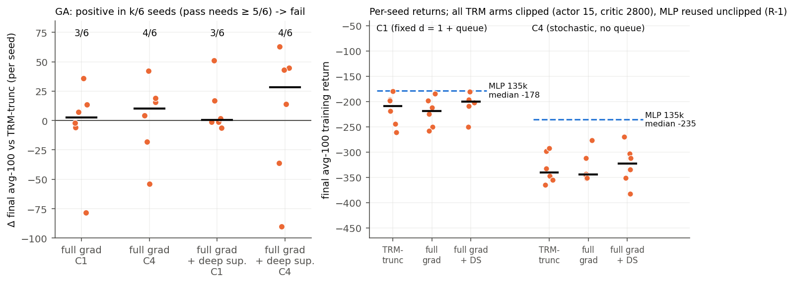
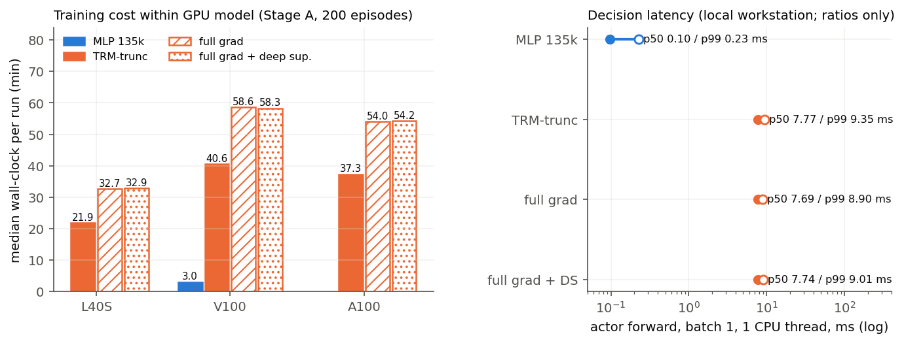

# Stage A: Restoring the Training Discipline

*trm-delay-robust-scaling · Phase 4 stage note · 2026-10-08*
*Covers the a0 pilot and the Stage A matrix. Plan §6; amendments R-1 and A-1; gate GA in `../../experiments/phase4/gates.json`; analyses in `../../experiments/analysis_p4_a0.json` and `analysis_p4_a.json`.*

## 1. Question and rule

The TRM port truncates the gradient to the last outer cycle and supervises only the final readout. With `H_cycles = 3` and `L_cycles = 6`, only 7 of the 21 cell applications in a forward pass receive gradient. Published TRM, by contrast, supervises a refinement trajectory at every improvement step (deep supervision). Phases 1–3 identified this missing discipline as the remaining open explanation for TRM's deficit. Stage A restores the two parts of it that have an off-policy analogue:

- **TRM-fullgrad** (`trm_fullgrad`): no truncation; the gradient flows through all H × (L + 1) = 21 cell applications.
- **TRM-fullgrad + deep supervision** (`trm_fullgrad_ds`): as above, plus a critic readout after every outer cycle. The critic loss is the mean over cycles of MSE(Q_k, y) against the same target-network TD target y (the target critic's final readout). The actor acts on the final cycle and its loss uses the critic's final readout.

**Setting.** Pendulum-v1, DDPG (`ddpg.yaml`), 200 episodes, conditions C1 (fixed d = 1 + queue) and C4 (stochastic d ~ U{0..4}, no queue), both with the previous action in the observation (matching Phase 3 Stage 2), seeds 1–6. The baseline is the truncated port (TRM-trunc, `trm`). All three TRM arms use gradient-norm clipping at the norms frozen by amendment A-1. The MLP 135k arm reuses Phase 3 Stage 2's runs (amendment R-1, below), unclipped.

**Parameters** (actor + critic, excluding target networks): 788,098 for every TRM arm at C1 and 787,842 at C4; the flags change training, not the network (`derived_numbers.json`, `a.params`).

> **Gate GA.** For D ∈ {TRM-fullgrad, TRM-fullgrad + deep sup.} and c ∈ {C1, C4}, per seed, Δ = final(D) − final(TRM-trunc). GA passes if any of the four contrasts is positive in ≥ 5/6 seeds (one-sided p = 0.109 each).

## 2. Verification and the MLP reuse (before any data)

- **Gradient-hook test (V-1).** Hooks on every cell application count those whose output receives non-zero gradient: 7 of 21 truncated and 21 of 21 with `full_grad` at H = 3; 7/7 at H = 1; 7/42 against 42/42 at H = 6. `clip = inf` reproduces the unclipped run exactly; both new configurations train.
- **Bit-identity (V-1).** 30 of 30 existing configurations train bit-identically (final-weight hash and full episode history) under the pre-Phase-4 snapshot and the Phase 4 tree, so the new flags do not touch any old code path.
- **MLP reuse (R-1).** DDPG + `dnn` at C1 and C4 with the previous action trained bit-identically under Phase 3's frozen `p3code/s2` snapshot and the Phase 4 tree, and the Hydra overrides differ only in logging fields. The 12 MLP runs were therefore reused from `phase3/results/results_p3s2` instead of rerun.

*Source: amendments V-1 and R-1 in `gates.json`; outputs in `experiments/phase4/verification/`.*

## 3. The a0 pilot and the clip norms (A-1)

Four runs, seed 1: TRM-trunc at C1 and C4 with clipping disabled but norms logged (clip = inf), and the two full-gradient arms at C1 for timing and norm diagnostics.

| Run | Final | Wall-clock | GPU | Actor norm p50 / p99 / max | Critic norm p50 / p99 / max | Would-clip at 15 / 2800 |
|---|---:|---:|---|---|---|---|
| TRM-trunc, C1 | −222.7 | 36.4 min | A100 | 0.80 / 9.61 / 309.6 | 324.9 / 2922.6 / 132,068.6 | 0.46% / 1.16% |
| TRM-trunc, C4 | −375.4 | 40.5 min | V100 | 2.25 / 18.82 / 760.3 | 616.3 / 2591.6 / 41,571.1 | 1.51% / 0.74% |
| TRM-fullgrad, C1 | −241.7 | 60.0 min | V100 | 1.50 / 32.06 / 1836.7 | 257.5 / 2113.3 / 80,537.3 | 3.00% / 0.42% |
| TRM-fullgrad + DS, C1 | −267.0 | 57.0 min | V100 | 1.42 / 31.85 / 2701.5 | 272.3 / 2170.6 / 33,370.4 | 2.82% / 0.36% |

*Source: `experiments/analysis_p4_a0.json`.*

The pre-clip norms are heavy-tailed: the largest per-update norm is 67 to about 1900 times the median, depending on run and network. Per the plan's rule, the clip norms were set to the 99th percentile of TRM-trunc's pooled C1 + C4 norms, at two significant figures: **actor 15, critic 2800**. They were frozen in `gates.json` before the Stage A matrix was submitted, and the author approved the matrix with clipping on all three TRM arms (A-1). Removing truncation roughly triples the actor's 99th-percentile norm at C1 (32.1 and 31.9 against 9.6), so the same actor clip binds the full-gradient arms more often.

## 4. Results

**Primary contrasts (GA).**

| Contrast | Per-seed Δ, seeds 1–6 | Median Δ | Positive | p one-sided | p two-sided | Pooled SD |
|---|---|---:|---:|---:|---:|---:|
| TRM-fullgrad − TRM-trunc, C1 | +35.95, +7.05, −5.85, −2.08, −78.52, +13.59 | +2.49 | 3/6 | 0.656 | 1.00 | 29.90 |
| TRM-fullgrad − TRM-trunc, C4 | −53.90, +15.72, +4.42, +19.04, −17.98, +42.40 | +10.07 | 4/6 | 0.344 | 0.69 | 30.28 |
| TRM-fullgrad + DS − TRM-trunc, C1 | +51.23, +16.77, −6.24, −1.21, −1.19, +1.89 | +0.35 | 3/6 | 0.656 | 1.00 | 27.60 |
| TRM-fullgrad + DS − TRM-trunc, C4 | −36.18, −90.32, +44.91, +13.94, +62.73, +42.95 | +28.45 | 4/6 | 0.344 | 0.69 | 35.12 |

*Source: `experiments/analysis_p4_a.json` (`contrasts`).*

**GA: fail.** No contrast reaches 5/6. The medians are small and positive, but every contrast has seeds on both sides of zero with magnitudes comparable to the pooled seed SD.

**Arms.**

| Arm | C1 median final | C4 median final | C1 / C4 eval last-5 | C1 / C4 late critic loss |
|---|---:|---:|---|---|
| MLP 135k (reused, unclipped) | −178.31 | −235.37 | −169.46 / −170.44 | 13.63 / 41.76 |
| TRM-trunc | −208.71 | −340.19 | −168.62 / −194.10 | 18.54 / 50.45 |
| TRM-fullgrad | −218.41 | −344.59 | −170.01 / −209.21 | 19.90 / 46.42 |
| TRM-fullgrad + DS | −200.00 | −323.03 | −159.59 / −202.06 | 16.84 / 47.85 |

*Source: `experiments/analysis_p4_a.json` (`arms`).*

**Secondary contrasts against the MLP and critic-loss ratios.**

| Contrast | C1: median Δ (k/6, two-sided p) | C4: median Δ (k/6, two-sided p) | Late critic-loss ratio C1 (k/6 above 1) | Ratio C4 (k/6 above 1) |
|---|---|---|---|---|
| TRM-fullgrad − MLP | −40.50 (1/6, 0.22) | −82.66 (1/6, 0.22) | 1.45 (6/6) | 1.30 (4/6) |
| TRM-fullgrad + DS − MLP | −22.46 (1/6, 0.22) | −88.77 (1/6, 0.22) | 1.35 (6/6) | 1.18 (5/6) |
| TRM-fullgrad / TRM-trunc | — | — | 1.04 (3/6) | 0.88 (2/6) |
| TRM-fullgrad + DS / TRM-trunc | — | — | 0.99 (2/6) | 0.85 (2/6) |

*Source: `experiments/analysis_p4_a.json` (`contrasts`). The critic-loss ratio is computed per seed from the median critic loss over the last quarter of episodes, then the median ratio is reported.*

What the numbers show:

- **Training all 21 cell applications does not change the result.** Removing truncation leaves the median within 10 reward units of the truncated port at both conditions, sign-inconsistently.
- **Deep supervision does not either, on the gate.** Its C4 contrast has the largest median (+28.45), but two of six seeds lose 36 and 90 units. At n = 6, this is noise-sized.
- **Both restored variants still trail the MLP in 5/6 seeds at each condition,** by 22–41 units at C1 and 83–89 units at C4. At C4 every TRM arm's median sits 88–109 units below the MLP's.
- **The value-fit deficit survives.** Both variants' late critic loss remains above the MLP's in 6/6 seeds at C1 (1.45× and 1.35×), as Phase 3 found for the truncated port at matched capacity (1.45× and 1.89×). Against TRM-trunc, the ratios are close to 1 at C1. At C4 both are below 1 in 4/6 seeds (0.88× and 0.85×), a small exploratory sign that full gradients fit the value slightly better under the harder condition without improving return.
- **Deterministic evaluation agrees.** At C1 all four arms' greedy policies are within about 10 units (−159.6 to −170.0). At C4 the TRM arms' greedy policies trail the MLP's by 24–39 units, and neither restored variant beats TRM-trunc there.

## 5. Clipping, latency and cost

**Clip-active fractions** (share of updates whose pre-clip norm exceeded the frozen clip, median over six seeds, with range):

| Arm | Actor, C1 | Actor, C4 | Critic, C1 | Critic, C4 |
|---|---|---|---|---|
| TRM-trunc | 0.60% (0.38–0.78) | 1.98% (0.90–5.98) | 0.74% (0.54–1.86) | 0.64% (0.34–2.44) |
| TRM-fullgrad | 4.09% (2.83–7.06) | 8.67% (6.28–19.55) | 1.02% (0.36–1.15) | 0.59% (0.51–0.75) |
| TRM-fullgrad + DS | 3.50% (1.29–6.57) | 7.45% (5.17–10.69) | 1.48% (0.77–1.97) | 0.90% (0.23–1.40) |

*Source: `derived_numbers.json` (`a.clip_active_fraction`), computed from the per-update norms logged in each run.*

The critic clip binds rarely in every arm. The actor clip binds about 4–7 times as often for the full-gradient arms as for TRM-trunc (median fractions), and on up to a fifth of updates in one full-gradient C4 seed.

**Latency.** Actor forward pass, batch 1, one CPU thread, on a local workstation (not the Phase 3 Katana Xeon; compare ratios only):

| Arm | p50 | p99 |
|---|---:|---:|
| MLP 135k | 0.098 ms | 0.229 ms |
| TRM-trunc | 7.766 ms | 9.349 ms |
| TRM-fullgrad | 7.689 ms | 8.902 ms |
| TRM-fullgrad + DS | 7.743 ms | 9.006 ms |

*Source: `experiments/analysis_p4_a.json` (`latency_actor_b1_cpu1`).*

As the plan expected, the flags change only training: the three TRM arms run the same inference operations, and their latencies agree within 5%. TRM is 79× the MLP at p50 and 41× at p99 on this machine (Phase 3 measured 65× at p99 on the Katana Xeon).

**Training cost**, median wall-clock per 200-episode run, within GPU model:

| GPU | MLP 135k | TRM-trunc | TRM-fullgrad | TRM-fullgrad + DS |
|---|---:|---:|---:|---:|
| L40S | — | 21.9 min | 32.7 min (1.49×) | 32.9 min (1.50×) |
| V100 | 3.0 min | 40.6 min | 58.6 min (1.44×) | 58.3 min (1.44×) |
| A100 | — | 37.3 min | 54.0 min (1.45×) | 54.2 min (1.45×) |

*Source: `experiments/analysis_p4_a.json` (`training_cost_median_min_by_gpu`); ratios to TRM-trunc on the same GPU computed from those medians. The A100 and V100 full-gradient cells hold 1–4 runs each. The MLP ran on V100 only (reused Phase 3 runs).*

Restoring the gradient costs about 1.45–1.5× the truncated port's training time on every GPU model. On a V100 the truncated port already costs 13.5× the MLP.

## 6. Threats to validity

- **Clipping is a confound against the MLP and Phase 3, and binds unevenly.** All Phase 1–3 runs, and the reused MLP, are unclipped. GA compares clipped TRM arms with each other, so the gate itself is internally fair, but the secondary contrasts against the MLP carry the clipping difference. Within GA, the same actor clip was active about 4–7 times as often for the full-gradient arms, so clipping could have restrained exactly the arms under test. The clip was set at the truncated port's 99th percentile, as pre-registered; a looser clip was not tried.
- **One way to restore the discipline.** Deep supervision here supervises each outer cycle's critic readout against the same bootstrapped target. Published TRM supervises successive improvement steps of the same input against a fixed, known answer, re-entering the instance with a carried latent and a learned halting head. That has no direct analogue in off-policy RL, and Stage A does not test it, nor a fixed-point (DEQ) formulation.
- **Six seeds.** GA detects only consistent effects (≥ 5/6). The C4 deep-supervision contrast (+28.45, 4/6) cannot be distinguished from noise at this n.
- **Hardware.** Runs spread across L40S, V100 and A100 GPUs, which do not reproduce each other bit-for-bit (Stage B0).
- **Execution note.** One Stage A job (`p4a_trm_fullgrad_ds_C1pa_clip_s4`) ended with PBS exit status −19 after its log had recorded `exit 0` and its results file had been written. It was counted as done (`experiments/phase4/dashboard_state/status_latest.json`).

## 7. What Stage A does and does not show

It shows that the two most direct ways of restoring TRM's training discipline in an off-policy actor-critic, backpropagating through every cell application and supervising every outer cycle's value readout, do not change TRM's standing on Pendulum: they neither beat the truncated port consistently nor close the gap to the MLP, at a 1.45–1.5× training-cost premium. The 14 cell applications that truncation leaves untrained were not what held TRM back. It does not show that no form of the discipline could help: the forms that need a fixed answer to refine toward, a revisitable instance, or per-pass error feedback have no counterpart in this setting and were not tested.

### References

Bai, S., Kolter, J. Z. & Koltun, V. (2019). *Deep Equilibrium Models.* NeurIPS · Jolicoeur-Martineau, A. (2025). *Less is More: Recursive Reasoning with Tiny Networks.* arXiv:2510.04871 · Lee, C.-Y. et al. (2015). *Deeply-Supervised Nets.* AISTATS
