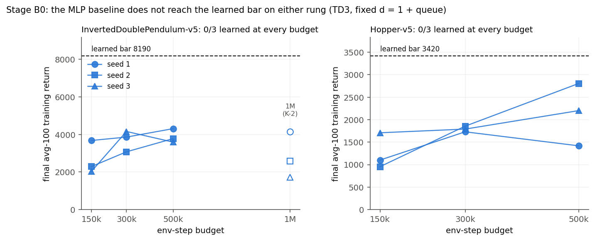
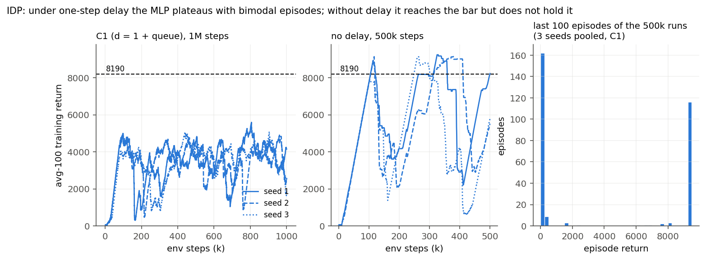

# Stage B0: Complexity Pilot, Hopper Fallback and IDP Diagnostic

*trm-delay-robust-scaling · Phase 4 stage note · 2026-10-08*
*Covers B0 (InvertedDoublePendulum-v5), its kill-switch fallback B0h (Hopper-v5) and the IDP diagnostic B0d (amendment K-2). Plan §3; gates GB0 and KB0 in `../../experiments/phase4/gates.json`.*

## 1. Question and rule

Stage B was Phase 4's first priority: add one complexity rung above Pendulum-v1 that the MLP baseline actually learns, then test whether TRM's relative deficit shrinks on it (H1′, Stage B1). B0 is the pilot that decides whether such a rung exists, and at what step budget.

- **Setting.** InvertedDoublePendulum-v5 (IDP), TD3 with `conf/arch/td3.yaml` unchanged, condition C1 (fixed one-step action delay with the pending-action queue in the observation, no previous-action input). MLP 135k (`dnn`), seeds 1–3, step budgets 150k, 300k and 500k. Two timing-only runs (TRM 788k and TRM H = 1, 15k steps, seed 1).
- **Reference.** 9100, the `reward_threshold` Gymnasium 1.3.0 registers for IDP-v5. A seed is **learned** at a budget if its final avg-100 training return is ≥ **8190** (90% of 9100).
- **Gate GB0.** Passes if ≥ 2/3 seeds are learned at some budget. B1's budget is the smallest passing budget.
- **Kill switch KB0.** If GB0 has not passed by 2026-10-09, repeat the pilot on Hopper-v5 (registered threshold 3800, so learned ≥ 3420). If that also fails, Stage B stops and goes to the author.

Parameter counts in this note are actor + twin critics, excluding target networks, as recorded in each results file's `param_count`: the MLP is 207,107 on IDP at C1 (206,339 without delay) and 211,717 on Hopper; the TRM 788k and TRM H = 1 timing runs are 1,184,131 each. "135k" and "788k" name the DDPG-basis configurations (actor + one critic), as in Phases 1–3.

## 2. Results on IDP (GB0)

| Budget | Final avg-100, seeds 1 / 2 / 3 | Learned | Eval last-5, seeds 1 / 2 / 3 | Full solves in the last 100 episodes | Wall-clock (min) | GPU models |
|---|---|---:|---|---|---|---|
| 150k | 3681.0 / 2291.1 / 2032.4 | 0/3 | 1908.2 / 3759.5 / 3784.9 | 39 / 10 / 13 | 15.6 / 12.1 / 12.1 | A100, V100 |
| 300k | 3861.2 / 3077.6 / 4160.1 | 0/3 | 5640.4 / 3762.3 / 3774.5 | 41 / 26 / 42 | 27.2 / 19.3 / 19.1 | A100, L40S |
| 500k | 4312.4 / 3781.1 / 3591.6 | 0/3 | 7463.4 / 3816.7 / 5598.1 | 45 / 39 / 32 | 33.6 / 34.3 / 35.0 | L40S |

*Source: `experiments/analysis_p4_b0.json`; full-solve counts (episode return > 9000) from `phase4/report/figures/derived_numbers.json` (`b0.idp.last100_full_solves_by_budget`). In the 500k runs' last 100 episodes, return > 9000 and survival to the full 1000 steps pick out exactly the same episodes (45, 39, 32).*

**GB0: fail.** No seed reached 8190 at any budget, and no seed's avg-100 ever crossed it (steps to threshold: none for all nine runs).

What the numbers show:

- **The MLP plateaus, it does not stall at the floor.** Final avg-100 sits between 3077.6 and 4312.4 at 300k and 500k. The untrained reference for IDP under the same wrapper (uniform-random actions, amendment R-2) is 49.90, so the MLP is learning something substantial. It is not learning to balance reliably.
- **Episodes are bimodal.** In the last 100 episodes of the 500k runs, 32–45% are full 1000-step solves. Pooling the three seeds' 300 episodes, 116 are full solves, 171 end with return below 500 and only 13 fall in between (`derived_numbers.json`, `b0.idp.last100_500k_pooled_returns`; figure below). The avg-100 near 4000 is the average of two populations, not a typical episode. The threshold was missed through unreliability, not lack of budget: more steps did not move the solve fraction above one half.
- **Deterministic evaluation is higher but also inconsistent.** Eval last-5 at 500k ranges from 3816.7 to 7463.4 across seeds. Removing exploration noise helps one seed a great deal and another hardly at all.

**Timing (for B1 planning; not gated).**

| Run | Steps | Wall-clock | GPU | Seconds per env step | Projected hours at 150k / 300k / 500k |
|---|---:|---:|---|---:|---|
| TRM 788k (H = 3), timing | 15,007 | 523 s | L40S | 0.03483 | 1.45 / 2.9 / 4.84 |
| TRM H = 1, timing | 15,012 | 297 s | L40S | 0.01976 | 0.82 / 1.65 / 2.74 |
| MLP 135k (median of the nine B0 runs) | — | — | A100, V100, L40S | 0.00419 | — |

*Source: `experiments/analysis_p4_b0.json` (`timing`).*

**GPU reproducibility (reported, not gated).** The three budgets are nested prefixes of one run for a given seed, so the 500k run's avg-100 at 150k and 300k can be compared with the shorter runs' finals.

| Seed | 500k run at 150k vs the 150k run | 500k run at 300k vs the 300k run |
|---|---|---|
| 1 | 3775.4 vs 3681.0 (L40S vs V100) | 3878.4 vs 3861.2 (L40S vs A100) |
| 2 | 1844.3 vs 2291.1 (L40S vs A100) | 3077.6 vs 3077.6, identical (L40S vs L40S) |
| 3 | 2766.3 vs 2032.4 (L40S vs A100) | 4160.1 vs 4160.1, identical (L40S vs L40S) |

*Source: `experiments/analysis_p4_b0.json` (`nested_check`); equality and devices from `derived_numbers.json` (`b0.idp.nested_check`).*

Runs are **not** bit-reproducible across GPU models: every pair run on different models diverged (IDP 0/4 identical; Hopper 0/2). Pairs run on the same model were identical to the last digit (IDP 2/2; Hopper 4/4). The divergence across models is large: seed 3 at 150k is 2032.4 on an A100 and 2766.3 on an L40S, a difference comparable to the seed-to-seed spread. Any Phase 4 comparison that mixes GPU models therefore carries hardware variation as part of its seed variation.

## 3. The Hopper fallback (KB0)

The author fired the kill switch on 2026-10-07, day 2 (amendment K-1), and the Hopper-v5 pilot ran as pre-registered: same budgets and seeds, MLP, TD3, C1, threshold unchanged at 3420.

| Budget | Final avg-100, seeds 1 / 2 / 3 | Learned | Eval last-5, seeds 1 / 2 / 3 | Wall-clock (min) |
|---|---|---:|---|---|
| 150k | 1101.1 / 954.0 / 1708.2 | 0/3 | 1022.3 / 1102.5 / 2481.4 | 8.7 / 14.3 / 8.7 |
| 300k | 1729.6 / 1855.6 / 1790.4 | 0/3 | 2961.6 / 2085.1 / 2031.1 | 19.4 / 30.3 / 19.4 |
| 500k | 1418.0 / 2805.3 / 2201.3 | 0/3 | 2268.1 / 2649.8 / 3048.2 | 32.5 / 32.5 / 34.5 |

*Source: `experiments/analysis_p4_b0h.json`.*

**KB0: fail.** The best final is 2805.3 (seed 2, 500k), 82% of the bar. The plan had flagged this risk in advance: Fujimoto et al. (2018) report about 3564 for TD3 on Hopper after 1M steps, so 3420 in noisy training return at ≤ 500k was likely out of reach. Hopper's untrained reference is 16.32 (R-2), so here too the MLP learns a great deal without reaching the bar. Per amendment K-2 the author dropped the Hopper rung.

## 4. The IDP diagnostic (B0d, amendment K-2)

K-2 asked two questions of IDP before any decision on B1: does a much larger budget fix C1, and is the delay the obstacle? MLP, TD3, seeds 1–3; C1 at 1M steps, and no delay at 500k. Reported against the unchanged 8190 bar; no gate of its own.

| Arm | Final avg-100, seeds 1 / 2 / 3 | Learned (final) | Best avg-100 at any point | First step with avg-100 ≥ 8190 | Last 30 deterministic evals solved |
|---|---|---:|---|---|---|
| C1, 1M steps | 4146.9 / 2590.2 / 1732.8 | 0/3 | 5593.9 / 4940.4 / 5093.4 | never | 11 / 9 / 9 of 30 |
| No delay, 500k | 8226.2 / 5516.8 / 5779.7 | 1/3 | 9238.6 / 9144.9 / 9131.9 | 106,068 / 105,798 / 249,276 | 23 / 26 / 24 of 30 |

*Source: `experiments/analysis_p4_b0d.json`. A deterministic eval counts as solved at return > 9000.*

- **More budget does not fix C1.** At 1M steps no seed is learned, and 1M is no better than 300k–500k. After the first 100k steps, the per-100k-window share of full solves moves between 5.7% and 48.5% without a trend, and the avg-100 at the end of each window ranges from 1007.7 to 5130.6. The curves show repeated collapse and recovery rather than slow convergence.
- **Without delay the same MLP reaches the bar.** All three seeds cross 8190 at some point (two by about 106k steps, the third by 249k), and best avg-100 exceeds 9100 in every seed. But the runs do not hold it: TD3 collapses and recovers here too (seed 1 falls from 8085.2 at 300k to 2907.5 at 400k, then returns to 8155.5), and only seed 1 ends above the bar.
- **The one-step delay on an unstable plant is the main obstacle.** The deterministic policy solves about three in four evaluation episodes without delay (23–26 of 30) and about one in three with it (9–11 of 30). The delay costs most of the reliability, even with the pending action in the observation.

## 5. What happened next

The 1M diagnostic did not pass GB0's rule (0/3), so under K-2 B1 could only have run as an exploratory study with a post-hoc "clear of floor" criterion. A draft amendment (`phase4/plan/K-3_draft.md`) proposed that. The author decided on 2026-10-08 (amendment K-3) not to run B1 at all, for two reasons recorded in `gates.json`: no rung above Pendulum was learnable by the baseline under the pre-registered conditions, and Stage T had meanwhile shown that TRM 788k does not train under `td3.yaml` even on Pendulum, so a TD3 B1 on IDP would most likely have measured that optimisation failure rather than complexity scaling. The draft is superseded. **H1′ is recorded as not run, and H1 remains untested for the project.**

## 6. Threats to validity

- **The bar is strict for noisy training return.** 8190 in avg-100 *training* return includes TD3's exploration noise; deterministic evaluation is higher. The bar was fixed before data and is reported as fixed. The IDP diagnostic shows that the failure is not only an artefact of the metric: even greedy policies solve only a third of episodes under delay.
- **One algorithm configuration.** TD3 ran with `td3.yaml` unchanged. A different learning rate, batch size or exploration scale might stabilise IDP. None was tried, by design.
- **Three seeds.** Every B0 conclusion rests on n = 3 per budget. The failure is uniform (0/3 at every budget; none of the 21 C1 runs in B0, B0h and B0d learned), so the small n does not change the verdict.
- **Hardware.** B0 runs landed on three GPU models, and results differ across models (§2). Budgets were not run on a single model.

## 7. What B0 does and does not show

It shows that, under the project's pre-registered conditions (TD3 as configured, one-step delay with the queue, ≤ 1M steps), neither IDP nor Hopper is learned reliably by the MLP baseline, and that on IDP the delay rather than the budget is the binding constraint. It does **not** show anything about TRM on these rungs: no TRM training run beyond the two 15k-step timing runs was made. In particular it is not evidence that TRM's relative deficit grows, shrinks or stays constant with complexity. That question, H1, is untested.

### References

Fujimoto, S., van Hoof, H. & Meger, D. (2018). *Addressing Function Approximation Error in Actor-Critic Methods.* ICML · Towers, M. et al. (2024). *Gymnasium.* arXiv:2407.17032
