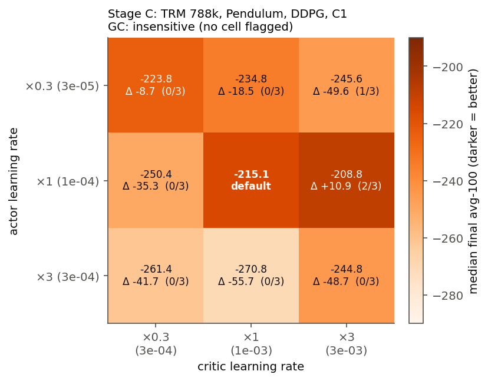

# Stage C: Learning-Rate Sweep for TRM 788k

*trm-delay-robust-scaling · Phase 4 stage note · 2026-10-08*
*Plan §4; gate GC in `../../experiments/phase4/gates.json`; analysis in `../../experiments/analysis_p4_c.json`.*

## 1. Question and rule

Every TRM result in Phases 1–3 used the DDPG learning rates in `conf/arch/ddpg.yaml` (actor 1e-4, critic 1e-3), which were never tuned for the recursive trunk. Stage C asks whether "TRM was never tuned" can explain its deficit.

- **Setting.** Pendulum-v1, DDPG, condition C1 (fixed d = 1 with the pending-action queue, no previous-action input), exactly the Phase 3 Stage 1 condition, so that a flagged learning rate could feed a rerun of the Stage 1 contrast. TRM 788k (`trm`, H = 3), 200 episodes. 787,842 parameters (actor + critic, excluding target networks).
- **Grid.** Actor LR × {0.3, 1, 3} of 1e-4 by critic LR × {0.3, 1, 3} of 1e-3, seeds 1–3: 27 jobs. The default ×1/×1 cell was rerun in the same snapshot so all nine cells share one code version.
- **Gate GC.** For each of the 8 non-default cells and each seed s, Δ(s) = final(cell, s) − final(×1/×1, s). A cell is **flagged** if Δ(s) exceeds the pooled seed SD of the two cells in all 3 seeds. Any flag goes to the author; none means "TRM insensitive to LR within ×0.3–×3".

## 2. Results

| Actor LR | Critic LR | Median final | Finals, seeds 1 / 2 / 3 | Median Δ vs default | Positive | Pooled SD | Flagged | Late critic loss | Eval last-5 |
|---|---|---:|---|---:|---:|---:|---|---:|---:|
| 3e-5 | 3e-4 | −223.85 | −225.9 / −223.9 / −220.7 | −8.73 | 0/3 | 9.08 | no | 19.12 | −175.88 |
| 3e-5 | 1e-3 | −234.79 | −234.8 / −219.9 / −238.2 | −18.51 | 0/3 | 11.25 | no | 23.26 | −175.38 |
| 3e-5 | 3e-3 | −245.59 | −245.6 / −270.8 / −195.0 | −49.57 | 1/3 | 28.68 | no | 22.54 | −173.47 |
| 1e-4 | 3e-4 | −250.41 | −252.4 / −250.4 / −240.9 | −35.29 | 0/3 | 9.88 | no | 22.41 | −179.28 |
| **1e-4** | **1e-3** | **−215.12** | −196.0 / −215.1 / −219.7 | default | — | — | — | 22.64 | −176.76 |
| 1e-4 | 3e-3 | −208.79 | −211.4 / −197.9 / −208.8 | +10.95 | 2/3 | 10.23 | no | 22.03 | −175.83 |
| 3e-4 | 3e-4 | −261.45 | −341.4 / −250.6 / −261.5 | −41.72 | 0/3 | 36.16 | no | 24.54 | −330.02 |
| 3e-4 | 1e-3 | −270.82 | −369.8 / −270.8 / −237.6 | −55.71 | 0/3 | 49.45 | no | 28.21 | −206.38 |
| 3e-4 | 3e-3 | −244.75 | −244.8 / −313.2 / −237.7 | −48.73 | 0/3 | 30.77 | no | 27.71 | −172.48 |

*Source: `experiments/analysis_p4_c.json`. Two-sided sign-test p is 0.25 for every 0/3 cell and 1.0 for the 1/3 and 2/3 cells. Late critic loss is the median over the last quarter of episodes; eval last-5 is the mean of the last five deterministic evaluation episodes, median over seeds.*

**GC: insensitive.** No cell beats the default by more than the pooled SD in 3/3 seeds. The one cell with a positive median (critic LR ×3, +10.95) has per-seed differences of −15.34, +17.26 and +10.95 against a pooled SD of 10.23, so it fails both the sign and the magnitude parts. The result is recorded as "TRM insensitive to LR within ×0.3–×3", and no rerun of the Stage 1 contrast was triggered.

## 3. Reading the grid

- **The default is near the top of the grid.** Seven of eight non-default cells have a lower median than the default, and six of them are below it in all three seeds. The grid does not hide a better setting the project missed.
- **Raising the actor learning rate hurts TRM, descriptively.** All three ×3-actor cells (3e-4) are below the default in 3/3 seeds, with median differences of −41.7, −55.7 and −48.7, the largest in the grid. They also carry the highest late critic losses (24.5–28.2 against the default's 22.6) and the worst deterministic evaluations (−330.0 at critic ×0.3). This is not a gate outcome: GC tests for improvement, and n = 3 per cell gives a two-sided p of 0.25 at best. It matters for Stage T, where `td3.yaml` sets the actor LR to 1e-3, ten times the DDPG default and more than three times the largest value tried here.
- **Deterministic evaluation is nearly flat.** Outside the ×3-actor row, eval last-5 ranges from −179.3 to −173.5. The learning rate moves training return more than it moves the greedy policy, the same pattern Phase 3 found for the TRM − MLP gap.
- **No cell approaches the MLP.** The best TRM cell's median (−208.79) is close to Phase 3 Stage 1's TRM 788k at C1 (−208.7 for seeds 1–3) and well below Stage 1's MLP 135k at C1 (−176.8 over six seeds; `experiments/analysis_phase3_full.json`, `reproduction`). That comparison crosses stages and code snapshots and is descriptive only.

## 4. Threats to validity

- **Low power by design.** The gate tests eight cells at n = 3. Under the null, a cell passes the sign part alone with probability 1/8, so the magnitude condition carries the weight. A flag would have been grounds for a confirmatory rerun, not a finding; equally, the absence of a flag excludes only large, consistent effects.
- **Only two hyperparameters.** Batch size, target-update rate τ, OU noise scale and warmup were held at `ddpg.yaml` values. "Untuned" is ruled out only along the learning-rate axes and within ×0.3–×3.
- **One condition.** C1 only. The sweep says nothing about C4 or the latent delay.
- **Mixed hardware.** Cells ran on V100, A100 and L40S GPUs (9 runs each). Stage B0 shows that runs on different GPU models diverge, so per-seed differences here include hardware variation.

## 5. What Stage C does and does not show

It shows that TRM 788k's Pendulum result under DDPG is not an artefact of the default learning rates: within a ninefold range of each, nothing improves it consistently, and the default is among the best settings. It does not show that TRM is insensitive to tuning in general, and it does not rule out that some other optimiser setting (for example a smaller target-update rate or gradient clipping, the latter tested in Stage A) would help.
