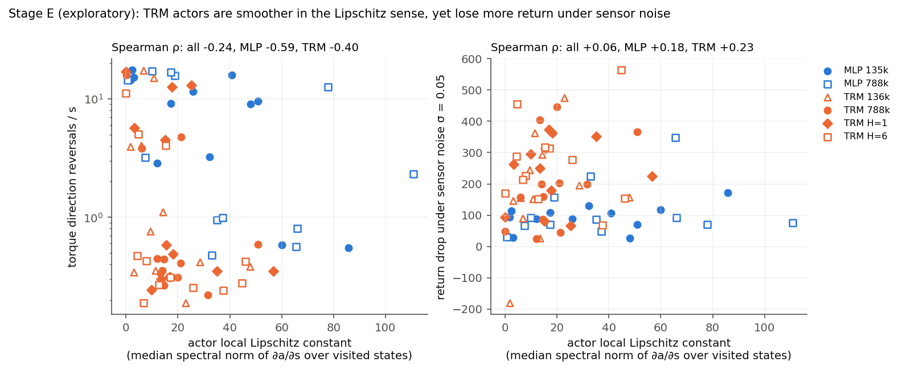

# Stage E: Actor Lipschitz Constants (Exploratory)

*trm-delay-robust-scaling · Phase 4 stage note · 2026-10-08*
*Plan §8. Exploratory throughout: no gate, no pre-registered decision. Analysis in `../../experiments/analysis_p4_e.json`; script `../../experiments/phase4/lipschitz.py`.*

## 1. Question

Phase 3's deployment scorecard found two facts about TRM's greedy policies that sit awkwardly together. TRM commands much smoother torque than the MLP (0.4 against 9 direction reversals per second, 11/12 pairs, p = 0.006), yet it loses more return under sensor noise (−75.8 against the MLP at σ = 0.05, 2/12 favourable, p = 0.039). A natural mechanism for both would be the actor's local gain: a policy whose output changes little with its input should chatter less, and should also pass less sensor noise through to the actuator. Stage E measures that gain directly and asks whether it explains either fact.

## 2. Method

- **Checkpoints.** All 72 Phase 3 Stage 1 checkpoints: six trunks (MLP 135k and 788k, TRM 136k, 788k, H = 1 and H = 6) × {no delay, fixed d = 1 + queue} × seeds 1–6. No training.
- **Local Lipschitz constant.** For each checkpoint, the actor is rebuilt from its results file and rolled out deterministically for 20 episodes on the battery's unseen nominal seeds (2,000,000 + i), under its training condition: 4000 visited states per checkpoint. At every state, the Jacobian ∂a/∂s is taken by autograd over the **plant-observation inputs only**; the pending-action queue is held fixed, because it holds the policy's own past outputs rather than sensor readings. The constant at that state is the Jacobian's spectral norm. Each checkpoint is summarised by the median and 95th percentile over its states.
- **TRM forward pass.** The truncated forward runs all but the last outer cycle under `no_grad`, which would hide those cycles from the Jacobian. The script switches on `full_grad`, which computes the same function without truncation, so the Jacobian is that of the deployed map.
- **Outcomes** from the Phase 3 battery, joined by `model_id` (72 of 72 joined): torque direction reversals per second and the drop in nominal IQM return under sensor noise σ = 0.05 (nominal IQM − noisy IQM; positive is a loss).
- **Statistics.** Spearman ρ across all checkpoints and within each family. Two-sided permutation p-values (20,000 permutations) and paired (seed, condition) sign counts were added for this note and are exploratory.

## 3. Results

**Per trunk** (medians over 12 checkpoints, pooling both conditions).

| Trunk | Lipschitz, median | Lipschitz, p95 | Reversals / s | Noise drop | Nominal IQM |
|---|---:|---:|---:|---:|---:|
| MLP 135k | 29.11 | 69.36 | 9.32 | 100.1 | −120.39 |
| MLP 788k | 34.05 | 51.94 | 2.76 | 81.0 | −121.33 |
| TRM 136k | 11.00 | 31.54 | 0.59 | 156.74 | −123.09 |
| TRM 788k (H = 3) | 14.61 | 30.47 | 0.43 | 179.09 | −126.50 |
| TRM H = 1 | 16.18 | 50.72 | 0.54 | 256.63 | −123.68 |
| TRM H = 6 | 14.01 | 31.87 | 0.37 | 251.42 | −124.79 |

*Source: `experiments/analysis_p4_e.json` (`per_model`). These medians pool both training conditions, so they differ from Phase 3's fixed-delay-only scorecard table.*

**Rank correlations with the Lipschitz median.**

| Scope | n | ρ with reversals / s | permutation p | ρ with noise drop | permutation p |
|---|---:|---:|---:|---:|---:|
| All checkpoints | 72 | −0.237 | 0.045 | +0.059 | 0.62 |
| MLP family | 24 | −0.594 | 0.003 | +0.183 | 0.39 |
| TRM family | 48 | −0.395 | 0.006 | +0.233 | 0.11 |

*Source: ρ from `experiments/analysis_p4_e.json` (`spearman`); permutation p from `phase4/report/figures/derived_numbers.json` (`e.spearman_permutation_p`).*

**Paired by (seed, condition)**, n = 12 each:

| Contrast | Lipschitz lower for TRM | Median Δ Lipschitz | Noise drop larger for TRM | Median Δ noise drop |
|---|---:|---:|---:|---:|
| TRM 788k − MLP 135k | 8/12 | −11.47 | 10/12 | +75.82 |
| TRM 788k − MLP 788k | 9/12 | −14.63 | 8/12 | +66.24 |
| TRM 136k − MLP 135k | 8/12 | −8.00 | 9/12 | +46.72 |

*Source: `derived_numbers.json` (`e.paired`), computed from the rows of `analysis_p4_e.json`.*

## 4. What the numbers show

- **TRM actors have lower local gain.** Every TRM variant's median Lipschitz constant (11.0–16.2) is between about a third and a half of the MLPs' (29.1–34.1), and the TRM 95th percentiles are lower too (30.5–50.7 against 51.9–69.4). Paired, TRM is lower in 8–9 of 12 pairs: consistent at the medians, not uniform per checkpoint.
- **Lower gain does not mean less noise sensitivity.** TRM loses more return under sensor noise in 8–10 of 12 pairs, by 47–76 units at the median, despite its lower gain. Across checkpoints the Lipschitz constant has essentially no rank correlation with the noise drop (+0.06 overall; +0.18 and +0.23 within families, permutation p 0.39 and 0.11). **The local Lipschitz constant does not explain TRM's noise sensitivity.**
- **Gain correlates negatively with reversals, the opposite of the naive expectation.** Higher-gain actors reverse torque *less* often, within both families (ρ = −0.59 and −0.40). The cause is visible in the low-gain checkpoints: of the 12 checkpoints with a median Lipschitz constant below 5, nine reverse torque more than five times per second, and seven of those have a command rate |Δu| (as defined in the Phase 3 battery) between 2.61 and 3.32 on a ±2 torque range with a 95th-percentile Lipschitz constant between 12.6 and 246.0 (`derived_numbers.json`, `e.low_lipschitz`). These are bang-bang controllers: saturated, and so locally flat, at most visited states, switching sharply across a narrow boundary. The median local gain is near zero exactly where the policy chatters most. Four of those seven are MLPs, three are TRMs, and six of the seven were trained without delay.

## 5. Competing explanations for TRM's noise sensitivity (untested)

Stage E removes one candidate, a large local gain. The others remain open:

- **Non-local sensitivity.** σ = 0.05 of the observation half-range is not infinitesimal. A first-order measure at nominal states can miss the response of the recursive map to finite perturbations, or to states that only noise visits.
- **Closed-loop effects.** A low-gain, smooth policy may correct the drift that noise induces more slowly than a high-gain one, so lower gain could even increase the return lost. Stage E did not measure closed-loop recovery.
- **State distribution.** The constant was measured on the nominal visited states. Under noise the policy visits other states, where its gain was not measured.

## 6. Threats to validity

- **Exploratory, post hoc in parts.** The plan fixed the Lipschitz measure and the Spearman correlations. The permutation p-values, the paired counts and the saturation reading were added while writing this note and should be read as hypothesis-generating.
- **The median is a poor summary for saturating policies** (§4). A switching-aware measure (for example the fraction of states in saturation, or the gain at the switching boundary) was not computed.
- **Plant inputs only.** The queue entries were held fixed. Sensitivity to the policy's own past actions, which carries the delay information, was not measured.
- **Execution note.** The first submission (six jobs, `p4e_lipschitz_00`–`05`) failed at import: in the frozen `p4code/e` snapshot the script could not locate the repository's `src/eval.py` (a snapshot path bug). It was rerun as `e2` (six jobs), which processed all 72 checkpoints (`experiments/phase4/dashboard_state/status_latest.json`).

## 7. What Stage E does and does not show

It shows that TRM's smoother actuation coincides with a lower local gain at the median, and that this lower gain does not protect TRM against sensor noise: the two properties are not linked through local sensitivity. It does not identify what makes TRM noise-sensitive, and its reversal correlation mostly reflects saturating bang-bang policies rather than a smooth relation between gain and chatter.
