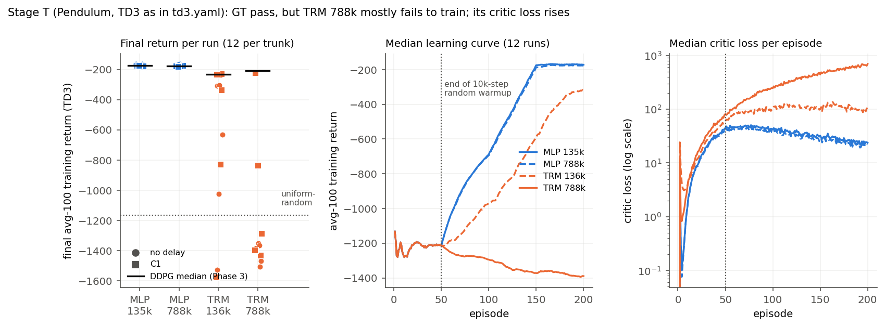

# Stage T: The Phase 3 Capacity Contrast Under TD3

*trm-delay-robust-scaling · Phase 4 stage note · 2026-10-08*
*Added by amendment T-1 (2026-10-07, before data); plan §9b; gate GT in `../../experiments/phase4/gates.json`; analysis in `../../experiments/analysis_p4_t.json`.*

## 1. Question and rule

Every contrast in Phases 1–3 used DDPG. Phase 3's central attribution, G1, was that TRM's deficit is architectural rather than a matter of capacity: TRM lost to a parameter-matched MLP at both 135k (−50.2, 0/12) and 788k (−27.1, 2/12), while growing the MLP 5.8× changed nothing (−3.8, 5/12). Stage T asks whether that attribution holds under a second learning algorithm.

- **Design.** Phase 3 Stage 1 with TD3 in place of DDPG: Pendulum-v1, `arch=td3` with `conf/arch/td3.yaml` unchanged and no tuning for any trunk, 200 episodes; conditions no delay and C1 (fixed d = 1 + queue, no previous-action input); trunks `dnn`, `dnn_large`, `trm_small`, `trm`; seeds 1–6. 48 jobs.
- **TD3 settings** (`td3.yaml`): actor and critic learning rates 1e-3, batch 256, 10,000 warmup steps of random actions, policy delay 2, target-policy noise 0.2 clipped at 0.5, Gaussian exploration noise 0.1 of the action range, γ = 0.99, τ = 0.005, buffer 200,000. For comparison, `ddpg.yaml` uses actor 1e-4 and critic 1e-3, batch 128, 1000 warmup steps and OU noise.
- **Gate GT.** Pairs are (seed, condition), n = 12. G1 reproduces under TD3 if TRM 788k − MLP 788k (final avg-100) is negative in ≥ 10/12 pairs. Two-sided sign-test p reported. Secondary: G1's other contrasts ("different" = ≥ 10/12 share a sign), late critic-loss ratios at matched capacity, eval last-5, and a side-by-side with Phase 3 Stage 1.

**Parameter-count basis.** The labels "135k" and "788k" name the DDPG-basis configurations (actor + one critic). Under TD3 each total includes twin critics, excluding target networks:

| Trunk | DDPG basis (Phase 3) | TD3, no delay | TD3, C1 |
|---|---:|---:|---:|
| MLP 135k (`dnn`) | 134,914 | 201,731 | 202,499 |
| MLP 788k (`dnn_large`) | 788,114 | 1,180,611 | 1,182,483 |
| TRM 136k (`trm_small`) | 135,654 | 203,371 | 203,503 |
| TRM 788k (`trm`) | 787,842 | 1,181,443 | 1,181,827 |

*Source: each run's `param_count` (`derived_numbers.json`, `t.per_trunk.*.params_actor_plus_twin_critics`); DDPG basis from the Phase 3 final report §9.4.*

So the "788k" TRM is a ~1.18M-parameter agent under TD3.

## 2. Results

**Arms** (12 runs each: 6 seeds × 2 conditions).

| Trunk | Median final, TD3 | Median final, DDPG (Phase 3 Stage 1) | Eval last-5, TD3 | Late critic loss, TD3 | Runs that learned (TD3) | Median wall-clock |
|---|---:|---:|---:|---:|---:|---:|
| MLP 135k | −171.71 | −174.48 | −165.11 | 26.34 | 12/12 | 3.35 min |
| MLP 788k | −175.92 | −177.32 | −168.25 | 23.69 | 12/12 | 3.36 min |
| TRM 136k | −321.44 | −232.39 | −218.35 | 107.74 | 9/12 | 41.60 min |
| TRM 788k | −1389.27 | −207.95 | −1415.09 | 560.94 | 2/12 | 42.54 min |

*Source: `experiments/analysis_p4_t.json` (`arms`, `ddpg_stage1_medians`). "Runs that learned" uses a descriptive cut at final avg-100 > −1000 (`derived_numbers.json`, `t`), which reproduces the counts recorded in the GT caveat in `gates.json`; a uniform-random policy scores −1163.84 under the same wrapper (amendment R-2). Wall-clock mixes V100, A100 and L40S runs.*

**Contrasts, TD3 against DDPG** (n = 12 (seed, condition) pairs each).

| Contrast | TD3 median Δ | TD3 positive | TD3 p (two-sided) | DDPG median Δ (Phase 3) | DDPG positive |
|---|---:|---:|---:|---:|---:|
| **TRM 788k − MLP 788k (GT)** | **−1214.95** | **0/12** | **0.0005** | −27.1 | 2/12 |
| TRM 136k − MLP 135k | −152.53 | 0/12 | 0.0005 | −50.2 | 0/12 |
| MLP 788k − MLP 135k | −2.73 | 2/12 | 0.039 | −3.8 | 5/12 |
| TRM 788k − TRM 136k | −669.48 | 3/12 | 0.15 | +20.7 | 7/12 |
| Late critic loss, TRM 788k / MLP 788k | 24.91× | 12/12 above 1 | — | 1.89× | 12/12 |
| Late critic loss, TRM 136k / MLP 135k | 3.83× | 12/12 above 1 | — | 1.45× | 12/12 |

*Source: `experiments/analysis_p4_t.json` (`contrasts`); DDPG column from the Phase 3 final report §9.4 (`experiments/analysis_s1.json`).*

**GT: pass,** as recorded in `gates.json`: TRM 788k − MLP 788k is negative in 12/12 pairs (two-sided p = 0.0005).

**The caveat recorded with it** (`gates.json`, GT detail, status unchanged): *the pass reflects an optimisation failure, not a Phase-3-sized deficit.* Under `td3.yaml`, TRM 788k stays at random-policy level in 10 of 12 runs (final avg-100 about −1390), its critic loss rises through training (the critic diverges), and every MLP run learns (about −172). TRM 136k learns in 9 of 12. TRM 788k − TRM 136k is −669 (3/12): the larger TRM fails more often. The likely contributor, untested, is `td3.yaml`'s actor learning rate of 1e-3, ten times DDPG's; Stage C showed that raising TRM's actor learning rate hurts it.

## 3. What the numbers show

- **The MLPs are unaffected by the change of algorithm.** Both MLP sizes reach the same medians under TD3 as under DDPG (−171.7 against −174.5; −175.9 against −177.3), in every run. TD3 as configured is a sound learner for this task.
- **TRM 788k mostly does not train.** Its two learning runs are both at C1 (seeds 2 and 5, finals −221.7 and −834.3); all six no-delay runs end between −1352.4 and −1505.3, below the uniform-random policy's −1163.84. Its median learning curve declines after the 50-episode random warmup instead of rising.
- **Its critic loss rises instead of falling.** The median critic loss over episodes 51–75 (the first 25 episodes after warmup) is 118.6 for TRM 788k and its median over the last quarter is 560.9; late exceeds early in 11 of 12 runs. For both MLPs the loss falls (46.2 to 26.3, and 41.2 to 23.7; late exceeds early in 0 of 12 runs each). TRM 136k is in between (82.4 to 107.7; 7 of 12). *Source: `derived_numbers.json` (`t.per_trunk`).*
- **TRM 136k learns but trails by more than under DDPG.** Every TRM 136k − MLP 135k difference is negative, the smallest by 46.8 units. Its median deficit (−152.5) is three times the DDPG figure (−50.2), and its late critic loss is 3.83× the MLP's against 1.45× under DDPG.
- **Under TD3 the bigger TRM is the worse TRM,** the reverse of DDPG, where TRM 788k beat TRM 136k in 7/12 pairs (+20.7). The difference between the two TRMs is width (hidden 128 against 44); depth is the same.
- **A small, consistent MLP capacity effect appears.** MLP 788k − MLP 135k is negative in 10 of 12 pairs, "different" by the ≥ 10/12 rule, but the median is only −2.73. Under DDPG it was 5/12. It goes the wrong way for a capacity account of TRM's deficit (the larger network is slightly worse, not the smaller TRM catching up), and it is tiny next to every TRM contrast.

## 4. Competing explanations for the TRM 788k failure

| Explanation | What favours it | What is against it, or untested |
|---|---|---|
| Actor learning rate 1e-3 is too high for TRM | Stage C: all three ×3-actor-LR cells (3e-4) are below the DDPG default in 3/3 seeds under DDPG, with the highest critic losses in the grid | TD3's 1e-3 itself was never tried on TRM at a lower value; untested |
| Other TD3 settings (batch 256, twin critics, target smoothing, policy delay) | They differ from DDPG and could interact with the recursive cell | Each applies equally to the MLPs, which are unaffected; untested for TRM |
| Width-dependent instability | TRM 136k (hidden 44) learns 9/12, TRM 788k (hidden 128) 2/12; the same width difference was harmless under DDPG | Confounded with total parameters; one width pair only |
| Critic divergence drives the failure | Critic loss rises in 11/12 TRM 788k runs while the actor never improves | A policy stuck near random visits high-cost states, which inflates value targets and TD error, so the rising loss may be a consequence rather than the cause; these data do not separate the two |
| Too few learning episodes (warmup is 50 of 200) | Applies to every arm | The MLPs converge by about episode 150; TRM 788k's median curve falls rather than rises slowly |

None of these was tested. Stage T was designed to replicate G1 with `td3.yaml` unchanged, not to make TRM train under TD3.

## 5. Threats to validity

- **The gate passed for a different reason than G1 did.** GT's rule counts signs. It cannot tell a Phase-3-sized architectural deficit from a failure to train, and here the second dominates. The pass must not be read as "Phase 3's −27.1 replicated under TD3"; that magnitude was not replicated, and Stage T does not measure it.
- **One configuration of TD3.** `td3.yaml` was used unchanged by design. A TD3 configuration closer to the DDPG learning rates might train TRM 788k, and would then measure the deficit G1 was about.
- **Warmup.** 10,000 random steps are 50 of the 200 episodes, which shortens the learning period for every arm alike (threat recorded in the plan).
- **Hardware.** 26 runs on V100, 13 on A100 and 9 on L40S. Results differ across GPU models (Stage B0).

## 6. What Stage T does and does not show

It shows that the MLP results transfer from DDPG to TD3 unchanged, and that the recursive trunk is fragile: under the TD3 configuration the project would have used for B1, TRM 788k fails to learn Pendulum in 10 of 12 runs and TRM 136k learns but trails the MLP by about three times its DDPG deficit. In that limited sense the attribution "TRM trails a parameter-matched MLP" holds under TD3 (0/12 at both sizes). It does not show that the size of Phase 3's deficit generalises, and it does not explain why TRM 788k fails. It also removed Stage T as a usable Pendulum reference for B1, one of the two reasons the author gave for amendment K-3.
