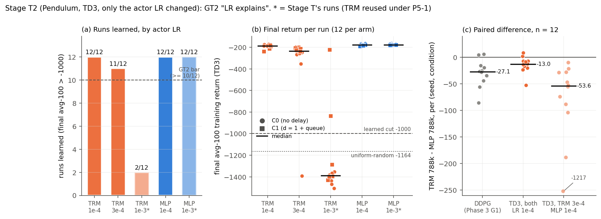
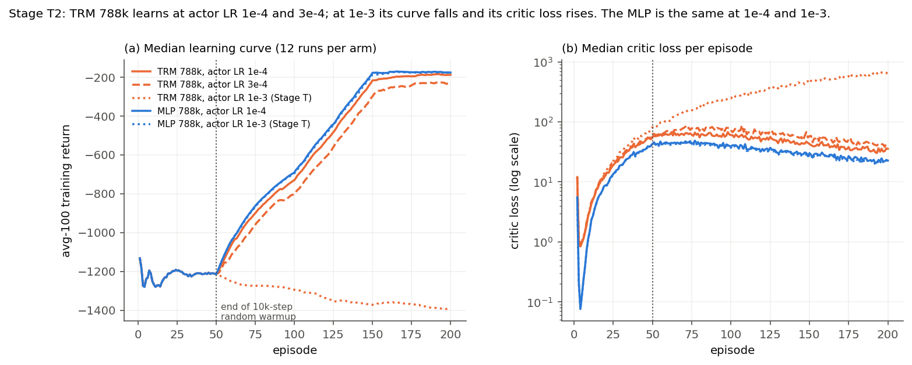

# Stage T2: Does the Actor Learning Rate Explain TRM's TD3 Failure?

*trm-delay-robust-scaling · Phase 5 stage note · 2026-10-10*
*Plan `../plan/plan.md` §2 (frozen 2026-10-10, before any Phase 5 data); gate GT2 and amendment P5-1 in `../../experiments/phase5/gates.json`; analysis in `../../experiments/analysis_p5_t2.json`; exploratory numbers in `figures/derived_numbers_p5.json`.*

## 1. Question and rule

Phase 4's Stage T reran Phase 3's capacity contrast under TD3 with `conf/arch/td3.yaml` unchanged. Its gate GT passed (TRM 788k − MLP 788k negative in 12/12 pairs), but `gates.json` records a caveat with it: the pass reflected an optimisation failure. TRM 788k stayed at random-policy level in 10 of 12 runs and its critic loss rose through training, while every MLP run learned. The caveat named a likely contributor, untested: `td3.yaml`'s actor learning rate of 1e-3 is ten times the DDPG actor rate (1e-4) under which TRM trained normally in Phases 1–4. Stage T2 tests that directly.

- **Design.** Pendulum-v1, TD3 with `td3.yaml`, only `arch.actor_lr` overridden: critic LR 1e-3, batch 256, warmup 10,000 steps and policy delay 2 are unchanged. 200 episodes. Conditions C0 (no delay) and C1 (fixed d = 1 with the one-slot queue, no previous-action input), the two Stage T used. Seeds 1–6.
- **Arms.** TRM 788k (`trm`) at actor LR 1e-4 and 3e-4 (12 runs each); TRM 788k at 1e-3, which is Stage T's 12 runs reused under amendment P5-1; and a control, MLP 788k (`dnn_large`) at actor LR 1e-4 (12 runs). 36 new jobs.
- **"Learned"** means final avg-100 > −1000, fixed before any data. Stage T had used the same cut descriptively. A uniform-random policy scores −1163.84 (Phase 4 amendment R-2).

> **Gate GT2.** For each actor LR, report TRM 788k runs learned out of 12. **"LR explains the TD3 failure"** if TRM 788k learns in ≥ 10/12 runs at some actor LR < 1e-3. If it does, also report TRM 788k − MLP 788k at that LR (n = 12 (seed, condition) pairs, sign test, two-sided p). If both 1e-4 and 3e-4 pass, both contrasts are reported: the 1e-4 one is LR-matched and primary; the 3e-4 one compares unequal actor LRs and is labelled so. *Secondary:* late critic-loss medians (last quarter of episodes), eval last-5, and the control MLP's learned count against Stage T's MLP 788k at actor LR 1e-3.

**Amendment P5-1** (2026-10-10, before data, author-approved). The TRM arm at 1e-3 reuses Stage T's runs: same configuration, code verified byte-identical to the frozen Stage T snapshot `p4code/t`. Runs are not bit-reproducible across GPU models, which `gates.json` records as the caveat on the reuse.

**Parameter counts** (actor + twin critics, excluding targets, from each run's `param_count`): TRM 788k 1,181,443 (C0) and 1,181,827 (C1); MLP 788k 1,180,611 and 1,182,483. The "788k" labels name the DDPG-basis configurations, as in Stage T.

## 2. Results

**Arms** (12 runs each: 6 seeds × 2 conditions).

| Arm | Actor LR | Runs learned | Median final | Eval last-5 | Late critic loss |
|---|---|---:|---:|---:|---:|
| TRM 788k | 1e-4 | **12/12** | −187.69 | −173.08 | 36.01 |
| TRM 788k | 3e-4 | **11/12** | −234.56 | −200.71 | 47.36 |
| TRM 788k (Stage T, P5-1) | 1e-3 | 2/12 | −1389.27 | −1415.09 | 560.94 |
| MLP 788k (control) | 1e-4 | 12/12 | −176.14 | −167.98 | 25.37 |
| MLP 788k (Stage T) | 1e-3 | 12/12 | −175.92 | −168.25 | 23.69 |

*Source: `experiments/analysis_p5_t2.json` (`arms`). Final = final avg-100 training return; late critic loss = median over the last quarter of episodes.*

**Contrasts** (n = 12 (seed, condition) pairs).

| Contrast | Label | Median Δ | Mean Δ | Positive | p (two-sided) |
|---|---|---:|---:|---:|---:|
| **TRM 788k @ 1e-4 − MLP 788k @ 1e-4** | **LR-matched (primary)** | **−12.98** | −14.45 | **2/12** | **0.039** |
| TRM 788k @ 3e-4 − MLP 788k @ 1e-4 | unequal actor LRs | −53.60 | −159.41 | 0/12 | 0.0005 |
| *Reference:* TRM 788k − MLP 788k, DDPG (Phase 3 G1) | — | −27.14 | −29.85 | 2/12 | 0.039 |

*Source: `experiments/analysis_p5_t2.json` (`contrasts`); Phase 3 reference from `experiments/analysis_s1.json` (`large: trm - dnn_large`).*

**GT2: "LR explains"**, as recorded in `gates.json`. TRM 788k learned in 12/12 runs at actor LR 1e-4 and 11/12 at 3e-4, against 2/12 at 1e-3; both lower rates clear the ≥ 10/12 bar. The control MLP learned 12/12 at 1e-4, as Stage T's MLP did at 1e-3. At the LR-matched setting, TRM 788k − MLP 788k is −12.98 (2/12 positive, two-sided p = 0.039).

**Secondary and exploratory numbers** (computed from the raw results by `make_figures_phase5.py`; not part of the gate).

| Quantity | TRM 1e-4 | TRM 3e-4 | TRM 1e-3 (Stage T) | MLP 1e-4 | MLP 1e-3 (Stage T) |
|---|---:|---:|---:|---:|---:|
| Learned, C0 / C1 | 6/6, 6/6 | 5/6, 6/6 | 0/6, 2/6 | 6/6, 6/6 | 6/6, 6/6 |
| Median final, C0 / C1 | −180.78 / −190.31 | −261.53 / −217.82 | −1408.96 / −1341.56 | −168.00 / −181.51 | −168.94 / −177.51 |
| Critic loss, episodes 51–75 | 59.2 | 68.5 | 118.6 | 44.0 | 41.2 |
| Critic loss, last quarter | 36.0 | 47.4 | 560.9 | 25.4 | 23.7 |
| Runs where late > early | 0/12 | 2/12 | 11/12 | 0/12 | 0/12 |

*Source: `figures/derived_numbers_p5.json` (`t2.per_arm`).*

| Paired quantity (n = 12) | Median | Positive / above 1 | p (two-sided) |
|---|---:|---:|---:|
| Late critic loss ratio, TRM @ 1e-4 / MLP @ 1e-4 | 1.50× | 12/12 | — |
| Late critic loss ratio, TRM @ 3e-4 / MLP @ 1e-4 | 1.75× | 12/12 | — |
| Eval last-5, TRM @ 1e-4 − MLP @ 1e-4 | −6.68 | 2/12 | 0.039 |
| Final, MLP @ 1e-4 − MLP @ 1e-3 (Stage T) | −0.03 | 6/12 | 1.00 |
| Final, TRM @ 1e-4 − TRM @ 3e-4 | +37.89 | 10/12 | 0.039 |

*Source: `figures/derived_numbers_p5.json` (`t2.pairs`). For comparison, the late critic-loss ratio TRM 788k / MLP 788k was 1.89× (12/12) under DDPG in Phase 3 and 24.91× (12/12) in Stage T (`analysis_p4_t.json`).*

## 3. What the numbers show

- **The TD3 failure goes away when only the actor learning rate is lowered.** At 1e-4 every TRM 788k run learns, at both conditions; its median learning curve rises after warmup like the MLP's instead of falling. At 3e-4 eleven of twelve learn; the one that does not is C0, seed 1 (final −1391.2).
- **The critic divergence goes with it.** At 1e-3 TRM's critic loss rose from 118.6 (episodes 51–75) to 560.9 (last quarter), in 11/12 runs. At 1e-4 it falls, from 59.2 to 36.0, in every run, as the MLP's does. The critic's own learning rate (1e-3) was the same in all arms, so the divergence was set off by the actor's step size, not the critic's.
- **At the LR-matched setting TRM still trails the MLP, by a modest and consistent margin.** TRM 788k − MLP 788k is negative in 10 of 12 pairs, median −12.98. The two positive pairs are C0 seed 1 (+2.01) and C1 seed 5 (+8.38). This is the same direction and the same sign count (2/12) as Phase 3's G1 contrast under DDPG (−27.14); the median is about half as large. TRM's late critic loss is above the MLP's in all 12 pairs (1.50×), as it was under DDPG (1.89×).
- **The deficit is small on the greedy policy too, but consistent.** On eval last-5 TRM @ 1e-4 trails by a median 6.68 (2/12). One pair (C1 seed 5) has a −176.48 eval difference although its training-return difference is positive; the median is not driven by it.
- **The MLP does not care about the actor rate; TRM does.** MLP 788k at 1e-4 and at 1e-3 differ by a median −0.03 (6/12), with nearly identical medians, eval and critic loss. TRM goes from 12/12 learned at 1e-4 to 11/12 at 3e-4 to 2/12 at 1e-3, and even between 1e-4 and 3e-4 it loses a median 37.89 (10/12 pairs favour 1e-4). Phase 4's Stage C found the same direction under DDPG: all three ×3-actor-LR cells (3e-4) were below the default in 3/3 seeds.
- **Cost is unchanged.** On L40S GPUs the median TRM 788k run at 1e-4 took 22.69 min (9 runs) against the MLP's 2.04 min (12 runs), 11.1×. Stage T's longer TRM median (42.54 min) reflects its hardware mix (7 of 12 runs on V100); its one L40S run took 23.37 min.

## 4. What the result does and does not settle

**It settles the open question GT left.** The caveat in Phase 4's `gates.json` named the actor LR as the likely, untested contributor; GT2 tests it and the answer is yes. GT's status in Phase 4's `gates.json` is unchanged ("pass"); what changes is its interpretation. With a DDPG-like actor rate TRM trains under TD3 and the capacity contrast shows a Phase-3-like deficit rather than a failure to train. Phase 3's attribution, that TRM trails a parameter-matched MLP for architectural reasons, now holds under two algorithms at matched, sensible learning rates.

**It does not settle:**

- *Whether 1e-4 is TRM's best TD3 actor rate.* The grid has three points. A lower rate was not tried, so the size of the deficit at TRM's best TD3 setting is not measured (plan threat 2).
- *Which part of the actor step causes the collapse.* The actor update and the critic's divergence cannot be separated here; the result shows only that the critic diverges when, and only when, the actor rate is high.
- *Why TRM is so much more LR-sensitive than the MLP.* That is an observation (exploratory), not a tested mechanism.
- *Anything beyond Pendulum-v1.*

## 5. Threats to validity

1. **The learned threshold is coarse.** −1000 separates runs that learned from runs near random (−1163.84), not good runs from mediocre ones. The gate result is not sensitive to it here: every TRM run at 1e-4 ends between −171.7 and −237.4, and the one failed 3e-4 run ends at −1391.2.
2. **Three LR points.** A pass shows the failure is LR-sensitive, not that 1e-4 is optimal.
3. **The MLP control ran at one new LR.** The 3e-4 contrast mixes architecture with learning rate and is labelled so. The MLP's insensitivity between 1e-4 and 1e-3 makes it unlikely that a different MLP rate would change the comparison much, but that is an inference across stages.
4. **Cross-GPU reproducibility.** Runs are not bit-reproducible across GPU models (Phase 4 B0). Every new MLP run ran on an L40S; the new TRM runs ran on L40S (15), V100 (4), H100 (3) and A100 (2); the reused 1e-3 arm ran mostly on V100 and A100. Hardware variation is part of the seed variation in every contrast.
5. **Reuse (P5-1).** The 1e-3 arm was submitted on 2026-10-07 (`experiments/phase4/dashboard_state/status_latest.json`), three days before the new arms, from a snapshot with byte-identical code. It is the same configuration, but not the same batch of jobs.
6. **One primary contrast at n = 12.** Two-sided p = 0.039 is the value 10/12 gives; it is a single pre-designated contrast, and the 3e-4 contrast is secondary.
7. **The comparison with Phase 3 crosses algorithms and stages.** "Same direction, same sign count" is descriptive; the two medians (−12.98, −27.14) come from different algorithms, batches and hardware.

## 6. Execution

36 PBS jobs (`p5t2_*`), submitted 2026-10-10 from the frozen snapshot `p5code/t2` (code byte-identical to `p4code/t`, plan §3), each with one GPU, two CPU cores, 8 GB and walltime 01:59:00 in `mechgpu2`, excluding the RTX PRO 6000 node (`gpu_rp6000=False`). All 36 finished with exit 0; none was resubmitted. *Source: `experiments/phase5/dashboard_state/status_latest.json`; job manager `experiments/phase5/p5.py`.*
